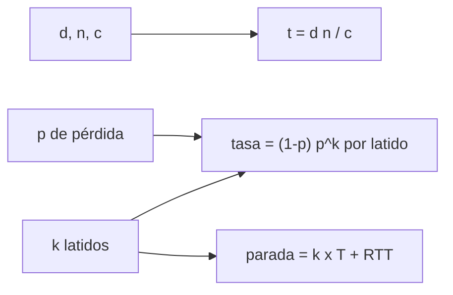

# B48-C09 — Control remoto de telescopios

<!-- nav:top -->
[🏠 Programa](../../../../README.md) · [📚 Bloque B48](../../../tronco-comun/B48-operaciones-de-observatorios-cientificos.md) · [← Anterior: B48-C08 — Automatización de cúpulas](../B48-C08-automatizacion-de-cupulas/CLASE.md) · [Siguiente: B48-C10 — Redes de instrumentos →](../B48-C10-redes-de-instrumentos/CLASE.md)
<!-- /nav -->

## 1. Ubicación, nivel y alcance

Clase 9 del bloque B48. Nivel N3. Controlar un telescopio a distancia añade retardo y la posibilidad de perder el enlace. Aquí calculas el retardo de propagación con la velocidad de la luz y evalúas cuántas veces un vigilante de latidos dispara por error. Usas [B12](../../../tronco-comun/B12-probabilidad-estadistica-e-incertidumbre.md) y [B05](../../../tronco-comun/B05-fisica-fundamental-para-el-espacio.md).

## 2. Por qué esta clase existe

Un vigilante muy sensible detiene la observación sin motivo y uno muy lento no protege. La decisión central: **¿tras cuántos latidos perdidos hay que disparar la parada?**

## 3. Lo que podrás hacer al terminar

1. Calcular el retardo de propagación en una fibra.
2. Obtener el tiempo de ida y vuelta.
3. Calcular la tasa de falsos disparos de un vigilante.
4. Verificar con una simulación de dos millones de latidos.
5. Estimar el tiempo de parada de emergencia.
6. Reconocer lo que el modelo no incluye.

La evidencia es la **ficha del control remoto** del ejercicio 12 (sección 20).

## 4. Con qué llegas y cómo comprobarlo

1. ¿Qué es una incertidumbre?
2. ¿Qué es una simulación Monte Carlo?
3. ¿Qué es una tabla de resultados?
4. ¿Qué es un valor ilustrativo?
5. ¿Qué es una verificación?

<details>
<summary>Ver respuestas</summary>

1. Un intervalo en que se espera el valor verdadero. 2. Repetir con números aleatorios de semilla fija. 3. Un resumen ordenado de cálculos. 4. Un valor propuesto para el ejemplo, no medido. 5. Comparar un cálculo con un caso independiente.
</details>

Con cuatro o cinco aciertos, sigue; si no, repasa los prerrequisitos.

## 5. Un caso de contexto y casos de referencia

Una fibra de 1200 km con índice 1,468 retarda 5,8761 ms en un sentido y 11,7521 ms de ida y vuelta. Con pérdida de latidos de 0,10, un vigilante de 3 latidos dispara por error 1800 veces en 2 millones de latidos (simulados 1807). Es el **ejemplo conductor**.

## 6. Vocabulario

**Retardo de propagación**: `d n / c`. **Latido**: mensaje periódico de vida. **Vigilante** (*watchdog*): dispara una parada si faltan latidos. **Falso disparo**: parada sin falla real. **Tiempo de parada**: desde la falla hasta que actúa la protección.

## 7. Modelo mental: un guardia que pide una señal cada segundo

Un guardia que pide una seña cada segundo: si faltan tres seguidas, da la alarma; pocas lo vuelven nervioso, muchas lo vuelven lento.



*Descripción textual:* el retardo viene de la distancia y el índice; el vigilante dispara tras k pérdidas seguidas y su tasa de falsos disparos y su tiempo de parada dependen de k.

Analogía: un guardia que pide una señal cada segundo. Límite: pérdidas independientes y sin congestión.

## 8. La explicación, paso a paso

### 8.1 Retardo

La velocidad de la luz usada es `c = 299 792 458 m/s` (exacta, tabla NIST CODATA 2022). El retardo unidireccional es `5,8761` ms y el de ida y vuelta `11,7521` ms.

### 8.2 Vigilante

| k | Disparos esperados | Simulados | Sigma | Parada tras |
|---|---|---|---|---|
| 3 | 1800,0 | 1807 | 42,4 | 3,012 s |
| 4 | 180,0 | 181 | 13,4 | 4,012 s |

### 8.3 Lectura

Subir `k` de 3 a 4 divide los falsos disparos por 10, pero añade 1 s a la parada. El retardo de red (≈ 12 ms) es despreciable frente al periodo del latido: lo que manda es `k` por el periodo. El modelo omite congestión, reintentos y el procesamiento.

## 9. Magnitudes, símbolos y unidades

| Símbolo | Qué es | Unidad | Valor / nota |
|---|---|---|---|
| `c` | velocidad de la luz | m/s | 299 792 458 (exacta, NIST) |
| `d` | distancia | m | 1 200 000 (ilustrativa) |
| `n` | índice de grupo | — | 1,468 (ilustrativo) |
| `p` | pérdida de latidos | — | 0,10 |
| `k` | latidos perdidos para disparar | — | 3 o 4 |

## 10. Convenciones y referencias

Unidades del SI salvo donde se indique; coma decimal en el texto y punto decimal en las salidas del laboratorio; semilla 20261109; todo valor que no esté citado en la sección 11 es ilustrativo o sintético.

## 11. De dónde sale lo que afirmamos

| ID | Fuente | Localizador | Respalda | Estado |
|---|---|---|---|---|
| S1 | NIST, *Fundamental Physical Constants* (CODATA 2022) | https://physics.nist.gov/cuu/Constants/Table/allascii.txt | velocidad de la luz en el vacío, 299 792 458 m/s (exacta) | Consultada el 2026-11-09 |

Límites: solo se consultó la tabla de NIST para c; la distancia, el índice, la pérdida de latidos y el periodo son ilustrativos.

## 12. Cómo ver los resultados

| k | Tasa por latido |
|---|---|
| 3 | 0,000900 |
| 4 | 0,0000900 |

Descripción larga: cada latido adicional exigido reduce diez veces la tasa de falsos disparos.

## 13. Ejemplo trabajado: el retardo y la tasa para k = 3

**Paso 1.** Retardo: `1 200 000 × 1,468/299 792 458 = 5,8761` ms.

**Paso 2.** Tasa: `(1 − 0,1) × 0,1³ = 9 × 10⁻⁴` por latido.

**Paso 3.** En 2 000 000 latidos: `1800`.

**Paso 4.** Parada: `3 × 1 + 2 × 0,00588 = 3,012` s.

## 14. Distintas formas de describir el resultado

**Por fórmula:** sección 8. **Por tabla:** sección 12. **Por código:** `control_remoto.py`. **Por contraste:** el laboratorio compara dos vías independientes.

## 15. Práctica guiada

**Ejercicio 1 · con los pasos indicados.** Retardo unidireccional en ms. *Pasos:* `d n/c`.

<details><summary>Solución comentada</summary>

`5,8761`.
</details>

**Ejercicio 2 · con una pista.** Ida y vuelta.

<details><summary>Solución comentada</summary>

`11,7521` ms.
</details>

**Ejercicio 3 · casi autónomo.** Disparos esperados con `k = 3`.

<details><summary>Solución comentada</summary>

`1800`.
</details>

## 16. Práctica autónoma, transferencia e integrador

**Ejercicio 4.** Disparos esperados con `k = 4`.

<details><summary>Solución comentada</summary>

`180`.
</details>

**Ejercicio 5.** Tasa por latido con `k = 5`.

<details><summary>Solución comentada</summary>

`0,00000900`.
</details>

**Ejercicio 6.** Tiempo de parada con `k = 4`.

<details><summary>Solución comentada</summary>

`4,012` s.
</details>

**Ejercicio 7.** Retardo si el índice fuera 1 (vacío).

<details><summary>Solución comentada</summary>

`4,0028` ms.
</details>

**Ejercicio 8.** Diferencia simulada − esperada para `k = 3`.

<details><summary>Solución comentada</summary>

`7`.
</details>

**Ejercicio 9 · transferencia.** **Transferencia.** ¿Cómo cambia el diseño si el latido es cada 0,1 s?

<details><summary>Solución comentada</summary>

La parada baja a unos 0,3 s con `k = 3`, pero la red debe soportar la tasa.
</details>

**Ejercicio 10 · transferencia.** **Transferencia.** ¿Cubre este vigilante una falla del telescopio?

<details><summary>Solución comentada</summary>

No: solo detecta pérdida de enlace; otras fallas necesitan sus propios chequeos.
</details>

**Ejercicio 11 · transferencia.** **Transferencia.** ¿Por qué usar valores de c exactos?

<details><summary>Solución comentada</summary>

Porque el metro se define con ella; el error viene del índice y de la distancia.
</details>

**Ejercicio 12.** **Integrador.** Elabora tu *ficha del control remoto*: retardo, tasa del vigilante, tiempo de parada y límites.

<details><summary>Solución comentada</summary>

Secciones 8.1–8.3.
</details>

**Ejercicio 12 · integrador.** **Integrador.** Elabora tu *ficha del control remoto*: retardo, tasa del vigilante, tiempo de parada y límites.

<details><summary>Solución modelo</summary>

Secciones 8.1–8.3.
</details>

## 17. Laboratorio: retardo y vigilante

El script [control_remoto.py](control_remoto.py) calcula el retardo y simula los falsos disparos del vigilante (**comprueba** a 4 sigmas de Poisson).

**Datos:** `c` de NIST; distancia, índice y pérdida **ilustrativos**. **Predice antes de ejecutar:** ¿cuántos falsos disparos con `k = 3`? (≈ 1800.) **Ejecución del 2026-11-09 (Python 3.12.9):**

```text
Retardo unidireccional = 5.8761 ms; ida y vuelta = 11.7521 ms
k = 3: disparos esperados 1800.0 | simulados 1807 (sigma 42.4) | parada tras 3.012 s
k = 4: disparos esperados 180.0 | simulados 181 (sigma 13.4) | parada tras 4.012 s
Pruebas superadas.
```

```bash
python programa/clases/B48/B48-C09-control-remoto-de-telescopios/control_remoto.py
```

**Límites:** el modelo es de libro y sus parámetros son ilustrativos; no describe ningún observatorio ni instrumento real.

## 18. Errores frecuentes y cómo corregirlos

**Confundir ida con ida y vuelta.** Se corrige con 8.1.

**Creer que el retardo domina la parada.** Se corrige con 8.3.

**Usar el índice 1 en fibra.** Se corrige con la sección 9.

**Suponer pérdidas independientes en un enlace real.** Se corrige con 8.3.

## 19. Cómo sabrás que vas bien

Tras la sección 8: ¿qué resultado esperabas y cuál obtuviste? Si dudas, repasa el ejemplo 13. Tras el laboratorio: ¿qué comprueba? (ver la sección 17).

## 20. Qué entregas y cómo se evalúa

El producto es tu **ficha del control remoto** (ejercicio 12).

| Criterio | Inicial | En desarrollo | Logrado | Destacado |
|---|---|---|---|---|
| Conceptos | Los confunde | Parciales | conceptos de la clase | Explica los límites |
| Cálculo | Sin unidades | Con errores | Tablas completas | Calcula casos nuevos |
| Numérico | Sin comprobar | Un caso | Contraste con el análisis | Interpreta las diferencias |
| Fuentes | Sin fuente | Sin fecha | fuentes con fecha | Declara lo ilustrativo |
| Límites | No los nombra | Uno | Tres | Discute qué falta del modelo |

**Condiciones críticas (no se compensan con promedio):** rotular lo ilustrativo y lo sintético; no presentar el modelo como práctica de un observatorio real; citar solo lo consultado.

## 21. Ética, seguridad y límites

Clase educativa: los modelos son simplificados. Accesibilidad: tablas equivalentes a las gráficas, fórmulas en texto, ejercicios sin conexión.

## 22. Para cerrar y seguir

El enlace retarda 11,8 ms de ida y vuelta, y el vigilante con `k = 3` dispara 1800 veces por 2 millones de latidos. Queda una pregunta: ¿cómo se coordinan muchos instrumentos?

**Glosario español–inglés.** retardo · *delay*; latido · *heartbeat*; vigilante · *watchdog*; falso disparo · *false trip*; enlace · *link*.

**Continuidad.** [B48-C10](../B48-C10-redes-de-instrumentos/CLASE.md) estudia las redes de instrumentos.

**Referencias:** ver sección 11.

<!-- nav:bottom -->
---

[← Anterior: B48-C08 — Automatización de cúpulas](../B48-C08-automatizacion-de-cupulas/CLASE.md) · [📚 Bloque B48](../../../tronco-comun/B48-operaciones-de-observatorios-cientificos.md) · [Siguiente: B48-C10 — Redes de instrumentos →](../B48-C10-redes-de-instrumentos/CLASE.md)
<!-- /nav -->
