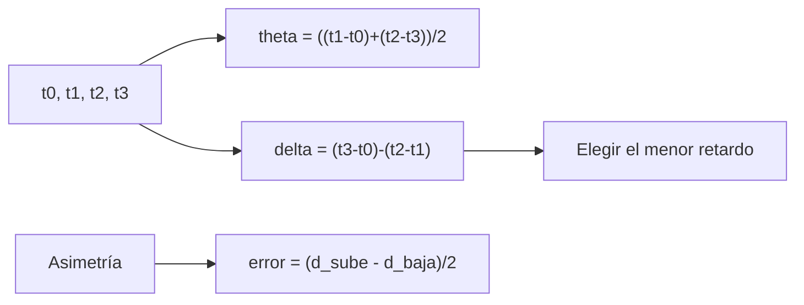

# B48-C10 — Redes de instrumentos

<!-- nav:top -->
[🏠 Programa](../../../../README.md) · [📚 Bloque B48](../../../tronco-comun/B48-operaciones-de-observatorios-cientificos.md) · [← Anterior: B48-C09 — Control remoto de telescopios](../B48-C09-control-remoto-de-telescopios/CLASE.md) · [Siguiente: B48-C11 — Calidad y clasificación de datos →](../B48-C11-calidad-y-clasificacion-de-datos/CLASE.md)
<!-- /nav -->

## 1. Ubicación, nivel y alcance

Clase 10 del bloque B48. Nivel N3. Una red de instrumentos necesita relojes sincronizados. Aquí estimas el desfase de un reloj con cuatro marcas de tiempo cuando la ida y la vuelta tardan distinto, y comparas un intercambio con un filtro de menor retardo. Usas [B12](../../../tronco-comun/B12-probabilidad-estadistica-e-incertidumbre.md). Los datos son sintéticos y no se reproduce ningún protocolo concreto.

## 2. Por qué esta clase existe

Si los relojes difieren, los datos de distintos instrumentos no se pueden correlacionar. La decisión central: **¿cómo se reduce el error de un desfase estimado cuando la red es asimétrica?**

## 3. Lo que podrás hacer al terminar

1. Escribir el desfase y el retardo con cuatro marcas de tiempo.
2. Deducir que la asimetría produce un sesgo de la mitad de la diferencia.
3. Medir la dispersión por el retardo aleatorio.
4. Aplicar el filtro de menor retardo de 8 intercambios.
5. Verificar con 20000 intercambios por caso.
6. Reconocer que el sesgo de asimetría no se filtra.

La evidencia es la **ficha de la red de instrumentos** del ejercicio 12 (sección 20).

## 4. Con qué llegas y cómo comprobarlo

1. ¿Qué es una incertidumbre?
2. ¿Qué es una simulación Monte Carlo?
3. ¿Qué es una tabla de resultados?
4. ¿Qué es un valor ilustrativo?
5. ¿Qué es una verificación?

<details>
<summary>Ver respuestas</summary>

1. Un intervalo en que se espera el valor verdadero. 2. Repetir con números aleatorios de semilla fija. 3. Un resumen ordenado de cálculos. 4. Un valor propuesto para el ejemplo, no medido. 5. Comparar un cálculo con un caso independiente.
</details>

Con cuatro o cinco aciertos, sigue; si no, repasa los prerrequisitos.

## 5. Un caso de contexto y casos de referencia

Con desfase verdadero de +12,0 ms, retardo base de subida 5,0 ms y de bajada 9,0 ms, un intercambio da error medio -2,022 ms (teórico -2,000) y desviación 2,131 ms (teórica 2,121). El filtro de menor retardo la baja a 0,533 ms pero deja el sesgo. Es el **ejemplo conductor**.

## 6. Vocabulario

**Desfase** (*offset*): diferencia entre dos relojes. **Retardo**: tiempo de ida y vuelta menos el procesamiento. **Asimetría**: ida y vuelta distintas. **Jitter**: variación aleatoria del retardo. **Filtro de menor retardo**: elige el intercambio más rápido.

## 7. Modelo mental: medir la hora con una carta lenta

Como calibrar un reloj con cartas cuyo correo tarda distinto de ida y de vuelta: se supone igual y la diferencia queda como error.



*Descripción textual:* las cuatro marcas dan el desfase y el retardo; la asimetría fija un sesgo y el jitter una dispersión que el filtro reduce.

Analogía: medir la hora con una carta lenta. Límite: reloj local sin deriva y retardos independientes.

## 8. La explicación, paso a paso

### 8.1 Error del desfase

| Estrategia | Error medio | Desviación |
|---|---|---|
| Un intercambio | -2,022 ms | 2,131 ms |
| Teoría de un intercambio | -2,000 ms | 2,121 ms |
| Menor retardo de 8 | -1,998 ms | 0,533 ms |

### 8.2 Deducción

Con retardo de subida `d_s` y de bajada `d_b`: `t1 − t0 = d_s + θ`, `t2 − t3 = θ − d_b`, así `θ_est = θ + (d_s − d_b)/2`. El sesgo es `(5 − 9)/2 = −2` ms. La desviación por jitter es `√2 × 3/2 = 2,121` ms (exponenciales de media y desviación 3 ms).

### 8.3 Lectura

El filtro reduce la dispersión 4,0 veces, pero no toca el sesgo de −2 ms: solo una medición independiente de la asimetría (por ejemplo, con un receptor de señal horaria común) lo elimina. El modelo no incluye deriva del reloj.

## 9. Magnitudes, símbolos y unidades

| Símbolo | Qué es | Unidad | Valor / nota |
|---|---|---|---|
| `θ` | desfase del reloj | ms | +12,0 (verdadero) |
| `d_s`, `d_b` | retardos de subida y bajada | ms | 5,0 y 9,0 base |
| `δ` | retardo total | ms | `d_s + d_b` |
| `σ_j` | jitter exponencial | ms | 3,0 |

## 10. Convenciones y referencias

Unidades del SI salvo donde se indique; coma decimal en el texto y punto decimal en las salidas del laboratorio; semilla 20261109; todo valor que no esté citado en la sección 11 es ilustrativo o sintético.

## 11. De dónde sale lo que afirmamos

| ID | Fuente | Localizador | Respalda | Estado |
|---|---|---|---|---|
| — | Sin fuente externa | — | relaciones estándar que verifica el laboratorio | No se consultó una fuente para esta clase |

Límites: no se consultó ninguna fuente externa para esta clase; los valores son ilustrativos o sintéticos y las relaciones son de libro, verificadas solo por el laboratorio.

## 12. Cómo ver los resultados

| Estrategia | Desviación (ms) |
|---|---|
| un intercambio | 2,131 |
| menor retardo de 8 | 0,533 |

Descripción larga: elegir el menor retardo de ocho intercambios reduce la dispersión a una cuarta parte, sin tocar el sesgo.

## 13. Ejemplo trabajado: el sesgo por asimetría

**Paso 1.** `θ_est = θ + (d_s − d_b)/2`.

**Paso 2.** `(5 − 9)/2 = −2` ms.

**Paso 3.** Dispersión: `√(3² + 3²)/2 = 2,121` ms.

**Paso 4.** La simulación da -2,022 ms y 2,131 ms.

## 14. Distintas formas de describir el resultado

**Por fórmula:** sección 8. **Por tabla:** sección 12. **Por código:** `sincronia_reloj.py`. **Por contraste:** el laboratorio compara dos vías independientes.

## 15. Práctica guiada

**Ejercicio 1 · con los pasos indicados.** Sesgo si la subida es 4 ms y la bajada 10 ms. *Pasos:* `(4 − 10)/2`.

<details><summary>Solución comentada</summary>

`−3` ms.
</details>

**Ejercicio 2 · con una pista.** Dispersión teórica de un intercambio.

<details><summary>Solución comentada</summary>

`2,121` ms.
</details>

**Ejercicio 3 · casi autónomo.** Retardo total base.

<details><summary>Solución comentada</summary>

`14` ms.
</details>

## 16. Práctica autónoma, transferencia e integrador

**Ejercicio 4.** Reducción de la dispersión con el filtro.

<details><summary>Solución comentada</summary>

`4,0` veces.
</details>

**Ejercicio 5.** Error medio con el filtro.

<details><summary>Solución comentada</summary>

`-1,998` ms.
</details>

**Ejercicio 6.** Sesgo si la red es simétrica.

<details><summary>Solución comentada</summary>

`0`.
</details>

**Ejercicio 7.** Diferencia simulada − teórica del sesgo.

<details><summary>Solución comentada</summary>

`-0,022` ms.
</details>

**Ejercicio 8.** Desviación si el jitter fuera 6 ms.

<details><summary>Solución comentada</summary>

`4,243` ms.
</details>

**Ejercicio 9 · transferencia.** **Transferencia.** ¿Qué pasa si el reloj local deriva 1 ppm?

<details><summary>Solución comentada</summary>

En 1 h acumula 3,6 ms: hay que re-sincronizar con frecuencia.
</details>

**Ejercicio 10 · transferencia.** **Transferencia.** ¿Por qué no basta filtrar más?

<details><summary>Solución comentada</summary>

El sesgo de asimetría es sistemático y no se promedia.
</details>

**Ejercicio 11 · transferencia.** **Transferencia.** ¿Esto reproduce un protocolo de tiempo real?

<details><summary>Solución comentada</summary>

No: es el cálculo básico de cuatro marcas, sin los detalles de ningún estándar.
</details>

**Ejercicio 12.** **Integrador.** Elabora tu *ficha de la red de instrumentos*: fórmulas, sesgo, dispersión, filtro y límites.

<details><summary>Solución comentada</summary>

Secciones 8.1–8.3.
</details>

**Ejercicio 12 · integrador.** **Integrador.** Elabora tu *ficha de la red de instrumentos*: fórmulas, sesgo, dispersión, filtro y límites.

<details><summary>Solución modelo</summary>

Secciones 8.1–8.3.
</details>

## 17. Laboratorio: desfase de reloj

El script [sincronia_reloj.py](sincronia_reloj.py) simula intercambios con rutas asimétricas y filtra por menor retardo (**comprueba** sesgo a 4 errores estándar y dispersión a 3 %).

**Datos:** retardos y desfase **sintéticos**. **Predice antes de ejecutar:** ¿cuánto vale el sesgo? (−2 ms.) **Ejecución del 2026-11-09 (Python 3.12.9):**

```text
Un intercambio: error medio -2.022 ms (teórico -2.000); desviación 2.131 ms (teórica 2.121)
Filtro de menor retardo de 8: error medio -1.998 ms; desviación 0.533 ms
Pruebas superadas.
```

```bash
python programa/clases/B48/B48-C10-redes-de-instrumentos/sincronia_reloj.py
```

**Límites:** el modelo es de libro y sus parámetros son ilustrativos; no describe ningún observatorio ni instrumento real.

## 18. Errores frecuentes y cómo corregirlos

**Creer que filtrar elimina el sesgo.** Se corrige con 8.3.

**Suponer ida y vuelta iguales sin comprobarlo.** Se corrige con 8.2.

**Olvidar la deriva del reloj.** Se corrige con 8.3.

**Confundir desfase con retardo.** Se corrige con la sección 6.

## 19. Cómo sabrás que vas bien

Tras la sección 8: ¿qué resultado esperabas y cuál obtuviste? Si dudas, repasa el ejemplo 13. Tras el laboratorio: ¿qué comprueba? (ver la sección 17).

## 20. Qué entregas y cómo se evalúa

El producto es tu **ficha de la red de instrumentos** (ejercicio 12).

| Criterio | Inicial | En desarrollo | Logrado | Destacado |
|---|---|---|---|---|
| Conceptos | Los confunde | Parciales | conceptos de la clase | Explica los límites |
| Cálculo | Sin unidades | Con errores | Tablas completas | Calcula casos nuevos |
| Numérico | Sin comprobar | Un caso | Contraste con el análisis | Interpreta las diferencias |
| Fuentes | Sin fuente | Sin fecha | fuentes con fecha | Declara lo ilustrativo |
| Límites | No los nombra | Uno | Tres | Discute qué falta del modelo |

**Condiciones críticas (no se compensan con promedio):** rotular lo ilustrativo y lo sintético; no presentar el modelo como práctica de un observatorio real; citar solo lo consultado.

## 21. Ética, seguridad y límites

Clase educativa: los modelos son simplificados. Accesibilidad: tablas equivalentes a las gráficas, fórmulas en texto, ejercicios sin conexión.

## 22. Para cerrar y seguir

El filtro baja la dispersión de 2,13 a 0,53 ms, pero el sesgo de -2 ms queda. Queda una pregunta: ¿cómo se clasifican los datos que esos instrumentos producen?

**Glosario español–inglés.** desfase · *offset*; retardo · *delay*; asimetría · *asymmetry*; jitter · *jitter*; sincronización · *synchronization*.

**Continuidad.** [B48-C11](../B48-C11-calidad-y-clasificacion-de-datos/CLASE.md) estudia la calidad y la clasificación de datos.

**Referencias:** ver sección 11.

<!-- nav:bottom -->
---

[← Anterior: B48-C09 — Control remoto de telescopios](../B48-C09-control-remoto-de-telescopios/CLASE.md) · [📚 Bloque B48](../../../tronco-comun/B48-operaciones-de-observatorios-cientificos.md) · [Siguiente: B48-C11 — Calidad y clasificación de datos →](../B48-C11-calidad-y-clasificacion-de-datos/CLASE.md)
<!-- /nav -->
