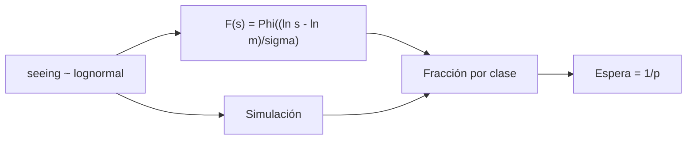

# B48-C11 — Calidad y clasificación de datos

<!-- nav:top -->
[🏠 Programa](../../../../README.md) · [📚 Bloque B48](../../../tronco-comun/B48-operaciones-de-observatorios-cientificos.md) · [← Anterior: B48-C10 — Redes de instrumentos](../B48-C10-redes-de-instrumentos/CLASE.md) · [Siguiente: B48-C12 — Monitorización de seeing →](../B48-C12-monitorizacion-de-seeing/CLASE.md)
<!-- /nav -->

## 1. Ubicación, nivel y alcance

Clase 11 del bloque B48. Nivel N3. Cada noche produce datos de calidad distinta y los programas piden calidades mínimas. Aquí clasificas noches por seeing con umbrales inventados y calculas la fracción de cada clase por la lognormal y por simulación. Usas [B12](../../../tronco-comun/B12-probabilidad-estadistica-e-incertidumbre.md).

## 2. Por qué esta clase existe

Un programa que exige la mejor calidad espera mucho; uno que acepta cualquiera desperdicia las buenas noches. La decisión central: **¿con qué frecuencia se da cada clase y cuánto hay que esperar?**

## 3. Lo que podrás hacer al terminar

1. Modelar el seeing nocturno como lognormal.
2. Calcular la fracción de cada clase con la función de distribución.
3. Verificarla con 400000 noches simuladas.
4. Calcular la espera media hasta una clase dada.
5. Estimar noches útiles por año para un programa.
6. Reconocer que los umbrales son inventados.

La evidencia es la **ficha de calidad y clasificación de datos** del ejercicio 12 (sección 20).

## 4. Con qué llegas y cómo comprobarlo

1. ¿Qué es una incertidumbre?
2. ¿Qué es una simulación Monte Carlo?
3. ¿Qué es una tabla de resultados?
4. ¿Qué es un valor ilustrativo?
5. ¿Qué es una verificación?

<details>
<summary>Ver respuestas</summary>

1. Un intervalo en que se espera el valor verdadero. 2. Repetir con números aleatorios de semilla fija. 3. Un resumen ordenado de cálculos. 4. Un valor propuesto para el ejemplo, no medido. 5. Comparar un cálculo con un caso independiente.
</details>

Con cuatro o cinco aciertos, sigue; si no, repasa los prerrequisitos.

## 5. Un caso de contexto y casos de referencia

Con mediana 0,90 arcsec y sigma del logaritmo 0,30, la clase A (hasta 0,7) ocurre 20,11 % de las noches, la B 43,62 %, la C 31,84 % y la D 4,43 %. Esperar una noche A toma 4,97 noches. Es el **ejemplo conductor** (sintético).

## 6. Vocabulario

**Clase de calidad**: categoría por umbrales. **Lognormal**: logaritmo normal. **Mediana**: valor que deja la mitad debajo. **Función de distribución**: probabilidad de no superar un valor. **Espera media**: inversa de la probabilidad por noche.

## 7. Modelo mental: clasificar frutas por tamaño

Es clasificar fruta por calibre: los umbrales fijan las cajas y la distribución dice cuántas caen en cada una.



*Descripción textual:* la distribución del seeing se corta en umbrales para dar la fracción de cada clase, y la espera hasta una clase es la inversa de su probabilidad.

Analogía: clasificar frutas por tamaño. Límite: noches independientes con un valor representativo.

## 8. La explicación, paso a paso

### 8.1 Fracciones por clase

| Clase | Rango (arcsec) | Analítica | Simulada |
|---|---|---|---|
| A | hasta 0,7 | 0,20110 | 0,20145 |
| B | 0,7 a 1,0 | 0,43619 | 0,43665 |
| C | 1,0 a 1,5 | 0,31841 | 0,31791 |
| D | más de 1,5 | 0,04431 | 0,04399 |

### 8.2 Espera

Una noche A tiene probabilidad 0,2011: se espera una cada 4,97 noches y ocurren 73,4 por año. Esto es antes de considerar el clima.

### 8.3 Lectura

La clase más frecuente es la B. Un programa que acepta hasta la clase C usa el 95,6 % de las noches. Pedir la mejor calidad parece prudente pero multiplica por 5,0 la espera. Los umbrales son inventados y no son los de ningún observatorio.

## 9. Magnitudes, símbolos y unidades

| Símbolo | Qué es | Unidad | Valor / nota |
|---|---|---|---|
| `m` | mediana del seeing | arcsec | 0,90 |
| `σ` | sigma del logaritmo | — | 0,30 |
| `Φ` | distribución normal estándar | — | — |
| `p_A` | probabilidad de clase A | — | 0,20110 |
| `E` | espera media | noches | 4,97 |

## 10. Convenciones y referencias

Unidades del SI salvo donde se indique; coma decimal en el texto y punto decimal en las salidas del laboratorio; semilla 20261109; todo valor que no esté citado en la sección 11 es ilustrativo o sintético.

## 11. De dónde sale lo que afirmamos

| ID | Fuente | Localizador | Respalda | Estado |
|---|---|---|---|---|
| — | Sin fuente externa | — | relaciones estándar que verifica el laboratorio | No se consultó una fuente para esta clase |

Límites: no se consultó ninguna fuente externa para esta clase; los valores son ilustrativos o sintéticos y las relaciones son de libro, verificadas solo por el laboratorio.

## 12. Cómo ver los resultados

| Clase | Probabilidad |
|---|---|
| A | 0,2011 |
| B | 0,4362 |
| C | 0,3184 |
| D | 0,0443 |

Descripción larga: la clase B domina y la D es rara.

## 13. Ejemplo trabajado: la probabilidad de la clase A

**Paso 1.** `z = (ln 0,7 − ln 0,9)/0,3 = (−0,3567 + 0,1054)/0,3 = −0,838`.

**Paso 2.** `Φ(−0,838) = 0,2011`.

**Paso 3.** Espera: `1/0,2011 = 4,97` noches.

**Paso 4.** Simulación: 0,20145.

## 14. Distintas formas de describir el resultado

**Por fórmula:** sección 8. **Por tabla:** sección 12. **Por código:** `clases_calidad.py`. **Por contraste:** el laboratorio compara dos vías independientes.

## 15. Práctica guiada

**Ejercicio 1 · con los pasos indicados.** Probabilidad de la clase A. *Pasos:* ejemplo 13.

<details><summary>Solución comentada</summary>

`0,2011`.
</details>

**Ejercicio 2 · con una pista.** Probabilidad de C o mejor.

<details><summary>Solución comentada</summary>

`0,9557`.
</details>

**Ejercicio 3 · casi autónomo.** Espera hasta una noche A.

<details><summary>Solución comentada</summary>

`4,97` noches.
</details>

## 16. Práctica autónoma, transferencia e integrador

**Ejercicio 4.** Noches A por año.

<details><summary>Solución comentada</summary>

`73,4`.
</details>

**Ejercicio 5.** Suma de las cuatro probabilidades.

<details><summary>Solución comentada</summary>

`1`.
</details>

**Ejercicio 6.** Espera hasta una noche D.

<details><summary>Solución comentada</summary>

`22,6` noches.
</details>

**Ejercicio 7.** Diferencia simulada − analítica de B.

<details><summary>Solución comentada</summary>

`0,00046`.
</details>

**Ejercicio 8.** ¿Qué clase es la más probable?

<details><summary>Solución comentada</summary>

La B.
</details>

**Ejercicio 9 · transferencia.** **Transferencia.** ¿Por qué el seeing de una noche no es un solo número?

<details><summary>Solución comentada</summary>

Varía en la noche; el ejemplo usa un valor representativo.
</details>

**Ejercicio 10 · transferencia.** **Transferencia.** ¿Qué hace un programador con programas de clases distintas?

<details><summary>Solución comentada</summary>

Los empareja con las condiciones que ocurren: los exigentes cuando hay A, el resto cuando no.
</details>

**Ejercicio 11 · transferencia.** **Transferencia.** ¿Son estos umbrales los de un observatorio?

<details><summary>Solución comentada</summary>

No: son inventados.
</details>

**Ejercicio 12.** **Integrador.** Elabora tu *ficha de calidad y clasificación de datos*: distribución, clases, espera y límites.

<details><summary>Solución comentada</summary>

Secciones 8.1–8.3.
</details>

**Ejercicio 12 · integrador.** **Integrador.** Elabora tu *ficha de calidad y clasificación de datos*: distribución, clases, espera y límites.

<details><summary>Solución modelo</summary>

Secciones 8.1–8.3.
</details>

## 17. Laboratorio: clases de seeing

El script [clases_calidad.py](clases_calidad.py) calcula la fracción de cada clase de dos maneras (**comprueba** a 4 sigmas por clase).

**Datos:** distribución y umbrales **sintéticos**. **Predice antes de ejecutar:** ¿cuánto se espera una noche A? (≈ 5.) **Ejecución del 2026-11-09 (Python 3.12.9):**

```text
Clase A: analítica 0.20110 | simulada 0.20145 | sigma 0.00063
Clase B: analítica 0.43619 | simulada 0.43665 | sigma 0.00078
Clase C: analítica 0.31841 | simulada 0.31791 | sigma 0.00074
Clase D: analítica 0.04431 | simulada 0.04399 | sigma 0.00033
Espera media hasta una noche A = 4.97 noches; noches A por año = 73.4
Pruebas superadas.
```

```bash
python programa/clases/B48/B48-C11-calidad-y-clasificacion-de-datos/clases_calidad.py
```

**Límites:** el modelo es de libro y sus parámetros son ilustrativos; no describe ningún observatorio ni instrumento real.

## 18. Errores frecuentes y cómo corregirlos

**Esperar siempre la mejor clase.** Se corrige con 8.3.

**Confundir mediana con media.** Se corrige con la sección 6.

**Tomar los umbrales como oficiales.** Se corrige con la sección 10.

**Olvidar el clima.** Se corrige con 8.2.

## 19. Cómo sabrás que vas bien

Tras la sección 8: ¿qué resultado esperabas y cuál obtuviste? Si dudas, repasa el ejemplo 13. Tras el laboratorio: ¿qué comprueba? (ver la sección 17).

## 20. Qué entregas y cómo se evalúa

El producto es tu **ficha de calidad y clasificación de datos** (ejercicio 12).

| Criterio | Inicial | En desarrollo | Logrado | Destacado |
|---|---|---|---|---|
| Conceptos | Los confunde | Parciales | conceptos de la clase | Explica los límites |
| Cálculo | Sin unidades | Con errores | Tablas completas | Calcula casos nuevos |
| Numérico | Sin comprobar | Un caso | Contraste con el análisis | Interpreta las diferencias |
| Fuentes | Sin fuente | Sin fecha | fuentes con fecha | Declara lo ilustrativo |
| Límites | No los nombra | Uno | Tres | Discute qué falta del modelo |

**Condiciones críticas (no se compensan con promedio):** rotular lo ilustrativo y lo sintético; no presentar el modelo como práctica de un observatorio real; citar solo lo consultado.

## 21. Ética, seguridad y límites

Clase educativa: los modelos son simplificados. Accesibilidad: tablas equivalentes a las gráficas, fórmulas en texto, ejercicios sin conexión.

## 22. Para cerrar y seguir

La clase A llega 73 noches al año y exige esperar 5,0 noches. Queda una pregunta: ¿cómo se mide el seeing en el sitio?

**Glosario español–inglés.** clase de calidad · *quality class*; lognormal · *lognormal*; mediana · *median*; seeing · *seeing*; espera · *waiting time*.

**Continuidad.** [B48-C12](../B48-C12-monitorizacion-de-seeing/CLASE.md) estudia la monitorización de seeing.

**Referencias:** ver sección 11.

<!-- nav:bottom -->
---

[← Anterior: B48-C10 — Redes de instrumentos](../B48-C10-redes-de-instrumentos/CLASE.md) · [📚 Bloque B48](../../../tronco-comun/B48-operaciones-de-observatorios-cientificos.md) · [Siguiente: B48-C12 — Monitorización de seeing →](../B48-C12-monitorizacion-de-seeing/CLASE.md)
<!-- /nav -->
