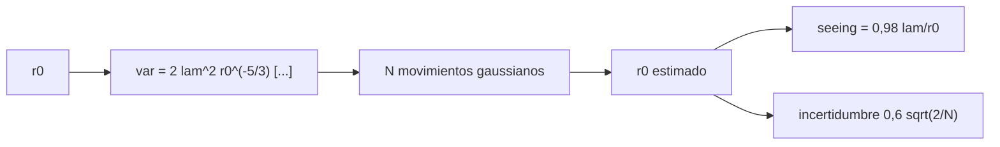

# B48-C12 — Monitorización de seeing

<!-- nav:top -->
[🏠 Programa](../../../../README.md) · [📚 Bloque B48](../../../tronco-comun/B48-operaciones-de-observatorios-cientificos.md) · [← Anterior: B48-C11 — Calidad y clasificación de datos](../B48-C11-calidad-y-clasificacion-de-datos/CLASE.md) · [Siguiente: B48-C13 — Calibraciones nocturnas →](../B48-C13-calibraciones-nocturnas/CLASE.md)
<!-- /nav -->

## 1. Ubicación, nivel y alcance

Clase 12 del bloque B48. Nivel N3. Un monitor de seeing mide cuánto se mueve la distancia entre dos imágenes de la misma estrella. Aquí conviertes la varianza de ese movimiento diferencial en el parámetro de Fried `r₀` y en seeing, y obtienes su incertidumbre. Usas [B42](../../../tronco-comun/B42-optica-fisica-y-optica-adaptativa.md) y [B12](../../../tronco-comun/B12-probabilidad-estadistica-e-incertidumbre.md). Los coeficientes son de libro y no se verificaron.

## 2. Por qué esta clase existe

Sin medir el seeing, no se sabe si una noche sirve para un programa. La decisión central: **¿cuántas medidas hacen falta para que `r₀` tenga una incertidumbre aceptable?**

## 3. Lo que podrás hacer al terminar

1. Escribir la varianza longitudinal en función de `r₀`.
2. Invertirla para obtener `r₀` y el seeing.
3. Simular movimientos gaussianos y recuperar `r₀`.
4. Deducir la incertidumbre relativa `(3/5)√(2/N)`.
5. Comparar la simulada con la analítica.
6. Reconocer los supuestos de Kolmogorov.

La evidencia es la **ficha de la monitorización de seeing** del ejercicio 12 (sección 20).

## 4. Con qué llegas y cómo comprobarlo

1. ¿Qué es una incertidumbre?
2. ¿Qué es una simulación Monte Carlo?
3. ¿Qué es una tabla de resultados?
4. ¿Qué es un valor ilustrativo?
5. ¿Qué es una verificación?

<details>
<summary>Ver respuestas</summary>

1. Un intervalo en que se espera el valor verdadero. 2. Repetir con números aleatorios de semilla fija. 3. Un resumen ordenado de cálculos. 4. Un valor propuesto para el ejemplo, no medido. 5. Comparar un cálculo con un caso independiente.
</details>

Con cuatro o cinco aciertos, sigue; si no, repasa los prerrequisitos.

## 5. Un caso de contexto y casos de referencia

Con r₀ = 0,100 m, λ = 500 nm, subaperturas de 0,10 m y separación 0,20 m, la desviación del movimiento es 0,4662 arcsec y el seeing verdadero 1,0107 arcsec. Con 1000 medidas, `r₀` tiene incertidumbre relativa 0,0271 (analítica 0,0268). Es el **ejemplo conductor**.

## 6. Vocabulario

**Parámetro de Fried** `r₀`: diámetro de coherencia de la turbulencia. **DIMM**: monitor de movimiento diferencial de imagen. **Varianza longitudinal**: a lo largo de la línea que une las subaperturas. **Seeing**: ancho a media altura, `0,98 λ/r₀`. **Kolmogorov**: modelo de turbulencia.

## 7. Modelo mental: dos corchos en un oleaje

Dos corchos en el oleaje: lo que importa no es cuánto sube cada uno sino cuánto cambia su distancia; más turbulencia, más cambio.



*Descripción textual:* la varianza del movimiento diferencial depende de `r₀` por una potencia; invertirla da `r₀` y el seeing, y la incertidumbre sale de la estadística de la varianza.

Analogía: dos corchos en un oleaje. Límite: turbulencia de Kolmogorov, exposición corta y sin ruido de centroide.

## 8. La explicación, paso a paso

### 8.1 Del `r₀` a la varianza y de vuelta

| Magnitud | Valor |
|---|---|
| Varianza longitudinal | 5.1085e-12 rad² |
| Desviación | 0,4662 arcsec |
| `r₀` recuperado sin ruido | 0,100000 m |
| Seeing verdadero | 1,0107 arcsec |

Los coeficientes 0,179 y 0,0968 son los que recuerda el texto de Sarazin y Roddier (1990); **no se verificaron contra el artículo**.

### 8.2 Con 1000 medidas

| Magnitud | Valor |
|---|---|
| `r₀` medio estimado | 0,10012 m |
| Incertidumbre relativa simulada | 0,0271 |
| Incertidumbre relativa analítica | 0,0268 |
| Seeing medio estimado | 1,0095 arcsec |

### 8.3 Lectura

Como la varianza va como `r₀^(−5/3)`, el error relativo de `r₀` es `3/5` del de la varianza, que para `N` datos gaussianos es `√(2/N)`. Con 1000 medidas la incertidumbre es de unos 2,7 %; para bajarla a la mitad se necesitan cuatro veces más medidas. El modelo no incluye ruido de centroide ni la escala externa de la turbulencia.

## 9. Magnitudes, símbolos y unidades

| Símbolo | Qué es | Unidad | Valor / nota |
|---|---|---|---|
| `r₀` | parámetro de Fried | m | 0,100 (ilustrativo) |
| `λ` | longitud de onda | m | 5,0 × 10⁻⁷ |
| `D`, `d` | diámetro y separación | m | 0,10 y 0,20 |
| `N` | medidas | — | 1000 |
| `ε` | seeing | arcsec | 1,0107 |

## 10. Convenciones y referencias

Unidades del SI salvo donde se indique; coma decimal en el texto y punto decimal en las salidas del laboratorio; semilla 20261109; todo valor que no esté citado en la sección 11 es ilustrativo o sintético.

## 11. De dónde sale lo que afirmamos

| ID | Fuente | Localizador | Respalda | Estado |
|---|---|---|---|---|
| S1 | Sarazin y Roddier (1990), método del movimiento diferencial de imagen | — | los coeficientes de la varianza y su uso para obtener `r₀` | No consultado |

Límites: no se consultó el artículo de Sarazin y Roddier; los coeficientes son de memoria del texto y no se verificaron; todos los valores numéricos son ilustrativos.

## 12. Cómo ver los resultados

| N | Incertidumbre relativa de r₀ |
|---|---|
| 100 | 0,0849 |
| 1000 | 0,0268 |
| 4000 | 0,0134 |

Descripción larga: la incertidumbre cae como el inverso de la raíz de N.

## 13. Ejemplo trabajado: la incertidumbre con 1000 medidas

**Paso 1.** Varianza relativa: `√(2/1000) = 0,04472`.

**Paso 2.** `r₀` relativa: `0,6 × 0,04472 = 0,0268`.

**Paso 3.** Absoluta: `0,100 × 0,0268 = 0,0027` m.

**Paso 4.** La simulación da 0,0271.

## 14. Distintas formas de describir el resultado

**Por fórmula:** sección 8. **Por tabla:** sección 12. **Por código:** `seeing_dimm.py`. **Por contraste:** el laboratorio compara dos vías independientes.

## 15. Práctica guiada

**Ejercicio 1 · con los pasos indicados.** Seeing para `r₀ = 0,10 m`. *Pasos:* `0,98 λ/r₀` en arcsec.

<details><summary>Solución comentada</summary>

`1,0107`.
</details>

**Ejercicio 2 · con una pista.** Incertidumbre relativa con `N = 100`.

<details><summary>Solución comentada</summary>

`0,0849`.
</details>

**Ejercicio 3 · casi autónomo.** Incertidumbre con `N = 4000`.

<details><summary>Solución comentada</summary>

`0,0134`.
</details>

## 16. Práctica autónoma, transferencia e integrador

**Ejercicio 4.** Seeing si `r₀ = 0,05 m`.

<details><summary>Solución comentada</summary>

`2,021` arcsec.
</details>

**Ejercicio 5.** Factor de medidas para dividir la incertidumbre por 2.

<details><summary>Solución comentada</summary>

`4`.
</details>

**Ejercicio 6.** Desviación del movimiento en arcsec.

<details><summary>Solución comentada</summary>

`0,4662`.
</details>

**Ejercicio 7.** Razón simulada/analítica de la incertidumbre.

<details><summary>Solución comentada</summary>

`1,009`.
</details>

**Ejercicio 8.** Seeing medio estimado menos verdadero.

<details><summary>Solución comentada</summary>

`-0,0012` arcsec.
</details>

**Ejercicio 9 · transferencia.** **Transferencia.** ¿Qué pasa si los coeficientes del libro están equivocados?

<details><summary>Solución comentada</summary>

El `r₀` queda sesgado: por eso se marcan como no verificados.
</details>

**Ejercicio 10 · transferencia.** **Transferencia.** ¿Por qué se usan exposiciones cortas?

<details><summary>Solución comentada</summary>

Para congelar el movimiento y no mezclar con vibraciones y seguimiento.
</details>

**Ejercicio 11 · transferencia.** **Transferencia.** ¿Mide esto el seeing de algún sitio real?

<details><summary>Solución comentada</summary>

No: usa un `r₀` elegido.
</details>

**Ejercicio 12.** **Integrador.** Elabora tu *ficha de la monitorización de seeing*: fórmula, inversión, incertidumbre y límites.

<details><summary>Solución comentada</summary>

Secciones 8.1–8.3.
</details>

**Ejercicio 12 · integrador.** **Integrador.** Elabora tu *ficha de la monitorización de seeing*: fórmula, inversión, incertidumbre y límites.

<details><summary>Solución modelo</summary>

Secciones 8.1–8.3.
</details>

## 17. Laboratorio: varianza de movimiento a seeing

El script [seeing_dimm.py](seeing_dimm.py) simula movimientos y recupera `r₀` (**comprueba** la incertidumbre simulada a 8 % de la analítica).

**Datos:** `r₀`, geometría y coeficientes **de libro, no verificados**. **Predice antes de ejecutar:** ¿qué incertidumbre da N = 1000? (≈ 2,7 %.) **Ejecución del 2026-11-09 (Python 3.12.9):**

```text
Varianza longitudinal = 5.1085e-12 rad^2; desviación = 0.4662 arcsec
r0 recuperado sin ruido = 0.100000 m; seeing verdadero = 1.0107 arcsec
r0 medio con N = 1000: 0.10012 m; incertidumbre relativa simulada 0.0271 | analítica 0.0268
Seeing medio estimado = 1.0095 arcsec
Pruebas superadas.
```

```bash
python programa/clases/B48/B48-C12-monitorizacion-de-seeing/seeing_dimm.py
```

**Límites:** el modelo es de libro y sus parámetros son ilustrativos; no describe ningún observatorio ni instrumento real.

## 18. Errores frecuentes y cómo corregirlos

**Confundir r₀ con el seeing.** Se corrige con la sección 9.

**Usar la varianza transversal con la fórmula longitudinal.** Se corrige con la sección 10.

**Ignorar la incertidumbre estadística.** Se corrige con 8.3.

**Tomar los coeficientes como verificados.** Se corrige con 8.1.

## 19. Cómo sabrás que vas bien

Tras la sección 8: ¿qué resultado esperabas y cuál obtuviste? Si dudas, repasa el ejemplo 13. Tras el laboratorio: ¿qué comprueba? (ver la sección 17).

## 20. Qué entregas y cómo se evalúa

El producto es tu **ficha de la monitorización de seeing** (ejercicio 12).

| Criterio | Inicial | En desarrollo | Logrado | Destacado |
|---|---|---|---|---|
| Conceptos | Los confunde | Parciales | conceptos de la clase | Explica los límites |
| Cálculo | Sin unidades | Con errores | Tablas completas | Calcula casos nuevos |
| Numérico | Sin comprobar | Un caso | Contraste con el análisis | Interpreta las diferencias |
| Fuentes | Sin fuente | Sin fecha | fuentes con fecha | Declara lo ilustrativo |
| Límites | No los nombra | Uno | Tres | Discute qué falta del modelo |

**Condiciones críticas (no se compensan con promedio):** rotular lo ilustrativo y lo sintético; no presentar el modelo como práctica de un observatorio real; citar solo lo consultado.

## 21. Ética, seguridad y límites

Clase educativa: los modelos son simplificados. Accesibilidad: tablas equivalentes a las gráficas, fórmulas en texto, ejercicios sin conexión.

## 22. Para cerrar y seguir

Con 1000 medidas, `r₀` se conoce al 2,7 % y el seeing es 1,01 arcsec. Queda una pregunta: ¿cómo se calibra el detector?

**Glosario español–inglés.** parámetro de Fried · *Fried parameter*; seeing · *seeing*; turbulencia · *turbulence*; movimiento diferencial · *differential motion*; varianza · *variance*.

**Continuidad.** [B48-C13](../B48-C13-calibraciones-nocturnas/CLASE.md) estudia las calibraciones nocturnas.

**Referencias:** ver sección 11.

<!-- nav:bottom -->
---

[← Anterior: B48-C11 — Calidad y clasificación de datos](../B48-C11-calidad-y-clasificacion-de-datos/CLASE.md) · [📚 Bloque B48](../../../tronco-comun/B48-operaciones-de-observatorios-cientificos.md) · [Siguiente: B48-C13 — Calibraciones nocturnas →](../B48-C13-calibraciones-nocturnas/CLASE.md)
<!-- /nav -->
