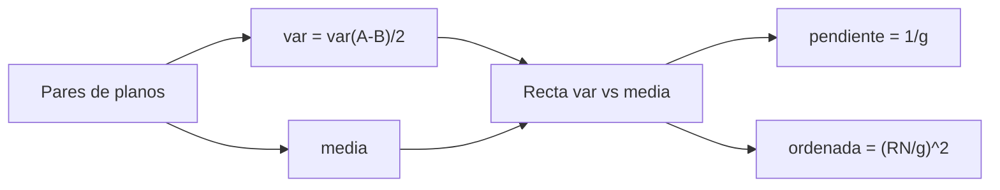

# B48-C13 — Calibraciones nocturnas

<!-- nav:top -->
[🏠 Programa](../../../../README.md) · [📚 Bloque B48](../../../tronco-comun/B48-operaciones-de-observatorios-cientificos.md) · [← Anterior: B48-C12 — Monitorización de seeing](../B48-C12-monitorizacion-de-seeing/CLASE.md) · [Siguiente: B48-C14 — Mantenimiento preventivo →](../B48-C14-mantenimiento-preventivo/CLASE.md)
<!-- /nav -->

## 1. Ubicación, nivel y alcance

Clase 13 del bloque B48. Nivel N3. Antes de usar un detector hay que conocer su ganancia y su ruido de lectura. Aquí aplicas la **curva de transferencia de fotones** a pares de planos simulados y recuperas ambos parámetros. Usas [B44](../../../tronco-comun/B44-detectores-y-adquisicion-astronomica.md) y [B12](../../../tronco-comun/B12-probabilidad-estadistica-e-incertidumbre.md). Los datos son sintéticos.

## 2. Por qué esta clase existe

Sin ganancia ni ruido de lectura, las incertidumbres de cada medida no se pueden calcular. La decisión central: **¿cuánto valen la ganancia y el ruido de lectura del detector?**

## 3. Lo que podrás hacer al terminar

1. Escribir la varianza como función de la señal en ADU.
2. Estimar la varianza con la diferencia de dos planos.
3. Ajustar la recta de varianza contra media.
4. Obtener la ganancia desde la pendiente y el ruido desde la ordenada.
5. Comparar un ajuste ponderado con uno simple.
6. Reconocer lo que la curva no corrige.

La evidencia es la **ficha de calibraciones nocturnas** del ejercicio 12 (sección 20).

## 4. Con qué llegas y cómo comprobarlo

1. ¿Qué es una incertidumbre?
2. ¿Qué es una simulación Monte Carlo?
3. ¿Qué es una tabla de resultados?
4. ¿Qué es un valor ilustrativo?
5. ¿Qué es una verificación?

<details>
<summary>Ver respuestas</summary>

1. Un intervalo en que se espera el valor verdadero. 2. Repetir con números aleatorios de semilla fija. 3. Un resumen ordenado de cálculos. 4. Un valor propuesto para el ejemplo, no medido. 5. Comparar un cálculo con un caso independiente.
</details>

Con cuatro o cinco aciertos, sigue; si no, repasa los prerrequisitos.

## 5. Un caso de contexto y casos de referencia

Con ganancia 1,80 e-/ADU y ruido de lectura 6,0 e- (ilustrativos) y 12 niveles de señal, el ajuste ponderado recupera g = 1,7835 e-/ADU y RN = 6,243 e-; el simple, g = 1,7776 y RN = 7,100. Es el **ejemplo conductor** (sintético).

## 6. Vocabulario

**Ganancia** `g`: electrones por ADU. **Ruido de lectura**: ruido del detector sin luz. **Ruido de disparo**: fluctuación de Poisson de los fotones. **Plano** (*flat*): imagen de iluminación uniforme. **Curva de transferencia**: varianza contra media.

## 7. Modelo mental: una recta cuya pendiente delata el tamaño del grano

Como contar granos de arena: la fluctuación de la cuenta dice cuántos granos hay por unidad; la pendiente de la varianza revela el tamaño del grano (la ganancia).



*Descripción textual:* la varianza de un plano uniforme crece linealmente con la media por el ruido de disparo, y la pendiente y la ordenada de esa recta dan la ganancia y el ruido de lectura.

Analogía: una recta cuya pendiente delata el tamaño del grano. Límite: sin no linealidad, patrón fijo ni cuantización.

## 8. La explicación, paso a paso

### 8.1 Algunos puntos

| Media (ADU) | Varianza medida | Varianza teórica |
|---|---|---|
| 199,9 | 126,11 | 122,16 |
| 784,2 | 451,53 | 446,80 |
| 3075,6 | 1764,23 | 1719,80 |
| 12063,0 | 7081,65 | 6712,75 |

### 8.2 Parámetros recuperados

| Método | Ganancia (e-/ADU) | Ruido de lectura (e-) |
|---|---|---|
| Verdadero | 1,8000 | 6,000 |
| Ajuste ponderado | 1,7835 | 6,243 |
| Ajuste simple | 1,7776 | 7,100 |

### 8.3 Lectura

El ajuste simple pesa igual a todos los puntos y, como la varianza crece con la señal, los niveles altos dominan; el ponderado usa la varianza esperada de cada estimación y recupera mejor el ruido de lectura. Aun así, el ruido de lectura sale con error de 4,0 %: se obtiene de una ordenada pequeña. La curva no corrige no linealidad ni patrón fijo.

## 9. Magnitudes, símbolos y unidades

| Símbolo | Qué es | Unidad | Valor / nota |
|---|---|---|---|
| `g` | ganancia | e-/ADU | 1,80 (ilustrativa) |
| `RN` | ruido de lectura | e- | 6,0 (ilustrativo) |
| `S` | media del plano | ADU | 200 a 30000 |
| `σ²` | varianza de un cuadro | ADU² | `S/g + (RN/g)²` |
| `N` | píxeles por cuadro | — | 4000 |

## 10. Convenciones y referencias

Unidades del SI salvo donde se indique; coma decimal en el texto y punto decimal en las salidas del laboratorio; semilla 20261109; todo valor que no esté citado en la sección 11 es ilustrativo o sintético.

## 11. De dónde sale lo que afirmamos

| ID | Fuente | Localizador | Respalda | Estado |
|---|---|---|---|---|
| — | Sin fuente externa | — | relaciones estándar que verifica el laboratorio | No se consultó una fuente para esta clase |

Límites: no se consultó ninguna fuente externa para esta clase; los valores son ilustrativos o sintéticos y las relaciones son de libro, verificadas solo por el laboratorio.

## 12. Cómo ver los resultados

| Magnitud | Valor |
|---|---|
| pendiente | 0,56069 |
| ordenada | 12,028 |
| ganancia = 1/pendiente | 1,7835 |

Descripción larga: la varianza sube con la media; la pendiente da el inverso de la ganancia.

## 13. Ejemplo trabajado: la varianza esperada a 1000 ADU

**Paso 1.** Disparo: `1000/1,8 = 555,56` ADU².

**Paso 2.** Lectura: `(6/1,8)² = 11,11` ADU².

**Paso 3.** Total: `566,67` ADU².

**Paso 4.** Desviación: `23,8` ADU.

## 14. Distintas formas de describir el resultado

**Por fórmula:** sección 8. **Por tabla:** sección 12. **Por código:** `curva_transferencia.py`. **Por contraste:** el laboratorio compara dos vías independientes.

## 15. Práctica guiada

**Ejercicio 1 · con los pasos indicados.** Varianza esperada a 1000 ADU. *Pasos:* ejemplo 13.

<details><summary>Solución comentada</summary>

`566,67`.
</details>

**Ejercicio 2 · con una pista.** Ruido de lectura en ADU.

<details><summary>Solución comentada</summary>

`6/1,8 = 3,333`.
</details>

**Ejercicio 3 · casi autónomo.** Pendiente teórica.

<details><summary>Solución comentada</summary>

`1/1,8 = 0,5556`.
</details>

## 16. Práctica autónoma, transferencia e integrador

**Ejercicio 4.** Ganancia estimada ponderada.

<details><summary>Solución comentada</summary>

`1,7835`.
</details>

**Ejercicio 5.** Error relativo de esa ganancia.

<details><summary>Solución comentada</summary>

`-0,92 %`.
</details>

**Ejercicio 6.** Ruido de lectura estimado.

<details><summary>Solución comentada</summary>

`6,243` e-.
</details>

**Ejercicio 7.** Ordenada teórica en ADU².

<details><summary>Solución comentada</summary>

`11,111`.
</details>

**Ejercicio 8.** Varianza esperada a 30000 ADU.

<details><summary>Solución comentada</summary>

`16677,8`.
</details>

**Ejercicio 9 · transferencia.** **Transferencia.** ¿Qué pasa si el detector es no lineal a alta señal?

<details><summary>Solución comentada</summary>

La curva se dobla; hay que recortar el rango.
</details>

**Ejercicio 10 · transferencia.** **Transferencia.** ¿Por qué usar la diferencia de dos planos?

<details><summary>Solución comentada</summary>

Para quitar el patrón fijo, que se resta.
</details>

**Ejercicio 11 · transferencia.** **Transferencia.** ¿Es esta la ganancia de algún detector real?

<details><summary>Solución comentada</summary>

No: es sintética.
</details>

**Ejercicio 12.** **Integrador.** Elabora tu *ficha de calibraciones nocturnas*: curva, parámetros, comparación de ajustes y límites.

<details><summary>Solución comentada</summary>

Secciones 8.1–8.3.
</details>

**Ejercicio 12 · integrador.** **Integrador.** Elabora tu *ficha de calibraciones nocturnas*: curva, parámetros, comparación de ajustes y límites.

<details><summary>Solución modelo</summary>

Secciones 8.1–8.3.
</details>

## 17. Laboratorio: curva de transferencia

El script [curva_transferencia.py](curva_transferencia.py) simula planos y recupera ganancia y ruido de lectura (**comprueba** g a 2 % y RN a 15 %).

**Datos:** ganancia, ruido y señales **sintéticos**. **Predice antes de ejecutar:** ¿cuánto vale `g`? (≈ 1,8.) **Ejecución del 2026-11-09 (Python 3.12.9):**

```text
media     199.9 ADU | varianza    126.11 ADU^2 | teoría    122.16
media     784.2 ADU | varianza    451.53 ADU^2 | teoría    446.80
media    3075.6 ADU | varianza   1764.23 ADU^2 | teoría   1719.80
media   12063.0 ADU | varianza   7081.65 ADU^2 | teoría   6712.75
Ajuste ponderado: g = 1.7835 e-/ADU, RN = 6.243 e-
Ajuste simple:    g = 1.7776 e-/ADU, RN = 7.100 e-
Pruebas superadas.
```

```bash
python programa/clases/B48/B48-C13-calibraciones-nocturnas/curva_transferencia.py
```

**Límites:** el modelo es de libro y sus parámetros son ilustrativos; no describe ningún observatorio ni instrumento real.

## 18. Errores frecuentes y cómo corregirlos

**Olvidar restar el patrón fijo.** Se corrige con 8.3.

**Confundir ADU y electrones.** Se corrige con la sección 9.

**Ajustar con saturación incluida.** Se corrige con 8.3.

**Creer que el ruido de lectura sale con precisión.** Se corrige con 8.3.

## 19. Cómo sabrás que vas bien

Tras la sección 8: ¿qué resultado esperabas y cuál obtuviste? Si dudas, repasa el ejemplo 13. Tras el laboratorio: ¿qué comprueba? (ver la sección 17).

## 20. Qué entregas y cómo se evalúa

El producto es tu **ficha de calibraciones nocturnas** (ejercicio 12).

| Criterio | Inicial | En desarrollo | Logrado | Destacado |
|---|---|---|---|---|
| Conceptos | Los confunde | Parciales | conceptos de la clase | Explica los límites |
| Cálculo | Sin unidades | Con errores | Tablas completas | Calcula casos nuevos |
| Numérico | Sin comprobar | Un caso | Contraste con el análisis | Interpreta las diferencias |
| Fuentes | Sin fuente | Sin fecha | fuentes con fecha | Declara lo ilustrativo |
| Límites | No los nombra | Uno | Tres | Discute qué falta del modelo |

**Condiciones críticas (no se compensan con promedio):** rotular lo ilustrativo y lo sintético; no presentar el modelo como práctica de un observatorio real; citar solo lo consultado.

## 21. Ética, seguridad y límites

Clase educativa: los modelos son simplificados. Accesibilidad: tablas equivalentes a las gráficas, fórmulas en texto, ejercicios sin conexión.

## 22. Para cerrar y seguir

La curva recupera g = 1,784 e-/ADU y RN = 6,24 e-. Queda una pregunta: ¿cuándo conviene dar mantenimiento al equipo?

**Glosario español–inglés.** ganancia · *gain*; ruido de lectura · *read noise*; plano · *flat field*; curva de transferencia · *photon transfer curve*; varianza · *variance*.

**Continuidad.** [B48-C14](../B48-C14-mantenimiento-preventivo/CLASE.md) estudia el mantenimiento preventivo.

**Referencias:** ver sección 11.

<!-- nav:bottom -->
---

[← Anterior: B48-C12 — Monitorización de seeing](../B48-C12-monitorizacion-de-seeing/CLASE.md) · [📚 Bloque B48](../../../tronco-comun/B48-operaciones-de-observatorios-cientificos.md) · [Siguiente: B48-C14 — Mantenimiento preventivo →](../B48-C14-mantenimiento-preventivo/CLASE.md)
<!-- /nav -->
