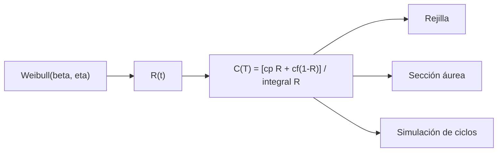

# B48-C14 — Mantenimiento preventivo

<!-- nav:top -->
[🏠 Programa](../../../../README.md) · [📚 Bloque B48](../../../tronco-comun/B48-operaciones-de-observatorios-cientificos.md) · [← Anterior: B48-C13 — Calibraciones nocturnas](../B48-C13-calibraciones-nocturnas/CLASE.md) · [Siguiente: B48-C15 — Gestión de fallas de instrumentos →](../B48-C15-gestion-de-fallas-de-instrumentos/CLASE.md)
<!-- /nav -->

## 1. Ubicación, nivel y alcance

Clase 14 del bloque B48. Nivel N3. Reemplazar antes de que falle cuesta poco; esperar a la falla cuesta mucho. Aquí hallas el intervalo de reemplazo que minimiza el costo por hora para una vida Weibull y lo verificas por dos métodos y por simulación. Usas [B12](../../../tronco-comun/B12-probabilidad-estadistica-e-incertidumbre.md). Los costos y la vida son ilustrativos.

## 2. Por qué esta clase existe

Reemplazar muy pronto desperdicia vida útil; muy tarde, produce fallas caras. La decisión central: **¿cada cuántas horas conviene reemplazar?**

## 3. Lo que podrás hacer al terminar

1. Escribir el costo por unidad de tiempo del reemplazo por edad.
2. Integrar la confiabilidad por la regla de Simpson.
3. Hallar el óptimo por rejilla y por sección áurea.
4. Verificarlo con una simulación de renovación.
5. Calcular el ahorro frente al mantenimiento solo correctivo.
6. Reconocer los supuestos de reemplazo perfecto.

La evidencia es la **ficha de mantenimiento preventivo** del ejercicio 12 (sección 20).

## 4. Con qué llegas y cómo comprobarlo

1. ¿Qué es una incertidumbre?
2. ¿Qué es una simulación Monte Carlo?
3. ¿Qué es una tabla de resultados?
4. ¿Qué es un valor ilustrativo?
5. ¿Qué es una verificación?

<details>
<summary>Ver respuestas</summary>

1. Un intervalo en que se espera el valor verdadero. 2. Repetir con números aleatorios de semilla fija. 3. Un resumen ordenado de cálculos. 4. Un valor propuesto para el ejemplo, no medido. 5. Comparar un cálculo con un caso independiente.
</details>

Con cuatro o cinco aciertos, sigue; si no, repasa los prerrequisitos.

## 5. Un caso de contexto y casos de referencia

Con vida Weibull de forma 2,5 y escala 1000 h, costo preventivo 1 y costo por falla 10, el reemplazo óptimo está en 354,6 h con costo 0,004751 por hora, frente a 0,011271 sin prevención: ahorro de 57,9 %. Es el **ejemplo conductor** (ilustrativo).

## 6. Vocabulario

**Confiabilidad** `R(t)`: probabilidad de sobrevivir hasta `t`. **Weibull**: distribución de vida con forma `β` y escala `η`. **Reemplazo por edad**: se cambia a las `T` horas o en la falla. **Tasa de costo**: costo esperado entre tiempo esperado. **Renovación**: reinicio del ciclo.

## 7. Modelo mental: cambiar el aceite del auto

Como cambiar el aceite del auto: muy seguido es un gasto inútil y muy tarde arruina el motor; el óptimo depende de cuánto cuesta cada error.



*Descripción textual:* la confiabilidad y los costos dan el costo por hora para cada intervalo; el mínimo se busca por dos métodos y se verifica por simulación.

Analogía: cambiar el aceite del auto. Límite: reemplazo perfecto e instantáneo y costos constantes.

## 8. La explicación, paso a paso

### 8.1 El óptimo

| Magnitud | Valor |
|---|---|
| Óptimo por rejilla | 355 h |
| Óptimo por sección áurea | 354,57 h |
| Costo por hora en el óptimo | 0,004751 |
| Costo solo correctivo | 0,011271 |
| Ahorro | 57,9 % |

### 8.2 Simulación y comprobación

La simulación de 300000 ciclos a ese `T` da 0,004759 con error estándar 0,000013. La integral de `R` hasta 6000 h es 887,264 h y coincide con `η Γ(1 + 1/β) = 887,264` h.

### 8.3 Lectura

El óptimo (355 h) es mucho menor que la vida característica (1000 h) porque la falla cuesta diez veces más que el reemplazo y el desgaste (`β > 1`) hace crecer la tasa de falla. Con `β ≤ 1` el reemplazo preventivo no ayuda. El modelo supone que el reemplazo deja el equipo como nuevo, algo que no siempre ocurre.

## 9. Magnitudes, símbolos y unidades

| Símbolo | Qué es | Unidad | Valor / nota |
|---|---|---|---|
| `β` | forma de Weibull | — | 2,5 (ilustrativa) |
| `η` | escala | h | 1000 |
| `c_p`, `c_f` | costos preventivo y por falla | relativo | 1 y 10 |
| `T` | intervalo de reemplazo | h | 354,6 |
| `C` | costo por hora | 1/h | 0,004751 |

## 10. Convenciones y referencias

Unidades del SI salvo donde se indique; coma decimal en el texto y punto decimal en las salidas del laboratorio; semilla 20261109; todo valor que no esté citado en la sección 11 es ilustrativo o sintético.

## 11. De dónde sale lo que afirmamos

| ID | Fuente | Localizador | Respalda | Estado |
|---|---|---|---|---|
| — | Sin fuente externa | — | relaciones estándar que verifica el laboratorio | No se consultó una fuente para esta clase |

Límites: no se consultó ninguna fuente externa para esta clase; los valores son ilustrativos o sintéticos y las relaciones son de libro, verificadas solo por el laboratorio.

## 12. Cómo ver los resultados

| T (h) | Costo por hora |
|---|---|
| 200 | 0,005827 |
| 355 | 0,004751 |
| 600 | 0,005739 |
| 1000 | 0,008562 |

Descripción larga: la curva baja hasta cerca de 355 h y vuelve a subir.

## 13. Ejemplo trabajado: el costo por hora a 355 h

**Paso 1.** `R(355) = exp(−0,355^2,5) = exp(−0,0751) = 0,9277`.

**Paso 2.** Costo del ciclo: `1 × 0,9277 + 10 × 0,0723 = 1,6510`.

**Paso 3.** Duración esperada: `∫R dt = 347,55` h.

**Paso 4.** Costo por hora: `0,004751`.

## 14. Distintas formas de describir el resultado

**Por fórmula:** sección 8. **Por tabla:** sección 12. **Por código:** `reemplazo_preventivo.py`. **Por contraste:** el laboratorio compara dos vías independientes.

## 15. Práctica guiada

**Ejercicio 1 · con los pasos indicados.** `R(1000)`. *Pasos:* `exp(−1)`.

<details><summary>Solución comentada</summary>

`0,3679`.
</details>

**Ejercicio 2 · con una pista.** Vida media del componente. *Pista:* `η Γ(1 + 1/β)`.

<details><summary>Solución comentada</summary>

`887,3` h.
</details>

**Ejercicio 3 · casi autónomo.** Costo correctivo por hora.

<details><summary>Solución comentada</summary>

`10/887,3 = 0,011271`.
</details>

## 16. Práctica autónoma, transferencia e integrador

**Ejercicio 4.** Costo a 200 h.

<details><summary>Solución comentada</summary>

`0,005827`.
</details>

**Ejercicio 5.** Costo a 1000 h.

<details><summary>Solución comentada</summary>

`0,008562`.
</details>

**Ejercicio 6.** Ahorro porcentual en el óptimo.

<details><summary>Solución comentada</summary>

`57,9 %`.
</details>

**Ejercicio 7.** Diferencia rejilla − áurea.

<details><summary>Solución comentada</summary>

`0,43` h.
</details>

**Ejercicio 8.** Diferencia simulada − analítica.

<details><summary>Solución comentada</summary>

`0,000009`.
</details>

**Ejercicio 9 · transferencia.** **Transferencia.** ¿Qué pasa si la falla cuesta 100?

<details><summary>Solución comentada</summary>

El óptimo baja: se reemplaza antes.
</details>

**Ejercicio 10 · transferencia.** **Transferencia.** ¿Y si `β = 1`?

<details><summary>Solución comentada</summary>

La tasa de falla es constante: reemplazar antes no ayuda.
</details>

**Ejercicio 11 · transferencia.** **Transferencia.** ¿Son estas cifras de un equipo real?

<details><summary>Solución comentada</summary>

No: son ilustrativas.
</details>

**Ejercicio 12.** **Integrador.** Elabora tu *ficha de mantenimiento preventivo*: modelo, óptimo por dos vías, simulación y límites.

<details><summary>Solución comentada</summary>

Secciones 8.1–8.3.
</details>

**Ejercicio 12 · integrador.** **Integrador.** Elabora tu *ficha de mantenimiento preventivo*: modelo, óptimo por dos vías, simulación y límites.

<details><summary>Solución modelo</summary>

Secciones 8.1–8.3.
</details>

## 17. Laboratorio: reemplazo por edad

El script [reemplazo_preventivo.py](reemplazo_preventivo.py) busca el óptimo por rejilla y sección áurea y simula ciclos (**comprueba** óptimos a 1 h y costo a 4 errores estándar).

**Datos:** Weibull y costos **ilustrativos**. **Predice antes de ejecutar:** ¿dónde está el óptimo? (≈ 355 h.) **Ejecución del 2026-11-09 (Python 3.12.9):**

```text
Óptimo por rejilla = 355 h; por sección áurea = 354.57 h
Costo por hora en el óptimo = 0.004751; solo correctivo = 0.011271; ahorro = 57.9 %
Simulación a ese T: 0.004759 (error estándar 0.000013)
Integral de R hasta 6000 h = 887.264; eta Gamma(1 + 1/beta) = 887.264
Pruebas superadas.
```

```bash
python programa/clases/B48/B48-C14-mantenimiento-preventivo/reemplazo_preventivo.py
```

**Límites:** el modelo es de libro y sus parámetros son ilustrativos; no describe ningún observatorio ni instrumento real.

## 18. Errores frecuentes y cómo corregirlos

**Reemplazar con `β ≤ 1` esperando ahorro.** Se corrige con 8.3.

**Olvidar la duración en el denominador.** Se corrige con el ejemplo 13.

**Tomar los costos como reales.** Se corrige con la sección 10.

**Suponer reemplazo perfecto sin discutirlo.** Se corrige con 8.3.

## 19. Cómo sabrás que vas bien

Tras la sección 8: ¿qué resultado esperabas y cuál obtuviste? Si dudas, repasa el ejemplo 13. Tras el laboratorio: ¿qué comprueba? (ver la sección 17).

## 20. Qué entregas y cómo se evalúa

El producto es tu **ficha de mantenimiento preventivo** (ejercicio 12).

| Criterio | Inicial | En desarrollo | Logrado | Destacado |
|---|---|---|---|---|
| Conceptos | Los confunde | Parciales | conceptos de la clase | Explica los límites |
| Cálculo | Sin unidades | Con errores | Tablas completas | Calcula casos nuevos |
| Numérico | Sin comprobar | Un caso | Contraste con el análisis | Interpreta las diferencias |
| Fuentes | Sin fuente | Sin fecha | fuentes con fecha | Declara lo ilustrativo |
| Límites | No los nombra | Uno | Tres | Discute qué falta del modelo |

**Condiciones críticas (no se compensan con promedio):** rotular lo ilustrativo y lo sintético; no presentar el modelo como práctica de un observatorio real; citar solo lo consultado.

## 21. Ética, seguridad y límites

Clase educativa: los modelos son simplificados. Accesibilidad: tablas equivalentes a las gráficas, fórmulas en texto, ejercicios sin conexión.

## 22. Para cerrar y seguir

El reemplazo cada 355 h ahorra 58 % del costo. Queda una pregunta: ¿cómo se gestiona una falla cuando ocurre?

**Glosario español–inglés.** confiabilidad · *reliability*; Weibull · *Weibull*; reemplazo preventivo · *preventive replacement*; renovación · *renewal*; tasa de costo · *cost rate*.

**Continuidad.** [B48-C15](../B48-C15-gestion-de-fallas-de-instrumentos/CLASE.md) estudia la gestión de fallas de instrumentos.

**Referencias:** ver sección 11.

<!-- nav:bottom -->
---

[← Anterior: B48-C13 — Calibraciones nocturnas](../B48-C13-calibraciones-nocturnas/CLASE.md) · [📚 Bloque B48](../../../tronco-comun/B48-operaciones-de-observatorios-cientificos.md) · [Siguiente: B48-C15 — Gestión de fallas de instrumentos →](../B48-C15-gestion-de-fallas-de-instrumentos/CLASE.md)
<!-- /nav -->
