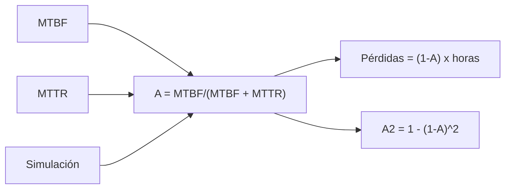

# B48-C15 — Gestión de fallas de instrumentos

<!-- nav:top -->
[🏠 Programa](../../../../README.md) · [📚 Bloque B48](../../../tronco-comun/B48-operaciones-de-observatorios-cientificos.md) · [← Anterior: B48-C14 — Mantenimiento preventivo](../B48-C14-mantenimiento-preventivo/CLASE.md) · [Siguiente: B48-C16 — Procesamiento de datos en línea →](../B48-C16-procesamiento-de-datos-en-linea/CLASE.md)
<!-- /nav -->

## 1. Ubicación, nivel y alcance

Clase 15 del bloque B48. Nivel N3. Cuando un instrumento falla, lo que importa es cuánto tiempo está fuera. Aquí calculas la **disponibilidad** a partir del tiempo entre fallas y de reparación, y evalúas el efecto de tener dos unidades. Usas [B12](../../../tronco-comun/B12-probabilidad-estadistica-e-incertidumbre.md). Las cifras son ilustrativas.

## 2. Por qué esta clase existe

Una avería de 8 h en una noche de 10 h casi pierde la noche. La decisión central: **¿vale la pena duplicar un instrumento?**

## 3. Lo que podrás hacer al terminar

1. Calcular la disponibilidad con MTBF y MTTR.
2. Simular un proceso de renovación alternante.
3. Comprobar que solo importan las medias.
4. Calcular la disponibilidad de dos unidades en paralelo.
5. Convertir la disponibilidad en horas de noche perdidas.
6. Reconocer los supuestos de reparación independiente.

La evidencia es la **ficha de gestión de fallas** del ejercicio 12 (sección 20).

## 4. Con qué llegas y cómo comprobarlo

1. ¿Qué es una incertidumbre?
2. ¿Qué es una simulación Monte Carlo?
3. ¿Qué es una tabla de resultados?
4. ¿Qué es un valor ilustrativo?
5. ¿Qué es una verificación?

<details>
<summary>Ver respuestas</summary>

1. Un intervalo en que se espera el valor verdadero. 2. Repetir con números aleatorios de semilla fija. 3. Un resumen ordenado de cálculos. 4. Un valor propuesto para el ejemplo, no medido. 5. Comparar un cálculo con un caso independiente.
</details>

Con cuatro o cinco aciertos, sigue; si no, repasa los prerrequisitos.

## 5. Un caso de contexto y casos de referencia

Con MTBF de 400 h y MTTR de 8 h la disponibilidad es 0,98039: se pierden 58,8 h de noche al año (de 3000). Con dos unidades independientes sube a 0,999616 y las pérdidas bajan a 1,15 h. Es el **ejemplo conductor** (ilustrativo).

## 6. Vocabulario

**MTBF**: tiempo medio entre fallas. **MTTR**: tiempo medio de reparación. **Disponibilidad**: fracción del tiempo en servicio. **Redundancia**: unidad de respaldo. **Causa común**: falla que afecta a ambas unidades.

## 7. Modelo mental: un taxi y su taller

Un taxi que pasa 8 h en el taller de cada 408: su disponibilidad depende de cuánto dura y cuánto tarda, no de la forma del retraso.



*Descripción textual:* la disponibilidad solo depende de las medias; la redundancia de dos unidades independientes eleva la disponibilidad según el complemento al cuadrado.

Analogía: un taxi y su taller. Límite: reparación independiente y sin causa común.

## 8. La explicación, paso a paso

### 8.1 Resultados

| Magnitud | Analítica | Simulada |
|---|---|---|
| Disponibilidad simple | 0,98039 | 0,98053 |
| Disponibilidad con dos unidades | 0,999616 | 0,999593 |
| Reparación media (h) | 8,000 | 8,017 |

Se simularon 9712 averías en 4 000 000 h con reparaciones lognormales (no exponenciales): la disponibilidad coincide porque solo importan las medias.

### 8.2 Horas de noche perdidas al año

Una unidad: 58,8 h; dos unidades: 1,15 h. Se recuperan 57,7 h al año.

### 8.3 Lectura

La segunda unidad rinde mucho si las fallas son independientes. Con una causa común (un corte eléctrico que afecta a ambas) la mejora sería menor: el modelo no la incluye. Reducir el MTTR a la mitad con repuestos en el sitio da una disponibilidad de 0,99010, una mejora menor que duplicar, pero mucho más barata.

## 9. Magnitudes, símbolos y unidades

| Símbolo | Qué es | Unidad | Valor / nota |
|---|---|---|---|
| MTBF | tiempo medio entre fallas | h | 400 (ilustrativo) |
| MTTR | tiempo medio de reparación | h | 8 (ilustrativo) |
| `A` | disponibilidad | — | 0,98039 |
| `A₂` | disponibilidad de dos unidades | — | 0,999616 |
| `H` | horas de noche por año | h | 3000 |

## 10. Convenciones y referencias

Unidades del SI salvo donde se indique; coma decimal en el texto y punto decimal en las salidas del laboratorio; semilla 20261109; todo valor que no esté citado en la sección 11 es ilustrativo o sintético.

## 11. De dónde sale lo que afirmamos

| ID | Fuente | Localizador | Respalda | Estado |
|---|---|---|---|---|
| — | Sin fuente externa | — | relaciones estándar que verifica el laboratorio | No se consultó una fuente para esta clase |

Límites: no se consultó ninguna fuente externa para esta clase; los valores son ilustrativos o sintéticos y las relaciones son de libro, verificadas solo por el laboratorio.

## 12. Cómo ver los resultados

| Configuración | Disponibilidad | Horas perdidas |
|---|---|---|
| una unidad | 0,98039 | 58,8 |
| dos unidades | 0,999616 | 1,15 |
| MTTR de 4 h | 0,99010 | 29,7 |

Descripción larga: duplicar elimina casi todas las pérdidas; mejorar la reparación las reduce a la mitad.

## 13. Ejemplo trabajado: la disponibilidad simple

**Paso 1.** `A = 400/(400 + 8) = 0,98039`.

**Paso 2.** `1 − A = 0,01961`.

**Paso 3.** Horas perdidas: `0,01961 × 3000 = 58,8`.

**Paso 4.** Con dos unidades: `1 − 0,01961² = 0,999616`.

## 14. Distintas formas de describir el resultado

**Por fórmula:** sección 8. **Por tabla:** sección 12. **Por código:** `disponibilidad_fallas.py`. **Por contraste:** el laboratorio compara dos vías independientes.

## 15. Práctica guiada

**Ejercicio 1 · con los pasos indicados.** Disponibilidad con MTBF 200 y MTTR 8. *Pasos:* `200/208`.

<details><summary>Solución comentada</summary>

`0,96154`.
</details>

**Ejercicio 2 · con una pista.** Indisponibilidad con los valores base.

<details><summary>Solución comentada</summary>

`0,01961`.
</details>

**Ejercicio 3 · casi autónomo.** Horas perdidas al año con una unidad.

<details><summary>Solución comentada</summary>

`58,8`.
</details>

## 16. Práctica autónoma, transferencia e integrador

**Ejercicio 4.** Disponibilidad de dos unidades.

<details><summary>Solución comentada</summary>

`0,999616`.
</details>

**Ejercicio 5.** Horas perdidas con dos.

<details><summary>Solución comentada</summary>

`1,15`.
</details>

**Ejercicio 6.** Disponibilidad con MTTR de 4 h.

<details><summary>Solución comentada</summary>

`0,99010`.
</details>

**Ejercicio 7.** Diferencia simulada − analítica (una unidad).

<details><summary>Solución comentada</summary>

`0,00014`.
</details>

**Ejercicio 8.** Disponibilidad de tres unidades.

<details><summary>Solución comentada</summary>

`1 − 0,01961³ = 0,99999246`.
</details>

**Ejercicio 9 · transferencia.** **Transferencia.** ¿Por qué la forma de la distribución de reparación no afecta a `A`?

<details><summary>Solución comentada</summary>

Porque `A` depende solo de las medias en un proceso de renovación.
</details>

**Ejercicio 10 · transferencia.** **Transferencia.** ¿Qué hace una causa común?

<details><summary>Solución comentada</summary>

Correlaciona las fallas y reduce la ventaja de duplicar.
</details>

**Ejercicio 11 · transferencia.** **Transferencia.** ¿Son estos datos de fallas reales?

<details><summary>Solución comentada</summary>

No: son ilustrativos.
</details>

**Ejercicio 12.** **Integrador.** Elabora tu *ficha de gestión de fallas*: disponibilidad, redundancia, horas perdidas y límites.

<details><summary>Solución comentada</summary>

Secciones 8.1–8.3.
</details>

**Ejercicio 12 · integrador.** **Integrador.** Elabora tu *ficha de gestión de fallas*: disponibilidad, redundancia, horas perdidas y límites.

<details><summary>Solución modelo</summary>

Secciones 8.1–8.3.
</details>

## 17. Laboratorio: disponibilidad con y sin redundancia

El script [disponibilidad_fallas.py](disponibilidad_fallas.py) simula averías y reparaciones y compara con la fórmula (**comprueba** a 5e-4 y 2e-4).

**Datos:** MTBF, MTTR y reparaciones **ilustrativos**. **Predice antes de ejecutar:** ¿cuántas horas se pierden al año? (≈ 59.) **Ejecución del 2026-11-09 (Python 3.12.9):**

```text
Averías simuladas: 9712; reparación media simulada 8.017 h (objetivo 8.0)
Disponibilidad simple: analítica 0.98039 | simulada 0.98053
Disponibilidad con dos unidades: analítica 0.999616 | simulada 0.999593
Horas de noche perdidas por año: 58.8 con una unidad; 1.15 con dos
Pruebas superadas.
```

```bash
python programa/clases/B48/B48-C15-gestion-de-fallas-de-instrumentos/disponibilidad_fallas.py
```

**Límites:** el modelo es de libro y sus parámetros son ilustrativos; no describe ningún observatorio ni instrumento real.

## 18. Errores frecuentes y cómo corregirlos

**Usar MTBF/MTTR sin sumarlos.** Se corrige con el ejemplo 13.

**Ignorar la causa común.** Se corrige con 8.3.

**Suponer reparaciones exponenciales siempre.** Se corrige con 8.1.

**Tomar los datos como reales.** Se corrige con la sección 10.

## 19. Cómo sabrás que vas bien

Tras la sección 8: ¿qué resultado esperabas y cuál obtuviste? Si dudas, repasa el ejemplo 13. Tras el laboratorio: ¿qué comprueba? (ver la sección 17).

## 20. Qué entregas y cómo se evalúa

El producto es tu **ficha de gestión de fallas** (ejercicio 12).

| Criterio | Inicial | En desarrollo | Logrado | Destacado |
|---|---|---|---|---|
| Conceptos | Los confunde | Parciales | conceptos de la clase | Explica los límites |
| Cálculo | Sin unidades | Con errores | Tablas completas | Calcula casos nuevos |
| Numérico | Sin comprobar | Un caso | Contraste con el análisis | Interpreta las diferencias |
| Fuentes | Sin fuente | Sin fecha | fuentes con fecha | Declara lo ilustrativo |
| Límites | No los nombra | Uno | Tres | Discute qué falta del modelo |

**Condiciones críticas (no se compensan con promedio):** rotular lo ilustrativo y lo sintético; no presentar el modelo como práctica de un observatorio real; citar solo lo consultado.

## 21. Ética, seguridad y límites

Clase educativa: los modelos son simplificados. Accesibilidad: tablas equivalentes a las gráficas, fórmulas en texto, ejercicios sin conexión.

## 22. Para cerrar y seguir

Duplicar el instrumento baja las pérdidas de 59 a 1,2 h al año. Queda una pregunta: ¿cómo se procesan los datos mientras llegan?

**Glosario español–inglés.** disponibilidad · *availability*; redundancia · *redundancy*; MTBF · *mean time between failures*; MTTR · *mean time to repair*; causa común · *common cause*.

**Continuidad.** [B48-C16](../B48-C16-procesamiento-de-datos-en-linea/CLASE.md) estudia el procesamiento de datos en línea.

**Referencias:** ver sección 11.

<!-- nav:bottom -->
---

[← Anterior: B48-C14 — Mantenimiento preventivo](../B48-C14-mantenimiento-preventivo/CLASE.md) · [📚 Bloque B48](../../../tronco-comun/B48-operaciones-de-observatorios-cientificos.md) · [Siguiente: B48-C16 — Procesamiento de datos en línea →](../B48-C16-procesamiento-de-datos-en-linea/CLASE.md)
<!-- /nav -->
