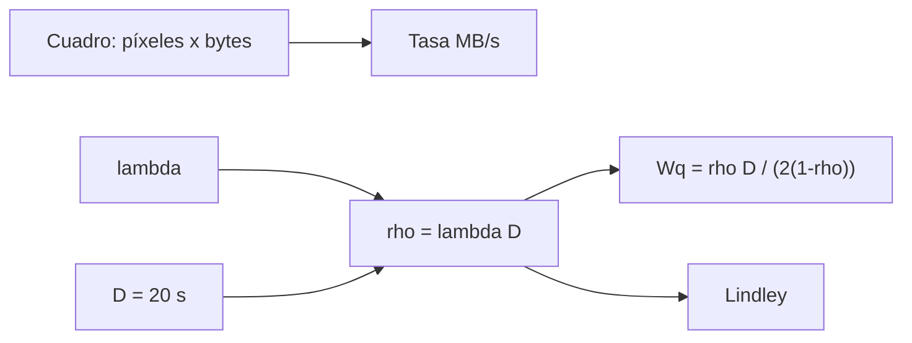

# B48-C16 — Procesamiento de datos en línea

<!-- nav:top -->
[🏠 Programa](../../../../README.md) · [📚 Bloque B48](../../../tronco-comun/B48-operaciones-de-observatorios-cientificos.md) · [← Anterior: B48-C15 — Gestión de fallas de instrumentos](../B48-C15-gestion-de-fallas-de-instrumentos/CLASE.md) · [Siguiente: B48-C17 — Gestión de archivos observacionales →](../B48-C17-gestion-de-archivos-observacionales/CLASE.md)
<!-- /nav -->

## 1. Ubicación, nivel y alcance

Clase 16 del bloque B48. Nivel N3. Los cuadros llegan mientras la reducción en línea aún procesa los anteriores. Aquí modelas la reducción como una cola de llegadas aleatorias y servicio fijo y calculas la espera y la tasa de datos. Usas [B15](../../../tronco-comun/B15-senales-imagenes-y-estimacion-cientifica.md) y [B44](../../../tronco-comun/B44-detectores-y-adquisicion-astronomica.md). La cámara y los tiempos son ilustrativos.

## 2. Por qué esta clase existe

Si la reducción no sigue el ritmo, se acumulan cuadros y el resultado llega tarde. La decisión central: **¿hasta qué ocupación del procesador es tolerable la espera?**

## 3. Lo que podrás hacer al terminar

1. Calcular la tasa de datos de una cámara.
2. Calcular la ocupación `ρ` de la reducción.
3. Aplicar la espera de una cola M/D/1.
4. Verificarla con la recursión de Lindley.
5. Ver cómo la espera explota cerca de `ρ = 1`.
6. Reconocer que una cadencia fija no es Poisson.

La evidencia es la **ficha del procesamiento en línea** del ejercicio 12 (sección 20).

## 4. Con qué llegas y cómo comprobarlo

1. ¿Qué es una incertidumbre?
2. ¿Qué es una simulación Monte Carlo?
3. ¿Qué es una tabla de resultados?
4. ¿Qué es un valor ilustrativo?
5. ¿Qué es una verificación?

<details>
<summary>Ver respuestas</summary>

1. Un intervalo en que se espera el valor verdadero. 2. Repetir con números aleatorios de semilla fija. 3. Un resumen ordenado de cálculos. 4. Un valor propuesto para el ejemplo, no medido. 5. Comparar un cálculo con un caso independiente.
</details>

Con cuatro o cinco aciertos, sigue; si no, repasa los prerrequisitos.

## 5. Un caso de contexto y casos de referencia

Un cuadro de 4096 × 4096 píxeles de 2 bytes pesa 33,554 MB; cada 30 s son 1,1185 MB/s y 40,27 GB en 10 h. Con reducción de 20 s, `ρ = 0,6667` y la espera en cola es 20,0 s; con 40 % más de carga, `ρ = 0,9333` y la espera sube a 140,0 s. Es el **ejemplo conductor**.

## 6. Vocabulario

**Cola M/D/1**: llegadas de Poisson, servicio determinista, un servidor. **Ocupación** `ρ`: tasa de llegada por tiempo de servicio. **Espera en cola** `W_q`. **Recursión de Lindley**: `W_{n+1} = máx(0, W_n + S − A)`. **Tasa de datos**: bytes por segundo.

## 7. Modelo mental: una caja de supermercado

Una caja con tiempo fijo por cliente: con poca gente casi no hay fila; cuando la caja está casi siempre ocupada, la fila crece sin freno.



*Descripción textual:* la ocupación determina la espera de la cola: pequeña con carga baja, divergente cerca de uno; la recursión de Lindley la verifica.

Analogía: una caja de supermercado. Límite: un procesador, sin prioridades y llegadas de Poisson.

## 8. La explicación, paso a paso

### 8.1 Tasa de datos

| Magnitud | Valor |
|---|---|
| Cuadro | 33,554 MB |
| Tasa a 30 s | 1,1185 MB/s |
| En 10 h | 40,27 GB |

### 8.2 Cola

| Caso | `ρ` | Espera analítica | Espera simulada |
|---|---|---|---|
| base (30 s) | 0,6667 | 20,000 s | 20,004 s |
| carga alta (21,4 s) | 0,9333 | 140,000 s | 143,401 s |

### 8.3 Lectura

Subir la carga 40 % multiplica la espera por 7: el comportamiento no es lineal. Una regla práctica es mantener `ρ` bien por debajo de 0,8. En un programa real los cuadros llegan a cadencia fija (cola D/D/1, sin espera si `D` es menor que la cadencia): el modelo de Poisson sobreestima la espera y sirve para ráfagas, no para el régimen estable.

## 9. Magnitudes, símbolos y unidades

| Símbolo | Qué es | Unidad | Valor / nota |
|---|---|---|---|
| `D` | tiempo de reducción | s | 20 (ilustrativo) |
| `λ` | tasa de llegada | 1/s | 1/30 |
| `ρ` | ocupación | — | 0,6667 |
| `W_q` | espera en cola | s | 20,0 |
| `B` | tamaño del cuadro | MB | 33,554 |

## 10. Convenciones y referencias

Unidades del SI salvo donde se indique; coma decimal en el texto y punto decimal en las salidas del laboratorio; semilla 20261109; todo valor que no esté citado en la sección 11 es ilustrativo o sintético.

## 11. De dónde sale lo que afirmamos

| ID | Fuente | Localizador | Respalda | Estado |
|---|---|---|---|---|
| — | Sin fuente externa | — | relaciones estándar que verifica el laboratorio | No se consultó una fuente para esta clase |

Límites: no se consultó ninguna fuente externa para esta clase; los valores son ilustrativos o sintéticos y las relaciones son de libro, verificadas solo por el laboratorio.

## 12. Cómo ver los resultados

| ρ | Espera (s) |
|---|---|
| 0,5 | 10,0 |
| 0,6667 | 20,0 |
| 0,8 | 40,0 |
| 0,95 | 190,0 |

Descripción larga: la espera crece despacio hasta 0,7 y después se dispara.

## 13. Ejemplo trabajado: la espera base

**Paso 1.** `λ = 1/30` y `ρ = 20/30 = 0,6667`.

**Paso 2.** `W_q = ρ D/(2(1 − ρ)) = 0,6667 × 20/(2 × 0,3333)`.

**Paso 3.** `W_q = 13,333/0,6667 = 20,0` s.

**Paso 4.** La simulación da 20,004 s.

## 14. Distintas formas de describir el resultado

**Por fórmula:** sección 8. **Por tabla:** sección 12. **Por código:** `cola_md1.py`. **Por contraste:** el laboratorio compara dos vías independientes.

## 15. Práctica guiada

**Ejercicio 1 · con los pasos indicados.** Tamaño del cuadro en MB. *Pasos:* `4096² × 2 / 10⁶`.

<details><summary>Solución comentada</summary>

`33,554`.
</details>

**Ejercicio 2 · con una pista.** Tasa a 30 s.

<details><summary>Solución comentada</summary>

`1,1185` MB/s.
</details>

**Ejercicio 3 · casi autónomo.** Espera con `ρ = 0,5`. *Pista:* fórmula.

<details><summary>Solución comentada</summary>

`10,0` s.
</details>

## 16. Práctica autónoma, transferencia e integrador

**Ejercicio 4.** Espera con `ρ = 0,8`.

<details><summary>Solución comentada</summary>

`40,0` s.
</details>

**Ejercicio 5.** Espera con `ρ = 0,95`.

<details><summary>Solución comentada</summary>

`190,0` s.
</details>

**Ejercicio 6.** Tiempo total en el sistema, caso base.

<details><summary>Solución comentada</summary>

`40,0` s.
</details>

**Ejercicio 7.** Datos en una noche de 10 h.

<details><summary>Solución comentada</summary>

`40,27` GB.
</details>

**Ejercicio 8.** Razón de esperas carga alta / base.

<details><summary>Solución comentada</summary>

`7,0`.
</details>

**Ejercicio 9 · transferencia.** **Transferencia.** ¿Qué pasa con `ρ ≥ 1`?

<details><summary>Solución comentada</summary>

La cola crece sin límite: la reducción no sigue el ritmo.
</details>

**Ejercicio 10 · transferencia.** **Transferencia.** ¿Por qué una cadencia fija da menos espera?

<details><summary>Solución comentada</summary>

Sin variabilidad de llegada, si `D` es menor que la cadencia no hay fila.
</details>

**Ejercicio 11 · transferencia.** **Transferencia.** ¿Es esta la cámara de algún observatorio?

<details><summary>Solución comentada</summary>

No: es ilustrativa.
</details>

**Ejercicio 12.** **Integrador.** Elabora tu *ficha del procesamiento en línea*: tasa de datos, ocupación, espera y límites.

<details><summary>Solución comentada</summary>

Secciones 8.1–8.3.
</details>

**Ejercicio 12 · integrador.** **Integrador.** Elabora tu *ficha del procesamiento en línea*: tasa de datos, ocupación, espera y límites.

<details><summary>Solución modelo</summary>

Secciones 8.1–8.3.
</details>

## 17. Laboratorio: cola M/D/1

El script [cola_md1.py](cola_md1.py) simula la cola con la recursión de Lindley (**comprueba** la espera a 3 % de la analítica en ambos casos).

**Datos:** cámara, cadencia y tiempo de reducción **ilustrativos**. **Predice antes de ejecutar:** ¿cuánto espera un cuadro en cola? (≈ 20 s.) **Ejecución del 2026-11-09 (Python 3.12.9):**

```text
Cuadro = 33.554 MB; tasa = 1.1185 MB/s; en 10 h = 40.27 GB
base: rho = 0.6667 | espera en cola analítica 20.000 s | simulada 20.004 s
carga alta: rho = 0.9333 | espera en cola analítica 140.000 s | simulada 143.401 s
Pruebas superadas.
```

```bash
python programa/clases/B48/B48-C16-procesamiento-de-datos-en-linea/cola_md1.py
```

**Límites:** el modelo es de libro y sus parámetros son ilustrativos; no describe ningún observatorio ni instrumento real.

## 18. Errores frecuentes y cómo corregirlos

**Ignorar que la espera diverge cerca de 1.** Se corrige con 8.3.

**Confundir espera en cola con tiempo total.** Se corrige con el ejercicio 6.

**Usar Poisson para cadencia fija.** Se corrige con 8.3.

**Olvidar convertir bytes a MB.** Se corrige con el ejercicio 1.

## 19. Cómo sabrás que vas bien

Tras la sección 8: ¿qué resultado esperabas y cuál obtuviste? Si dudas, repasa el ejemplo 13. Tras el laboratorio: ¿qué comprueba? (ver la sección 17).

## 20. Qué entregas y cómo se evalúa

El producto es tu **ficha del procesamiento en línea** (ejercicio 12).

| Criterio | Inicial | En desarrollo | Logrado | Destacado |
|---|---|---|---|---|
| Conceptos | Los confunde | Parciales | conceptos de la clase | Explica los límites |
| Cálculo | Sin unidades | Con errores | Tablas completas | Calcula casos nuevos |
| Numérico | Sin comprobar | Un caso | Contraste con el análisis | Interpreta las diferencias |
| Fuentes | Sin fuente | Sin fecha | fuentes con fecha | Declara lo ilustrativo |
| Límites | No los nombra | Uno | Tres | Discute qué falta del modelo |

**Condiciones críticas (no se compensan con promedio):** rotular lo ilustrativo y lo sintético; no presentar el modelo como práctica de un observatorio real; citar solo lo consultado.

## 21. Ética, seguridad y límites

Clase educativa: los modelos son simplificados. Accesibilidad: tablas equivalentes a las gráficas, fórmulas en texto, ejercicios sin conexión.

## 22. Para cerrar y seguir

Con `ρ = 0,67` la espera es 20 s y con `ρ = 0,93` sube a 140 s. Queda una pregunta: ¿cómo se guardan y verifican los datos?

**Glosario español–inglés.** cola · *queue*; ocupación · *utilization*; servicio determinista · *deterministic service*; tasa de datos · *data rate*; espera · *waiting time*.

**Continuidad.** [B48-C17](../B48-C17-gestion-de-archivos-observacionales/CLASE.md) estudia la gestión de archivos observacionales.

**Referencias:** ver sección 11.

<!-- nav:bottom -->
---

[← Anterior: B48-C15 — Gestión de fallas de instrumentos](../B48-C15-gestion-de-fallas-de-instrumentos/CLASE.md) · [📚 Bloque B48](../../../tronco-comun/B48-operaciones-de-observatorios-cientificos.md) · [Siguiente: B48-C17 — Gestión de archivos observacionales →](../B48-C17-gestion-de-archivos-observacionales/CLASE.md)
<!-- /nav -->
