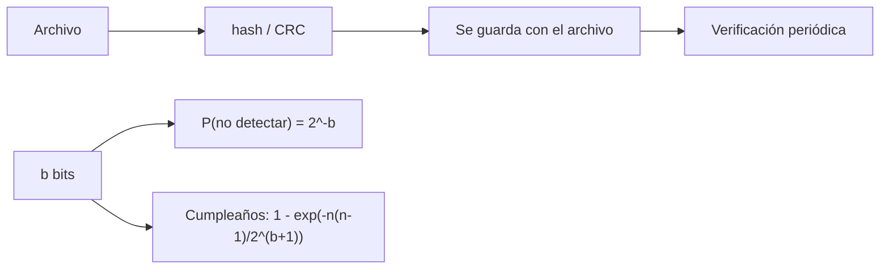

# B48-C17 — Gestión de archivos observacionales

<!-- nav:top -->
[🏠 Programa](../../../../README.md) · [📚 Bloque B48](../../../tronco-comun/B48-operaciones-de-observatorios-cientificos.md) · [← Anterior: B48-C16 — Procesamiento de datos en línea](../B48-C16-procesamiento-de-datos-en-linea/CLASE.md) · [Siguiente: B48-C18 — Protección del cielo oscuro →](../B48-C18-proteccion-del-cielo-oscuro/CLASE.md)
<!-- /nav -->

## 1. Ubicación, nivel y alcance

Clase 17 del bloque B48. Nivel N3. Un archivo observacional debe poder verificarse décadas después. Aquí compruebas dos sumas de verificación contra vectores de prueba conocidos, mides la detección de un bit alterado y estimas el riesgo de colisión de un hash corto. Usas [B12](../../../tronco-comun/B12-probabilidad-estadistica-e-incertidumbre.md). Es una clase de integridad, no de criptografía.

## 2. Por qué esta clase existe

Un archivo que se corrompe en silencio contamina todos los análisis posteriores. La decisión central: **¿qué suma de verificación y con cuántos bits detecta la corrupción?**

## 3. Lo que podrás hacer al terminar

1. Calcular SHA-256 y CRC-32 y compararlos con vectores conocidos.
2. Verificar que un bit alterado siempre se detecta con CRC-32.
3. Calcular la probabilidad de que un hash de b bits no detecte un cambio.
4. Estimar colisiones con el problema del cumpleaños.
5. Verificar ambas con simulación.
6. Reconocer que verificar no es corregir.

La evidencia es la **ficha de la gestión de archivos** del ejercicio 12 (sección 20).

## 4. Con qué llegas y cómo comprobarlo

1. ¿Qué es una incertidumbre?
2. ¿Qué es una simulación Monte Carlo?
3. ¿Qué es una tabla de resultados?
4. ¿Qué es un valor ilustrativo?
5. ¿Qué es una verificación?

<details>
<summary>Ver respuestas</summary>

1. Un intervalo en que se espera el valor verdadero. 2. Repetir con números aleatorios de semilla fija. 3. Un resumen ordenado de cálculos. 4. Un valor propuesto para el ejemplo, no medido. 5. Comparar un cálculo con un caso independiente.
</details>

Con cuatro o cinco aciertos, sigue; si no, repasa los prerrequisitos.

## 5. Un caso de contexto y casos de referencia

El SHA-256 de «abc» es ba7816bf8f01cfea…, y el CRC-32 de «123456789» es 0xcbf43926. Un bit volteado en bloques de 4096 bytes se detectó en 3000 de 3000 casos. Con un hash de 10 bits, pasaron 404 de 400000 corrupciones (esperadas 390,6). Es el **ejemplo conductor**.

## 6. Vocabulario

**Suma de verificación**: resumen corto de un archivo. **SHA-256**: hash criptográfico de 256 bits. **CRC-32**: código cíclico de 32 bits. **Colisión**: dos contenidos con el mismo resumen. **Problema del cumpleaños**: colisiones aparecen con `√N` elementos.

## 7. Modelo mental: un sello de cera en un sobre

Un sello de cera: no impide que alteren la carta, pero delata el cambio.



*Descripción textual:* el resumen se calcula al archivar y se vuelve a calcular al verificar; con `b` bits, una corrupción aleatoria pasa con probabilidad `2^−b` y las colisiones entre `n` archivos siguen el cumpleaños.

Analogía: un sello de cera en un sobre. Límite: hash tratado como función aleatoria uniforme.

## 8. La explicación, paso a paso

### 8.1 Vectores de prueba

| Función | Entrada | Resultado |
|---|---|---|
| SHA-256 | «abc» | `ba7816bf8f01cfea414140de5dae2223b00361a396177a9cb410ff61f20015ad` |
| CRC-32 | «123456789» | `0xcbf43926` |

Ambos coinciden con los valores de referencia conocidos, pero esos valores **no se consultaron en una fuente en esta sesión**: se comprobaron contra `hashlib` y `zlib`.

### 8.2 Detección y colisión

| Prueba | Esperado | Obtenido |
|---|---|---|
| Un bit volteado, CRC-32 (3000 bloques) | 3000 | 3000 |
| Hash de 10 bits deja pasar (400000 intentos) | 390,6 (sigma 19,8) | 404 |
| Colisión entre 4000 archivos con 24 bits | 0,3792 | 0,4050 |

### 8.3 Lectura

El CRC-32 detecta con seguridad cualquier cambio de un bit, pero no protege de una alteración deliberada; para eso se usa SHA-256. Con 24 bits, 4000 archivos ya tienen 38 % de probabilidad de alguna colisión: los hashes cortos sirven para detectar errores, no para identificar archivos. Verificar detecta, no repara: hacen falta copias.

## 9. Magnitudes, símbolos y unidades

| Símbolo | Qué es | Unidad | Valor / nota |
|---|---|---|---|
| `b` | bits del resumen | bit | 10, 24, 32, 256 |
| `n` | archivos | — | 4000 |
| `p` | probabilidad de no detectar | — | `2^−b` |
| SHA-256 | hash de 256 bits | — | ver 8.1 |
| CRC-32 | código de 32 bits | — | 0xcbf43926 |

## 10. Convenciones y referencias

Unidades del SI salvo donde se indique; coma decimal en el texto y punto decimal en las salidas del laboratorio; semilla 20261109; todo valor que no esté citado en la sección 11 es ilustrativo o sintético.

## 11. De dónde sale lo que afirmamos

| ID | Fuente | Localizador | Respalda | Estado |
|---|---|---|---|---|
| S1 | FIPS 180 (SHA-256) y valor de verificación de CRC-32 | — | vectores de prueba de «abc» y «123456789» | No consultado |

Límites: no se consultaron las especificaciones; los vectores de prueba se comprobaron contra `hashlib` y `zlib` de la biblioteca estándar, y el resto de los datos son sintéticos.

## 12. Cómo ver los resultados

| Bits | Probabilidad de pasar |
|---|---|
| 10 | 0,000977 |
| 24 | 0,000000060 |
| 32 | 0,000000000233 |

Descripción larga: cada bit adicional divide por dos la probabilidad de no detectar.

## 13. Ejemplo trabajado: la probabilidad de colisión con 24 bits

**Paso 1.** `n(n − 1)/2 = 4000 × 3999/2 = 7 998 000`.

**Paso 2.** `2^24 = 16 777 216`.

**Paso 3.** Cociente: `0,4767`.

**Paso 4.** `P = 1 − e^−0,4767 = 0,3792`.

## 14. Distintas formas de describir el resultado

**Por fórmula:** sección 8. **Por tabla:** sección 12. **Por código:** `integridad_archivo.py`. **Por contraste:** el laboratorio compara dos vías independientes.

## 15. Práctica guiada

**Ejercicio 1 · con los pasos indicados.** Probabilidad de pasar con 16 bits. *Pasos:* `2^−16`.

<details><summary>Solución comentada</summary>

`0,00001526`.
</details>

**Ejercicio 2 · con una pista.** Pasan esperados de 400000 con 10 bits.

<details><summary>Solución comentada</summary>

`390,6`.
</details>

**Ejercicio 3 · casi autónomo.** Sigma de ese conteo.

<details><summary>Solución comentada</summary>

`19,8`.
</details>

## 16. Práctica autónoma, transferencia e integrador

**Ejercicio 4.** Colisión con 1000 archivos y 24 bits.

<details><summary>Solución comentada</summary>

`0,0293`.
</details>

**Ejercicio 5.** Archivos para 50 % con 32 bits (aprox. `1,18 × 2^16`).

<details><summary>Solución comentada</summary>

`77162`.
</details>

**Ejercicio 6.** Diferencia simulada − analítica de la colisión.

<details><summary>Solución comentada</summary>

`0,0258`.
</details>

**Ejercicio 7.** ¿Detectó CRC-32 todos los bits alterados?

<details><summary>Solución comentada</summary>

Sí: 3000 de 3000.
</details>

**Ejercicio 8.** Bits de SHA-256.

<details><summary>Solución comentada</summary>

`256`.
</details>

**Ejercicio 9 · transferencia.** **Transferencia.** ¿Basta un hash para preservar un archivo?

<details><summary>Solución comentada</summary>

No: detecta, no repara; hacen falta copias independientes.
</details>

**Ejercicio 10 · transferencia.** **Transferencia.** ¿Por qué no usar CRC-32 contra manipulación?

<details><summary>Solución comentada</summary>

Porque se puede fabricar un cambio con el mismo CRC.
</details>

**Ejercicio 11 · transferencia.** **Transferencia.** ¿Se consultaron los vectores de prueba?

<details><summary>Solución comentada</summary>

No en esta sesión: se comprobaron con la biblioteca estándar.
</details>

**Ejercicio 12.** **Integrador.** Elabora tu *ficha de la gestión de archivos*: resúmenes, detección, colisiones y copias.

<details><summary>Solución comentada</summary>

Secciones 8.1–8.3.
</details>

**Ejercicio 12 · integrador.** **Integrador.** Elabora tu *ficha de la gestión de archivos*: resúmenes, detección, colisiones y copias.

<details><summary>Solución modelo</summary>

Secciones 8.1–8.3.
</details>

## 17. Laboratorio: integridad y colisiones

El script [integridad_archivo.py](integridad_archivo.py) comprueba los vectores, la detección de un bit y las probabilidades de paso y colisión (**comprueba** a 4 sigmas).

**Datos:** bloques y corrupciones **sintéticos**; vectores comprobados con `hashlib` y `zlib`. **Predice antes de ejecutar:** ¿se detectan todos los cambios de un bit? (sí.) **Ejecución del 2026-11-09 (Python 3.12.9):**

```text
SHA-256('abc') = ba7816bf8f01cfea414140de5dae2223b00361a396177a9cb410ff61f20015ad
CRC-32('123456789') = 0xcbf43926
Un bit volteado en bloques de 4096 bytes: detectados 3000 de 3000
Hash de 10 bits: pasan 404 de 400000 (esperados 390.6, sigma 19.8)
Colisión entre 4000 archivos con 24 bits: analítica 0.3792 | simulada 0.4050
Pruebas superadas.
```

```bash
python programa/clases/B48/B48-C17-gestion-de-archivos-observacionales/integridad_archivo.py
```

**Límites:** el modelo es de libro y sus parámetros son ilustrativos; no describe ningún observatorio ni instrumento real.

## 18. Errores frecuentes y cómo corregirlos

**Confundir detectar con corregir.** Se corrige con 8.3.

**Identificar archivos con hashes cortos.** Se corrige con 8.3.

**Usar CRC contra manipulación.** Se corrige con el ejercicio 10.

**Guardar una sola copia.** Se corrige con 8.3.

## 19. Cómo sabrás que vas bien

Tras la sección 8: ¿qué resultado esperabas y cuál obtuviste? Si dudas, repasa el ejemplo 13. Tras el laboratorio: ¿qué comprueba? (ver la sección 17).

## 20. Qué entregas y cómo se evalúa

El producto es tu **ficha de la gestión de archivos** (ejercicio 12).

| Criterio | Inicial | En desarrollo | Logrado | Destacado |
|---|---|---|---|---|
| Conceptos | Los confunde | Parciales | conceptos de la clase | Explica los límites |
| Cálculo | Sin unidades | Con errores | Tablas completas | Calcula casos nuevos |
| Numérico | Sin comprobar | Un caso | Contraste con el análisis | Interpreta las diferencias |
| Fuentes | Sin fuente | Sin fecha | fuentes con fecha | Declara lo ilustrativo |
| Límites | No los nombra | Uno | Tres | Discute qué falta del modelo |

**Condiciones críticas (no se compensan con promedio):** rotular lo ilustrativo y lo sintético; no presentar el modelo como práctica de un observatorio real; citar solo lo consultado.

## 21. Ética, seguridad y límites

Clase educativa: los modelos son simplificados. Accesibilidad: tablas equivalentes a las gráficas, fórmulas en texto, ejercicios sin conexión.

## 22. Para cerrar y seguir

El CRC-32 detectó 3000 de 3000 cambios de un bit. Queda una pregunta: ¿cómo protegemos el cielo desde el que se observa?

**Glosario español–inglés.** suma de verificación · *checksum*; colisión · *collision*; integridad · *integrity*; cumpleaños · *birthday*; copia · *replica*.

**Continuidad.** [B48-C18](../B48-C18-proteccion-del-cielo-oscuro/CLASE.md) estudia la protección del cielo oscuro.

**Referencias:** ver sección 11.

<!-- nav:bottom -->
---

[← Anterior: B48-C16 — Procesamiento de datos en línea](../B48-C16-procesamiento-de-datos-en-linea/CLASE.md) · [📚 Bloque B48](../../../tronco-comun/B48-operaciones-de-observatorios-cientificos.md) · [Siguiente: B48-C18 — Protección del cielo oscuro →](../B48-C18-proteccion-del-cielo-oscuro/CLASE.md)
<!-- /nav -->
