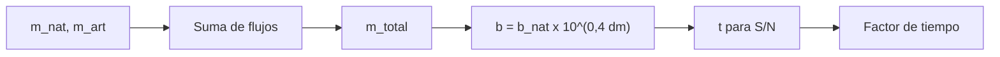

# B48-C18 — Protección del cielo oscuro

<!-- nav:top -->
[🏠 Programa](../../../../README.md) · [📚 Bloque B48](../../../tronco-comun/B48-operaciones-de-observatorios-cientificos.md) · [← Anterior: B48-C17 — Gestión de archivos observacionales](../B48-C17-gestion-de-archivos-observacionales/CLASE.md) · [Siguiente: B48-C19 — Divulgación y ciencia ciudadana →](../B48-C19-divulgacion-y-ciencia-ciudadana/CLASE.md)
<!-- /nav -->

## 1. Ubicación, nivel y alcance

Clase 18 del bloque B48. Nivel N3. La luz artificial se suma al brillo natural del cielo y obliga a exponer más. Aquí sumas brillos en magnitudes y calculas cuánto crece el tiempo de exposición para la misma relación señal-ruido. Usas [B44](../../../tronco-comun/B44-detectores-y-adquisicion-astronomica.md) y [B15](../../../tronco-comun/B15-senales-imagenes-y-estimacion-cientifica.md). Los brillos son ilustrativos.

## 2. Por qué esta clase existe

Cada fracción de magnitud perdida se paga en tiempo de telescopio. La decisión central: **¿cuánto cuesta en exposición una contaminación luminosa dada?**

## 3. Lo que podrás hacer al terminar

1. Sumar brillos expresados en magnitudes por segundo de arco cuadrado.
2. Convertir el brillo en tasa de electrones por segundo.
3. Calcular el tiempo para una relación señal-ruido dada.
4. Verificar la señal-ruido con simulación.
5. Calcular el factor de tiempo por la luz artificial.
6. Reconocer los supuestos de cielo conocido.

La evidencia es la **ficha del cielo oscuro** del ejercicio 12 (sección 20).

## 4. Con qué llegas y cómo comprobarlo

1. ¿Qué es una incertidumbre?
2. ¿Qué es una simulación Monte Carlo?
3. ¿Qué es una tabla de resultados?
4. ¿Qué es un valor ilustrativo?
5. ¿Qué es una verificación?

<details>
<summary>Ver respuestas</summary>

1. Un intervalo en que se espera el valor verdadero. 2. Repetir con números aleatorios de semilla fija. 3. Un resumen ordenado de cálculos. 4. Un valor propuesto para el ejemplo, no medido. 5. Comparar un cálculo con un caso independiente.
</details>

Con cuatro o cinco aciertos, sigue; si no, repasa los prerrequisitos.

## 5. Un caso de contexto y casos de referencia

Un cielo natural de 21,6 y una contribución artificial de 22,0 mag/arcsec² suman 21,0291 (más brillante en 0,5709 mag). El cielo pasa de 20 a 33,837 e-/s y el tiempo para S/N = 10 de 3,120 a 3,629 s: factor 1,1630. Es el **ejemplo conductor** (ilustrativo).

## 6. Vocabulario

**Brillo del cielo**: mag por arcsec². **Suma de flujos**: los brillos se suman como flujos. **Limitado por el cielo**: ruido dominado por el fondo. **Relación señal-ruido**: señal entre ruido. **Contaminación lumínica**: luz artificial en el cielo.

## 7. Modelo mental: agregar ruido a una conversación

Es una conversación en una sala: cada voz nueva sube el murmullo de fondo y obliga a hablar más tiempo para hacerse entender.



*Descripción textual:* los flujos de las fuentes de brillo se suman, de la suma sale el cielo en electrones por segundo y de él el tiempo necesario para una relación señal-ruido.

Analogía: agregar ruido a una conversación. Límite: cielo conocido y restado sin error.

## 8. La explicación, paso a paso

### 8.1 Brillo

Los flujos relativos son `10^(−0,4·21,6) + 10^(−0,4·22,0)`; el total corresponde a 21,0291 mag/arcsec². El cielo en electrones por segundo es `20 × 10^(0,4 × 0,5709) = 33,837`.

### 8.2 Exposición

| Caso | Cielo (e-/s) | Tiempo para S/N = 10 | S/N simulada |
|---|---|---|---|
| natural | 20,000 | 3,120 s | 9,922 |
| con luz artificial | 33,837 | 3,629 s | 10,048 |

### 8.3 Lectura

La luz artificial aumenta el tiempo 16,3 %, menos que el aumento del cielo (69 %) porque la fuente aporta también ruido propio y el ruido de lectura pesa. Para fuentes débiles, donde domina el cielo, el factor se acerca al del cielo. Una duplicación de cielo es 0,75 mag.

## 9. Magnitudes, símbolos y unidades

| Símbolo | Qué es | Unidad | Valor / nota |
|---|---|---|---|
| `m` | brillo del cielo | mag/arcsec² | 21,6 y 22,0 (ilustrativos) |
| `b` | cielo | e-/s | 33,837 |
| `s` | fuente | e-/s | 50 |
| `RN` | ruido de lectura | e- | 5 |
| `t` | tiempo de exposición | s | 3,629 |

## 10. Convenciones y referencias

Unidades del SI salvo donde se indique; coma decimal en el texto y punto decimal en las salidas del laboratorio; semilla 20261109; todo valor que no esté citado en la sección 11 es ilustrativo o sintético.

## 11. De dónde sale lo que afirmamos

| ID | Fuente | Localizador | Respalda | Estado |
|---|---|---|---|---|
| — | Sin fuente externa | — | relaciones estándar que verifica el laboratorio | No se consultó una fuente para esta clase |

Límites: no se consultó ninguna fuente externa para esta clase; los valores son ilustrativos o sintéticos y las relaciones son de libro, verificadas solo por el laboratorio.

## 12. Cómo ver los resultados

| Magnitud | Valor |
|---|---|
| brillo total | 21,0291 |
| diferencia con el natural | 0,5709 mag |
| factor de tiempo | 1,1630 |

Descripción larga: añadir una luz artificial algo más débil que el cielo natural encarece la exposición en un 16 %.

## 13. Ejemplo trabajado: el tiempo para S/N = 10 en cielo natural

**Paso 1.** `a = S²(s + b) = 100 × 70 = 7000`.

**Paso 2.** `4 s² S² RN² = 4 × 2500 × 100 × 25 = 25 000 000`.

**Paso 3.** `√(7000² + 25 000 000) = 8602`.

**Paso 4.** `t = (7000 + 8602)/(2 × 2500) = 3,120` s.

## 14. Distintas formas de describir el resultado

**Por fórmula:** sección 8. **Por tabla:** sección 12. **Por código:** `cielo_oscuro.py`. **Por contraste:** el laboratorio compara dos vías independientes.

## 15. Práctica guiada

**Ejercicio 1 · con los pasos indicados.** Suma de dos cielos iguales de 21,6. *Pasos:* `21,6 − 2,5 log 2`.

<details><summary>Solución comentada</summary>

`20,8474`.
</details>

**Ejercicio 2 · con una pista.** Brillo total del ejemplo.

<details><summary>Solución comentada</summary>

`21,0291`.
</details>

**Ejercicio 3 · casi autónomo.** Cielo en e-/s.

<details><summary>Solución comentada</summary>

`33,837`.
</details>

## 16. Práctica autónoma, transferencia e integrador

**Ejercicio 4.** Tiempo natural para S/N = 10.

<details><summary>Solución comentada</summary>

`3,120` s.
</details>

**Ejercicio 5.** Tiempo con luz artificial.

<details><summary>Solución comentada</summary>

`3,629` s.
</details>

**Ejercicio 6.** Factor de tiempo.

<details><summary>Solución comentada</summary>

`1,1630`.
</details>

**Ejercicio 7.** Brillo si el artificial fuera 21,6 (igual al natural).

<details><summary>Solución comentada</summary>

`20,8474`.
</details>

**Ejercicio 8.** Tiempo para S/N = 20 en cielo natural.

<details><summary>Solución comentada</summary>

`11,546` s.
</details>

**Ejercicio 9 · transferencia.** **Transferencia.** ¿Por qué el factor de tiempo es menor que el factor de cielo?

<details><summary>Solución comentada</summary>

Porque la fuente y el ruido de lectura aportan ruido que no cambia.
</details>

**Ejercicio 10 · transferencia.** **Transferencia.** ¿Y si el telescopio observa una fuente muy débil?

<details><summary>Solución comentada</summary>

Domina el cielo y el factor se acerca al del cielo.
</details>

**Ejercicio 11 · transferencia.** **Transferencia.** ¿Son 21,6 y 22,0 mediciones de un sitio?

<details><summary>Solución comentada</summary>

No: son ilustrativas.
</details>

**Ejercicio 12.** **Integrador.** Elabora tu *ficha del cielo oscuro*: suma de brillos, tiempos, factor y límites.

<details><summary>Solución comentada</summary>

Secciones 8.1–8.3.
</details>

**Ejercicio 12 · integrador.** **Integrador.** Elabora tu *ficha del cielo oscuro*: suma de brillos, tiempos, factor y límites.

<details><summary>Solución modelo</summary>

Secciones 8.1–8.3.
</details>

## 17. Laboratorio: suma de brillos y exposición

El script [cielo_oscuro.py](cielo_oscuro.py) suma brillos, calcula tiempos y simula la señal-ruido (**comprueba** a 1,5 %).

**Datos:** brillos, fuente y ruido **ilustrativos**. **Predice antes de ejecutar:** ¿cuánto crece el tiempo? (≈ 16 %.) **Ejecución del 2026-11-09 (Python 3.12.9):**

```text
Brillo total = 21.0291 mag/arcsec^2 (más brillante en 0.5709 mag); cielo = 33.837 e-/s
natural: cielo 20.000 e-/s | tiempo para S/N = 10: 3.120 s | S/N simulada 9.922
con luz artificial: cielo 33.837 e-/s | tiempo para S/N = 10: 3.629 s | S/N simulada 10.048
Factor de tiempo por la luz artificial = 1.1630
Pruebas superadas.
```

```bash
python programa/clases/B48/B48-C18-proteccion-del-cielo-oscuro/cielo_oscuro.py
```

**Límites:** el modelo es de libro y sus parámetros son ilustrativos; no describe ningún observatorio ni instrumento real.

## 18. Errores frecuentes y cómo corregirlos

**Sumar magnitudes en vez de flujos.** Se corrige con 8.1.

**Creer que el tiempo crece como el cielo.** Se corrige con 8.3.

**Usar cielos medidos sin fuente.** Se corrige con la sección 10.

**Olvidar el ruido de lectura.** Se corrige con el ejemplo 13.

## 19. Cómo sabrás que vas bien

Tras la sección 8: ¿qué resultado esperabas y cuál obtuviste? Si dudas, repasa el ejemplo 13. Tras el laboratorio: ¿qué comprueba? (ver la sección 17).

## 20. Qué entregas y cómo se evalúa

El producto es tu **ficha del cielo oscuro** (ejercicio 12).

| Criterio | Inicial | En desarrollo | Logrado | Destacado |
|---|---|---|---|---|
| Conceptos | Los confunde | Parciales | conceptos de la clase | Explica los límites |
| Cálculo | Sin unidades | Con errores | Tablas completas | Calcula casos nuevos |
| Numérico | Sin comprobar | Un caso | Contraste con el análisis | Interpreta las diferencias |
| Fuentes | Sin fuente | Sin fecha | fuentes con fecha | Declara lo ilustrativo |
| Límites | No los nombra | Uno | Tres | Discute qué falta del modelo |

**Condiciones críticas (no se compensan con promedio):** rotular lo ilustrativo y lo sintético; no presentar el modelo como práctica de un observatorio real; citar solo lo consultado.

## 21. Ética, seguridad y límites

Clase educativa: los modelos son simplificados. Accesibilidad: tablas equivalentes a las gráficas, fórmulas en texto, ejercicios sin conexión.

## 22. Para cerrar y seguir

La luz artificial añade 0,57 mag y encarece la exposición en 16 %. Queda una pregunta: ¿cómo se acerca el observatorio al público?

**Glosario español–inglés.** cielo oscuro · *dark sky*; contaminación lumínica · *light pollution*; magnitud · *magnitude*; señal-ruido · *signal-to-noise*; exposición · *exposure*.

**Continuidad.** [B48-C19](../B48-C19-divulgacion-y-ciencia-ciudadana/CLASE.md) estudia la divulgación y la ciencia ciudadana.

**Referencias:** ver sección 11.

<!-- nav:bottom -->
---

[← Anterior: B48-C17 — Gestión de archivos observacionales](../B48-C17-gestion-de-archivos-observacionales/CLASE.md) · [📚 Bloque B48](../../../tronco-comun/B48-operaciones-de-observatorios-cientificos.md) · [Siguiente: B48-C19 — Divulgación y ciencia ciudadana →](../B48-C19-divulgacion-y-ciencia-ciudadana/CLASE.md)
<!-- /nav -->
