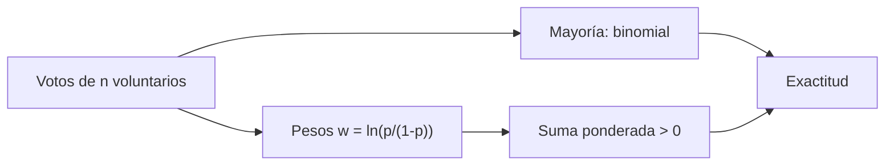

# B48-C19 — Divulgación y ciencia ciudadana

<!-- nav:top -->
[🏠 Programa](../../../../README.md) · [📚 Bloque B48](../../../tronco-comun/B48-operaciones-de-observatorios-cientificos.md) · [← Anterior: B48-C18 — Protección del cielo oscuro](../B48-C18-proteccion-del-cielo-oscuro/CLASE.md) · [Siguiente: B48-C20 — Diseño de una campaña observacional profesional →](../B48-C20-diseno-de-una-campana-observacional-profesional/CLASE.md)
<!-- /nav -->

## 1. Ubicación, nivel y alcance

Clase 19 del bloque B48. Nivel N3. En ciencia ciudadana, muchas personas clasifican la misma imagen. Aquí combinas votos por mayoría y por ponderación según la fiabilidad de cada voluntario. Usas [B12](../../../tronco-comun/B12-probabilidad-estadistica-e-incertidumbre.md). Los voluntarios son sintéticos y no se describe ningún proyecto real.

## 2. Por qué esta clase existe

Un solo voluntario se equivoca; muchos pueden acertar, pero no todos valen lo mismo. La decisión central: **¿cómo se combinan los votos para clasificar con confianza?**

## 3. Lo que podrás hacer al terminar

1. Calcular la exactitud de un voto mayoritario con la binomial.
2. Ver cómo crece con el número de votantes.
3. Combinar un grupo mixto por mayoría simple.
4. Combinar con pesos de log-verosimilitud.
5. Verificar por enumeración exacta y simulación.
6. Reconocer la hipótesis de independencia.

La evidencia es la **ficha de ciencia ciudadana** del ejercicio 12 (sección 20).

## 4. Con qué llegas y cómo comprobarlo

1. ¿Qué es una incertidumbre?
2. ¿Qué es una simulación Monte Carlo?
3. ¿Qué es una tabla de resultados?
4. ¿Qué es un valor ilustrativo?
5. ¿Qué es una verificación?

<details>
<summary>Ver respuestas</summary>

1. Un intervalo en que se espera el valor verdadero. 2. Repetir con números aleatorios de semilla fija. 3. Un resumen ordenado de cálculos. 4. Un valor propuesto para el ejemplo, no medido. 5. Comparar un cálculo con un caso independiente.
</details>

Con cuatro o cinco aciertos, sigue; si no, repasa los prerrequisitos.

## 5. Un caso de contexto y casos de referencia

Con voluntarios de acierto 0,70, la mayoría de 1, 3, 5, 9 y 15 acierta 0,700, 0,784, 0,837, 0,901 y 0,950. En un grupo de 2 expertos (0,90) y 3 novatos (0,60), la mayoría da 0,8770 y el voto ponderado 0,9266. Es el **ejemplo conductor** (sintético).

## 6. Vocabulario

**Voto mayoritario**: gana la categoría más votada. **Peso**: influencia de cada voto. **Log-verosimilitud**: `ln(p/(1−p))`, peso óptimo bajo independencia. **Independencia**: errores no relacionados. **Sabiduría de la multitud**: mejora al agregar.

## 7. Modelo mental: un jurado

Un jurado: agregar opiniones independientes mejora la decisión, y dar más peso a quien suele acertar la mejora todavía más.



*Descripción textual:* cada voto acierta con su probabilidad; la mayoría usa pesos iguales y la ponderada pesos de log-verosimilitud, y se compara su exactitud exacta y simulada.

Analogía: un jurado. Límite: voluntarios independientes y dos categorías equiprobables.

## 8. La explicación, paso a paso

### 8.1 Mayoría con acierto 0,70

| Votantes | Exactitud |
|---|---|
| 1 | 0,70000 |
| 3 | 0,78400 |
| 5 | 0,83692 (simulada 0,83706) |
| 9 | 0,90119 |
| 15 | 0,94999 |

### 8.2 Grupo mixto (0,90; 0,90; 0,60; 0,60; 0,60)

| Regla | Exacta | Simulada |
|---|---|---|
| Mayoría simple | 0,87696 | 0,87780 |
| Voto ponderado | 0,92664 | 0,92568 |

### 8.3 Lectura

Ponderar mejora la exactitud en 5,0 puntos. Pero la fórmula supone independencia: si los voluntarios ven la misma imagen engañosa, sus errores se correlacionan y la mejora es menor. Los pesos exigen conocer la fiabilidad de cada uno, que se estima con imágenes de respuesta conocida.

## 9. Magnitudes, símbolos y unidades

| Símbolo | Qué es | Unidad | Valor / nota |
|---|---|---|---|
| `p` | acierto de un voluntario | — | 0,70; 0,90; 0,60 |
| `n` | votantes | — | 1 a 15 |
| `w` | peso | — | `ln(p/(1−p))` |
| `E` | exactitud del grupo | — | 0,9266 (ponderado) |

## 10. Convenciones y referencias

Unidades del SI salvo donde se indique; coma decimal en el texto y punto decimal en las salidas del laboratorio; semilla 20261109; todo valor que no esté citado en la sección 11 es ilustrativo o sintético.

## 11. De dónde sale lo que afirmamos

| ID | Fuente | Localizador | Respalda | Estado |
|---|---|---|---|---|
| — | Sin fuente externa | — | relaciones estándar que verifica el laboratorio | No se consultó una fuente para esta clase |

Límites: no se consultó ninguna fuente externa para esta clase; los valores son ilustrativos o sintéticos y las relaciones son de libro, verificadas solo por el laboratorio.

## 12. Cómo ver los resultados

| Regla | Exactitud |
|---|---|
| un experto | 0,9000 |
| mayoría mixta | 0,8770 |
| ponderado mixto | 0,9266 |

Descripción larga: el voto ponderado del grupo mixto supera a la mayoría y a cada experto solo.

## 13. Ejemplo trabajado: la mayoría de tres con acierto 0,70

**Paso 1.** Dos aciertos y un error: `3 × 0,7² × 0,3 = 0,441`.

**Paso 2.** Tres aciertos: `0,7³ = 0,343`.

**Paso 3.** Suma: `0,441 + 0,343 = 0,784`.

## 14. Distintas formas de describir el resultado

**Por fórmula:** sección 8. **Por tabla:** sección 12. **Por código:** `voto_voluntarios.py`. **Por contraste:** el laboratorio compara dos vías independientes.

## 15. Práctica guiada

**Ejercicio 1 · con los pasos indicados.** Exactitud de la mayoría de 3 con 0,80. *Pasos:* ejemplo 13.

<details><summary>Solución comentada</summary>

`0,896`.
</details>

**Ejercicio 2 · con una pista.** Mayoría de 5 con 0,70.

<details><summary>Solución comentada</summary>

`0,83692`.
</details>

**Ejercicio 3 · casi autónomo.** Peso de un experto de 0,90.

<details><summary>Solución comentada</summary>

`ln 9 = 2,1972`.
</details>

## 16. Práctica autónoma, transferencia e integrador

**Ejercicio 4.** Peso de un novato de 0,60.

<details><summary>Solución comentada</summary>

`ln 1,5 = 0,4055`.
</details>

**Ejercicio 5.** Ganancia del voto ponderado sobre la mayoría.

<details><summary>Solución comentada</summary>

`0,0497`.
</details>

**Ejercicio 6.** Exactitud de la mayoría de 15.

<details><summary>Solución comentada</summary>

`0,94999`.
</details>

**Ejercicio 7.** ¿Quién es mejor: ponderado mixto o un experto?

<details><summary>Solución comentada</summary>

El ponderado (0,9266 frente a 0,9000).
</details>

**Ejercicio 8.** Diferencia simulada − exacta del ponderado.

<details><summary>Solución comentada</summary>

`-0,00096`.
</details>

**Ejercicio 9 · transferencia.** **Transferencia.** ¿Qué pasa con voluntarios correlacionados?

<details><summary>Solución comentada</summary>

La mejora de agregar se reduce.
</details>

**Ejercicio 10 · transferencia.** **Transferencia.** ¿Cómo se estiman los pesos?

<details><summary>Solución comentada</summary>

Con imágenes de respuesta conocida mezcladas en el flujo.
</details>

**Ejercicio 11 · transferencia.** **Transferencia.** ¿Describe esto algún proyecto real?

<details><summary>Solución comentada</summary>

No: los voluntarios son sintéticos.
</details>

**Ejercicio 12.** **Integrador.** Elabora tu *ficha de ciencia ciudadana*: mayoría, ponderación, exactitudes y límites.

<details><summary>Solución comentada</summary>

Secciones 8.1–8.3.
</details>

**Ejercicio 12 · integrador.** **Integrador.** Elabora tu *ficha de ciencia ciudadana*: mayoría, ponderación, exactitudes y límites.

<details><summary>Solución modelo</summary>

Secciones 8.1–8.3.
</details>

## 17. Laboratorio: voto de voluntarios

El script [voto_voluntarios.py](voto_voluntarios.py) calcula por enumeración exacta y simulación la exactitud de dos reglas (**comprueba** a 4 desviaciones binomiales).

**Datos:** aciertos de los voluntarios **sintéticos**. **Predice antes de ejecutar:** ¿cuánto gana la ponderación? (≈ 5 puntos.) **Ejecución del 2026-11-09 (Python 3.12.9):**

```text
Mayoría de  1 voluntarios con 0,70: 0.70000
Mayoría de  3 voluntarios con 0,70: 0.78400
Mayoría de  5 voluntarios con 0,70: 0.83692
Mayoría de  9 voluntarios con 0,70: 0.90119
Mayoría de 15 voluntarios con 0,70: 0.94999
Simulación con 5: 0.83706
Grupo mixto, mayoría: exacta 0.87696 | simulada 0.87780
Grupo mixto, ponderado: exacta 0.92664 | simulada 0.92568
Pruebas superadas.
```

```bash
python programa/clases/B48/B48-C19-divulgacion-y-ciencia-ciudadana/voto_voluntarios.py
```

**Límites:** el modelo es de libro y sus parámetros son ilustrativos; no describe ningún observatorio ni instrumento real.

## 18. Errores frecuentes y cómo corregirlos

**Suponer independencia sin discutirla.** Se corrige con 8.3.

**Dar el mismo peso a todos.** Se corrige con 8.2.

**Creer que más votos siempre ayudan.** Se corrige con 8.3.

**Presentar el modelo como un proyecto real.** Se corrige con la sección 10.

## 19. Cómo sabrás que vas bien

Tras la sección 8: ¿qué resultado esperabas y cuál obtuviste? Si dudas, repasa el ejemplo 13. Tras el laboratorio: ¿qué comprueba? (ver la sección 17).

## 20. Qué entregas y cómo se evalúa

El producto es tu **ficha de ciencia ciudadana** (ejercicio 12).

| Criterio | Inicial | En desarrollo | Logrado | Destacado |
|---|---|---|---|---|
| Conceptos | Los confunde | Parciales | conceptos de la clase | Explica los límites |
| Cálculo | Sin unidades | Con errores | Tablas completas | Calcula casos nuevos |
| Numérico | Sin comprobar | Un caso | Contraste con el análisis | Interpreta las diferencias |
| Fuentes | Sin fuente | Sin fecha | fuentes con fecha | Declara lo ilustrativo |
| Límites | No los nombra | Uno | Tres | Discute qué falta del modelo |

**Condiciones críticas (no se compensan con promedio):** rotular lo ilustrativo y lo sintético; no presentar el modelo como práctica de un observatorio real; citar solo lo consultado.

## 21. Ética, seguridad y límites

Clase educativa: los modelos son simplificados. Accesibilidad: tablas equivalentes a las gráficas, fórmulas en texto, ejercicios sin conexión.

## 22. Para cerrar y seguir

La ponderación sube la exactitud del grupo mixto de 0,877 a 0,927. Queda una pregunta: ¿cómo se junta todo en una campaña?

**Glosario español–inglés.** voto mayoritario · *majority vote*; peso · *weight*; ciencia ciudadana · *citizen science*; independencia · *independence*; exactitud · *accuracy*.

**Continuidad.** [B48-C20](../B48-C20-diseno-de-una-campana-observacional-profesional/CLASE.md) estudia el diseño de una campaña observacional.

**Referencias:** ver sección 11.

<!-- nav:bottom -->
---

[← Anterior: B48-C18 — Protección del cielo oscuro](../B48-C18-proteccion-del-cielo-oscuro/CLASE.md) · [📚 Bloque B48](../../../tronco-comun/B48-operaciones-de-observatorios-cientificos.md) · [Siguiente: B48-C20 — Diseño de una campaña observacional profesional →](../B48-C20-diseno-de-una-campana-observacional-profesional/CLASE.md)
<!-- /nav -->
