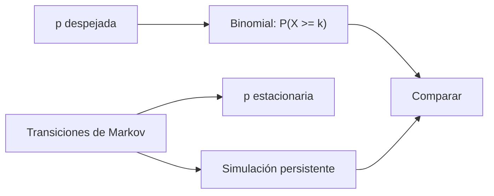

# B48-C20 — Diseño de una campaña observacional profesional

<!-- nav:top -->
[🏠 Programa](../../../../README.md) · [📚 Bloque B48](../../../tronco-comun/B48-operaciones-de-observatorios-cientificos.md) · [← Anterior: B48-C19 — Divulgación y ciencia ciudadana](../B48-C19-divulgacion-y-ciencia-ciudadana/CLASE.md) · [Siguiente: B48-C21 — Protocolos estándar de control instrumental (ASCOM e INDI) →](../B48-C21-protocolos-estandar-de-control-instrumental-ascom-e-indi/CLASE.md)
<!-- /nav -->

## 1. Ubicación, nivel y alcance

Clase 20 del bloque B48. Nivel N3. Una campaña profesional necesita un número de noches despejadas dentro de una ventana. Aquí calculas la probabilidad de completarla con clima independiente y la comparas con un clima persistente de Markov. Usas [B12](../../../tronco-comun/B12-probabilidad-estadistica-e-incertidumbre.md). El clima es sintético.

## 2. Por qué esta clase existe

Planificar con el clima medio sin considerar su persistencia da una confianza falsa. La decisión central: **¿qué ventana asegura completar la campaña con 95 % de probabilidad?**

## 3. Lo que podrás hacer al terminar

1. Calcular la probabilidad de al menos k noches despejadas con la binomial.
2. Hallar la ventana mínima para un nivel de confianza.
3. Modelar el clima con una cadena de Markov de dos estados.
4. Comparar el clima independiente con el persistente.
5. Verificar con 100000 campañas simuladas.
6. Reconocer que las noches no son idénticas.

La evidencia es la **ficha de la campaña observacional** del ejercicio 12 (sección 20).

## 4. Con qué llegas y cómo comprobarlo

1. ¿Qué es una incertidumbre?
2. ¿Qué es una simulación Monte Carlo?
3. ¿Qué es una tabla de resultados?
4. ¿Qué es un valor ilustrativo?
5. ¿Qué es una verificación?

<details>
<summary>Ver respuestas</summary>

1. Un intervalo en que se espera el valor verdadero. 2. Repetir con números aleatorios de semilla fija. 3. Un resumen ordenado de cálculos. 4. Un valor propuesto para el ejemplo, no medido. 5. Comparar un cálculo con un caso independiente.
</details>

Con cuatro o cinco aciertos, sigue; si no, repasa los prerrequisitos.

## 5. Un caso de contexto y casos de referencia

Con 30 noches y 18 despejadas necesarias, y una probabilidad estacionaria de 0,7273, la probabilidad de completar es 0,9574 con clima independiente y 0,8600 con clima persistente. Es el **ejemplo conductor** (sintético).

## 6. Vocabulario

**Campaña**: conjunto de observaciones con un objetivo. **Binomial**: número de éxitos en n ensayos. **Cadena de Markov**: estado que depende del anterior. **Persistencia**: tendencia a repetir. **Ventana**: noches disponibles.

## 7. Modelo mental: racha de buen tiempo

El clima viene en rachas: un día nublado suele seguirse de otro, y esas rachas hacen más probable terminar mal una campaña que lo que predice el promedio.



*Descripción textual:* la binomial da la probabilidad con noches independientes y la cadena de Markov la rebaja al incluir la persistencia, con la misma fracción media de noches despejadas.

Analogía: racha de buen tiempo. Límite: cada noche despejada rinde igual y no hay fallas técnicas.

## 8. La explicación, paso a paso

### 8.1 Probabilidad de completar 18 de 30

| Modelo | Probabilidad |
|---|---|
| Binomial (independiente), analítica | 0,95742 |
| Binomial, simulada | 0,95655 |
| Markov (persistente), simulada | 0,85999 |

### 8.2 Ventana

La ventana mínima para alcanzar 95 % con 18 noches y clima independiente es 30 noches. Con el clima persistente ese mismo 95 % requiere una ventana mayor.

### 8.3 Lectura

El promedio de noches despejadas es el mismo en ambos modelos (21,82 de 30), pero la persistencia hace más probables las rachas largas de mal tiempo y baja la probabilidad de éxito en 9,7 puntos. Una campaña planificada con el modelo independiente promete 96 % y entrega 86 %. Todo es sintético: ningún clima real se usó.

## 9. Magnitudes, símbolos y unidades

| Símbolo | Qué es | Unidad | Valor / nota |
|---|---|---|---|
| `n`, `k` | noches de la ventana y necesarias | — | 30 y 18 |
| `π` | probabilidad estacionaria de despejado | — | 0,7273 |
| `P_cc` | despejado tras despejado | — | 0,85 |
| `P_nc` | despejado tras nublado | — | 0,40 |

## 10. Convenciones y referencias

Unidades del SI salvo donde se indique; coma decimal en el texto y punto decimal en las salidas del laboratorio; semilla 20261109; todo valor que no esté citado en la sección 11 es ilustrativo o sintético.

## 11. De dónde sale lo que afirmamos

| ID | Fuente | Localizador | Respalda | Estado |
|---|---|---|---|---|
| — | Sin fuente externa | — | relaciones estándar que verifica el laboratorio | No se consultó una fuente para esta clase |

Límites: no se consultó ninguna fuente externa para esta clase; los valores son ilustrativos o sintéticos y las relaciones son de libro, verificadas solo por el laboratorio.

## 12. Cómo ver los resultados

| Modelo | P(completar) |
|---|---|
| independiente | 0,9574 |
| persistente | 0,8600 |

Descripción larga: con el mismo promedio, la persistencia baja la probabilidad de completar la campaña.

## 13. Ejemplo trabajado: la probabilidad por aproximación normal

**Paso 1.** Media: `30 × 0,7273 = 21,82`; desviación: `√(30 × 0,7273 × 0,2727) = 2,439`.

**Paso 2.** Con corrección de continuidad: `z = (17,5 − 21,82)/2,439 = -1,77`.

**Paso 3.** `P(X ≥ 18) ≈ 0,9617`.

**Paso 4.** Exacto: 0,9574.

## 14. Distintas formas de describir el resultado

**Por fórmula:** sección 8. **Por tabla:** sección 12. **Por código:** `campana.py`. **Por contraste:** el laboratorio compara dos vías independientes.

## 15. Práctica guiada

**Ejercicio 1 · con los pasos indicados.** Probabilidad estacionaria. *Pasos:* `0,40/(0,15 + 0,40)`.

<details><summary>Solución comentada</summary>

`0,7273`.
</details>

**Ejercicio 2 · con una pista.** Noches despejadas esperadas en 30.

<details><summary>Solución comentada</summary>

`21,82`.
</details>

**Ejercicio 3 · casi autónomo.** Desviación binomial.

<details><summary>Solución comentada</summary>

`2,439`.
</details>

## 16. Práctica autónoma, transferencia e integrador

**Ejercicio 4.** Probabilidad exacta de al menos 18.

<details><summary>Solución comentada</summary>

`0,9574`.
</details>

**Ejercicio 5.** Aproximación normal.

<details><summary>Solución comentada</summary>

`0,9617`.
</details>

**Ejercicio 6.** Probabilidad con persistencia.

<details><summary>Solución comentada</summary>

`0,8600`.
</details>

**Ejercicio 7.** Baja por persistencia, en puntos.

<details><summary>Solución comentada</summary>

`9,7`.
</details>

**Ejercicio 8.** Ventana mínima para 95 %.

<details><summary>Solución comentada</summary>

`30` noches.
</details>

**Ejercicio 9 · transferencia.** **Transferencia.** ¿Qué se hace si la ventana no alcanza?

<details><summary>Solución comentada</summary>

Reducir lo requerido, ampliar la ventana o priorizar los objetivos.
</details>

**Ejercicio 10 · transferencia.** **Transferencia.** ¿Por qué no todas las noches rinden igual?

<details><summary>Solución comentada</summary>

El seeing, la Luna y la masa de aire cambian; el modelo las trata como iguales.
</details>

**Ejercicio 11 · transferencia.** **Transferencia.** ¿Es este clima el de un sitio real?

<details><summary>Solución comentada</summary>

No: es sintético.
</details>

**Ejercicio 12.** **Integrador.** Elabora tu *ficha de la campaña observacional*: ventana, probabilidades, persistencia y límites.

<details><summary>Solución comentada</summary>

Secciones 8.1–8.3.
</details>

**Ejercicio 12 · integrador.** **Integrador.** Elabora tu *ficha de la campaña observacional*: ventana, probabilidades, persistencia y límites.

<details><summary>Solución modelo</summary>

Secciones 8.1–8.3.
</details>

## 17. Laboratorio: campaña con clima persistente

El script [campana.py](campana.py) calcula la probabilidad binomial y simula el clima de Markov (**comprueba** a 4 sigmas y que la persistencia dé menos éxito).

**Datos:** clima y requisitos **sintéticos**. **Predice antes de ejecutar:** ¿cuánto baja la persistencia? (≈ 10 puntos.) **Ejecución del 2026-11-09 (Python 3.12.9):**

```text
Probabilidad estacionaria de noche despejada = 0.7273; noches esperadas en 30 = 21.82
P(al menos 18 de 30) independiente: analítica 0.95742 | simulada 0.95655
Con persistencia de Markov: 0.85999
Ventana mínima independiente para 95 % con 18 noches: 30 noches
Pruebas superadas.
```

```bash
python programa/clases/B48/B48-C20-diseno-de-una-campana-observacional-profesional/campana.py
```

**Límites:** el modelo es de libro y sus parámetros son ilustrativos; no describe ningún observatorio ni instrumento real.

## 18. Errores frecuentes y cómo corregirlos

**Planificar con el promedio solamente.** Se corrige con 8.3.

**Suponer noches independientes.** Se corrige con 8.1.

**Tratar todas las noches como iguales.** Se corrige con la sección 10.

**Usar el clima sintético como real.** Se corrige con 8.3.

## 19. Cómo sabrás que vas bien

Tras la sección 8: ¿qué resultado esperabas y cuál obtuviste? Si dudas, repasa el ejemplo 13. Tras el laboratorio: ¿qué comprueba? (ver la sección 17).

## 20. Qué entregas y cómo se evalúa

El producto es tu **ficha de la campaña observacional** (ejercicio 12).

| Criterio | Inicial | En desarrollo | Logrado | Destacado |
|---|---|---|---|---|
| Conceptos | Los confunde | Parciales | conceptos de la clase | Explica los límites |
| Cálculo | Sin unidades | Con errores | Tablas completas | Calcula casos nuevos |
| Numérico | Sin comprobar | Un caso | Contraste con el análisis | Interpreta las diferencias |
| Fuentes | Sin fuente | Sin fecha | fuentes con fecha | Declara lo ilustrativo |
| Límites | No los nombra | Uno | Tres | Discute qué falta del modelo |

**Condiciones críticas (no se compensan con promedio):** rotular lo ilustrativo y lo sintético; no presentar el modelo como práctica de un observatorio real; citar solo lo consultado.

## 21. Ética, seguridad y límites

Clase educativa: los modelos son simplificados. Accesibilidad: tablas equivalentes a las gráficas, fórmulas en texto, ejercicios sin conexión.

## 22. Para cerrar y seguir

La campaña se completa con 96 % si el clima es independiente y con 86 % si persiste. Queda una pregunta: ¿cómo se manejan los instrumentos con protocolos estándar?

**Glosario español–inglés.** campaña · *campaign*; binomial · *binomial*; cadena de Markov · *Markov chain*; persistencia · *persistence*; ventana · *window*.

**Continuidad.** [B48-C21](../B48-C21-protocolos-estandar-de-control-instrumental-ascom-e-indi/CLASE.md) estudia los protocolos de control instrumental.

**Referencias:** ver sección 11.

<!-- nav:bottom -->
---

[← Anterior: B48-C19 — Divulgación y ciencia ciudadana](../B48-C19-divulgacion-y-ciencia-ciudadana/CLASE.md) · [📚 Bloque B48](../../../tronco-comun/B48-operaciones-de-observatorios-cientificos.md) · [Siguiente: B48-C21 — Protocolos estándar de control instrumental (ASCOM e INDI) →](../B48-C21-protocolos-estandar-de-control-instrumental-ascom-e-indi/CLASE.md)
<!-- /nav -->
