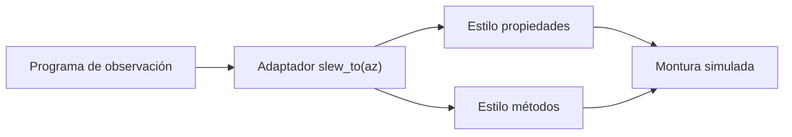

# B48-C21 — Protocolos estándar de control instrumental (ASCOM e INDI)

<!-- nav:top -->
[🏠 Programa](../../../../README.md) · [📚 Bloque B48](../../../tronco-comun/B48-operaciones-de-observatorios-cientificos.md) · [← Anterior: B48-C20 — Diseño de una campaña observacional profesional](../B48-C20-diseno-de-una-campana-observacional-profesional/CLASE.md) · [Siguiente: B48-C22 — Control automático del enfocador y autoenfoque →](../B48-C22-control-automatico-del-enfocador-y-autoenfoque/CLASE.md)
<!-- /nav -->

## 1. Ubicación, nivel y alcance

Clase 21 del bloque B48. Nivel N3. Los observatorios controlan monturas, cúpulas, enfocadores y cámaras con protocolos estándar como ASCOM e INDI. Aquí no implementas esos protocolos: construyes un **modelo de juguete** de dos estilos (propiedades y métodos) y un adaptador común, y mides la latencia del sondeo. Usas [B43](../../../tronco-comun/B43-construccion-y-mecanica-de-telescopios.md) y [B44](../../../tronco-comun/B44-detectores-y-adquisicion-astronomica.md).

## 2. Por qué esta clase existe

Sin una capa común, el software de la noche depende de cada fabricante. La decisión central: **¿cómo se aísla el programa de observación del estilo de cada protocolo?**

## 3. Lo que podrás hacer al terminar

1. Distinguir un estilo por propiedades de uno por métodos.
2. Construir un adaptador que exponga una operación común.
3. Verificar que ambos estilos dan el mismo resultado.
4. Manejar un destino fuera de rango en ambos estilos.
5. Calcular la latencia media del sondeo `T/2`.
6. Reconocer qué NO reproduce el modelo de juguete.

La evidencia es la **ficha de protocolos de control instrumental** del ejercicio 12 (sección 20).

## 4. Con qué llegas y cómo comprobarlo

1. ¿Qué es una incertidumbre?
2. ¿Qué es una simulación Monte Carlo?
3. ¿Qué es una tabla de resultados?
4. ¿Qué es un valor ilustrativo?
5. ¿Qué es una verificación?

<details>
<summary>Ver respuestas</summary>

1. Un intervalo en que se espera el valor verdadero. 2. Repetir con números aleatorios de semilla fija. 3. Un resumen ordenado de cálculos. 4. Un valor propuesto para el ejemplo, no medido. 5. Comparar un cálculo con un caso independiente.
</details>

Con cuatro o cinco aciertos, sigue; si no, repasa los prerrequisitos.

## 5. Un caso de contexto y casos de referencia

Con una montura simulada de 3,0°/s que parte del azimut 10°, mover a 100° toma 30,000 s y a 250° toma 80,000 s en ambos estilos; el destino 400° se rechaza en ambos. Un sondeo cada 1 s detecta un evento con latencia media 0,4997 s (teórica 0,5000). Es el **ejemplo conductor** (juguete).

## 6. Vocabulario

**Protocolo**: reglas de comunicación con un dispositivo. **Interfaz**: conjunto de operaciones por tipo de dispositivo. **Propiedad**: valor expuesto por un driver. **Adaptador**: capa que traduce a una operación común. **Sondeo** (*polling*): consulta periódica.

## 7. Modelo mental: un enchufe universal

Un adaptador de enchufe: el aparato no sabe de qué país es la pared; la capa común oculta la diferencia.



*Descripción textual:* el programa llama a una operación común; el adaptador la traduce al estilo de cada dispositivo y ambos mueven la misma montura simulada.

Analogía: un enchufe universal. Límite: no hay red, concurrencia ni errores de hardware.

## 8. La explicación, paso a paso

### 8.1 Qué se consultó

Se consultó la página de la documentación de ASCOM sobre sus interfaces de dispositivo, que confirma la existencia de interfaces maestras por tipo de dispositivo (telescopio, enfocador, cúpula, cámara, monitor de seguridad y otros), y la página de INDI, que describe un protocolo con drivers que exponen propiedades en un formato estándar a clientes. **No se confirmó** en esas páginas ningún nombre de estado (Idle, Ok, Busy, Alert) ni el detalle de las llamadas: en el juguete son una convención propia.

### 8.2 Resultados del juguete

| Destino | Estilo propiedades | Estilo métodos |
|---|---|---|
| 100° | az 100,0°, t = 30,000 s | az 100,0°, t = 30,000 s |
| 250° | az 250,0°, t = 80,000 s | az 250,0°, t = 80,000 s |
| 400° | rechazado | rechazado |

### 8.3 Latencia del sondeo

| Periodo | Latencia media simulada | Teórica | Máxima |
|---|---|---|---|
| 1 s | 0,4997 s | 0,5000 s | 1,0000 s |
| 5 s | 2,4986 s | 2,5000 s | 5,0000 s |

### 8.4 Lectura

El adaptador permite que el programa no cambie al cambiar de protocolo; el costo es una capa más que mantener. El sondeo añade una latencia media de la mitad del periodo; una notificación por eventos la evita. Los protocolos reales tienen discovery, tipos de datos, errores y concurrencia que este juguete no modela.

## 9. Magnitudes, símbolos y unidades

| Símbolo | Qué es | Unidad | Valor / nota |
|---|---|---|---|
| `v` | velocidad de la montura | °/s | 3,0 (ilustrativa) |
| `T` | periodo de sondeo | s | 1 y 5 |
| `L` | latencia de detección | s | media `T/2` |
| `t` | tiempo de movimiento | s | `|Δaz|/v` |

## 10. Convenciones y referencias

Unidades del SI salvo donde se indique; coma decimal en el texto y punto decimal en las salidas del laboratorio; semilla 20261109; todo valor que no esté citado en la sección 11 es ilustrativo o sintético.

## 11. De dónde sale lo que afirmamos

| ID | Fuente | Localizador | Respalda | Estado |
|---|---|---|---|---|
| S1 | ASCOM Standards, documentación para desarrolladores (espacio de nombres ASCOM.DeviceInterface) | https://ascom-standards.org/Help/Developer/html/N_ASCOM_DeviceInterface.htm | existencia de interfaces maestras por tipo de dispositivo (telescopio, enfocador, cúpula, cámara, monitor de seguridad y otros) | Consultada el 2026-11-09 (solo esa página) |
| S2 | INDI Library, *Discover INDI* | https://www.indilib.org/about/discover-indi.html | protocolo cliente-servidor con drivers que describen propiedades en formato estándar | Consultada el 2026-11-09 (solo esa página; no confirmó los estados Idle, Ok, Busy y Alert) |

Límites: solo se leyeron las dos páginas citadas; no se consultaron las especificaciones de los protocolos y el modelo es un juguete con nombres de estado propios.

## 12. Cómo ver los resultados

| Periodo T | Latencia media | Máxima |
|---|---|---|
| 1 s | 0,4997 s | 1,0000 s |
| 5 s | 2,4986 s | 5,0000 s |

Descripción larga: la latencia media es la mitad del periodo y la máxima es el periodo.

## 13. Ejemplo trabajado: el tiempo de un movimiento

**Paso 1.** Desplazamiento: `100 − 10 = 90°`.

**Paso 2.** Tiempo: `90/3 = 30,0` s.

**Paso 3.** Ambos estilos devuelven az 100° y 30,000 s.

## 14. Distintas formas de describir el resultado

**Por fórmula:** sección 8. **Por tabla:** sección 12. **Por código:** `adaptador_protocolos.py`. **Por contraste:** el laboratorio compara dos vías independientes.

## 15. Práctica guiada

**Ejercicio 1 · con los pasos indicados.** Tiempo a 250° desde 10°. *Pasos:* `240/3`.

<details><summary>Solución comentada</summary>

`80,000` s.
</details>

**Ejercicio 2 · con una pista.** Latencia media con `T = 2 s`.

<details><summary>Solución comentada</summary>

`1` s.
</details>

**Ejercicio 3 · casi autónomo.** Latencia máxima con `T = 5 s`.

<details><summary>Solución comentada</summary>

`5` s.
</details>

## 16. Práctica autónoma, transferencia e integrador

**Ejercicio 4.** ¿Qué hacen ambos estilos con 400°?

<details><summary>Solución comentada</summary>

Rechazan el destino.
</details>

**Ejercicio 5.** Diferencia de tiempo entre estilos a 100°.

<details><summary>Solución comentada</summary>

`0,000000000` s.
</details>

**Ejercicio 6.** Latencia media simulada con 5 s.

<details><summary>Solución comentada</summary>

`2,4986` s.
</details>

**Ejercicio 7.** Tiempo de ir de 10° a 10°.

<details><summary>Solución comentada</summary>

`0` s.
</details>

**Ejercicio 8.** Periodo para latencia media de 0,25 s.

<details><summary>Solución comentada</summary>

`0,5` s.
</details>

**Ejercicio 9 · transferencia.** **Transferencia.** ¿Implementa este juguete ASCOM?

<details><summary>Solución comentada</summary>

No: ilustra la idea de interfaces por tipo de dispositivo.
</details>

**Ejercicio 10 · transferencia.** **Transferencia.** ¿Por qué usar notificaciones en vez de sondeo?

<details><summary>Solución comentada</summary>

Para evitar la latencia de `T/2` y el tráfico de consultas inútiles.
</details>

**Ejercicio 11 · transferencia.** **Transferencia.** ¿Qué verificaría antes de usar un protocolo real?

<details><summary>Solución comentada</summary>

Su especificación oficial y la versión del driver.
</details>

**Ejercicio 12.** **Integrador.** Elabora tu *ficha de protocolos de control instrumental*: estilos, adaptador, latencia y límites.

<details><summary>Solución comentada</summary>

Secciones 8.1–8.4.
</details>

**Ejercicio 12 · integrador.** **Integrador.** Elabora tu *ficha de protocolos de control instrumental*: estilos, adaptador, latencia y límites.

<details><summary>Solución modelo</summary>

Secciones 8.1–8.4.
</details>

## 17. Laboratorio: adaptador sobre dos estilos

El script [adaptador_protocolos.py](adaptador_protocolos.py) construye dos dispositivos simulados y un adaptador común y mide la latencia del sondeo (**comprueba** igualdad de resultados y `T/2`).

**Datos:** montura y protocolos de **juguete**; solo se consultaron las dos páginas oficiales citadas. **Predice antes de ejecutar:** ¿difieren los estilos en el resultado? (no.) **Ejecución del 2026-11-09 (Python 3.12.9):**

```text
Destino 100°: propiedades -> az 100.0°, t = 30.000 s | métodos -> az 100.0°, t = 30.000 s
Destino 250°: propiedades -> az 250.0°, t = 80.000 s | métodos -> az 250.0°, t = 80.000 s
Destino 400°: ambos estilos rechazan: propiedades None, métodos None
Sondeo cada 1 s: latencia media 0.4997 s (teórica 0.5000), máxima 1.0000 s
Sondeo cada 5 s: latencia media 2.4986 s (teórica 2.5000), máxima 5.0000 s
Pruebas superadas.
```

```bash
python programa/clases/B48/B48-C21-protocolos-estandar-de-control-instrumental-ascom-e-indi/adaptador_protocolos.py
```

**Límites:** el modelo es de libro y sus parámetros son ilustrativos; no describe ningún observatorio ni instrumento real.

## 18. Errores frecuentes y cómo corregirlos

**Creer que el juguete es ASCOM o INDI.** Se corrige con 8.1.

**Olvidar la latencia del sondeo.** Se corrige con 8.3.

**Acoplar el programa a un solo fabricante.** Se corrige con 8.4.

**No manejar destinos inválidos.** Se corrige con 8.2.

## 19. Cómo sabrás que vas bien

Tras la sección 8: ¿qué resultado esperabas y cuál obtuviste? Si dudas, repasa el ejemplo 13. Tras el laboratorio: ¿qué comprueba? (ver la sección 17).

## 20. Qué entregas y cómo se evalúa

El producto es tu **ficha de protocolos de control instrumental** (ejercicio 12).

| Criterio | Inicial | En desarrollo | Logrado | Destacado |
|---|---|---|---|---|
| Conceptos | Los confunde | Parciales | conceptos de la clase | Explica los límites |
| Cálculo | Sin unidades | Con errores | Tablas completas | Calcula casos nuevos |
| Numérico | Sin comprobar | Un caso | Contraste con el análisis | Interpreta las diferencias |
| Fuentes | Sin fuente | Sin fecha | fuentes con fecha | Declara lo ilustrativo |
| Límites | No los nombra | Uno | Tres | Discute qué falta del modelo |

**Condiciones críticas (no se compensan con promedio):** rotular lo ilustrativo y lo sintético; no presentar el modelo como práctica de un observatorio real; citar solo lo consultado.

## 21. Ética, seguridad y límites

Clase educativa: los modelos son simplificados. Accesibilidad: tablas equivalentes a las gráficas, fórmulas en texto, ejercicios sin conexión.

## 22. Para cerrar y seguir

Ambos estilos mueven la montura igual y el sondeo añade en media 0,50 s con T = 1 s. Queda una pregunta: ¿cómo se enfoca el telescopio de forma automática?

**Glosario español–inglés.** protocolo · *protocol*; interfaz · *interface*; adaptador · *adapter*; sondeo · *polling*; propiedad · *property*.

**Continuidad.** [B48-C22](../B48-C22-control-automatico-del-enfocador-y-autoenfoque/CLASE.md) estudia el autoenfoque.

**Referencias:** ver sección 11.

<!-- nav:bottom -->
---

[← Anterior: B48-C20 — Diseño de una campaña observacional profesional](../B48-C20-diseno-de-una-campana-observacional-profesional/CLASE.md) · [📚 Bloque B48](../../../tronco-comun/B48-operaciones-de-observatorios-cientificos.md) · [Siguiente: B48-C22 — Control automático del enfocador y autoenfoque →](../B48-C22-control-automatico-del-enfocador-y-autoenfoque/CLASE.md)
<!-- /nav -->
