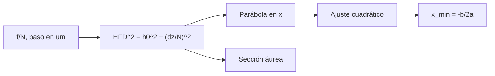

# B48-C22 — Control automático del enfocador y autoenfoque

<!-- nav:top -->
[🏠 Programa](../../../../README.md) · [📚 Bloque B48](../../../tronco-comun/B48-operaciones-de-observatorios-cientificos.md) · [← Anterior: B48-C21 — Protocolos estándar de control instrumental (ASCOM e INDI)](../B48-C21-protocolos-estandar-de-control-instrumental-ascom-e-indi/CLASE.md) · [Siguiente: B48-C23 — Observabilidad del software de observatorio: registros, métricas y alertas →](../B48-C23-observabilidad-del-software-de-observatorio-registros-metricas-y-alertas/CLASE.md)
<!-- /nav -->

## 1. Ubicación, nivel y alcance

Clase 22 del bloque B48. Nivel N3. El enfoque cambia con la temperatura y debe corregirse sin intervención. Aquí modelas la curva en V del tamaño de estrella contra la posición del enfocador y encuentras el mínimo con un ajuste cuadrático. Usas [B41](../../../tronco-comun/B41-optica-geometrica-y-diseno-de-telescopios.md) y [B44](../../../tronco-comun/B44-detectores-y-adquisicion-astronomica.md). El telescopio y el ruido son ilustrativos.

## 2. Por qué esta clase existe

Un enfoque erróneo pierde resolución en todas las imágenes de la noche. La decisión central: **¿en qué posición del enfocador está el mínimo y con qué incertidumbre?**

## 3. Lo que podrás hacer al terminar

1. Deducir que el cuadrado del tamaño es una parábola de la posición.
2. Ajustarla con las ecuaciones normales.
3. Hallar el mínimo desde los coeficientes.
4. Verificarlo con una sección áurea.
5. Simular el ruido y medir el sesgo y la dispersión.
6. Reconocer la holgura y la deriva que el modelo omite.

La evidencia es la **ficha del autoenfoque** del ejercicio 12 (sección 20).

## 4. Con qué llegas y cómo comprobarlo

1. ¿Qué es una incertidumbre?
2. ¿Qué es una simulación Monte Carlo?
3. ¿Qué es una tabla de resultados?
4. ¿Qué es un valor ilustrativo?
5. ¿Qué es una verificación?

<details>
<summary>Ver respuestas</summary>

1. Un intervalo en que se espera el valor verdadero. 2. Repetir con números aleatorios de semilla fija. 3. Un resumen ordenado de cálculos. 4. Un valor propuesto para el ejemplo, no medido. 5. Comparar un cálculo con un caso independiente.
</details>

Con cuatro o cinco aciertos, sigue; si no, repasa los prerrequisitos.

## 5. Un caso de contexto y casos de referencia

A f/8 con 5 µm por paso y mejor foco en el paso 1234, la pendiente de desenfoque es 0,6250 µm de HFD por paso. Con 9 posiciones entre ±400 pasos, el ajuste da el mínimo en 1234,000000 sin ruido; con ruido de 0,15 µm la media es 1233,999 pasos y la desviación 0,104 pasos. Es el **ejemplo conductor**.

## 6. Vocabulario

**HFD**: diámetro de media energía de una estrella. **Curva en V**: HFD contra posición. **Enfocador**: mecanismo que mueve el foco. **Número f**: foco entre apertura. **Ecuaciones normales**: sistema del ajuste por mínimos cuadrados.

## 7. Modelo mental: encontrar el fondo de un valle

Es encontrar el fondo de un valle a partir de unos pocos puntos de la ladera: la parábola ajustada indica dónde está el fondo.



*Descripción textual:* el desenfoque geométrico crece linealmente con la posición y se compone con el tamaño mínimo; su cuadrado es una parábola cuyo mínimo da el foco.

Analogía: encontrar el fondo de un valle. Límite: pasos exactos y sin deriva térmica durante la serie.

## 8. La explicación, paso a paso

### 8.1 Resultados

| Magnitud | Valor |
|---|---|
| Pendiente de desenfoque | 0,6250 µm/paso |
| HFD en el foco | 3,000 µm |
| HFD a 400 pasos | 250,018 µm |
| Mínimo por ajuste cuadrático | 1234,000000 |
| Mínimo por sección áurea | 1234,000000 |

### 8.2 Con ruido

Con ruido de 0,15 µm en cada HFD y 4000 repeticiones, la media del mínimo es 1233,999 pasos y la desviación 0,104 pasos (error estándar 0,0016). Ajustar el cuadrado del HFD da un estimador sin sesgo apreciable.

### 8.3 Lectura

La desviación de 0,10 pasos equivale a 0,52 µm de enfocador, menos que la profundidad de foco de un f/8, que una relación de libro (no consultada) sitúa en `±2 λ N²`, unos 64 µm para λ = 0,5 µm. El modelo supone pasos exactos: la holgura mecánica y el cambio de temperatura exigen aproximarse siempre desde el mismo lado y recalibrar.

## 9. Magnitudes, símbolos y unidades

| Símbolo | Qué es | Unidad | Valor / nota |
|---|---|---|---|
| `N` | número f | — | 8 |
| `h₀` | HFD mínimo | µm | 3,0 (ilustrativo) |
| `x₀` | paso de mejor foco | paso | 1234 |
| `k` | µm de HFD por paso | µm/paso | 0,6250 |
| `σ` | ruido del HFD | µm | 0,15 |

## 10. Convenciones y referencias

Unidades del SI salvo donde se indique; coma decimal en el texto y punto decimal en las salidas del laboratorio; semilla 20261109; todo valor que no esté citado en la sección 11 es ilustrativo o sintético.

## 11. De dónde sale lo que afirmamos

| ID | Fuente | Localizador | Respalda | Estado |
|---|---|---|---|---|
| — | Sin fuente externa | — | relaciones estándar que verifica el laboratorio | No se consultó una fuente para esta clase |

Límites: no se consultó ninguna fuente externa para esta clase; los valores son ilustrativos o sintéticos y las relaciones son de libro, verificadas solo por el laboratorio.

## 12. Cómo ver los resultados

| Paso | HFD (µm) |
|---|---|
| 834 | 250,018 |
| 1134 | 62,572 |
| 1234 | 3,000 |
| 1334 | 62,572 |

Descripción larga: el HFD baja linealmente hacia el foco y sube al otro lado, con un fondo redondeado por el tamaño mínimo.

## 13. Ejemplo trabajado: el HFD a 100 pasos del foco

**Paso 1.** Desenfoque: `5 × 100/8 = 62,5` µm.

**Paso 2.** `HFD² = 3² + 62,5² = 9 + 3906,25 = 3915,25`.

**Paso 3.** `HFD = 62,572` µm.

## 14. Distintas formas de describir el resultado

**Por fórmula:** sección 8. **Por tabla:** sección 12. **Por código:** `autoenfoque.py`. **Por contraste:** el laboratorio compara dos vías independientes.

## 15. Práctica guiada

**Ejercicio 1 · con los pasos indicados.** Pendiente de desenfoque. *Pasos:* `5/8`.

<details><summary>Solución comentada</summary>

`0,6250` µm/paso.
</details>

**Ejercicio 2 · con una pista.** HFD a 100 pasos.

<details><summary>Solución comentada</summary>

`62,572` µm.
</details>

**Ejercicio 3 · casi autónomo.** HFD a 400 pasos.

<details><summary>Solución comentada</summary>

`250,018` µm.
</details>

## 16. Práctica autónoma, transferencia e integrador

**Ejercicio 4.** Mínimo ajustado sin ruido.

<details><summary>Solución comentada</summary>

`1234,000000`.
</details>

**Ejercicio 5.** Diferencia ajuste − áurea.

<details><summary>Solución comentada</summary>

`-0,000000`.
</details>

**Ejercicio 6.** Sesgo con ruido, en pasos.

<details><summary>Solución comentada</summary>

`-0,001`.
</details>

**Ejercicio 7.** Dispersión en µm de enfocador.

<details><summary>Solución comentada</summary>

`0,52`.
</details>

**Ejercicio 8.** HFD en el foco.

<details><summary>Solución comentada</summary>

`3,000` µm.
</details>

**Ejercicio 9 · transferencia.** **Transferencia.** ¿Por qué ajustar el HFD² y no el HFD?

<details><summary>Solución comentada</summary>

Porque el cuadrado es exactamente una parábola; el HFD tiene forma de V redondeada.
</details>

**Ejercicio 10 · transferencia.** **Transferencia.** ¿Qué pasa con la holgura mecánica?

<details><summary>Solución comentada</summary>

Introduce un sesgo según el sentido de aproximación.
</details>

**Ejercicio 11 · transferencia.** **Transferencia.** ¿Cuándo repetir el autoenfoque?

<details><summary>Solución comentada</summary>

Al cambiar la temperatura, el filtro o la posición del telescopio, según el instrumento.
</details>

**Ejercicio 12.** **Integrador.** Elabora tu *ficha del autoenfoque*: modelo, ajuste, sección áurea, ruido y límites.

<details><summary>Solución comentada</summary>

Secciones 8.1–8.3.
</details>

**Ejercicio 12 · integrador.** **Integrador.** Elabora tu *ficha del autoenfoque*: modelo, ajuste, sección áurea, ruido y límites.

<details><summary>Solución modelo</summary>

Secciones 8.1–8.3.
</details>

## 17. Laboratorio: curva en V y ajuste cuadrático

El script [autoenfoque.py](autoenfoque.py) ajusta una parábola al HFD² y lo contrasta con una sección áurea (**comprueba** 1e-6 pasos sin ruido y sesgo a 4 errores estándar).

**Datos:** telescopio, paso y ruido **ilustrativos**. **Predice antes de ejecutar:** ¿dónde está el mínimo? (paso 1234.) **Ejecución del 2026-11-09 (Python 3.12.9):**

```text
Pendiente de desenfoque = 0.6250 µm de HFD por paso; HFD en el borde = 250.018 µm
Mínimo sin ruido: ajuste cuadrático 1234.000000 | sección áurea 1234.000000
Con ruido de 0.15 µm: media 1233.999 pasos, desviación 0.104 pasos
Pruebas superadas.
```

```bash
python programa/clases/B48/B48-C22-control-automatico-del-enfocador-y-autoenfoque/autoenfoque.py
```

**Límites:** el modelo es de libro y sus parámetros son ilustrativos; no describe ningún observatorio ni instrumento real.

## 18. Errores frecuentes y cómo corregirlos

**Ajustar una recta al HFD.** Se corrige con 8.1.

**Ignorar la holgura.** Se corrige con 8.3.

**Usar pocos puntos solo de un lado.** Se corrige con 8.2.

**Tomar el HFD proporcional al diámetro como exacto.** Se corrige con la sección 10.

## 19. Cómo sabrás que vas bien

Tras la sección 8: ¿qué resultado esperabas y cuál obtuviste? Si dudas, repasa el ejemplo 13. Tras el laboratorio: ¿qué comprueba? (ver la sección 17).

## 20. Qué entregas y cómo se evalúa

El producto es tu **ficha del autoenfoque** (ejercicio 12).

| Criterio | Inicial | En desarrollo | Logrado | Destacado |
|---|---|---|---|---|
| Conceptos | Los confunde | Parciales | conceptos de la clase | Explica los límites |
| Cálculo | Sin unidades | Con errores | Tablas completas | Calcula casos nuevos |
| Numérico | Sin comprobar | Un caso | Contraste con el análisis | Interpreta las diferencias |
| Fuentes | Sin fuente | Sin fecha | fuentes con fecha | Declara lo ilustrativo |
| Límites | No los nombra | Uno | Tres | Discute qué falta del modelo |

**Condiciones críticas (no se compensan con promedio):** rotular lo ilustrativo y lo sintético; no presentar el modelo como práctica de un observatorio real; citar solo lo consultado.

## 21. Ética, seguridad y límites

Clase educativa: los modelos son simplificados. Accesibilidad: tablas equivalentes a las gráficas, fórmulas en texto, ejercicios sin conexión.

## 22. Para cerrar y seguir

El ajuste halla el foco en 1234 con dispersión de 0,10 pasos bajo ruido. Queda una pregunta: ¿cómo se vigila el software que hace todo esto?

**Glosario español–inglés.** autoenfoque · *autofocus*; curva en V · *V-curve*; enfocador · *focuser*; HFD · *half-flux diameter*; holgura · *backlash*.

**Continuidad.** [B48-C23](../B48-C23-observabilidad-del-software-de-observatorio-registros-metricas-y-alertas/CLASE.md) estudia la observabilidad del software.

**Referencias:** ver sección 11.

<!-- nav:bottom -->
---

[← Anterior: B48-C21 — Protocolos estándar de control instrumental (ASCOM e INDI)](../B48-C21-protocolos-estandar-de-control-instrumental-ascom-e-indi/CLASE.md) · [📚 Bloque B48](../../../tronco-comun/B48-operaciones-de-observatorios-cientificos.md) · [Siguiente: B48-C23 — Observabilidad del software de observatorio: registros, métricas y alertas →](../B48-C23-observabilidad-del-software-de-observatorio-registros-metricas-y-alertas/CLASE.md)
<!-- /nav -->
