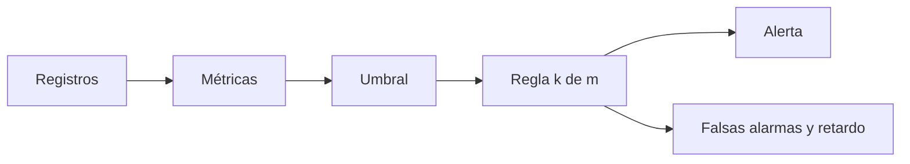

# B48-C23 — Observabilidad del software de observatorio: registros, métricas y alertas

<!-- nav:top -->
[🏠 Programa](../../../../README.md) · [📚 Bloque B48](../../../tronco-comun/B48-operaciones-de-observatorios-cientificos.md) · [← Anterior: B48-C22 — Control automático del enfocador y autoenfoque](../B48-C22-control-automatico-del-enfocador-y-autoenfoque/CLASE.md) · [Siguiente: B49-C01 — Antenas de hilo: dipolo, monopolo e impedancia de radiación →](../../B49/B49-C01-antenas-de-hilo-dipolo-monopolo-e-impedancia-de-radiacion/CLASE.md)
<!-- /nav -->

## 1. Ubicación, nivel y alcance

Clase 23 del bloque B48. Nivel N3. El software de un observatorio genera registros, métricas y alertas, y una alerta mal diseñada despierta a alguien sin motivo o avisa tarde. Aquí evalúas una regla «k de m», cuentas falsas alarmas y retardo, y obtienes métricas desde registros de texto. Usas [B12](../../../tronco-comun/B12-probabilidad-estadistica-e-incertidumbre.md). Los datos son sintéticos.

## 2. Por qué esta clase existe

Demasiadas falsas alarmas se ignoran; muy pocas dejan las averías sin ver. La decisión central: **¿qué regla de alerta equilibra falsas alarmas y retardo?**

## 3. Lo que podrás hacer al terminar

1. Distinguir registros, métricas y alertas.
2. Calcular la probabilidad de superar un umbral en régimen sano y averiado.
3. Calcular falsa alarma y detección de la regla k de m.
4. Verificarlo con simulación.
5. Medir el retardo medio de detección.
6. Extraer métricas de registros con una expresión regular.

La evidencia es la **ficha de observabilidad del software** del ejercicio 12 (sección 20).

## 4. Con qué llegas y cómo comprobarlo

1. ¿Qué es una incertidumbre?
2. ¿Qué es una simulación Monte Carlo?
3. ¿Qué es una tabla de resultados?
4. ¿Qué es un valor ilustrativo?
5. ¿Qué es una verificación?

<details>
<summary>Ver respuestas</summary>

1. Un intervalo en que se espera el valor verdadero. 2. Repetir con números aleatorios de semilla fija. 3. Un resumen ordenado de cálculos. 4. Un valor propuesto para el ejemplo, no medido. 5. Comparar un cálculo con un caso independiente.
</details>

Con cuatro o cinco aciertos, sigue; si no, repasa los prerrequisitos.

## 5. Un caso de contexto y casos de referencia

Con umbral de 2 sigmas y avería de +3 sigmas, la regla 3 de 5 tiene falsa alarma 1.138e-04 por ventana, detección 0,9690 y retardo medio 3,59 muestras (la regla de una muestra tiene 1,19 pero falsas alarmas 2,28 % por muestra). Es el **ejemplo conductor** (sintético).

## 6. Vocabulario

**Registro** (*log*): línea de texto con un evento. **Métrica**: serie numérica. **Alerta**: aviso por regla. **Falsa alarma**: alerta sin falla. **Retardo de detección**: muestras hasta alertar. **Regla k de m**: al menos k de m muestras superan el umbral.

## 7. Modelo mental: un detector de humo

Un detector de humo que suena con una sola partícula es insoportable; uno que exige humo sostenido tarda más pero sirve.



*Descripción textual:* los registros se convierten en métricas; una regla k de m sobre el umbral decide la alerta, y su falsa alarma y su retardo se calculan por binomial y simulación.

Analogía: un detector de humo. Límite: muestras independientes y gaussianas.

## 8. La explicación, paso a paso

### 8.1 Probabilidades por muestra

En régimen sano `p = 0,02275` de superar 2 sigmas; con la avería, `p = 0,84134`.

### 8.2 Regla 3 de 5 en ventanas disjuntas

| Magnitud | Analítica | Simulada |
|---|---|---|
| Falsa alarma por ventana | 1.138e-04 | 9.333e-05 |
| Detección por ventana | 0,96897 | 0,96953 |

### 8.3 Retardo con ventana deslizante

El retardo medio es 3,588 muestras (máximo 14 en 20000 averías). La regla de una sola muestra detecta en 1,19 muestras, pero con falsa alarma de 2,28 % por muestra, unas 200 veces mayor que la de la regla 3 de 5 por ventana.

### 8.4 Registros

De 1000 líneas «clave=valor» se contaron por nivel {'INFO': 893, 'WARN': 84, 'ERROR': 23}; coinciden con las generadas.

### 8.5 Lectura

La regla 3 de 5 cuesta unas 2,4 muestras de retardo adicional a cambio de reducir las falsas alarmas en dos órdenes de magnitud. Con falsas alarmas continuas, los operadores aprenden a ignorarlas. Los valores son sintéticos y no describen ningún sistema real.

## 9. Magnitudes, símbolos y unidades

| Símbolo | Qué es | Unidad | Valor / nota |
|---|---|---|---|
| `u` | umbral | σ | 2,0 |
| `Δ` | desplazamiento por avería | σ | 3,0 |
| `k`, `m` | muestras necesarias y ventana | — | 3 y 5 |
| `p₀`, `p₁` | probabilidad de superar el umbral | — | 0,02275 y 0,84134 |
| `d` | retardo medio | muestras | 3,588 |

## 10. Convenciones y referencias

Unidades del SI salvo donde se indique; coma decimal en el texto y punto decimal en las salidas del laboratorio; semilla 20261109; todo valor que no esté citado en la sección 11 es ilustrativo o sintético.

## 11. De dónde sale lo que afirmamos

| ID | Fuente | Localizador | Respalda | Estado |
|---|---|---|---|---|
| — | Sin fuente externa | — | relaciones estándar que verifica el laboratorio | No se consultó una fuente para esta clase |

Límites: no se consultó ninguna fuente externa para esta clase; los valores son ilustrativos o sintéticos y las relaciones son de libro, verificadas solo por el laboratorio.

## 12. Cómo ver los resultados

| Regla | Falsa alarma | Retardo |
|---|---|---|
| 1 de 1 | 0,02275 por muestra | 1,19 |
| 3 de 5 | 1.14e-04 por ventana | 3,59 |

Descripción larga: exigir 3 de 5 reduce mucho las falsas alarmas a cambio de unas 2,4 muestras más de retardo.

## 13. Ejemplo trabajado: la falsa alarma de la regla 3 de 5

**Paso 1.** `p = 0,02275`.

**Paso 2.** `P = C(5,3)p³(1−p)² + C(5,4)p⁴(1−p) + p⁵`.

**Paso 3.** El primer término domina: `10 × 1.177e-05 × 0,9550 = 1.125e-04`.

**Paso 4.** Total: 1.138e-04.

## 14. Distintas formas de describir el resultado

**Por fórmula:** sección 8. **Por tabla:** sección 12. **Por código:** `alertas_k_de_m.py`. **Por contraste:** el laboratorio compara dos vías independientes.

## 15. Práctica guiada

**Ejercicio 1 · con los pasos indicados.** Probabilidad por muestra en régimen sano. *Pasos:* `1 − Φ(2)`.

<details><summary>Solución comentada</summary>

`0,02275`.
</details>

**Ejercicio 2 · con una pista.** Probabilidad con avería.

<details><summary>Solución comentada</summary>

`0,84134`.
</details>

**Ejercicio 3 · casi autónomo.** Retardo de la regla de una muestra.

<details><summary>Solución comentada</summary>

`1/p₁ = 1,19`.
</details>

## 16. Práctica autónoma, transferencia e integrador

**Ejercicio 4.** Detección de 3 de 5.

<details><summary>Solución comentada</summary>

`0,96897`.
</details>

**Ejercicio 5.** Falsa alarma de 3 de 5.

<details><summary>Solución comentada</summary>

`1.138e-04`.
</details>

**Ejercicio 6.** Retardo medio simulado.

<details><summary>Solución comentada</summary>

`3,588`.
</details>

**Ejercicio 7.** Líneas con nivel ERROR.

<details><summary>Solución comentada</summary>

`23`.
</details>

**Ejercicio 8.** Líneas totales contadas.

<details><summary>Solución comentada</summary>

`1000`.
</details>

**Ejercicio 9 · transferencia.** **Transferencia.** ¿Qué pasa si las muestras están correlacionadas?

<details><summary>Solución comentada</summary>

Las falsas alarmas vienen en rachas y la fórmula las subestima.
</details>

**Ejercicio 10 · transferencia.** **Transferencia.** ¿Por qué medir el retardo y no solo la detección?

<details><summary>Solución comentada</summary>

Una avería detectada tarde puede dañar el equipo.
</details>

**Ejercicio 11 · transferencia.** **Transferencia.** ¿Es esto un sistema de monitorización real?

<details><summary>Solución comentada</summary>

No: es un modelo sintético.
</details>

**Ejercicio 12.** **Integrador.** Elabora tu *ficha de observabilidad del software*: registros, métricas, regla k de m, falsas alarmas, retardo y límites.

<details><summary>Solución comentada</summary>

Secciones 8.1–8.5.
</details>

**Ejercicio 12 · integrador.** **Integrador.** Elabora tu *ficha de observabilidad del software*: registros, métricas, regla k de m, falsas alarmas, retardo y límites.

<details><summary>Solución modelo</summary>

Secciones 8.1–8.5.
</details>

## 17. Laboratorio: regla k de m y registros

El script [alertas_k_de_m.py](alertas_k_de_m.py) calcula la regla k de m por binomial y simulación, mide el retardo y cuenta registros (**comprueba** a 4 sigmas y conteos exactos).

**Datos:** métrica, avería y registros **sintéticos**. **Predice antes de ejecutar:** ¿cuántas muestras tarda en alertar? (≈ 3,6.) **Ejecución del 2026-11-09 (Python 3.12.9):**

```text
p sano = 0.02275; p con avería = 0.84134
Falsa alarma por ventana de 5: analítica 1.138e-04 | simulada 9.333e-05
Detección por ventana de 5: analítica 0.96897 | simulada 0.96953
Retardo medio de detección (ventana deslizante) = 3.588 muestras (máximo 14); regla de 1 muestra = 1.189
Registros: generados {'INFO': 893, 'WARN': 84, 'ERROR': 23} | contados {'INFO': 893, 'WARN': 84, 'ERROR': 23}
Pruebas superadas.
```

```bash
python programa/clases/B48/B48-C23-observabilidad-del-software-de-observatorio-registros-metricas-y-alertas/alertas_k_de_m.py
```

**Límites:** el modelo es de libro y sus parámetros son ilustrativos; no describe ningún observatorio ni instrumento real.

## 18. Errores frecuentes y cómo corregirlos

**Alertar con una sola muestra.** Se corrige con 8.3.

**Ignorar el retardo.** Se corrige con 8.3.

**Suponer muestras independientes sin revisar.** Se corrige con la sección 10.

**No contar los registros en la fuente.** Se corrige con 8.4.

## 19. Cómo sabrás que vas bien

Tras la sección 8: ¿qué resultado esperabas y cuál obtuviste? Si dudas, repasa el ejemplo 13. Tras el laboratorio: ¿qué comprueba? (ver la sección 17).

## 20. Qué entregas y cómo se evalúa

El producto es tu **ficha de observabilidad del software** (ejercicio 12).

| Criterio | Inicial | En desarrollo | Logrado | Destacado |
|---|---|---|---|---|
| Conceptos | Los confunde | Parciales | conceptos de la clase | Explica los límites |
| Cálculo | Sin unidades | Con errores | Tablas completas | Calcula casos nuevos |
| Numérico | Sin comprobar | Un caso | Contraste con el análisis | Interpreta las diferencias |
| Fuentes | Sin fuente | Sin fecha | fuentes con fecha | Declara lo ilustrativo |
| Límites | No los nombra | Uno | Tres | Discute qué falta del modelo |

**Condiciones críticas (no se compensan con promedio):** rotular lo ilustrativo y lo sintético; no presentar el modelo como práctica de un observatorio real; citar solo lo consultado.

## 21. Ética, seguridad y límites

Clase educativa: los modelos son simplificados. Accesibilidad: tablas equivalentes a las gráficas, fórmulas en texto, ejercicios sin conexión.

## 22. Para cerrar y seguir

La regla 3 de 5 detecta con probabilidad 0,969 y retardo 3,6 muestras con muy pocas falsas alarmas. Con esto se cierra el bloque: de la propuesta al software que la sostiene, cada decisión se cuantifica y se contrasta.

**Glosario español–inglés.** registro · *log*; métrica · *metric*; alerta · *alert*; falsa alarma · *false alarm*; retardo · *latency*.

**Continuidad.** cierra el bloque; el siguiente es B49.

**Referencias:** ver sección 11.

<!-- nav:bottom -->
---

[← Anterior: B48-C22 — Control automático del enfocador y autoenfoque](../B48-C22-control-automatico-del-enfocador-y-autoenfoque/CLASE.md) · [📚 Bloque B48](../../../tronco-comun/B48-operaciones-de-observatorios-cientificos.md) · [Siguiente: B49-C01 — Antenas de hilo: dipolo, monopolo e impedancia de radiación →](../../B49/B49-C01-antenas-de-hilo-dipolo-monopolo-e-impedancia-de-radiacion/CLASE.md)
<!-- /nav -->
