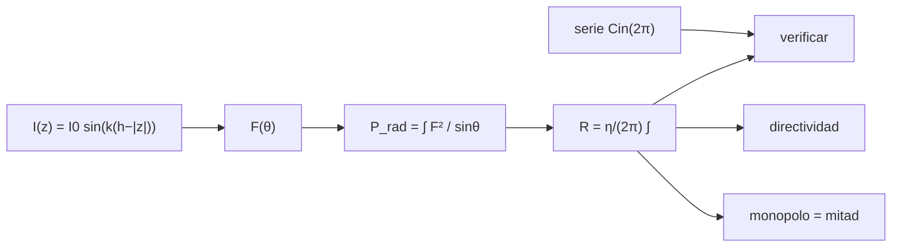

# B49-C01 — Antenas de hilo: dipolo, monopolo e impedancia de radiación

<!-- nav:top -->
[🏠 Programa](../../../../README.md) · [📚 Bloque B49](../../../tronco-comun/B49-antenas-y-receptores-de-radioastronomia.md) · [← Anterior: B48-C23 — Observabilidad del software de observatorio: registros, métricas y alertas](../../B48/B48-C23-observabilidad-del-software-de-observatorio-registros-metricas-y-alertas/CLASE.md) · [Siguiente: B49-C02 — Adaptación de impedancias y líneas de transmisión en antenas →](../B49-C02-adaptacion-de-impedancias-y-lineas-de-transmision-en-antenas/CLASE.md)
<!-- /nav -->

## 1. Ubicación, nivel y alcance

Clase 1 del bloque B49. Nivel N3. Una antena de hilo convierte la corriente de una línea en una onda y al revés. Aquí calculas la **resistencia de radiación** del dipolo y del monopolo integrando el campo lejano de una corriente sinusoidal, la contrastas con una serie independiente (la función `Cin`) y obtienes la directividad y la longitud física a 150 MHz. Usas [B05](../../../tronco-comun/B05-fisica-fundamental-para-el-espacio.md) y [B10](../../../tronco-comun/B10-algebra-lineal-y-matematicas-geometricas.md). Es la base de B46-C03 (antenas parabólicas) y de C04 de este bloque (elementos de un arreglo).

## 2. Por qué esta clase existe

Sin la resistencia de radiación no se sabe qué carga ve la línea ni cuánta potencia se irradia. La decisión central: **¿de qué longitud hacer el hilo y qué impedancia presentará a la línea?**

## 3. Lo que podrás hacer al terminar

1. Escribir el campo lejano `F(θ) = [cos(kh cosθ) − cos(kh)]/sinθ`.
2. Calcular `R` integrando la potencia radiada.
3. Verificar `R` de media onda con la serie `Cin(2π)`.
4. Obtener la directividad numéricamente.
5. Pasar del dipolo al monopolo sobre un plano conductor.
6. Convertir longitudes de onda en metros a una frecuencia dada.

La evidencia es la **ficha de las antenas de hilo** del ejercicio 12 (sección 20).

## 4. Con qué llegas y cómo comprobarlo

1. ¿Qué es una incertidumbre?
2. ¿Qué es una simulación Monte Carlo?
3. ¿Qué es una tabla de resultados?
4. ¿Qué es un valor ilustrativo?
5. ¿Qué es una verificación?

<details>
<summary>Ver respuestas</summary>

1. Un intervalo en que se espera el valor verdadero. 2. Repetir con números aleatorios de semilla fija. 3. Un resumen ordenado de cálculos. 4. Un valor propuesto para el ejemplo, no medido. 5. Comparar un cálculo con un caso independiente.
</details>

Con cuatro o cinco aciertos, sigue; si no, repasa los prerrequisitos.

## 5. Un caso de contexto y casos de referencia

A 150 MHz, `λ = 1,99862 m`. El dipolo de media onda mide `0,99931 m`, tiene `R = 73,079 Ω` y `D = 1,6409` (2,151 dBi); el monopolo de cuarto de onda mide `0,49965 m`, tiene `36,540 Ω` y `D = 3,2818` (5,161 dBi). Es el **ejemplo conductor**; las longitudes y la frecuencia son ilustrativas.

## 6. Vocabulario

El **dipolo** es un hilo alimentado en el centro. El **monopolo** es la mitad de un dipolo sobre un **plano de tierra**. La **resistencia de radiación** es `R = 2P_rad/I²`. La **corriente de alimentación** es la del punto de entrada. El **campo lejano** es el de distancias mucho mayores que `λ` y que la antena. La **directividad** `D` es el cociente entre la intensidad máxima y la media. `Cin(x)` es la función integral del coseno modificada.

## 7. Modelo mental: una cuerda de guitarra

Como una cuerda, el hilo tiene una distribución de corriente estacionaria: nodos en los extremos y un máximo en el centro cuando mide media onda.



*Descripción textual:* la corriente sinusoidal fija el campo lejano; su integral da la potencia y la resistencia de radiación, que una serie independiente verifica.

Analogía: una cuerda de guitarra. Límite: hilo delgado, sin pérdidas, sin reactancia.

## 8. La explicación, paso a paso

### 8.1 Dipolo de longitud total `L`

| L/λ | R referida al máximo (Ω) | D | D (dBi) | R de entrada (Ω) |
|---|---|---|---|---|
| 0,02 | 0,0003 | 1,5002 | 1,761 | 0,0789 |
| 0,10 | 0,1909 | 1,5050 | 1,775 | 1,9989 |
| 0,25 | 6,7156 | 1,5318 | 1,852 | 13,4312 |
| 0,50 | 73,0790 | 1,6409 | 2,151 | 73,0790 |
| 0,75 | 185,6801 | 1,8821 | 2,746 | 371,3601 |
| 1,25 | 106,4632 | 3,2825 | 5,162 | 212,9264 |

La resistencia de entrada es `R/sin²(kh)`, porque la corriente de alimentación es `I₀ sin(kh)`.

### 8.2 Dos vías para la media onda

La integral numérica da `73,07901 Ω`; la serie `η/(4π) Cin(2π)` da `73,07901 Ω`. Con `120π` en lugar del valor de NIST (`376,730313 Ω`) se obtiene `73,12960 Ω`: la cifra de 73,13 de muchos textos usa `η = 120π`, una aproximación.

### 8.3 Dipolo corto y monopolo

Para `L = 0,02 λ`, `R = 0,07894 Ω` frente a `20π²(L/λ)² × (η/120π) = 0,07890 Ω`: diferencia de 0,053 %. El monopolo sobre plano perfecto tiene `36,5395 Ω` y la directividad doble (`3,2818`), porque la misma potencia sale por medio espacio.

### 8.4 Lectura

La resistencia de radiación crece con el cuadrado de la longitud hasta media onda. A `L = λ` la corriente de alimentación es nula y la resistencia de entrada del modelo diverge. Un hilo real resuena a una longitud algo menor y tiene reactancia; eso no se calcula aquí.

## 9. Magnitudes, símbolos y unidades

| Símbolo | Qué es | Unidad | Valor / nota |
|---|---|---|---|
| `η` | impedancia característica del vacío | Ω | 376,730313412 (NIST) |
| `R` | resistencia de radiación | Ω | 73,079 (media onda) |
| `D` | directividad | — | 1,6409 |
| `k h` | `π L/λ` | rad | `π/2` para media onda |
| `λ` | longitud de onda `c/f` | m | 1,99862 a 150 MHz |

## 10. Convenciones y referencias

NIST (`η`, `c`); longitudes, frecuencia y modelo de hilo ideal **ilustrativos**.

## 11. De dónde sale lo que afirmamos

| ID | Fuente | Localizador | Respalda | Estado |
|---|---|---|---|---|
| S1 | NIST, *Fundamental Physical Constants* (CODATA 2022) | https://physics.nist.gov/cuu/Constants/Table/allascii.txt | constantes citadas en la sección 9 | Consultada el 2026-11-09 |

Límites: La distribución sinusoidal de corriente y la integral se escribieron de los resultados estándar de la teoría de antenas (texto no consultado); se validaron con la serie `Cin` y con el límite del dipolo corto.

## 12. Cómo ver la resistencia frente a la longitud

| L/λ | R de entrada (Ω) |
|---|---|
| 0,10 | 1,9989 |
| 0,25 | 13,4312 |
| 0,50 | 73,0790 |
| 0,75 | 371,3601 |

Descripción larga: la resistencia de entrada sube con la longitud, vale 73 Ω en media onda y crece rápido al acercarse a una onda completa.

## 13. Ejemplo trabajado: el dipolo de media onda

**Paso 1 · Campo.** `kh = π/2`: `F = cos(π/2 cosθ)/sinθ`.

**Paso 2 · Integral.** `R = η/(2π) ∫ cos²(π/2 cosθ)/sinθ dθ = 73,079 Ω`.

**Paso 3 · Serie.** `η/(4π) = 29,9792 Ω` y `Cin(2π) ≈ 2,4376`: `R = 73,079 Ω`.

**Paso 4 · Longitud.** `λ/2 = 0,99931 m` a 150 MHz.

## 14. Distintas formas de describir el mismo resultado

**Por fórmula:** `η/(4π) Cin`. **Por tabla:** resistencia frente a longitud. **Por integral numérica:** punto medio con 20 000 puntos. **Por código:** `dipolo.py`.

## 15. Práctica guiada

**Ejercicio 1 · con los pasos indicados.** Longitud del dipolo de media onda a 150 MHz. *Pasos:* ejemplo 13.

<details><summary>Solución comentada</summary>

`λ/2 = 0,99931 m`.
</details>

**Ejercicio 2 · con una pista.** Longitud del monopolo de cuarto de onda. *Pasos:* `λ/4`.

<details><summary>Solución comentada</summary>

`0,49965 m`.
</details>

**Ejercicio 3 · casi autónomo.** Resistencia del monopolo.

<details><summary>Solución comentada</summary>

La mitad: `36,54 Ω`.
</details>

## 16. Práctica autónoma, transferencia e integrador

**Ejercicio 4.** Directividad en dBi de `D = 1,6409`.

<details><summary>Solución comentada</summary>

`10 log₁₀ 1,6409 = 2,151 dBi`.
</details>

**Ejercicio 5.** `R` del dipolo corto de `0,02 λ`.

<details><summary>Solución comentada</summary>

`20π²(0,02)² × 0,99933 = 0,0789 Ω`.
</details>

**Ejercicio 6.** Diferencia relativa entre 73,1296 y 73,0790 Ω.

<details><summary>Solución comentada</summary>

`0,0506/73,079 = 0,069 %`.
</details>

**Ejercicio 7.** `R` de entrada de `L = 0,25 λ` partiendo de `6,7156 Ω`.

<details><summary>Solución comentada</summary>

`sin²(π/4) = 0,5`: `13,43 Ω`.
</details>

**Ejercicio 8.** Pérdida por desadaptación de 73,08 Ω con una línea de 50 Ω.

<details><summary>Solución comentada</summary>

`|Γ| = 0,1875`; `−10 log₁₀(1 − 0,0352) = 0,155 dB`.
</details>

**Ejercicio 9 · transferencia.** **Transferencia.** Un compañero afirma que un dipolo real de hilo mide exactamente 73 Ω. Responde.

<details><summary>Solución comentada</summary>

El valor es del modelo ideal de hilo delgado; un hilo real tiene reactancia y resuena a otra longitud. Eso no se calculó.
</details>

**Ejercicio 10 · transferencia.** **Transferencia.** ¿Por qué el monopolo tiene el doble de directividad que el dipolo?

<details><summary>Solución comentada</summary>

Irradia la misma potencia en medio espacio: `D = 2 × 1,6409 = 3,2818`.
</details>

**Ejercicio 11 · transferencia.** **Transferencia.** ¿Por qué diverge la resistencia de entrada en `L = λ`?

<details><summary>Solución comentada</summary>

La corriente de alimentación `I₀ sin(π)` es nula y la resistencia se refiere a ella.
</details>

**Ejercicio 12.** **Integrador.** Elabora tu *ficha de las antenas de hilo*: resistencia, directividad y longitud de un dipolo y un monopolo a 150 MHz.

<details><summary>Solución comentada</summary>

Secciones 8.1–8.4.
</details>

**Ejercicio 12 · integrador.** **Integrador.** Elabora tu *ficha de las antenas de hilo*: resistencia, directividad y longitud de un dipolo y un monopolo a 150 MHz.

<details><summary>Solución modelo</summary>

Secciones 8.1–8.4.
</details>

## 17. Laboratorio: resistencia de radiación

El script [dipolo.py](dipolo.py) integra el campo lejano de un hilo y verifica la media onda con la serie `Cin` (**comprueba** `10⁻⁶` y el dipolo corto a 2 %).

**Datos:** constantes de NIST; longitudes, frecuencia y hilo **ilustrativos**. **Predice antes de ejecutar:** ¿cuánto vale `R` en media onda? (≈ 73 Ω.) **Ejecución del 2026-11-09 (Python 3.12.9):**

```text
Python 3.12.9 (biblioteca estandar)
eta = 376.730313412 ohm (NIST) ; 120 pi = 376.991118 ohm
Dipolo de longitud total L (h = L/2, k h = pi L / lambda):
 L/lambda  R_pico (ohm)       D  D (dBi)  R_in (ohm)
     0.02        0.0003  1.5002    1.761      0.0789
     0.10        0.1909  1.5050    1.775      1.9989
     0.25        6.7156  1.5318    1.852     13.4312
     0.50       73.0790  1.6409    2.151     73.0790
     0.75      185.6801  1.8821    2.746    371.3601
     1.25      106.4632  3.2825    5.162    212.9264
Media onda: integral numerica = 73.07901 ohm ; serie Cin = 73.07901 ohm ; con 120 pi = 73.12960 ohm
Dipolo corto L = 0,02 lambda (referido a la corriente de alimentacion): numerico = 0.07894 ohm ; formula 20 pi^2 (L/lambda)^2 = 0.07890 ohm ; dif = 0.053 %
Monopolo sobre plano perfecto (mitad del dipolo): longitud h = L/2
  cuarto de onda: R = 36.5395 ohm ; D = 3.2818 (5.161 dBi)
A 150 MHz: lambda = 1.99862 m ; dipolo de media onda L = 0.99931 m ; monopolo L = 0.49965 m
Pruebas superadas.
```

```bash
python programa/clases/B49/B49-C01-antenas-de-hilo-dipolo-monopolo-e-impedancia-de-radiacion/dipolo.py
```

**Límites:** hilo ideal, sin reactancia ni pérdidas.

## 18. Errores frecuentes y cómo corregirlos

**Usar 73,13 Ω como si fuera el valor de NIST.** Se corrige con 8.2: usa `120π`, una aproximación.

**Confundir `R` referida al máximo con la de entrada.** Se corrige con la sección 8.1.

**Olvidar el plano de tierra del monopolo.** Se corrige con 8.3.

**Medir `L` en metros sin pasar por `λ`.** Se corrige con la sección 9.

## 19. Cómo sabrás que vas bien

Tras la sección 8: ¿qué resultado esperabas y cuál obtuviste? Si dudas, repasa el ejemplo 13. Tras el laboratorio: ¿qué comprueba? (ver la sección 17).

## 20. Qué entregas y cómo se evalúa

El producto es tu **ficha de las antenas de hilo** (ejercicio 12).

| Criterio | Inicial | En desarrollo | Logrado | Destacado |
|---|---|---|---|---|
| Conceptos | Los confunde | Parciales | conceptos de la clase | Explica los límites |
| Cálculo | Sin unidades | Con errores | Tablas completas | Calcula casos nuevos |
| Numérico | Sin comprobar | Un caso | Contraste con el análisis | Interpreta las diferencias |
| Fuentes | Sin fuente | Sin fecha | fuentes con fecha | Declara lo ilustrativo |
| Límites | No los nombra | Uno | Tres | Discute qué falta del modelo |

**Condiciones críticas (no se compensan con promedio):** rotular el hilo como ideal; no tomar 73 Ω como medida de una antena real; citar solo NIST.

## 21. Ética, seguridad y límites

Clase educativa: los modelos son simplificados. Accesibilidad: tablas equivalentes a las gráficas, fórmulas en texto, ejercicios sin conexión.

## 22. Para cerrar y seguir

Un dipolo de media onda tiene `73,079 Ω` y `D = 1,6409`; el monopolo, la mitad de resistencia y el doble de directividad. Queda una pregunta: ¿cómo se une esa impedancia a una línea de 50 Ω?

**Glosario español–inglés.** dipolo · *dipole*; monopolo · *monopole*; resistencia de radiación · *radiation resistance*; directividad · *directivity*; plano de tierra · *ground plane*.

**Continuidad.** [B49-C02](../B49-C02-adaptacion-de-impedancias-y-lineas-de-transmision-en-antenas/CLASE.md) estudia la adaptación de impedancias y las líneas de transmisión.

**Referencias:** ver sección 11.

<!-- nav:bottom -->
---

[← Anterior: B48-C23 — Observabilidad del software de observatorio: registros, métricas y alertas](../../B48/B48-C23-observabilidad-del-software-de-observatorio-registros-metricas-y-alertas/CLASE.md) · [📚 Bloque B49](../../../tronco-comun/B49-antenas-y-receptores-de-radioastronomia.md) · [Siguiente: B49-C02 — Adaptación de impedancias y líneas de transmisión en antenas →](../B49-C02-adaptacion-de-impedancias-y-lineas-de-transmision-en-antenas/CLASE.md)
<!-- /nav -->
