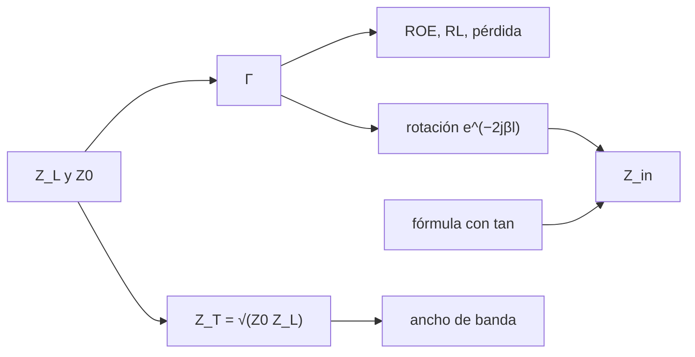

# B49-C02 — Adaptación de impedancias y líneas de transmisión en antenas

<!-- nav:top -->
[🏠 Programa](../../../../README.md) · [📚 Bloque B49](../../../tronco-comun/B49-antenas-y-receptores-de-radioastronomia.md) · [← Anterior: B49-C01 — Antenas de hilo: dipolo, monopolo e impedancia de radiación](../B49-C01-antenas-de-hilo-dipolo-monopolo-e-impedancia-de-radiacion/CLASE.md) · [Siguiente: B49-C03 — Apuntamiento y seguimiento de radiotelescopios: modelos de apuntado y errores →](../B49-C03-apuntamiento-y-seguimiento-de-radiotelescopios-modelos-de-apuntado-y-errores/CLASE.md)
<!-- /nav -->

## 1. Ubicación, nivel y alcance

Clase 2 del bloque B49. Nivel N3. La antena y el receptor tienen impedancias distintas; la línea que los une refleja parte de la potencia. Aquí calculas el **coeficiente de reflexión**, la **ROE** y la pérdida por desadaptación, la impedancia de entrada por dos vías (fórmula con tangente y rotación en la **carta de Smith**), el patrón de ondas estacionarias y un **transformador de cuarto de onda**. Usas [B05](../../../tronco-comun/B05-fisica-fundamental-para-el-espacio.md) y [B10](../../../tronco-comun/B10-algebra-lineal-y-matematicas-geometricas.md); la carga de 73,08 Ω viene de B49-C01.

## 2. Por qué esta clase existe

Una antena desadaptada devuelve potencia y empeora la sensibilidad. La decisión central: **¿cuánta potencia se refleja y cómo se adapta con un tramo de línea?**

## 3. Lo que podrás hacer al terminar

1. Calcular `Γ`, la ROE y la pérdida por desadaptación.
2. Obtener `Z_in` con la tangente y con la carta de Smith.
3. Medir la ROE a partir del patrón de ondas estacionarias.
4. Diseñar un transformador de cuarto de onda.
5. Hallar su ancho de banda con una perdida de retorno de 20 dB.
6. Convertir longitud eléctrica en longitud física con el factor de velocidad.

La evidencia es la **ficha de la adaptación de impedancias** del ejercicio 12 (sección 20).

## 4. Con qué llegas y cómo comprobarlo

1. ¿Qué es una incertidumbre?
2. ¿Qué es una simulación Monte Carlo?
3. ¿Qué es una tabla de resultados?
4. ¿Qué es un valor ilustrativo?
5. ¿Qué es una verificación?

<details>
<summary>Ver respuestas</summary>

1. Un intervalo en que se espera el valor verdadero. 2. Repetir con números aleatorios de semilla fija. 3. Un resumen ordenado de cálculos. 4. Un valor propuesto para el ejemplo, no medido. 5. Comparar un cálculo con un caso independiente.
</details>

Con cuatro o cinco aciertos, sigue; si no, repasa los prerrequisitos.

## 5. Un caso de contexto y casos de referencia

Una carga de `73,08 Ω` en una línea de `50 Ω` da `|Γ| = 0,1875`, ROE `1,4616` y `3,516 %` de potencia reflejada (`0,155 dB`). Un transformador de `60,448 Ω` y `0,32977 m` a 150 MHz (factor 0,66) la adapta y mantiene una pérdida de retorno de 20 dB entre `0,6475 f₀` y `1,3525 f₀`. Es el **ejemplo conductor**; valores ilustrativos.

## 6. Vocabulario

El **coeficiente de reflexión** `Γ = (Z_L − Z₀)/(Z_L + Z₀)`. La **ROE** (razón de onda estacionaria) `(1 + |Γ|)/(1 − |Γ|)`. La **pérdida de retorno** `−20 log₁₀|Γ|`. La **carta de Smith** representa `Γ` en el plano complejo. La **longitud eléctrica** `βl`. El **factor de velocidad** es `v/c` en el cable.

## 7. Modelo mental: un eco en un pasillo

Como el eco en un pasillo que se estrecha: una parte del sonido vuelve; con un tramo intermedio de ancho adecuado, el eco casi desaparece a una frecuencia.



*Descripción textual:* la carga fija `Γ`; la línea la rota; un tramo de cuarto de onda la anula a una frecuencia.

Analogía: un eco en un pasillo. Límite: línea sin pérdidas, carga independiente de la frecuencia.

## 8. La explicación, paso a paso

### 8.1 Reflexión

| Z_L (Ω) | Módulo de Γ | ROE | RL (dB) | pérdida (dB) | reflejada % |
|---|---|---|---|---|---|
| 50 | 0,0000 | 1,0000 | — | 0,00000 | 0,000 |
| 73,08 | 0,1875 | 1,4616 | 14,539 | 0,15546 | 3,516 |
| 100 | 0,3333 | 2,0000 | 9,542 | 0,51153 | 11,111 |
| 25 | 0,3333 | 2,0000 | 9,542 | 0,51153 | 11,111 |
| 10 | 0,6667 | 5,0000 | 3,522 | 2,55273 | 44,444 |
| 50 + j50 | 0,4472 | 2,6180 | 6,990 | 0,96910 | 20,000 |
| 200 | 0,6000 | 4,0000 | 4,437 | 1,93820 | 36,000 |

### 8.2 Dos vías para `Z_in`

Con `Z_L = 73,08 + j20 Ω`: a `l = 0,05 λ`, `Z_in = 82,2353 − j3,2272 Ω`; a `0,125 λ`, `58,5513 − j25,9642 Ω`; a `0,25 λ`, `31,8255 − j8,7098 Ω` (que es `Z₀²/Z_L`); a `0,5 λ` se repite `Z_L`. La fórmula con tangente y la rotación de Smith difieren menos de `4,4 × 10⁻¹⁶` en términos relativos. El patrón de ondas estacionarias de esa carga da ROE muestreada `1,64872`, igual a la analítica (`|Γ| = 0,24492`).

### 8.3 Transformador

`Z_T = √(50 × 73,08) = 60,4483 Ω`.

| f/f₀ | Módulo de Γ directo | Módulo de Γ con transf. | RL con transf. (dB) |
|---|---|---|---|
| 0,5 | 0,18752 | 0,133778 | 17,472 |
| 0,7 | 0,18752 | 0,086346 | 21,275 |
| 0,9 | 0,18752 | 0,029851 | 30,501 |
| 1,0 | 0,18752 | 0,000000 | — |
| 1,1 | 0,18752 | 0,029851 | 30,501 |
| 1,3 | 0,18752 | 0,086346 | 21,275 |

La perdida de retorno supera 20 dB entre `0,6475` y `1,3525` de `f₀` (ancho fraccional `0,7050`).

### 8.4 Lectura

Una ROE de 1,46 pierde solo 0,155 dB; una de 5 pierde 2,55 dB. El transformador adapta exactamente en una frecuencia y degrada suavemente fuera de ella. Una antena real no tiene una carga constante con la frecuencia: aquí no se modela.

## 9. Magnitudes, símbolos y unidades

| Símbolo | Qué es | Unidad | Valor / nota |
|---|---|---|---|
| `Γ` | coeficiente de reflexión | — | 0,1875 |
| ROE | razón de onda estacionaria | — | 1,4616 |
| `Z₀` | impedancia característica | Ω | 50 (ilustrativo) |
| `Z_T` | impedancia del transformador | Ω | 60,4483 |
| `v_f` | factor de velocidad | — | 0,66 (ilustrativo) |

## 10. Convenciones y referencias

Sin constantes propias; `Z_L = 73,08 Ω` de B49-C01 (NIST); `Z₀`, frecuencia y factor de velocidad **ilustrativos**.

## 11. De dónde sale lo que afirmamos

| ID | Fuente | Localizador | Respalda | Estado |
|---|---|---|---|---|
| S1 | NIST, *Fundamental Physical Constants* (CODATA 2022) | https://physics.nist.gov/cuu/Constants/Table/allascii.txt | constantes citadas en la sección 9 | Consultada el 2026-11-09 |

Límites: Las fórmulas de línea sin pérdidas son estándar (texto no consultado) y se validaron por dos vías independientes y con el patrón de ondas estacionarias muestreado.

## 12. Cómo ver la pérdida por desadaptación

| ROE | reflejada % | pérdida (dB) |
|---|---|---|
| 1,4616 | 3,516 | 0,15546 |
| 2,0 | 11,111 | 0,51153 |
| 4,0 | 36,000 | 1,93820 |
| 5,0 | 44,444 | 2,55273 |

Descripción larga: a mayor ROE más potencia vuelve y más se pierde.

## 13. Ejemplo trabajado: el transformador de cuarto de onda

**Paso 1 · Impedancia.** `Z_T = √(50 × 73,08) = 60,4483 Ω`.

**Paso 2 · Longitud.** `l = 0,66 c/(4 f) = 0,32977 m` a 150 MHz.

**Paso 3 · Entrada.** `Z_in = Z_T²/Z_L = 50 Ω`, luego `Γ = 0`.

**Paso 4 · Banda.** Barriendo `f/f₀`, RL ≥ 20 dB en `0,6475–1,3525`.

## 14. Distintas formas de describir el mismo resultado

**Por fórmula:** `Γ` y ROE. **Por carta de Smith:** rotación de `Γ`. **Por tabla:** pérdida y reflejada. **Por código:** `linea_adaptacion.py`.

## 15. Práctica guiada

**Ejercicio 1 · con los pasos indicados.** `Γ` de 100 Ω en 50 Ω. *Pasos:* ejemplo 13.

<details><summary>Solución comentada</summary>

`50/150 = 0,3333`.
</details>

**Ejercicio 2 · con una pista.** ROE de ese caso.

<details><summary>Solución comentada</summary>

`1,3333/0,6667 = 2,0`.
</details>

**Ejercicio 3 · casi autónomo.** Pérdida de retorno.

<details><summary>Solución comentada</summary>

`−20 log₁₀ 0,3333 = 9,54 dB`.
</details>

## 16. Práctica autónoma, transferencia e integrador

**Ejercicio 4.** Potencia reflejada de la carga de 200 Ω.

<details><summary>Solución comentada</summary>

`0,6² = 36 %`.
</details>

**Ejercicio 5.** Pérdida por desadaptación de 10 Ω.

<details><summary>Solución comentada</summary>

`−10 log₁₀(1 − 0,4444) = 2,553 dB`.
</details>

**Ejercicio 6.** Transformador para 100 Ω entre 50 Ω y 200 Ω.

<details><summary>Solución comentada</summary>

`√(50 × 200) = 100 Ω`.
</details>

**Ejercicio 7.** Longitud física de un cuarto de onda a 150 MHz con `v_f = 0,66`.

<details><summary>Solución comentada</summary>

`0,32977 m`.
</details>

**Ejercicio 8.** ¿Qué `Z_in` da una línea de `λ/4` y `Z₀ = 50` con carga `73,08 + j20`?

<details><summary>Solución comentada</summary>

`2500/(73,08 + j20) = 31,83 − j8,71 Ω`.
</details>

**Ejercicio 9 · transferencia.** **Transferencia.** Un compañero dice que con ROE de 2 se pierde la mitad de la señal. Responde.

<details><summary>Solución comentada</summary>

Se refleja el 11,1 % (0,51 dB), no la mitad.
</details>

**Ejercicio 10 · transferencia.** **Transferencia.** ¿Por qué el transformador solo es perfecto en `f₀`?

<details><summary>Solución comentada</summary>

Su longitud es `λ/4` solo en `f₀`; fuera, `Γ` crece como muestra 8.3.
</details>

**Ejercicio 11 · transferencia.** **Transferencia.** ¿Qué limita aplicar esto a una antena real?

<details><summary>Solución comentada</summary>

Su impedancia varía con la frecuencia; el modelo usa una carga constante.
</details>

**Ejercicio 12.** **Integrador.** Elabora tu *ficha de la adaptación de impedancias*: `Γ`, ROE, pérdida y transformador de una carga.

<details><summary>Solución comentada</summary>

Secciones 8.1–8.4.
</details>

**Ejercicio 12 · integrador.** **Integrador.** Elabora tu *ficha de la adaptación de impedancias*: `Γ`, ROE, pérdida y transformador de una carga.

<details><summary>Solución modelo</summary>

Secciones 8.1–8.4.
</details>

## 17. Laboratorio: reflexión y transformador

El script [linea_adaptacion.py](linea_adaptacion.py) calcula `Γ`, `Z_in` por dos vías, la ROE muestreada y el ancho de banda del transformador (**comprueba** `10⁻⁹` y `10⁻³`).

**Datos:** constante del dipolo de B49-C01 (NIST); línea y cable **ilustrativos**. **Predice antes de ejecutar:** ¿cuánto se refleja con ROE 2? (11,1 %.) **Ejecución del 2026-11-09 (Python 3.12.9):**

```text
Python 3.12.9 (biblioteca estandar)
        ZL (ohm)  |Gamma|      ROE  RL (dB)  perdida (dB)  potencia reflejada %
            50.0   0.0000   1.0000      inf       0.00000                 0.000
           73.08   0.1875   1.4616   14.539       0.15546                 3.516
           100.0   0.3333   2.0000    9.542       0.51153                11.111
            25.0   0.3333   2.0000    9.542       0.51153                11.111
            10.0   0.6667   5.0000    3.522       2.55273                44.444
        (50+50j)   0.4472   2.6180    6.990       0.96910                20.000
           200.0   0.6000   4.0000    4.437       1.93820                36.000
Impedancia de entrada de una linea de 50 ohm cargada con 73,08 + j20 ohm segun la longitud electrica:
 l/lambda             Zin tangente                Zin Smith  dif relativa
    0.000     73.0800  +20.0000j     73.0800  +20.0000j      1.93e-16
    0.050     82.2353   -3.2272j     82.2353   -3.2272j      4.32e-17
    0.125     58.5513  -25.9642j     58.5513  -25.9642j      3.37e-16
    0.250     31.8255   -8.7098j     31.8255   -8.7098j      2.41e-16
    0.300     30.3538   +1.1912j     30.3538   +1.1912j      2.43e-16
    0.500     73.0800  +20.0000j     73.0800  +20.0000j      1.88e-16
Carga 73,08 + j20: |Gamma| = 0.24492 ; ROE analitica = 1.64872 ; ROE muestreada = 1.64872
Transformador de cuarto de onda entre 50 y 73,08 ohm: Z_T = sqrt(50 x 73,08) = 60.4483 ohm
A 150 MHz con factor de velocidad 0.66: longitud electrica de cuarto de onda = 0.32977 m
  f/f0  |Gamma| directo  |Gamma| con transf.  RL con transf. (dB)
  0.50          0.18752             0.133778               17.472
  0.60          0.18752             0.111512               19.054
  0.70          0.18752             0.086346               21.275
  0.80          0.18752             0.058891               24.599
  0.90          0.18752             0.029851               30.501
  1.00          0.18752             0.000000                  inf
  1.10          0.18752             0.029851               30.501
  1.20          0.18752             0.058891               24.599
  1.30          0.18752             0.086346               21.275
  1.40          0.18752             0.111512               19.054
  1.50          0.18752             0.133778               17.472
RL >= 20 dB para f/f0 entre 0.6475 y 1.3525 (ancho fraccional 0.7050)
Pruebas superadas.
```

```bash
python programa/clases/B49/B49-C02-adaptacion-de-impedancias-y-lineas-de-transmision-en-antenas/linea_adaptacion.py
```

**Límites:** línea sin pérdidas, carga constante.

## 18. Errores frecuentes y cómo corregirlos

**Confundir ROE y pérdida de retorno.** Se corrige con 8.1.

**Creer que el transformador adapta toda la banda.** Se corrige con 8.3.

**Usar la longitud en el vacío en lugar de la del cable.** Se corrige con el factor de velocidad.

**Olvidar la parte imaginaria de la carga.** Se corrige con 8.2.

## 19. Cómo sabrás que vas bien

Tras la sección 8: ¿qué resultado esperabas y cuál obtuviste? Si dudas, repasa el ejemplo 13. Tras el laboratorio: ¿qué comprueba? (ver la sección 17).

## 20. Qué entregas y cómo se evalúa

El producto es tu **ficha de la adaptación de impedancias** (ejercicio 12).

| Criterio | Inicial | En desarrollo | Logrado | Destacado |
|---|---|---|---|---|
| Conceptos | Los confunde | Parciales | conceptos de la clase | Explica los límites |
| Cálculo | Sin unidades | Con errores | Tablas completas | Calcula casos nuevos |
| Numérico | Sin comprobar | Un caso | Contraste con el análisis | Interpreta las diferencias |
| Fuentes | Sin fuente | Sin fecha | fuentes con fecha | Declara lo ilustrativo |
| Límites | No los nombra | Uno | Tres | Discute qué falta del modelo |

**Condiciones críticas (no se compensan con promedio):** rotular las impedancias como ilustrativas; no presentar el cable como medido; citar solo lo consultado.

## 21. Ética, seguridad y límites

Clase educativa: los modelos son simplificados. Accesibilidad: tablas equivalentes a las gráficas, fórmulas en texto, ejercicios sin conexión.

## 22. Para cerrar y seguir

`Γ` y ROE cuantifican el eco; el cuarto de onda lo anula en una frecuencia y mantiene RL ≥ 20 dB en un 70 % de ancho fraccional. Queda una pregunta: ¿cómo se apunta una antena grande con precisión?

**Glosario español–inglés.** coeficiente de reflexión · *reflection coefficient*; ROE · *VSWR*; carta de Smith · *Smith chart*; pérdida de retorno · *return loss*; factor de velocidad · *velocity factor*.

**Continuidad.** [B49-C03](../B49-C03-apuntamiento-y-seguimiento-de-radiotelescopios-modelos-de-apuntado-y-errores/CLASE.md) estudia el apuntamiento y el seguimiento de radiotelescopios.

**Referencias:** ver sección 11.

<!-- nav:bottom -->
---

[← Anterior: B49-C01 — Antenas de hilo: dipolo, monopolo e impedancia de radiación](../B49-C01-antenas-de-hilo-dipolo-monopolo-e-impedancia-de-radiacion/CLASE.md) · [📚 Bloque B49](../../../tronco-comun/B49-antenas-y-receptores-de-radioastronomia.md) · [Siguiente: B49-C03 — Apuntamiento y seguimiento de radiotelescopios: modelos de apuntado y errores →](../B49-C03-apuntamiento-y-seguimiento-de-radiotelescopios-modelos-de-apuntado-y-errores/CLASE.md)
<!-- /nav -->
