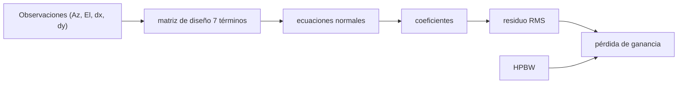

# B49-C03 — Apuntamiento y seguimiento de radiotelescopios: modelos de apuntado y errores

<!-- nav:top -->
[🏠 Programa](../../../../README.md) · [📚 Bloque B49](../../../tronco-comun/B49-antenas-y-receptores-de-radioastronomia.md) · [← Anterior: B49-C02 — Adaptación de impedancias y líneas de transmisión en antenas](../B49-C02-adaptacion-de-impedancias-y-lineas-de-transmision-en-antenas/CLASE.md) · [Siguiente: B49-C04 — Arreglos de antenas: factor de arreglo y formación de haz →](../B49-C04-arreglos-de-antenas-factor-de-arreglo-y-formacion-de-haz/CLASE.md)
<!-- /nav -->

## 1. Ubicación, nivel y alcance

Clase 3 del bloque B49. Nivel N3. Una antena grande apunta con errores sistemáticos por montaje y por gravedad. Aquí ajustas por **mínimos cuadrados** un modelo de siete términos (IA, IE, CA, NPAE, AN, AW y flexión) a observaciones sintéticas de calibradores y calculas la **pérdida de ganancia** que deja el error residual. Usas [B12](../../../tronco-comun/B12-probabilidad-estadistica-e-incertidumbre.md), [B10](../../../tronco-comun/B10-algebra-lineal-y-matematicas-geometricas.md) y [B05](../../../tronco-comun/B05-fisica-fundamental-para-el-espacio.md). B43 trata monturas ópticas; aquí el caso es una antena de 25 m a 22 GHz (ilustrativa).

## 2. Por qué esta clase existe

Con un haz estrecho, un error de apuntado pequeño pierde ganancia. La decisión central: **¿qué términos modelar, y cuánto error residual queda frente al ancho del haz?**

## 3. Lo que podrás hacer al terminar

1. Escribir las filas de diseño de los siete términos.
2. Resolver las ecuaciones normales.
3. Comparar coeficientes con su error formal.
4. Verificar el RMS residual frente al ruido.
5. Calcular el ancho del haz `1,2 λ/D`.
6. Convertir el error en pérdida de ganancia.

La evidencia es la **ficha del modelo de apuntado** del ejercicio 12 (sección 20).

## 4. Con qué llegas y cómo comprobarlo

1. ¿Qué es una incertidumbre?
2. ¿Qué es una simulación Monte Carlo?
3. ¿Qué es una tabla de resultados?
4. ¿Qué es un valor ilustrativo?
5. ¿Qué es una verificación?

<details>
<summary>Ver respuestas</summary>

1. Un intervalo en que se espera el valor verdadero. 2. Repetir con números aleatorios de semilla fija. 3. Un resumen ordenado de cálculos. 4. Un valor propuesto para el ejemplo, no medido. 5. Comparar un cálculo con un caso independiente.
</details>

Con cuatro o cinco aciertos, sigue; si no, repasa los prerrequisitos.

## 5. Un caso de contexto y casos de referencia

Con 150 calibradores (300 mediciones) y ruido de `5` segundos de arco, el RMS por eje baja de `28,797″` a `5,074″` (esperado `4,941″`). El haz mide `134,92″`; el error radial pasa de `40,72″` (`1,097 dB`) a `7,18″` (`0,034 dB`). Es el **ejemplo conductor**; todo es sintético.

## 6. Vocabulario

El **desplazamiento de cero** (IA, IE). La **colimación** (CA). La **no perpendicularidad de ejes** (NPAE). La **inclinación del eje de azimut** (AN, AW). La **flexión gravitatoria** (FLEX). El **residuo** es lo que el modelo no explica. El **ancho a mitad de potencia** (HPBW) mide el haz.

## 7. Modelo mental: afinar una brújula

Como corregir una brújula con una tabla de desvíos: se mide hacia puntos conocidos y se ajustan las correcciones.



*Descripción textual:* las observaciones fijan los coeficientes; el residuo, comparado con el haz, fija la pérdida.

Analogía: afinar una brújula. Límite: primer orden, sin viento ni refracción.

## 8. La explicación, paso a paso

### 8.1 Coeficientes (segundos de arco)

| término | verdad | ajuste | error formal | (ajuste − verdad)/error |
|---|---|---|---|---|
| IA | 30,00 | 29,978 | 5,095 | −0,00 |
| IE | −20,00 | −19,308 | 1,001 | 0,69 |
| CA | 12,00 | 9,325 | 7,512 | −0,36 |
| NPAE | 8,00 | 11,357 | 6,247 | 0,54 |
| AN | 15,00 | 15,519 | 0,462 | 1,12 |
| AW | −10,00 | −10,246 | 0,456 | −0,54 |
| FLEX | 25,00 | 23,475 | 1,571 | −0,97 |

### 8.2 Residuo y haz

RMS antes `28,797″`; después `5,074″`; esperado `σ√((n − p)/n) = 4,941″`. `λ = 13,6269 mm` y `HPBW = 134,92″`.

| error radial (″) | e/HPBW | pérdida (dB) |
|---|---|---|
| 40,72 | 0,3019 | 1,0971 |
| 20,00 | 0,1482 | 0,2646 |
| 10,00 | 0,0741 | 0,0662 |
| 7,18 | 0,0532 | 0,0341 |

### 8.3 Lectura

Los términos AN y AW se determinan bien (0,46″) porque dependen del azimut; IA y CA tienen errores grandes (5,1″ y 7,5″) porque ambos son casi constantes en el cielo: están **correlacionados**. Aun así todos caen dentro de 1,2 desviaciones. El modelo no incluye viento ni refracción.

## 9. Magnitudes, símbolos y unidades

| Símbolo | Qué es | Unidad | Valor / nota |
|---|---|---|---|
| `dx, dy` | error en elevación cruzada y en elevación | ″ | — |
| `σ` | ruido por medición | ″ | 5 (sintético) |
| `p, n` | parámetros y mediciones | — | 7 y 300 |
| `HPBW` | ancho a mitad de potencia | ″ | 134,92 |
| `λ` | longitud de onda | mm | 13,6269 (22 GHz) |

## 10. Convenciones y referencias

NIST (`c`); observaciones, coeficientes y antena **sintéticos**.

## 11. De dónde sale lo que afirmamos

| ID | Fuente | Localizador | Respalda | Estado |
|---|---|---|---|---|
| S1 | NIST, *Fundamental Physical Constants* (CODATA 2022) | https://physics.nist.gov/cuu/Constants/Table/allascii.txt | constantes citadas en la sección 9 | Consultada el 2026-11-09 |

Límites: El modelo de siete términos es el clásico de las antenas altazimutales (texto no consultado). Los números son sintéticos y no describen ninguna antena real.

## 12. Cómo ver el residuo del ajuste

| etapa | RMS (″) |
|---|---|
| antes | 28,797 |
| después | 5,074 |
| esperado | 4,941 |

Descripción larga: el ajuste reduce el error sistemático hasta el nivel del ruido.

## 13. Ejemplo trabajado: el residuo y la pérdida

**Paso 1 · Haz.** `1,2 × 13,6269 mm / 25 m = 6,541 × 10⁻⁴ rad = 134,9″`.

**Paso 2 · Radial.** `√2 × 5,074 = 7,18″`.

**Paso 3 · Cociente.** `7,18/134,92 = 0,0532`.

**Paso 4 · Pérdida.** `4 ln2 × 0,0532² = 0,00785`, o `0,0341 dB`.

## 14. Distintas formas de describir el mismo resultado

**Por matriz:** ecuaciones normales. **Por tabla:** coeficientes. **Por fórmula:** `exp(−4 ln2 (e/HPBW)²)`. **Por código:** `apuntado.py`.

## 15. Práctica guiada

**Ejercicio 1 · con los pasos indicados.** `HPBW` en radianes. *Pasos:* ejemplo 13.

<details><summary>Solución comentada</summary>

`1,2 λ/D = 6,541 × 10⁻⁴ rad`.
</details>

**Ejercicio 2 · con una pista.** Error radial de 5,074″ por eje. *Pasos:* `√2`.

<details><summary>Solución comentada</summary>

`7,18″`.
</details>

**Ejercicio 3 · casi autónomo.** Cociente de RMS antes/después.

<details><summary>Solución comentada</summary>

`28,797/5,074 = 5,67`.
</details>

## 16. Práctica autónoma, transferencia e integrador

**Ejercicio 4.** Pérdida de 20″ radiales.

<details><summary>Solución comentada</summary>

`0,2646 dB`.
</details>

**Ejercicio 5.** Desviaciones de AN: `(15,519 − 15)/0,462`.

<details><summary>Solución comentada</summary>

`1,12`.
</details>

**Ejercicio 6.** Grados de libertad.

<details><summary>Solución comentada</summary>

`300 − 7 = 293`.
</details>

**Ejercicio 7.** RMS esperado con `σ = 5`.

<details><summary>Solución comentada</summary>

`5√(293/300) = 4,941″`.
</details>

**Ejercicio 8.** Fracción del HPBW en 10″.

<details><summary>Solución comentada</summary>

`0,0741`.
</details>

**Ejercicio 9 · transferencia.** **Transferencia.** Un compañero afirma que estos coeficientes son de una antena real. Responde.

<details><summary>Solución comentada</summary>

Son sintéticos.
</details>

**Ejercicio 10 · transferencia.** **Transferencia.** ¿Por qué IA y CA tienen errores grandes?

<details><summary>Solución comentada</summary>

Su efecto es casi constante en el cielo y se confunden.
</details>

**Ejercicio 11 · transferencia.** **Transferencia.** ¿Qué haría falta para modelar el viento?

<details><summary>Solución comentada</summary>

Términos dependientes del tiempo; no se modelan.
</details>

**Ejercicio 12.** **Integrador.** Elabora tu *ficha del modelo de apuntado*: coeficientes, residuo y pérdida.

<details><summary>Solución comentada</summary>

Secciones 8.1–8.3.
</details>

**Ejercicio 12 · integrador.** **Integrador.** Elabora tu *ficha del modelo de apuntado*: coeficientes, residuo y pérdida.

<details><summary>Solución modelo</summary>

Secciones 8.1–8.3.
</details>

## 17. Laboratorio: modelo de apuntado

El script [apuntado.py](apuntado.py) ajusta siete términos por mínimos cuadrados y calcula la pérdida (**comprueba** 4 desviaciones y el RMS a 8 %).

**Datos:** `c` de NIST; observaciones **sintéticas**. **Predice antes de ejecutar:** ¿cuánto se pierde con 1/10 del haz? (≈ 0,1 dB.) **Ejecución del 2026-11-09 (Python 3.12.9):**

```text
Python 3.12.9 (biblioteca estandar)
150 calibradores, 300 mediciones, 7 parametros, sigma de ruido = 5.0 segundos de arco
 termino   verdad    ajuste  error formal  (ajuste-verdad)/error
      IA    30.00    29.978         5.095                  -0.00
      IE   -20.00   -19.308         1.001                   0.69
      CA    12.00     9.325         7.512                  -0.36
    NPAE     8.00    11.357         6.247                   0.54
      AN    15.00    15.519         0.462                   1.12
      AW   -10.00   -10.246         0.456                  -0.54
    FLEX    25.00    23.475         1.571                  -0.97
RMS antes del ajuste = 28.797 ; RMS residual = 5.074 ; esperado sigma sqrt((n-p)/n) = 4.941 segundos de arco
lambda = 13.6269 mm ; HPBW = 1,2 lambda/D = 134.92 segundos de arco con D = 25 m
error radial (arcsec)   e/HPBW   perdida de ganancia (dB)
                40.72   0.3019                     1.0971
                20.00   0.1482                     0.2646
                10.00   0.0741                     0.0662
                 7.18   0.0532                     0.0341
Pruebas superadas.
```

```bash
python programa/clases/B49/B49-C03-apuntamiento-y-seguimiento-de-radiotelescopios-modelos-de-apuntado-y-errores/apuntado.py
```

**Límites:** primer orden, sin viento ni refracción.

## 18. Errores frecuentes y cómo corregirlos

**Confundir ruido y error sistemático.** Se corrige con 8.2.

**Interpretar un coeficiente con error grande como pequeño.** Se corrige con 8.1.

**Aplicar el error por eje como radial.** Se corrige con el paso 2.

**Presentar el modelo sintético como real.** Se corrige con la sección 10.

## 19. Cómo sabrás que vas bien

Tras la sección 8: ¿qué resultado esperabas y cuál obtuviste? Si dudas, repasa el ejemplo 13. Tras el laboratorio: ¿qué comprueba? (ver la sección 17).

## 20. Qué entregas y cómo se evalúa

El producto es tu **ficha del modelo de apuntado** (ejercicio 12).

| Criterio | Inicial | En desarrollo | Logrado | Destacado |
|---|---|---|---|---|
| Conceptos | Los confunde | Parciales | conceptos de la clase | Explica los límites |
| Cálculo | Sin unidades | Con errores | Tablas completas | Calcula casos nuevos |
| Numérico | Sin comprobar | Un caso | Contraste con el análisis | Interpreta las diferencias |
| Fuentes | Sin fuente | Sin fecha | fuentes con fecha | Declara lo ilustrativo |
| Límites | No los nombra | Uno | Tres | Discute qué falta del modelo |

**Condiciones críticas (no se compensan con promedio):** rotular todo como sintético; no atribuir coeficientes a antenas reales; citar solo lo consultado.

## 21. Ética, seguridad y límites

Clase educativa: los modelos son simplificados. Accesibilidad: tablas equivalentes a las gráficas, fórmulas en texto, ejercicios sin conexión.

## 22. Para cerrar y seguir

Siete términos reducen el error de 28,8″ a 5,1″ por eje y la pérdida de 1,10 dB a 0,03 dB. Queda una pregunta: ¿cómo se combinan muchas antenas en un haz?

**Glosario español–inglés.** modelo de apuntado · *pointing model*; flexión · *flexure*; colimación · *collimation*; mínimos cuadrados · *least squares*; residuo · *residual*.

**Continuidad.** [B49-C04](../B49-C04-arreglos-de-antenas-factor-de-arreglo-y-formacion-de-haz/CLASE.md) estudia arreglos de antenas y formación de haz.

**Referencias:** ver sección 11.

<!-- nav:bottom -->
---

[← Anterior: B49-C02 — Adaptación de impedancias y líneas de transmisión en antenas](../B49-C02-adaptacion-de-impedancias-y-lineas-de-transmision-en-antenas/CLASE.md) · [📚 Bloque B49](../../../tronco-comun/B49-antenas-y-receptores-de-radioastronomia.md) · [Siguiente: B49-C04 — Arreglos de antenas: factor de arreglo y formación de haz →](../B49-C04-arreglos-de-antenas-factor-de-arreglo-y-formacion-de-haz/CLASE.md)
<!-- /nav -->
