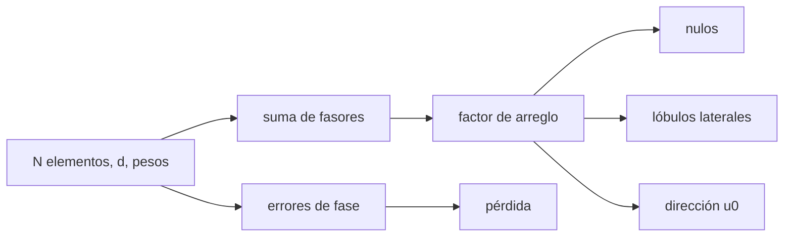

# B49-C04 — Arreglos de antenas: factor de arreglo y formación de haz

<!-- nav:top -->
[🏠 Programa](../../../../README.md) · [📚 Bloque B49](../../../tronco-comun/B49-antenas-y-receptores-de-radioastronomia.md) · [← Anterior: B49-C03 — Apuntamiento y seguimiento de radiotelescopios: modelos de apuntado y errores](../B49-C03-apuntamiento-y-seguimiento-de-radiotelescopios-modelos-de-apuntado-y-errores/CLASE.md) · [Siguiente: B49-C05 — Medición y calibración de patrones de antena →](../B49-C05-medicion-y-calibracion-de-patrones-de-antena/CLASE.md)
<!-- /nav -->

## 1. Ubicación, nivel y alcance

Clase 4 del bloque B49. Nivel N3. Varias antenas sumadas con fase y peso forman un haz que se dirige sin mover nada. Aquí calculas el **factor de arreglo** de 8 elementos con separación de media longitud de onda, sus **nulos** y **lóbulos laterales**, el efecto de ponderar (Hann, Hamming), el **direccionamiento** a 30° y la pérdida por errores de fase aleatorios. Usas [B10](../../../tronco-comun/B10-algebra-lineal-y-matematicas-geometricas.md), [B12](../../../tronco-comun/B12-probabilidad-estadistica-e-incertidumbre.md) y [B05](../../../tronco-comun/B05-fisica-fundamental-para-el-espacio.md). Se apoya en B46-C14 (líneas de base) y en C01 de este bloque (elemento).

## 2. Por qué esta clase existe

El arreglo cambia ancho de haz, lóbulos laterales y ganancia según los pesos. La decisión central: **¿qué pesos y qué separación dan el haz y el nivel de lóbulos que se necesitan?**

## 3. Lo que podrás hacer al terminar

1. Sumar fasores y compararlos con la forma cerrada.
2. Localizar los nulos `u = mλ/(Nd)`.
3. Medir ancho, lóbulo lateral y directividad con distintos pesos.
4. Dirigir el haz y ver el ensanchamiento `1/cosθ`.
5. Reconocer lóbulos de rejilla.
6. Estimar la pérdida por errores de fase.

La evidencia es la **ficha del factor de arreglo** del ejercicio 12 (sección 20).

## 4. Con qué llegas y cómo comprobarlo

1. ¿Qué es una incertidumbre?
2. ¿Qué es una simulación Monte Carlo?
3. ¿Qué es una tabla de resultados?
4. ¿Qué es un valor ilustrativo?
5. ¿Qué es una verificación?

<details>
<summary>Ver respuestas</summary>

1. Un intervalo en que se espera el valor verdadero. 2. Repetir con números aleatorios de semilla fija. 3. Un resumen ordenado de cálculos. 4. Un valor propuesto para el ejemplo, no medido. 5. Comparar un cálculo con un caso independiente.
</details>

Con cuatro o cinco aciertos, sigue; si no, repasa los prerrequisitos.

## 5. Un caso de contexto y casos de referencia

Con `N = 8` y `d = 0,5 λ`, el arreglo uniforme tiene ancho `12,804°`, primer nulo en `14,478°`, lóbulo lateral `−12,797 dB` y `D = 9,031 dBi`. Con pesos de Hann, el lateral baja a `−31,752 dB` y el ancho sube a `18,428°`. Un error de fase de 10° rms cuesta `0,1172 dB`. Es el **ejemplo conductor**; los pesos y la geometría son ilustrativos.

## 6. Vocabulario

El **factor de arreglo** es la suma de las contribuciones de los elementos. El **peso** es la amplitud y fase de cada uno. El **nulo** es una dirección sin respuesta. El **lóbulo lateral** es un máximo secundario. El **lóbulo de rejilla** es un máximo principal extra por separación grande. La **ponderación** (apodización) baja los lóbulos y ensancha el haz.

## 7. Modelo mental: un coro

Como un coro: si todos cantan en fase se oye fuerte en una dirección; cambiar los retardos orienta el sonido sin mover a nadie.



*Descripción textual:* los pesos y la geometría fijan el factor de arreglo; los nulos, lóbulos y la dirección salen de él.

Analogía: un coro. Límite: elementos isotrópicos, sin acoplamiento mutuo.

## 8. La explicación, paso a paso

### 8.1 Dos vías y nulos

La suma de fasores y la forma cerrada difieren `4,44 × 10⁻¹⁶` como máximo. Los nulos están en `u = 0,25; 0,50; 0,75` (14,478°, 30,000°, 48,590°), con AF del orden de `10⁻¹⁵`.

### 8.2 Pesos

| pesos | HPBW (°) | primer mínimo (°) | lóbulo lateral (dB) | D (dBi) | eficiencia |
|---|---|---|---|---|---|
| uniforme | 12,804 | 14,478 | −12,797 | 9,031 | 1,0000 |
| Hann | 18,428 | 26,388 | −31,752 | 7,782 | 0,7500 |
| Hamming | 20,408 | 42,144 | −33,621 | 7,279 | 0,6680 |

### 8.3 Dirección, rejilla y fase

Con el haz a 30°, el pico está en `30,0000°` y el ancho en `u` es el mismo (`0,11150`); el ancho angular crece a `14,754°`. Con `d = 1 λ` aparecen máximos principales en `u = ±1`; con `0,5 λ`, solo en `u = 0`. Con 10° rms de error de fase, la potencia en el pico simulada es `0,97337` y la teórica `0,97375` (`0,1172 dB`).

### 8.4 Lectura

Ponderar baja los lóbulos 19 a 21 dB, a costa de 1,2 a 1,8 dB de directividad y un haz más ancho. En Hamming con 8 elementos, el «primer mínimo» se ha fusionado con la caída del lóbulo principal, por eso se da su ubicación como primer mínimo local.

## 9. Magnitudes, símbolos y unidades

| Símbolo | Qué es | Unidad | Valor / nota |
|---|---|---|---|
| `N` | elementos | — | 8 |
| `d` | separación | `λ` | 0,5 |
| `u` | `sin θ` | — | — |
| `w_n` | pesos | — | uniforme, Hann, Hamming |
| `σ_φ` | error de fase | rad | `10° = 0,1745` |

## 10. Convenciones y referencias

Sin constantes; pesos, geometría y errores de fase **ilustrativos** con semilla `20261109`.

## 11. De dónde sale lo que afirmamos

| ID | Fuente | Localizador | Respalda | Estado |
|---|---|---|---|---|
| — | Sin fuente externa | — | relaciones estándar que verifica el laboratorio | No se consultó una fuente para esta clase |

Límites: Las fórmulas del arreglo lineal son estándar (texto no consultado); se validaron con la forma cerrada, los nulos y una simulación.

## 12. Cómo ver el factor de arreglo

| pesos | lóbulo lateral (dB) |
|---|---|
| uniforme | −12,797 |
| Hann | −31,752 |
| Hamming | −33,621 |

Descripción larga: los pesos suaves bajan los lóbulos laterales y ensanchan el haz.

## 13. Ejemplo trabajado: los nulos

**Paso 1 · Fase.** `ψ = 2π d (u − u₀)`.

**Paso 2 · Cerrada.** `AF/N = sin(Nψ/2)/(N sin(ψ/2))`.

**Paso 3 · Nulo.** `Nψ/2 = π`: `u = 1/(N d) = 0,25`.

**Paso 4 · Ángulo.** `arcsin 0,25 = 14,478°`.

## 14. Distintas formas de describir el mismo resultado

**Por fasores:** suma directa. **Por fórmula:** `sin(Nψ/2)/(N sin(ψ/2))`. **Por tabla:** pesos. **Por código:** `arreglo.py`.

## 15. Práctica guiada

**Ejercicio 1 · con los pasos indicados.** Primer nulo de `N = 8`, `d = 0,5 λ`. *Pasos:* ejemplo 13.

<details><summary>Solución comentada</summary>

`u = 0,25`; `14,478°`.
</details>

**Ejercicio 2 · con una pista.** Segundo nulo.

<details><summary>Solución comentada</summary>

`u = 0,5`; `30°`.
</details>

**Ejercicio 3 · casi autónomo.** Directividad uniforme en dBi.

<details><summary>Solución comentada</summary>

`10 log₁₀ 8 = 9,031`.
</details>

## 16. Práctica autónoma, transferencia e integrador

**Ejercicio 4.** Pérdida de directividad de Hann.

<details><summary>Solución comentada</summary>

`9,031 − 7,782 = 1,25 dB`.
</details>

**Ejercicio 5.** Eficiencia de Hann.

<details><summary>Solución comentada</summary>

`0,7500`.
</details>

**Ejercicio 6.** Ancho angular a 30° si en `u` es `0,1115`.

<details><summary>Solución comentada</summary>

`2 × 0,1115/cos 30° = 0,2575 rad = 14,754°`.
</details>

**Ejercicio 7.** Pérdida por 10° rms.

<details><summary>Solución comentada</summary>

`−10 log₁₀ 0,97337 = 0,1172 dB`.
</details>

**Ejercicio 8.** Fórmula teórica con `σ = 0,1745`.

<details><summary>Solución comentada</summary>

`e^(−0,03046) + (1 − e^(−0,03046))/8 = 0,97375`.
</details>

**Ejercicio 9 · transferencia.** **Transferencia.** Un compañero dice que más separación siempre da mejor haz. Responde.

<details><summary>Solución comentada</summary>

Con `d = 1 λ` aparecen lóbulos de rejilla en `u = ±1`.
</details>

**Ejercicio 10 · transferencia.** **Transferencia.** ¿Por qué Hann ensancha el haz?

<details><summary>Solución comentada</summary>

Da menos peso a los elementos del borde: apertura efectiva menor.
</details>

**Ejercicio 11 · transferencia.** **Transferencia.** ¿Qué no modela este laboratorio?

<details><summary>Solución comentada</summary>

El patrón del elemento y el acoplamiento mutuo.
</details>

**Ejercicio 12.** **Integrador.** Elabora tu *ficha del factor de arreglo*: nulos, lóbulos, pesos y pérdida de fase.

<details><summary>Solución comentada</summary>

Secciones 8.1–8.4.
</details>

**Ejercicio 12 · integrador.** **Integrador.** Elabora tu *ficha del factor de arreglo*: nulos, lóbulos, pesos y pérdida de fase.

<details><summary>Solución modelo</summary>

Secciones 8.1–8.4.
</details>

## 17. Laboratorio: factor de arreglo

El script [arreglo.py](arreglo.py) suma fasores, mide nulos, lóbulos, dirección y errores de fase (**comprueba** `10⁻¹²` y 1,5 %).

**Datos:** sin constantes; arreglo **ilustrativo**. **Predice antes de ejecutar:** ¿cuánto baja el lóbulo con Hann? (a ≈ −32 dB.) **Ejecución del 2026-11-09 (Python 3.12.9):**

```text
Python 3.12.9 (biblioteca estandar)
Maxima diferencia entre suma de fasores y forma cerrada (N = 8, d = 0,5 lambda, 2001 puntos): 4.44e-16
Nulos del arreglo uniforme: u_m = m lambda/(N d)
  m = 1: u = 0.25000 ; theta = 14.478 grados ; |AF| = 5.98e-16
  m = 2: u = 0.50000 ; theta = 30.000 grados ; |AF| = 6.17e-16
  m = 3: u = 0.75000 ; theta = 48.590 grados ; |AF| = 9.16e-16
    pesos  HPBW (grados)  1er nulo (grados)  lobulo lateral (dB)  D (dBi)  eficiencia
 uniforme         12.804             14.478              -12.797    9.031      1.0000
     Hann         18.428             26.388              -31.752    7.782      0.7500
  Hamming         20.408             42.144              -33.621    7.279      0.6680
Direccionamiento a 30.0 grados: pico en 30.0000 grados ; ancho en u identico (0.11150 = 0.11150) ; ancho angular crece como 1/cos: 14.754 grados
Maximos principales en u = -1, 0, 1: con d = 1 lambda en u = [-1.0, 0.0, 1.0] (lobulos de rejilla en +-1); con d = 0,5 lambda solo en u = [0.0]
Error de fase 10.0 grados rms en 8 elementos: potencia relativa en el pico simulada = 0.97337 ; teoria = 0.97375 ; perdida = 0.1172 dB
Pruebas superadas.
```

```bash
python programa/clases/B49/B49-C04-arreglos-de-antenas-factor-de-arreglo-y-formacion-de-haz/arreglo.py
```

**Límites:** elementos isotrópicos, sin acoplamiento.

## 18. Errores frecuentes y cómo corregirlos

**Dirigir el haz y esperar el mismo ancho angular.** Se corrige con 8.3.

**Olvidar los lóbulos de rejilla.** Se corrige con 8.3.

**Ponderar sin contar la pérdida de directividad.** Se corrige con 8.2.

**Confundir `u` con el ángulo.** Se corrige con la sección 9.

## 19. Cómo sabrás que vas bien

Tras la sección 8: ¿qué resultado esperabas y cuál obtuviste? Si dudas, repasa el ejemplo 13. Tras el laboratorio: ¿qué comprueba? (ver la sección 17).

## 20. Qué entregas y cómo se evalúa

El producto es tu **ficha del factor de arreglo** (ejercicio 12).

| Criterio | Inicial | En desarrollo | Logrado | Destacado |
|---|---|---|---|---|
| Conceptos | Los confunde | Parciales | conceptos de la clase | Explica los límites |
| Cálculo | Sin unidades | Con errores | Tablas completas | Calcula casos nuevos |
| Numérico | Sin comprobar | Un caso | Contraste con el análisis | Interpreta las diferencias |
| Fuentes | Sin fuente | Sin fecha | fuentes con fecha | Declara lo ilustrativo |
| Límites | No los nombra | Uno | Tres | Discute qué falta del modelo |

**Condiciones críticas (no se compensan con promedio):** rotular el arreglo como ilustrativo; no atribuir valores a un instrumento; no ignorar el acoplamiento mutuo en un diseño real.

## 21. Ética, seguridad y límites

Clase educativa: los modelos son simplificados. Accesibilidad: tablas equivalentes a las gráficas, fórmulas en texto, ejercicios sin conexión.

## 22. Para cerrar y seguir

Ocho elementos dan 9,03 dBi; ponderar baja los lóbulos de −12,8 a −31,8 dB y los errores de fase cuestan 0,12 dB. Queda una pregunta: ¿cómo se mide un patrón real?

**Glosario español–inglés.** factor de arreglo · *array factor*; lóbulo lateral · *sidelobe*; lóbulo de rejilla · *grating lobe*; formación de haz · *beamforming*; apodización · *apodization*.

**Continuidad.** [B49-C05](../B49-C05-medicion-y-calibracion-de-patrones-de-antena/CLASE.md) estudia la medición y calibración de patrones de antena.

**Referencias:** ver sección 11.

<!-- nav:bottom -->
---

[← Anterior: B49-C03 — Apuntamiento y seguimiento de radiotelescopios: modelos de apuntado y errores](../B49-C03-apuntamiento-y-seguimiento-de-radiotelescopios-modelos-de-apuntado-y-errores/CLASE.md) · [📚 Bloque B49](../../../tronco-comun/B49-antenas-y-receptores-de-radioastronomia.md) · [Siguiente: B49-C05 — Medición y calibración de patrones de antena →](../B49-C05-medicion-y-calibracion-de-patrones-de-antena/CLASE.md)
<!-- /nav -->
