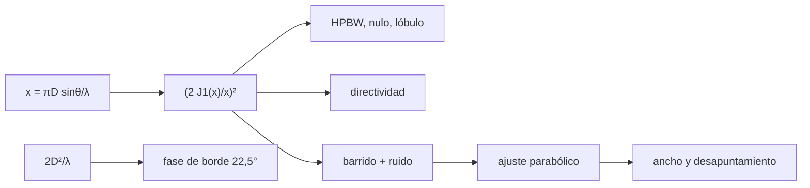

# B49-C05 — Medición y calibración de patrones de antena

<!-- nav:top -->
[🏠 Programa](../../../../README.md) · [📚 Bloque B49](../../../tronco-comun/B49-antenas-y-receptores-de-radioastronomia.md) · [← Anterior: B49-C04 — Arreglos de antenas: factor de arreglo y formación de haz](../B49-C04-arreglos-de-antenas-factor-de-arreglo-y-formacion-de-haz/CLASE.md) · [Siguiente: B49-C06 — Amplificadores de bajo ruido (LNA): tecnología, ganancia y adaptación →](../B49-C06-amplificadores-de-bajo-ruido-lna-tecnologia-ganancia-y-adaptacion/CLASE.md)
<!-- /nav -->

## 1. Ubicación, nivel y alcance

Clase 5 del bloque B49. Nivel N3. Medir un patrón es barrer una fuente puntual a través del haz y ajustar lo que sale con ruido. Aquí calculas el patrón de **Airy** de una apertura circular, su directividad por dos vías, simulas un barrido con ruido, ajustas el ancho del haz y el desapuntamiento, y obtienes la **distancia de campo lejano** `2D²/λ`. Usas [B12](../../../tronco-comun/B12-probabilidad-estadistica-e-incertidumbre.md), [B10](../../../tronco-comun/B10-algebra-lineal-y-matematicas-geometricas.md) y [B05](../../../tronco-comun/B05-fisica-fundamental-para-el-espacio.md). B46-C04 enseña a interpretar el diagrama; aquí se mide.

## 2. Por qué esta clase existe

Un patrón mal medido o medido demasiado cerca da un haz y unos lóbulos falsos. La decisión central: **¿a qué distancia medir y con qué nivel de ruido, para que el ancho y el lóbulo lateral sean fiables?**

## 3. Lo que podrás hacer al terminar

1. Evaluar `J1` y el patrón `(2J1(x)/x)²`.
2. Hallar el ancho a mitad de potencia, el primer nulo y el primer lóbulo lateral.
3. Verificar la directividad con `(πD/λ)²`.
4. Ajustar una parábola al logaritmo del patrón medido con ruido.
5. Comparar el lóbulo lateral medido con el verdadero.
6. Calcular `2D²/λ` y el error de fase en el borde.

La evidencia es la **ficha del patrón de antena medido** del ejercicio 12 (sección 20).

## 4. Con qué llegas y cómo comprobarlo

1. ¿Qué es una incertidumbre?
2. ¿Qué es una simulación Monte Carlo?
3. ¿Qué es una tabla de resultados?
4. ¿Qué es un valor ilustrativo?
5. ¿Qué es una verificación?

<details>
<summary>Ver respuestas</summary>

1. Un intervalo en que se espera el valor verdadero. 2. Repetir con números aleatorios de semilla fija. 3. Un resumen ordenado de cálculos. 4. Un valor propuesto para el ejemplo, no medido. 5. Comparar un cálculo con un caso independiente.
</details>

Con cuatro o cinco aciertos, sigue; si no, repasa los prerrequisitos.

## 5. Un caso de contexto y casos de referencia

Para una apertura de `3 m` a `10 GHz` (`λ = 2,99792 cm`): `HPBW = 1,0290 λ/D`, primer nulo `1,2197 λ/D`, primer lóbulo lateral `−17,570 dB`. El ajuste de un barrido con ruido de desviación `10⁻³` da `HPBW = 1,0341 λ/D` (0,50 %) y desapuntamiento `0,1201` (verdadero `0,12`). La distancia de campo lejano es `600,42 m` con una fase de borde de `22,500°`. Es el **ejemplo conductor**; el barrido es sintético.

## 6. Vocabulario

El **patrón de Airy** es el de una apertura circular uniforme. El **campo lejano** es la región donde la fase es casi plana. La **distancia de Fraunhofer** es `2D²/λ`. El **ancho a mitad de potencia** (HPBW) es el ancho a −3 dB. El **barrido** es la medición paso a paso. El **suelo de ruido** limita lo que se ve de los lóbulos.

## 7. Modelo mental: una linterna lejana

Como iluminar una pared con una linterna: de cerca la mancha tiene franjas deformadas; de lejos adopta su forma definitiva.



*Descripción textual:* el patrón teórico fija los rasgos del haz; el barrido con ruido, ajustado, los recupera con un error pequeño; la distancia de medición fija la fase.

Analogía: una linterna lejana. Límite: apertura sin bloqueo, fuente puntual lejana.

## 8. La explicación, paso a paso

### 8.1 Rasgos del patrón

`J1(1,8412) = 0,581865224` y su primer cero es `3,8317060`, iguales a los valores conocidos con 7 cifras. El ancho a mitad de potencia es `1,0290 λ/D`, el primer nulo `1,2197 λ/D` y el primer lóbulo lateral está en `x = 5,1356` con `−17,570 dB`.

### 8.2 Directividad por dos vías

La integral de `4J1²/x` entre 0 y 300 vale `1,995750`; con la cola `4/(πX)`, `1,999994`, frente al valor exacto `2`. La directividad numérica dividida entre `(πD/λ)²` es `1,00000`. Para `D = 3 m` y `λ = 2,99792 cm`, `(πD/λ)² ≈ 98 800`, o unos `49,95 dBi`.

### 8.3 Medición simulada

| magnitud | verdadera | ajustada o medida |
|---|---|---|
| desapuntamiento (en x) | 0,12 | 0,1201 |
| HPBW (λ/D) | 1,0290 | 1,0341 |
| lóbulo lateral (dB) | −17,570 | −17,443 |

Se usaron `32` puntos con `P > 0,5` de un barrido de 161; el suelo de ruido es `−60 dB`. Con el umbral `P > 0,1` el ajuste parabólico da un ancho 5,5 % menor, porque el patrón de Airy no es gaussiano lejos del pico: por eso se ajusta cerca del máximo.

### 8.4 Campo lejano

`2D²/λ = 600,42 m`; la diferencia de camino en el borde es `0,06250 λ`, es decir `22,500°`.

## 9. Magnitudes, símbolos y unidades

| Símbolo | Qué es | Unidad | Valor / nota |
|---|---|---|---|
| `x` | `π D sinθ/λ` | — | 1,6163 a −3 dB |
| `J1` | función de Bessel de primer orden | — | 0,581865 (máximo) |
| `R_ff` | distancia de campo lejano | m | 600,42 |
| `HPBW` | ancho a −3 dB | `λ/D` | 1,0290 |
| `c` | velocidad de la luz | m/s | 299 792 458 (NIST) |

## 10. Convenciones y referencias

NIST (`c`); apertura, frecuencia y barrido **ilustrativos y sintéticos** (semilla `20261109`).

## 11. De dónde sale lo que afirmamos

| ID | Fuente | Localizador | Respalda | Estado |
|---|---|---|---|---|
| S1 | NIST, *Fundamental Physical Constants* (CODATA 2022) | https://physics.nist.gov/cuu/Constants/Table/allascii.txt | constantes citadas en la sección 9 | Consultada el 2026-11-09 |

Límites: El patrón de Airy y la distancia `2D²/λ` son resultados estándar (texto no consultado); se verificaron con valores conocidos de `J1` y con la fase de borde calculada. Ninguna medición real.

## 12. Cómo ver la medición del haz

| magnitud | verdadera | medida |
|---|---|---|
| HPBW (λ/D) | 1,0290 | 1,0341 |
| lóbulo lateral (dB) | −17,570 | −17,443 |

Descripción larga: el ajuste recupera el ancho con 0,5 % de diferencia y el lóbulo con 0,13 dB.

## 13. Ejemplo trabajado: el ancho del haz de 3 m

**Paso 1 · Longitud de onda.** `λ = c/f = 2,99792 cm`.

**Paso 2 · Ancho.** `1,0290 × 0,0299792/3 = 0,010283 rad`.

**Paso 3 · Grados.** `0,010283 × 57,2958 = 0,5892°`.

**Paso 4 · Campo lejano.** `2 × 9/0,0299792 = 600,4 m`.

## 14. Distintas formas de describir el mismo resultado

**Por fórmula:** `1,029 λ/D`. **Por integral:** `∫ 4J1²/x`. **Por simulación:** barrido con ruido. **Por código:** `patron_antena.py`.

## 15. Práctica guiada

**Ejercicio 1 · con los pasos indicados.** Longitud de onda a 10 GHz. *Pasos:* ejemplo 13.

<details><summary>Solución comentada</summary>

`2,99792 cm`.
</details>

**Ejercicio 2 · con una pista.** HPBW en grados de la antena de 3 m.

<details><summary>Solución comentada</summary>

`0,5892°`.
</details>

**Ejercicio 3 · casi autónomo.** Primer nulo en grados.

<details><summary>Solución comentada</summary>

`1,2197 × 0,00999307 = 0,012189 rad = 0,698°`.
</details>

## 16. Práctica autónoma, transferencia e integrador

**Ejercicio 4.** Distancia de campo lejano.

<details><summary>Solución comentada</summary>

`600,42 m`.
</details>

**Ejercicio 5.** Directividad en dBi.

<details><summary>Solución comentada</summary>

`10 log₁₀ 98 800 ≈ 49,95`.
</details>

**Ejercicio 6.** Error del lóbulo lateral medido.

<details><summary>Solución comentada</summary>

`−17,443 − (−17,570) = 0,127 dB`.
</details>

**Ejercicio 7.** Error del ancho ajustado.

<details><summary>Solución comentada</summary>

`1,0341/1,0290 − 1 = 0,5 %`.
</details>

**Ejercicio 8.** Puntos usados en el ajuste.

<details><summary>Solución comentada</summary>

`32`.
</details>

**Ejercicio 9 · transferencia.** **Transferencia.** Un compañero dice que a 100 m el patrón de esta antena ya es de campo lejano. Responde.

<details><summary>Solución comentada</summary>

No: `2D²/λ = 600 m`; a 100 m la fase de borde es mucho mayor que 22,5°.
</details>

**Ejercicio 10 · transferencia.** **Transferencia.** ¿Por qué se ajusta cerca del pico y no hasta −10 dB?

<details><summary>Solución comentada</summary>

El patrón de Airy no es gaussiano lejos del máximo: con `P > 0,1` el ancho sale 5,5 % menor.
</details>

**Ejercicio 11 · transferencia.** **Transferencia.** ¿Qué limita medir lóbulos laterales profundos?

<details><summary>Solución comentada</summary>

El suelo de ruido (−60 dB aquí) y las reflexiones, que no se simulan.
</details>

**Ejercicio 12.** **Integrador.** Elabora tu *ficha del patrón de antena medido*: ancho, lóbulo, ajuste y distancia.

<details><summary>Solución comentada</summary>

Secciones 8.1–8.4.
</details>

**Ejercicio 12 · integrador.** **Integrador.** Elabora tu *ficha del patrón de antena medido*: ancho, lóbulo, ajuste y distancia.

<details><summary>Solución modelo</summary>

Secciones 8.1–8.4.
</details>

## 17. Laboratorio: patrón de Airy medido

El script [patron_antena.py](patron_antena.py) calcula el patrón, verifica la directividad y ajusta un barrido con ruido (**comprueba** `10⁻³` y 3 %).

**Datos:** `c` de NIST; barrido **sintético**. **Predice antes de ejecutar:** ¿a qué distancia medir? (≥ 600 m.) **Ejecución del 2026-11-09 (Python 3.12.9):**

```text
Python 3.12.9 (biblioteca estandar)
J1(1,8412) = 0.581865224 (maximo de J1, valor conocido 0,581865) ; primer cero de J1 = 3.8317060 (conocido 3,8317060)
HPBW = 1.0290 lambda/D ; primer nulo = 1.2197 lambda/D ; primer lobulo lateral en x = 5.1356, nivel = -17.570 dB
Integral de 4 J1^2/x entre 0 y 300 = 1.995750 ; con cola 4/(pi X) = 1.999994 ; valor exacto 2
Directividad numerica / (pi D/lambda)^2 = 1.00000
Puntos usados en el ajuste (P > 0,5): 32 ; pico ajustado en x = 0.1201 (verdadero 0.12) ; HPBW ajustado = 1.0341 lambda/D (Airy 1.0290) ; dif = 0.50 %
Primer lobulo lateral medido (maximo en el barrido) = -17.443 dB ; verdadero -17.570 dB ; suelo de ruido = -60.0 dB
lambda = 2.99792 cm ; D = 3.0 m ; 2 D^2/lambda = 600.42 m ; diferencia de camino en el borde = 0.06250 lambda ; fase de borde = 22.500 grados
Pruebas superadas.
```

```bash
python programa/clases/B49/B49-C05-medicion-y-calibracion-de-patrones-de-antena/patron_antena.py
```

**Límites:** apertura ideal, un solo corte.

## 18. Errores frecuentes y cómo corregirlos

**Medir en campo cercano.** Se corrige con 8.4.

**Ajustar la parábola con demasiado rango.** Se corrige con 8.3.

**Confundir el nivel de ruido con el del lóbulo.** Se corrige con la sección 9.

**Tomar el barrido sintético por medición.** Se corrige con la sección 10.

## 19. Cómo sabrás que vas bien

Tras la sección 8: ¿qué resultado esperabas y cuál obtuviste? Si dudas, repasa el ejemplo 13. Tras el laboratorio: ¿qué comprueba? (ver la sección 17).

## 20. Qué entregas y cómo se evalúa

El producto es tu **ficha del patrón de antena medido** (ejercicio 12).

| Criterio | Inicial | En desarrollo | Logrado | Destacado |
|---|---|---|---|---|
| Conceptos | Los confunde | Parciales | conceptos de la clase | Explica los límites |
| Cálculo | Sin unidades | Con errores | Tablas completas | Calcula casos nuevos |
| Numérico | Sin comprobar | Un caso | Contraste con el análisis | Interpreta las diferencias |
| Fuentes | Sin fuente | Sin fecha | fuentes con fecha | Declara lo ilustrativo |
| Límites | No los nombra | Uno | Tres | Discute qué falta del modelo |

**Condiciones críticas (no se compensan con promedio):** rotular el barrido como sintético; no atribuirlo a una antena real; citar solo NIST.

## 21. Ética, seguridad y límites

Clase educativa: los modelos son simplificados. Accesibilidad: tablas equivalentes a las gráficas, fórmulas en texto, ejercicios sin conexión.

## 22. Para cerrar y seguir

El haz de Airy de 3 m a 10 GHz mide 1,029 λ/D; un barrido con ruido lo recupera al 0,5 % y exige medir a más de 600 m. Queda una pregunta: ¿cómo se amplifica la señal sin degradarla?

**Glosario español–inglés.** patrón de Airy · *Airy pattern*; campo lejano · *far field*; barrido · *scan*; lóbulo lateral · *sidelobe*; suelo de ruido · *noise floor*.

**Continuidad.** [B49-C06](../B49-C06-amplificadores-de-bajo-ruido-lna-tecnologia-ganancia-y-adaptacion/CLASE.md) estudia el amplificador de bajo ruido.

**Referencias:** ver sección 11.

<!-- nav:bottom -->
---

[← Anterior: B49-C04 — Arreglos de antenas: factor de arreglo y formación de haz](../B49-C04-arreglos-de-antenas-factor-de-arreglo-y-formacion-de-haz/CLASE.md) · [📚 Bloque B49](../../../tronco-comun/B49-antenas-y-receptores-de-radioastronomia.md) · [Siguiente: B49-C06 — Amplificadores de bajo ruido (LNA): tecnología, ganancia y adaptación →](../B49-C06-amplificadores-de-bajo-ruido-lna-tecnologia-ganancia-y-adaptacion/CLASE.md)
<!-- /nav -->
