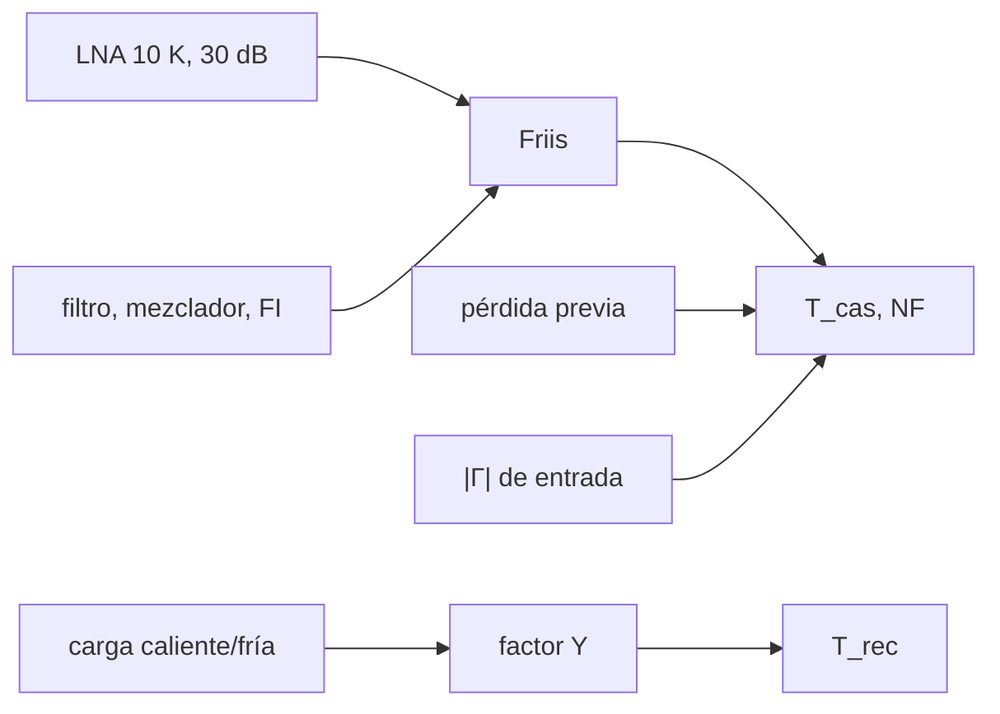

# B49-C06 — Amplificadores de bajo ruido (LNA): tecnología, ganancia y adaptación

<!-- nav:top -->
[🏠 Programa](../../../../README.md) · [📚 Bloque B49](../../../tronco-comun/B49-antenas-y-receptores-de-radioastronomia.md) · [← Anterior: B49-C05 — Medición y calibración de patrones de antena](../B49-C05-medicion-y-calibracion-de-patrones-de-antena/CLASE.md) · [Siguiente: B49-C07 — Criogenia y refrigeración de receptores de radio →](../B49-C07-criogenia-y-refrigeracion-de-receptores-de-radio/CLASE.md)
<!-- /nav -->

## 1. Ubicación, nivel y alcance

Clase 6 del bloque B49. Nivel N3. El primer amplificador domina el ruido del receptor. Aquí aplicas la **fórmula de Friis** a una cascada de cuatro bloques, la comparas con el cálculo por factores de ruido, ves el efecto de una pérdida antes del LNA y de una desadaptación, y recuperas la temperatura del receptor con el **método del factor Y** simulado. Usas [B12](../../../tronco-comun/B12-probabilidad-estadistica-e-incertidumbre.md), [B05](../../../tronco-comun/B05-fisica-fundamental-para-el-espacio.md) y [B10](../../../tronco-comun/B10-algebra-lineal-y-matematicas-geometricas.md). B46-C07 describe la cadena en general.

## 2. Por qué esta clase existe

Una décima de decibelio antes del primer amplificador cuesta más que mejorar el mezclador. La decisión central: **¿qué bloque domina la temperatura de ruido y qué pérdidas deben evitarse antes de él?**

## 3. Lo que podrás hacer al terminar

1. Aplicar Friis a una cascada.
2. Convertir temperatura y cifra de ruido.
3. Repartir el aporte de cada etapa.
4. Calcular el efecto de una pérdida previa.
5. Estimar el efecto de la desadaptación.
6. Recuperar `T_rec` con el factor Y.

La evidencia es la **ficha del amplificador de bajo ruido** del ejercicio 12 (sección 20).

## 4. Con qué llegas y cómo comprobarlo

1. ¿Qué es una incertidumbre?
2. ¿Qué es una simulación Monte Carlo?
3. ¿Qué es una tabla de resultados?
4. ¿Qué es un valor ilustrativo?
5. ¿Qué es una verificación?

<details>
<summary>Ver respuestas</summary>

1. Un intervalo en que se espera el valor verdadero. 2. Repetir con números aleatorios de semilla fija. 3. Un resumen ordenado de cálculos. 4. Un valor propuesto para el ejemplo, no medido. 5. Comparar un cálculo con un caso independiente.
</details>

Con cuatro o cinco aciertos, sigue; si no, repasa los prerrequisitos.

## 5. Un caso de contexto y casos de referencia

La cascada (LNA `10 K`, `30 dB`; filtro `1 dB`; mezclador `7 dB`; FI `100 K`, `25 dB`) da `T = 12,1707 K` y `NF = 0,1785 dB`; el LNA aporta el `82,2 %`. Medio decibelio de pérdida antes del LNA lleva la temperatura a `49,041 K`. El factor Y simulado da `11,795 K`, `3,09 %` de diferencia. Es el **ejemplo conductor**; valores ilustrativos.

## 6. Vocabulario

La **temperatura de ruido** `T_e` de una etapa. La **cifra de ruido** `NF = 10 log₁₀(1 + T/T₀)` con `T₀ = 290 K`. La **fórmula de Friis**. La **ganancia disponible** `G`. El **factor Y** es el cociente de potencias con carga caliente y fría. La **desadaptación** reduce la potencia transferida.

## 7. Modelo mental: una cañería con fugas

Como una cañería con fugas: una fuga al principio pierde más caudal útil que una al final, donde ya hay mucha presión.



*Descripción textual:* la primera etapa fija la temperatura; las siguientes se dividen por la ganancia acumulada.

Analogía: una cañería con fugas. Límite: etapas lineales y adaptadas.

## 8. La explicación, paso a paso

### 8.1 Cascada

`T_cas = 12,1707 K`, `F = 1,04197`, `NF = 0,1785 dB`. El cálculo por factores de ruido da lo mismo (diferencia relativa menor que `10⁻⁹`).

| etapa | aporte (K) | porcentaje |
|---|---|---|
| LNA | 10,0000 | 82,164 |
| filtro | 0,0751 | 0,617 |
| mezclador | 1,4647 | 12,035 |
| FI | 0,6310 | 5,184 |

### 8.2 Pérdida previa y desadaptación

| pérdida antes del LNA (dB) | T_cas (K) | NF (dB) |
|---|---|---|
| 0,0 | 12,171 | 0,179 |
| 0,1 | 19,209 | 0,279 |
| 0,5 | 49,041 | 0,679 |
| 1,0 | 90,410 | 1,179 |

Con desadaptación `Γ = 0,1; 0,3; 0,5`, la temperatura aproximada `T/(1 − Γ²)` pasa a `12,294; 13,374; 16,228 K`.

### 8.3 Factor Y

Con cargas a `300 K` y `77 K` y 1,2 millones de muestras por carga: `Y = 3,51141`, `T_rec = 11,795 K` frente a `12,171 K` (3,09 %); la dispersión estadística esperada es de 1,6 %. La potencia de ruido `k B T = 1,680 × 10⁻¹⁴ W` para 100 MHz.

### 8.4 Lectura

Una pérdida de 0,1 dB delante del LNA suma 7 K, más que el filtro, el mezclador y la FI juntos. El filtro de 1 dB va después del LNA y solo aporta 0,075 K. Por eso se coloca el LNA lo más cerca posible de la antena.

## 9. Magnitudes, símbolos y unidades

| Símbolo | Qué es | Unidad | Valor / nota |
|---|---|---|---|
| `T_e` | temperatura de ruido | K | 10 (LNA) |
| `G` | ganancia | — | 1000 (30 dB) |
| `F, NF` | factor y cifra de ruido | —, dB | 1,04197; 0,1785 |
| `Y` | factor Y | — | 3,51141 |
| `k` | constante de Boltzmann | J/K | 1,380649 × 10⁻²³ (NIST) |

## 10. Convenciones y referencias

NIST (`k`); etapas, cargas y ancho de banda **ilustrativos**; muestras **sintéticas** con semilla `20261109`.

## 11. De dónde sale lo que afirmamos

| ID | Fuente | Localizador | Respalda | Estado |
|---|---|---|---|---|
| S1 | NIST, *Fundamental Physical Constants* (CODATA 2022) | https://physics.nist.gov/cuu/Constants/Table/allascii.txt | constantes citadas en la sección 9 | Consultada el 2026-11-09 |

Límites: Las relaciones de Friis y del factor Y son estándar (texto no consultado) y se validaron por dos vías (factores de ruido y simulación).

## 12. Cómo ver el reparto del ruido

| etapa | aporte (K) |
|---|---|
| LNA | 10,0000 |
| filtro | 0,0751 |
| mezclador | 1,4647 |
| FI | 0,6310 |

Descripción larga: el LNA aporta cuatro de cada cinco kelvin.

## 13. Ejemplo trabajado: la cascada

**Paso 1 · LNA.** `10 K`.

**Paso 2 · Filtro.** `75,09 K / 1000 = 0,0751 K`.

**Paso 3 · Mezclador.** `1163,4 K / (1000 × 0,7943) = 1,4647 K`.

**Paso 4 · FI.** `100 K / (1000 × 0,7943 × 0,1995) = 0,6310 K`; suma `12,1707 K`.

## 14. Distintas formas de describir el mismo resultado

**Por fórmula:** Friis. **Por factores:** `F = F₁ + (F₂−1)/G₁`. **Por simulación:** factor Y. **Por código:** `lna_cascada.py`.

## 15. Práctica guiada

**Ejercicio 1 · con los pasos indicados.** `T_e` de un filtro de 1 dB a 290 K. *Pasos:* ejemplo 13.

<details><summary>Solución comentada</summary>

`290 × (1,2589 − 1) = 75,09 K`.
</details>

**Ejercicio 2 · con una pista.** `NF` de 12,1707 K.

<details><summary>Solución comentada</summary>

`10 log₁₀(1 + 12,1707/290) = 0,1785 dB`.
</details>

**Ejercicio 3 · casi autónomo.** Temperatura con 0,5 dB antes del LNA.

<details><summary>Solución comentada</summary>

`35,39 + 1,122 × 12,171 = 49,04 K`.
</details>

## 16. Práctica autónoma, transferencia e integrador

**Ejercicio 4.** Potencia de ruido para 100 MHz.

<details><summary>Solución comentada</summary>

`1,38065 × 10⁻²³ × 10⁸ × 12,1707 = 1,680 × 10⁻¹⁴ W`.
</details>

**Ejercicio 5.** Factor Y esperado con 300 K y 77 K.

<details><summary>Solución comentada</summary>

`(300 + 12,17)/(77 + 12,17) = 3,5008`.
</details>

**Ejercicio 6.** Aporte de la FI.

<details><summary>Solución comentada</summary>

`0,6310 K`.
</details>

**Ejercicio 7.** Fracción del LNA.

<details><summary>Solución comentada</summary>

`10/12,1707 = 82,2 %`.
</details>

**Ejercicio 8.** Temperatura con `Γ = 0,3`.

<details><summary>Solución comentada</summary>

`12,1707/0,91 = 13,374 K`.
</details>

**Ejercicio 9 · transferencia.** **Transferencia.** Un compañero dice que un mejor mezclador compensa una pérdida previa. Responde.

<details><summary>Solución comentada</summary>

El mezclador aporta 1,46 K; 0,5 dB previos suman 37 K.
</details>

**Ejercicio 10 · transferencia.** **Transferencia.** ¿Por qué el factor Y simulado difiere 3 %?

<details><summary>Solución comentada</summary>

Por la dispersión estadística (≈ 1,6 % rms) con 1,2 millones de muestras.
</details>

**Ejercicio 11 · transferencia.** **Transferencia.** ¿Qué no incluye este modelo?

<details><summary>Solución comentada</summary>

Ruido no adaptado (parámetros de ruido del dispositivo) ni dependencia en frecuencia.
</details>

**Ejercicio 12.** **Integrador.** Elabora tu *ficha del amplificador de bajo ruido*: cascada, reparto y pérdida previa.

<details><summary>Solución comentada</summary>

Secciones 8.1–8.4.
</details>

**Ejercicio 12 · integrador.** **Integrador.** Elabora tu *ficha del amplificador de bajo ruido*: cascada, reparto y pérdida previa.

<details><summary>Solución modelo</summary>

Secciones 8.1–8.4.
</details>

## 17. Laboratorio: cascada de ruido

El script [lna_cascada.py](lna_cascada.py) calcula Friis, la pérdida previa y el factor Y (**comprueba** `10⁻⁹` y 5 %).

**Datos:** `k` de NIST; bloques **ilustrativos**. **Predice antes de ejecutar:** ¿qué bloque domina? (el LNA, 82 %.) **Ejecución del 2026-11-09 (Python 3.12.9):**

```text
Python 3.12.9 (biblioteca estandar)
Bloques (Te, G): LNA 10.0 K, 30 dB ; filtro 75.09 K, -1 dB ; mezclador 1163.4 K, -7 dB ; FI 100.0 K, 25 dB
Friis: T_cas = 12.1707 K ; F = 1 + T/T0 = 1.04197 ; NF = 0.1785 dB
Friis con factores de ruido: F_cas = 1.04197 ; T = (F - 1) T0 = 12.1707 K
     etapa   aporte a T_cas (K)  porcentaje
       LNA              10.0000      82.164
    filtro               0.0751       0.617
 mezclador               1.4647      12.035
        FI               0.6310       5.184
Perdida pasiva (a 290 K) colocada ANTES del LNA:
 perdida (dB)  T_cas (K)  NF (dB)
          0.0     12.171    0.179
          0.1     19.209    0.279
          0.5     49.041    0.679
          1.0     90.410    1.179
Desadaptacion de entrada del LNA (T_rec/(1 - |Gamma|^2), aproximacion):
  |Gamma| = 0.0 -> T_rec = 12.171 K
  |Gamma| = 0.1 -> T_rec = 12.294 K
  |Gamma| = 0.3 -> T_rec = 13.374 K
  |Gamma| = 0.5 -> T_rec = 16.228 K
Factor Y: Y = 3.51141 ; T_rec recuperada = 11.795 K ; Friis = 12.171 K ; dif = 3.09 % ; potencia de ruido k B T_cas = 1.680e-14 W
Pruebas superadas.
```

```bash
python programa/clases/B49/B49-C06-amplificadores-de-bajo-ruido-lna-tecnologia-ganancia-y-adaptacion/lna_cascada.py
```

**Límites:** etapas lineales y adaptadas.

## 18. Errores frecuentes y cómo corregirlos

**Poner el filtro antes del LNA sin contar su pérdida.** Se corrige con 8.2.

**Sumar temperaturas sin dividir por la ganancia.** Se corrige con el ejemplo 13.

**Confundir `NF` y `T_e`.** Se corrige con la sección 9.

**Presentar los bloques como un LNA real.** Se corrige con la sección 10.

## 19. Cómo sabrás que vas bien

Tras la sección 8: ¿qué resultado esperabas y cuál obtuviste? Si dudas, repasa el ejemplo 13. Tras el laboratorio: ¿qué comprueba? (ver la sección 17).

## 20. Qué entregas y cómo se evalúa

El producto es tu **ficha del amplificador de bajo ruido** (ejercicio 12).

| Criterio | Inicial | En desarrollo | Logrado | Destacado |
|---|---|---|---|---|
| Conceptos | Los confunde | Parciales | conceptos de la clase | Explica los límites |
| Cálculo | Sin unidades | Con errores | Tablas completas | Calcula casos nuevos |
| Numérico | Sin comprobar | Un caso | Contraste con el análisis | Interpreta las diferencias |
| Fuentes | Sin fuente | Sin fecha | fuentes con fecha | Declara lo ilustrativo |
| Límites | No los nombra | Uno | Tres | Discute qué falta del modelo |

**Condiciones críticas (no se compensan con promedio):** rotular las etapas como ilustrativas; no presentar la cascada como un receptor real; citar solo NIST.

## 21. Ética, seguridad y límites

Clase educativa: los modelos son simplificados. Accesibilidad: tablas equivalentes a las gráficas, fórmulas en texto, ejercicios sin conexión.

## 22. Para cerrar y seguir

El LNA fija 82 % de los 12,17 K de la cascada, y 0,5 dB de pérdida previa los lleva a 49 K. Queda una pregunta: ¿cómo se enfría el receptor para bajar aún más esa temperatura?

**Glosario español–inglés.** amplificador de bajo ruido · *low-noise amplifier*; cifra de ruido · *noise figure*; método del factor Y · *Y-factor method*; temperatura de ruido · *noise temperature*; cascada · *cascade*.

**Continuidad.** [B49-C07](../B49-C07-criogenia-y-refrigeracion-de-receptores-de-radio/CLASE.md) estudia la criogenia de receptores.

**Referencias:** ver sección 11.

<!-- nav:bottom -->
---

[← Anterior: B49-C05 — Medición y calibración de patrones de antena](../B49-C05-medicion-y-calibracion-de-patrones-de-antena/CLASE.md) · [📚 Bloque B49](../../../tronco-comun/B49-antenas-y-receptores-de-radioastronomia.md) · [Siguiente: B49-C07 — Criogenia y refrigeración de receptores de radio →](../B49-C07-criogenia-y-refrigeracion-de-receptores-de-radio/CLASE.md)
<!-- /nav -->
