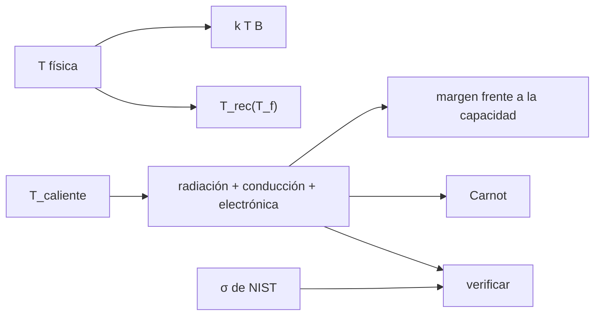

# B49-C07 — Criogenia y refrigeración de receptores de radio

<!-- nav:top -->
[🏠 Programa](../../../../README.md) · [📚 Bloque B49](../../../tronco-comun/B49-antenas-y-receptores-de-radioastronomia.md) · [← Anterior: B49-C06 — Amplificadores de bajo ruido (LNA): tecnología, ganancia y adaptación](../B49-C06-amplificadores-de-bajo-ruido-lna-tecnologia-ganancia-y-adaptacion/CLASE.md) · [Siguiente: B49-C08 — Estabilidad de ganancia de receptores y variaciones de ganancia →](../B49-C08-estabilidad-de-ganancia-de-receptores-y-variaciones-de-ganancia/CLASE.md)
<!-- /nav -->

## 1. Ubicación, nivel y alcance

Clase 7 del bloque B49. Nivel N3. Enfriar la entrada del receptor reduce el ruido térmico, pero cuesta potencia frigorífica. Aquí calculas el **ruido de Johnson**, la mejora de la temperatura del receptor al enfriar un modelo ilustrativo de LNA, el balance de cargas térmicas de un criostato de dos etapas y la potencia mínima de Carnot. Usas [B05](../../../tronco-comun/B05-fisica-fundamental-para-el-espacio.md), [B10](../../../tronco-comun/B10-algebra-lineal-y-matematicas-geometricas.md) y [B12](../../../tronco-comun/B12-probabilidad-estadistica-e-incertidumbre.md). B44-C08 trata detectores ópticos; aquí es el receptor de radio.

## 2. Por qué esta clase existe

Cada kelvin ahorrado exige vatios en la cabeza fría, y cada vatio de carga reduce el margen. La decisión central: **¿a qué temperatura enfriar y cuánta carga admite el criostato?**

## 3. Lo que podrás hacer al terminar

1. Calcular `k T` y la tensión de Johnson.
2. Verificar `σ` de Stefan–Boltzmann con `k`, `h`, `c`.
3. Calcular `T_rec` frente a la temperatura física.
4. Sumar cargas por radiación, conducción y electrónica.
5. Ver el efecto del aislamiento multicapa.
6. Calcular la potencia mínima de Carnot.

La evidencia es la **ficha de la criogenia del receptor** del ejercicio 12 (sección 20).

## 4. Con qué llegas y cómo comprobarlo

1. ¿Qué es una incertidumbre?
2. ¿Qué es una simulación Monte Carlo?
3. ¿Qué es una tabla de resultados?
4. ¿Qué es un valor ilustrativo?
5. ¿Qué es una verificación?

<details>
<summary>Ver respuestas</summary>

1. Un intervalo en que se espera el valor verdadero. 2. Repetir con números aleatorios de semilla fija. 3. Un resumen ordenado de cálculos. 4. Un valor propuesto para el ejemplo, no medido. 5. Comparar un cálculo con un caso independiente.
</details>

Con cuatro o cinco aciertos, sigue; si no, repasa los prerrequisitos.

## 5. Un caso de contexto y casos de referencia

`k T` a 290 K es `−173,975 dBm/Hz`; `σ` calculada coincide con la de NIST a `3,3 × 10⁻¹¹`. Con el modelo ilustrativo `T_LNA = 4 K + 0,15 T_f`, la temperatura del receptor pasa de `74,00 K` a 290 K a `10,13 K` a 15 K (mejora `7,31`). La etapa de 40 K carga `3,876 W` (capacidad ilustrativa 40 W) y la de 15 K `0,580 W` (1 W). Es el **ejemplo conductor**.

## 6. Vocabulario

El **ruido de Johnson** es el ruido térmico de una resistencia. La **potencia disponible** es `k T B`. La **cabeza fría** es la etapa de un refrigerador. La **carga térmica** es el calor que llega a una etapa. El **aislamiento multicapa** son láminas reflectantes que reducen la radiación. La **potencia de Carnot** es la mínima para extraer calor.

## 7. Modelo mental: un termo

Como un termo: lo que importa es cuánto calor se cuela por conducción y radiación, no solo cuán frío esté el líquido.



*Descripción textual:* la temperatura física fija el ruido; las cargas fijan el margen de refrigeración.

Analogía: un termo. Límite: conductividad constante, sin ventana ni cableado.

## 8. La explicación, paso a paso

### 8.1 Ruido térmico

`σ = 2π⁵k⁴/(15h³c²) = 5,670374419 × 10⁻⁸ W m⁻² K⁻⁴`, igual a la de NIST. `k T` a 290 K vale `4,0039 × 10⁻²¹ W/Hz` (`−173,975 dBm/Hz`).

| T (K) | tensión rms (μV) | k T B (W) |
|---|---|---|
| 290 | 8,949 | 4,004 × 10⁻¹³ |
| 77 | 4,611 | 1,063 × 10⁻¹³ |
| 15 | 2,035 | 2,071 × 10⁻¹⁴ |

(para 50 Ω y 100 MHz).

### 8.2 Receptor enfriado

| T física (K) | T_LNA (K) | T_rec (K) | mejora |
|---|---|---|---|
| 290 | 47,50 | 74,00 | 1,00 |
| 77 | 15,55 | 24,53 | 3,02 |
| 40 | 10,00 | 15,93 | 4,64 |
| 15 | 6,25 | 10,13 | 7,31 |
| 4 | 4,60 | 7,57 | 9,77 |

### 8.3 Balance térmico

Etapa de 40 K: radiación `1,044 W`, conducción `0,832 W`, electrónica `2,000 W`; total `3,876 W`; margen `36,124 W`. Etapa de 15 K: radiación `0,00019 W`, conducción `0,080 W`, electrónica `0,500 W`; total `0,580 W`; margen `0,420 W`. Con 0, 5, 10 y 30 capas de aislante, la radiación a la etapa de 40 K es `11,4789; 1,9131; 1,0435; 0,3703 W`. Carnot: `25,19 W` para 3,876 W a 40 K y `11,02 W` para 0,580 W a 15 K.

### 8.4 Lectura

Pasar de 77 K a 15 K mejora la temperatura solo 2,4 veces porque el aporte del alimentador y del resto de la cadena no se enfría. La etapa fría es la que menos margen tiene. Las capacidades y la ley del LNA son ilustrativas, no de un refrigerador real.

## 9. Magnitudes, símbolos y unidades

| Símbolo | Qué es | Unidad | Valor / nota |
|---|---|---|---|
| `σ` | constante de Stefan–Boltzmann | W m⁻² K⁻⁴ | 5,670374419 × 10⁻⁸ (NIST) |
| `k` | constante de Boltzmann | J/K | 1,380649 × 10⁻²³ (NIST) |
| `T_rec` | temperatura del receptor | K | 10,13 (a 15 K) |
| `Q` | carga térmica | W | 3,876; 0,580 |
| `N` | capas de aislante | — | 10 |

## 10. Convenciones y referencias

NIST (`k`, `h`, `c`, `σ`); ley del LNA, áreas, emisividades, conductividad y capacidades **ilustrativas**.

## 11. De dónde sale lo que afirmamos

| ID | Fuente | Localizador | Respalda | Estado |
|---|---|---|---|---|
| S1 | NIST, *Fundamental Physical Constants* (CODATA 2022) | https://physics.nist.gov/cuu/Constants/Table/allascii.txt | constantes citadas en la sección 9 | Consultada el 2026-11-09 |

Límites: La forma de las cargas (Stefan–Boltzmann, conducción lineal, Carnot) es estándar (texto no consultado). Las cifras del criostato no corresponden a ningún equipo real.

## 12. Cómo ver el balance de cargas

| etapa | carga (W) | capacidad (W) | margen (W) |
|---|---|---|---|
| 40 K | 3,876 | 40 | 36,124 |
| 15 K | 0,580 | 1 | 0,420 |

Descripción larga: la etapa fría tiene mucho menos margen que la intermedia.

## 13. Ejemplo trabajado: la tensión de Johnson

**Paso 1 · Producto.** `4 k T R B = 4 × 1,380649 × 10⁻²³ × 290 × 50 × 10⁸ = 8,008 × 10⁻¹¹ V²`.

**Paso 2 · Raíz.** `√(8,008 × 10⁻¹¹) = 8,949 × 10⁻⁶ V`.

**Paso 3 · A 15 K.** `8,949 × √(15/290) = 2,035 μV`.

**Paso 4 · Potencia.** `k T B = 4,004 × 10⁻¹³ W` a 290 K.

## 14. Distintas formas de describir el mismo resultado

**Por fórmula:** `4kTRB`. **Por tabla:** temperatura y cargas. **Por verificación:** `σ` desde `k`, `h`, `c`. **Por código:** `criogenia.py`.

## 15. Práctica guiada

**Ejercicio 1 · con los pasos indicados.** Tensión de Johnson a 290 K. *Pasos:* ejemplo 13.

<details><summary>Solución comentada</summary>

`8,949 μV`.
</details>

**Ejercicio 2 · con una pista.** Mejora de 290 K a 15 K.

<details><summary>Solución comentada</summary>

`74,00/10,13 = 7,31`.
</details>

**Ejercicio 3 · casi autónomo.** `T_rec` a 77 K.

<details><summary>Solución comentada</summary>

`5,51 + 1,0715 × (15,55 + 2,2) = 24,53 K`.
</details>

## 16. Práctica autónoma, transferencia e integrador

**Ejercicio 4.** Cociente de radiación con 10 capas y sin ellas.

<details><summary>Solución comentada</summary>

`1/11 = 0,0909`.
</details>

**Ejercicio 5.** Conducción de la etapa de 40 K.

<details><summary>Solución comentada</summary>

`4 × 0,4 × 2×10⁻⁴ × 260/0,1 = 0,832 W`.
</details>

**Ejercicio 6.** Margen de la etapa de 15 K.

<details><summary>Solución comentada</summary>

`1 − 0,580 = 0,420 W`.
</details>

**Ejercicio 7.** Carnot para 1 W a 4 K desde 300 K.

<details><summary>Solución comentada</summary>

`296/4 = 74 W`.
</details>

**Ejercicio 8.** Relación entre las tensiones a 290 K y 77 K.

<details><summary>Solución comentada</summary>

`√(290/77) = 1,94`.
</details>

**Ejercicio 9 · transferencia.** **Transferencia.** Un compañero afirma que estas cifras son de un criostato real. Responde.

<details><summary>Solución comentada</summary>

Son ilustrativas; no corresponden a ningún equipo.
</details>

**Ejercicio 10 · transferencia.** **Transferencia.** ¿Por qué enfriar de 77 K a 15 K mejora solo 2,4 veces?

<details><summary>Solución comentada</summary>

El alimentador y el resto de la cadena aportan un ruido que no baja.
</details>

**Ejercicio 11 · transferencia.** **Transferencia.** ¿Qué le falta al balance térmico?

<details><summary>Solución comentada</summary>

Cableado, ventana, conductividad que depende de T, contactos reales.
</details>

**Ejercicio 12.** **Integrador.** Elabora tu *ficha de la criogenia del receptor*: ruido, mejora y balance.

<details><summary>Solución comentada</summary>

Secciones 8.1–8.4.
</details>

**Ejercicio 12 · integrador.** **Integrador.** Elabora tu *ficha de la criogenia del receptor*: ruido, mejora y balance.

<details><summary>Solución modelo</summary>

Secciones 8.1–8.4.
</details>

## 17. Laboratorio: ruido y cargas térmicas

El script [criogenia.py](criogenia.py) verifica `σ`, calcula la temperatura del receptor y el balance de un criostato (**comprueba** `10⁻⁹` y márgenes positivos).

**Datos:** constantes de NIST; criostato y LNA **ilustrativos**. **Predice antes de ejecutar:** ¿cuánto mejora enfriar a 15 K? (7,3 veces.) **Ejecución del 2026-11-09 (Python 3.12.9):**

```text
Python 3.12.9 (biblioteca estandar)
sigma calculada = 5.670374419e-08 W m^-2 K^-4 ; NIST = 5.670374419e-08 ; dif relativa = 3.3e-11
Densidad de ruido disponible k T a 290 K = 4.0039e-21 W/Hz = -173.975 dBm/Hz
  T =   290 K: tension rms de Johnson (R = 50 ohm, B = 100 MHz) = 8.949 microvoltios ; k T B = 4.004e-13 W
  T =    77 K: tension rms de Johnson (R = 50 ohm, B = 100 MHz) = 4.611 microvoltios ; k T B = 1.063e-13 W
  T =    15 K: tension rms de Johnson (R = 50 ohm, B = 100 MHz) = 2.035 microvoltios ; k T B = 2.071e-14 W
 T fisica (K)  T_LNA (K)  T_rec (K)   mejora
          290      47.50      74.00     1.00
           77      15.55      24.53     3.02
           40      10.00      15.93     4.64
           15       6.25      10.13     7.31
            4       4.60       7.57     9.77
Etapa de 40 K: radiacion 1.044 W + conduccion 0.832 W + electronica 2,000 W = 3.876 W ; capacidad 40.0 W ; margen 36.124 W
Etapa de 15 K: radiacion 0.00019 W + conduccion 0.080 W + electronica 0,500 W = 0.580 W ; capacidad 1.0 W ; margen 0.420 W
Capas de aislante multicapa y radiacion de la etapa de 40 K:
  N =  0: 11.4789 W
  N =  5: 1.9131 W
  N = 10: 1.0435 W
  N = 30: 0.3703 W
Carnot para extraer 3.876 W a 40 K desde 300 K: W_min = 25.19 W
Carnot para extraer 0.580 W a 15 K desde 300 K: W_min = 11.02 W
Pruebas superadas.
```

```bash
python programa/clases/B49/B49-C07-criogenia-y-refrigeracion-de-receptores-de-radio/criogenia.py
```

**Límites:** conductividad constante.

## 18. Errores frecuentes y cómo corregirlos

**Creer que enfriar todo baja el ruido hasta cero.** Se corrige con 8.4.

**Olvidar la carga de la electrónica.** Se corrige con 8.3.

**Medir potencia frigorífica en la etapa equivocada.** Se corrige con la sección 9.

**Presentar el modelo como el de un LNA real.** Se corrige con la sección 10.

## 19. Cómo sabrás que vas bien

Tras la sección 8: ¿qué resultado esperabas y cuál obtuviste? Si dudas, repasa el ejemplo 13. Tras el laboratorio: ¿qué comprueba? (ver la sección 17).

## 20. Qué entregas y cómo se evalúa

El producto es tu **ficha de la criogenia del receptor** (ejercicio 12).

| Criterio | Inicial | En desarrollo | Logrado | Destacado |
|---|---|---|---|---|
| Conceptos | Los confunde | Parciales | conceptos de la clase | Explica los límites |
| Cálculo | Sin unidades | Con errores | Tablas completas | Calcula casos nuevos |
| Numérico | Sin comprobar | Un caso | Contraste con el análisis | Interpreta las diferencias |
| Fuentes | Sin fuente | Sin fecha | fuentes con fecha | Declara lo ilustrativo |
| Límites | No los nombra | Uno | Tres | Discute qué falta del modelo |

**Condiciones críticas (no se compensan con promedio):** rotular el criostato y el LNA como ilustrativos; citar solo NIST; no sustituir el diseño térmico real.

## 21. Ética, seguridad y límites

Clase educativa: los modelos son simplificados. Accesibilidad: tablas equivalentes a las gráficas, fórmulas en texto, ejercicios sin conexión.

## 22. Para cerrar y seguir

Enfriar a 15 K baja la temperatura del receptor de 74 a 10,1 K, con una etapa fría cuyo margen es de 0,42 W. Queda una pregunta: ¿cómo se mantiene estable la ganancia?

**Glosario español–inglés.** ruido de Johnson · *Johnson noise*; criostato · *cryostat*; cabeza fría · *cold head*; carga térmica · *heat load*; potencia de Carnot · *Carnot power*.

**Continuidad.** [B49-C08](../B49-C08-estabilidad-de-ganancia-de-receptores-y-variaciones-de-ganancia/CLASE.md) estudia la estabilidad de ganancia.

**Referencias:** ver sección 11.

<!-- nav:bottom -->
---

[← Anterior: B49-C06 — Amplificadores de bajo ruido (LNA): tecnología, ganancia y adaptación](../B49-C06-amplificadores-de-bajo-ruido-lna-tecnologia-ganancia-y-adaptacion/CLASE.md) · [📚 Bloque B49](../../../tronco-comun/B49-antenas-y-receptores-de-radioastronomia.md) · [Siguiente: B49-C08 — Estabilidad de ganancia de receptores y variaciones de ganancia →](../B49-C08-estabilidad-de-ganancia-de-receptores-y-variaciones-de-ganancia/CLASE.md)
<!-- /nav -->
