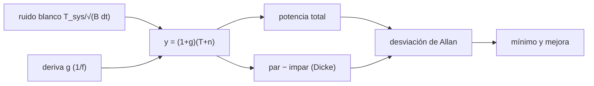

# B49-C08 — Estabilidad de ganancia de receptores y variaciones de ganancia

<!-- nav:top -->
[🏠 Programa](../../../../README.md) · [📚 Bloque B49](../../../tronco-comun/B49-antenas-y-receptores-de-radioastronomia.md) · [← Anterior: B49-C07 — Criogenia y refrigeración de receptores de radio](../B49-C07-criogenia-y-refrigeracion-de-receptores-de-radio/CLASE.md) · [Siguiente: B49-C09 — Linealidad, compresión e intermodulación de receptores de RF →](../B49-C09-linealidad-compresion-e-intermodulacion-de-receptores-de-rf/CLASE.md)
<!-- /nav -->

## 1. Ubicación, nivel y alcance

Clase 8 del bloque B49. Nivel N3. La ganancia de un receptor fluctúa y esa deriva puede superar al ruido térmico. Aquí aplicas la **ecuación del radiómetro**, generas una deriva de ganancia con espectro aproximadamente `1/f`, calculas la **desviación de Allan** de un receptor de potencia total y de uno con **conmutación tipo Dicke**, y ves cuándo conviene conmutar. Usas [B12](../../../tronco-comun/B12-probabilidad-estadistica-e-incertidumbre.md), B15 y [B05](../../../tronco-comun/B05-fisica-fundamental-para-el-espacio.md). B46-C08 trata la estabilidad de osciladores; aquí es la ganancia.

## 2. Por qué esta clase existe

Integrar más tiempo no siempre mejora la medida: la deriva lo impide. La decisión central: **¿hasta qué tiempo de integración vale la pena, y cuándo hay que conmutar?**

## 3. Lo que podrás hacer al terminar

1. Aplicar `ΔT = T_sys/√(Bτ)`.
2. Generar una deriva de ganancia aproximadamente 1/f.
3. Calcular la desviación de Allan.
4. Hallar el tiempo del mínimo de Allan.
5. Simular el receptor tipo Dicke.
6. Cuantificar la mejora y el coste de conmutar.

La evidencia es la **ficha de la estabilidad de ganancia** del ejercicio 12 (sección 20).

## 4. Con qué llegas y cómo comprobarlo

1. ¿Qué es una incertidumbre?
2. ¿Qué es una simulación Monte Carlo?
3. ¿Qué es una tabla de resultados?
4. ¿Qué es un valor ilustrativo?
5. ¿Qué es una verificación?

<details>
<summary>Ver respuestas</summary>

1. Un intervalo en que se espera el valor verdadero. 2. Repetir con números aleatorios de semilla fija. 3. Un resumen ordenado de cálculos. 4. Un valor propuesto para el ejemplo, no medido. 5. Comparar un cálculo con un caso independiente.
</details>

Con cuatro o cinco aciertos, sigue; si no, repasa los prerrequisitos.

## 5. Un caso de contexto y casos de referencia

Con `T_sys = 50 K`, `B = 100 MHz` y muestras de 1 ms, el ruido blanco es `0,15811 K` por muestra y `0,005000 K` en 1 s. Con una deriva de ganancia de `0,481 %` rms, la desviación de Allan de potencia total tiene su mínimo en `1,024 s` (`0,07908 K`) y sube después a `0,08998 K`. A `16,384 s`, el receptor Dicke mejora la medida por un factor `30,73`. Es el **ejemplo conductor**; todo es sintético.

## 6. Vocabulario

La **ecuación del radiómetro** da la sensibilidad. La **deriva de ganancia** es la variación lenta de la amplificación. La **desviación de Allan** compara promedios consecutivos. La **conmutación tipo Dicke** alterna cielo y referencia. La **potencia total** mide sin conmutar. El **ruido 1/f** tiene más potencia a baja frecuencia.

## 7. Modelo mental: una balanza que se descalibra

Como pesar con una balanza que se descalibra: pesar mucho rato promedia el ruido, pero la descalibración crece; hay que tarar a menudo.



*Descripción textual:* el ruido blanco baja con el tiempo y la deriva sube; el Dicke elimina la deriva a cambio de un factor 2 de ruido.

Analogía: una balanza que se descalibra. Límite: ruido gaussiano, deriva común en muestras adyacentes.

## 8. La explicación, paso a paso

### 8.1 Allan frente al tiempo de integración

| τ (s) | blanco (K) | teoría blanco | potencia total (K) | Dicke (K) | teoría Dicke |
|---|---|---|---|---|---|
| 0,001 | 0,15833 | 0,15811 | 0,17281 | — | 0,31623 |
| 0,004 | 0,07844 | 0,07906 | 0,11221 | 0,17201 | 0,15811 |
| 0,016 | 0,03901 | 0,03953 | 0,09906 | 0,08289 | 0,07906 |
| 0,064 | 0,01974 | 0,01976 | 0,09941 | 0,04106 | 0,03953 |
| 0,256 | 0,01036 | 0,00988 | 0,09465 | 0,02088 | 0,01976 |
| 1,024 | 0,00556 | 0,00494 | 0,07908 | 0,01034 | 0,00988 |
| 4,096 | 0,00311 | 0,00247 | 0,08595 | 0,00579 | 0,00494 |
| 16,384 | 0,00113 | 0,00124 | 0,08998 | 0,00293 | 0,00247 |

### 8.2 Lectura

El ruido blanco sigue `τ^(−1/2)` (la estimación de Allan con pocos intervalos tiene una incertidumbre del orden de `1/√(2n)`, hasta 12 % en `τ` largos). El receptor de potencia total deja de mejorar hacia 1 s y empeora: la deriva domina. El Dicke mantiene la pendiente `τ^(−1/2)` con un nivel doble del blanco (`2 T_sys/√(Bτ)`), y a 16,4 s es 30,73 veces mejor. La deriva sintética no describe ningún receptor real.

## 9. Magnitudes, símbolos y unidades

| Símbolo | Qué es | Unidad | Valor / nota |
|---|---|---|---|
| `T_sys` | temperatura del sistema | K | 50 (ilustrativo) |
| `B` | ancho de banda | Hz | 10⁸ |
| `τ` | tiempo de integración | s | 0,001–16,384 |
| `g` | fluctuación relativa de ganancia | — | 0,481 % rms |
| `σ_A` | desviación de Allan | K | 0,07908 (mínimo) |

## 10. Convenciones y referencias

Sin constantes; ruido y deriva **sintéticos** (semilla `20261109`).

## 11. De dónde sale lo que afirmamos

| ID | Fuente | Localizador | Respalda | Estado |
|---|---|---|---|---|
| — | Sin fuente externa | — | relaciones estándar que verifica el laboratorio | No se consultó una fuente para esta clase |

Límites: La ecuación del radiómetro y la desviación de Allan son estándar (texto no consultado); se verificaron con la simulación del ruido blanco. La deriva `1/f` es una aproximación.

## 12. Cómo ver la curva de Allan

| τ (s) | potencia total (K) | Dicke (K) |
|---|---|---|
| 0,064 | 0,09941 | 0,04106 |
| 1,024 | 0,07908 | 0,01034 |
| 16,384 | 0,08998 | 0,00293 |

Descripción larga: la curva de potencia total deja de bajar y el Dicke sigue bajando.

## 13. Ejemplo trabajado: la sensibilidad en 1 s

**Paso 1 · Producto.** `B τ = 10⁸ × 1 = 10⁸`.

**Paso 2 · Raíz.** `√(10⁸) = 10⁴`.

**Paso 3 · Cociente.** `ΔT = 50/10⁴ = 0,005 K`.

**Paso 4 · Dicke.** El factor 2 da `0,010 K`.

## 14. Distintas formas de describir el mismo resultado

**Por fórmula:** `T_sys/√(Bτ)`. **Por simulación:** Allan. **Por tabla:** curva. **Por código:** `ganancia_allan.py`.

## 15. Práctica guiada

**Ejercicio 1 · con los pasos indicados.** Ruido por muestra de 1 ms. *Pasos:* ejemplo 13.

<details><summary>Solución comentada</summary>

`50/√(10⁸ × 10⁻³) = 0,15811 K`.
</details>

**Ejercicio 2 · con una pista.** Sensibilidad en 1 s.

<details><summary>Solución comentada</summary>

`0,005 K`.
</details>

**Ejercicio 3 · casi autónomo.** Tiempo para 1 mK de ruido blanco.

<details><summary>Solución comentada</summary>

`(50/0,001)²/10⁸ = 25 s`.
</details>

## 16. Práctica autónoma, transferencia e integrador

**Ejercicio 4.** Sensibilidad en 1 s con Dicke.

<details><summary>Solución comentada</summary>

`0,010 K`.
</details>

**Ejercicio 5.** Tiempo del mínimo de Allan de potencia total.

<details><summary>Solución comentada</summary>

`1,024 s`.
</details>

**Ejercicio 6.** Cociente potencia total/Dicke a 16,384 s.

<details><summary>Solución comentada</summary>

`30,73`.
</details>

**Ejercicio 7.** Estabilidad de ganancia para tener 0,005 K de deriva con 50 K.

<details><summary>Solución comentada</summary>

`ΔG/G = 10⁻⁴`.
</details>

**Ejercicio 8.** Duración de la serie de 2¹⁷ muestras.

<details><summary>Solución comentada</summary>

`131,07 s`.
</details>

**Ejercicio 9 · transferencia.** **Transferencia.** Un compañero dice que integrar más siempre mejora. Responde.

<details><summary>Solución comentada</summary>

No: sobre 1 s la deriva domina en la potencia total.
</details>

**Ejercicio 10 · transferencia.** **Transferencia.** ¿Por qué el Dicke pierde un factor 2 a tiempos cortos?

<details><summary>Solución comentada</summary>

Mira la fuente solo la mitad del tiempo y resta dos señales con ruido.
</details>

**Ejercicio 11 · transferencia.** **Transferencia.** ¿Qué limita la conmutación?

<details><summary>Solución comentada</summary>

La deriva más rápida que la conmutación no se cancela.
</details>

**Ejercicio 12.** **Integrador.** Elabora tu *ficha de la estabilidad de ganancia*: sensibilidad, curva de Allan y mejora de Dicke.

<details><summary>Solución comentada</summary>

Secciones 8.1–8.2.
</details>

**Ejercicio 12 · integrador.** **Integrador.** Elabora tu *ficha de la estabilidad de ganancia*: sensibilidad, curva de Allan y mejora de Dicke.

<details><summary>Solución modelo</summary>

Secciones 8.1–8.2.
</details>

## 17. Laboratorio: estabilidad de ganancia

El script [ganancia_allan.py](ganancia_allan.py) simula ruido y deriva y calcula la desviación de Allan de dos receptores (**comprueba** 3 % del blanco y mejora > 3).

**Datos:** sin constantes; serie **sintética**. **Predice antes de ejecutar:** ¿hasta cuándo conviene integrar sin conmutar? (≈ 1 s aquí.) **Ejecución del 2026-11-09 (Python 3.12.9):**

```text
Python 3.12.9 (biblioteca estandar)
Ecuacion del radiometro: sigma por muestra = T_sys/sqrt(B dt) = 0.15811 K (0.3162 % de T_sys) ; 1 s: 0.005000 K
Deriva de ganancia sintetica: rms = 0.481 % (objetivo 0,5 % por componente)
  tau (s)  blanco (K)  teoria blanco  potencia total (K)  Dicke (K)  teoria Dicke
    0.001     0.15833        0.15811             0.17281        nan       0.31623
    0.004     0.07844        0.07906             0.11221    0.17201       0.15811
    0.016     0.03901        0.03953             0.09906    0.08289       0.07906
    0.064     0.01974        0.01976             0.09941    0.04106       0.03953
    0.256     0.01036        0.00988             0.09465    0.02088       0.01976
    1.024     0.00556        0.00494             0.07908    0.01034       0.00988
    4.096     0.00311        0.00247             0.08595    0.00579       0.00494
   16.384     0.00113        0.00124             0.08998    0.00293       0.00247
Potencia total: minimo de Allan en tau = 1.024 s (0.07908 K) ; despues sube hasta 0.08998 K
A tau = 16,384 s: potencia total / Dicke = 30.73
Pruebas superadas.
```

```bash
python programa/clases/B49/B49-C08-estabilidad-de-ganancia-de-receptores-y-variaciones-de-ganancia/ganancia_allan.py
```

**Límites:** deriva aproximadamente 1/f, sintética.

## 18. Errores frecuentes y cómo corregirlos

**Integrar sin límite en potencia total.** Se corrige con 8.1.

**Olvidar el coste de factor 2 del Dicke.** Se corrige con 8.2.

**Confundir desviación estándar y de Allan.** Se corrige con la sección 6.

**Presentar la deriva sintética como la de un receptor.** Se corrige con la sección 10.

## 19. Cómo sabrás que vas bien

Tras la sección 8: ¿qué resultado esperabas y cuál obtuviste? Si dudas, repasa el ejemplo 13. Tras el laboratorio: ¿qué comprueba? (ver la sección 17).

## 20. Qué entregas y cómo se evalúa

El producto es tu **ficha de la estabilidad de ganancia** (ejercicio 12).

| Criterio | Inicial | En desarrollo | Logrado | Destacado |
|---|---|---|---|---|
| Conceptos | Los confunde | Parciales | conceptos de la clase | Explica los límites |
| Cálculo | Sin unidades | Con errores | Tablas completas | Calcula casos nuevos |
| Numérico | Sin comprobar | Un caso | Contraste con el análisis | Interpreta las diferencias |
| Fuentes | Sin fuente | Sin fecha | fuentes con fecha | Declara lo ilustrativo |
| Límites | No los nombra | Uno | Tres | Discute qué falta del modelo |

**Condiciones críticas (no se compensan con promedio):** rotular la deriva como sintética; no atribuirla a un instrumento; citar la incertidumbre de Allan.

## 21. Ética, seguridad y límites

Clase educativa: los modelos son simplificados. Accesibilidad: tablas equivalentes a las gráficas, fórmulas en texto, ejercicios sin conexión.

## 22. Para cerrar y seguir

El ruido blanco da 5 mK en 1 s; la deriva fija un mínimo hacia 1 s en potencia total y el Dicke lo supera por un factor de 30 a 16 s. Queda una pregunta: ¿qué ocurre cuando la señal es fuerte y la cadena deja de ser lineal?

**Glosario español–inglés.** estabilidad de ganancia · *gain stability*; desviación de Allan · *Allan deviation*; conmutación tipo Dicke · *Dicke switching*; ecuación del radiómetro · *radiometer equation*; ruido 1/f · *1/f noise*.

**Continuidad.** [B49-C09](../B49-C09-linealidad-compresion-e-intermodulacion-de-receptores-de-rf/CLASE.md) estudia la linealidad y la intermodulación.

**Referencias:** ver sección 11.

<!-- nav:bottom -->
---

[← Anterior: B49-C07 — Criogenia y refrigeración de receptores de radio](../B49-C07-criogenia-y-refrigeracion-de-receptores-de-radio/CLASE.md) · [📚 Bloque B49](../../../tronco-comun/B49-antenas-y-receptores-de-radioastronomia.md) · [Siguiente: B49-C09 — Linealidad, compresión e intermodulación de receptores de RF →](../B49-C09-linealidad-compresion-e-intermodulacion-de-receptores-de-rf/CLASE.md)
<!-- /nav -->
