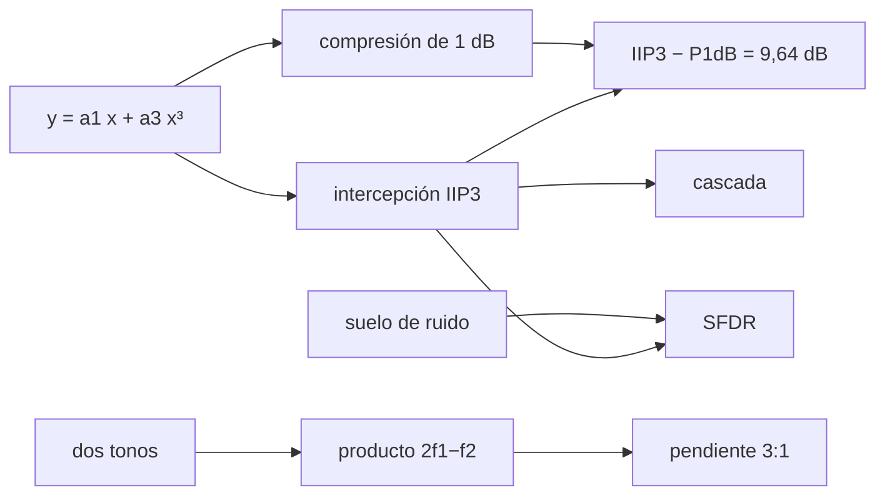

# B49-C09 — Linealidad, compresión e intermodulación de receptores de RF

<!-- nav:top -->
[🏠 Programa](../../../../README.md) · [📚 Bloque B49](../../../tronco-comun/B49-antenas-y-receptores-de-radioastronomia.md) · [← Anterior: B49-C08 — Estabilidad de ganancia de receptores y variaciones de ganancia](../B49-C08-estabilidad-de-ganancia-de-receptores-y-variaciones-de-ganancia/CLASE.md) · [Siguiente: B49-C10 — Filtros de radiofrecuencia pasabanda y rechazo de banda imagen →](../B49-C10-filtros-de-radiofrecuencia-pasabanda-y-rechazo-de-banda-imagen/CLASE.md)
<!-- /nav -->

## 1. Ubicación, nivel y alcance

Clase 9 del bloque B49. Nivel N3. Un receptor es lineal solo hasta cierta potencia; una señal fuerte (por ejemplo una interferencia) comprime la ganancia y crea productos falsos. Aquí modelas la no linealidad con un polinomio, calculas el **punto de compresión de 1 dB** y el **punto de intercepción de tercer orden**, haces una prueba de dos tonos con una transformada discreta, combinas etapas y obtienes el rango libre de espurios. Usas [B05](../../../tronco-comun/B05-fisica-fundamental-para-el-espacio.md), [B10](../../../tronco-comun/B10-algebra-lineal-y-matematicas-geometricas.md) y [B12](../../../tronco-comun/B12-probabilidad-estadistica-e-incertidumbre.md). B44-C10 trata la no linealidad de detectores ópticos; aquí es el receptor de RF.

## 2. Por qué esta clase existe

Un receptor que satura con una señal fuerte arruina la observación de una señal débil cercana. La decisión central: **¿qué potencia máxima admite el receptor y qué productos de intermodulación genera?**

## 3. Lo que podrás hacer al terminar

1. Relacionar `a₁`, `a₃` con P1dB e IIP3.
2. Comprobar que IIP3 − P1dB = 9,64 dB.
3. Medir la intermodulación de tercer orden con dos tonos.
4. Verificar la pendiente 3:1.
5. Combinar el IIP3 de dos etapas.
6. Calcular el rango libre de espurios.

La evidencia es la **ficha de la linealidad del receptor** del ejercicio 12 (sección 20).

## 4. Con qué llegas y cómo comprobarlo

1. ¿Qué es una incertidumbre?
2. ¿Qué es una simulación Monte Carlo?
3. ¿Qué es una tabla de resultados?
4. ¿Qué es un valor ilustrativo?
5. ¿Qué es una verificación?

<details>
<summary>Ver respuestas</summary>

1. Un intervalo en que se espera el valor verdadero. 2. Repetir con números aleatorios de semilla fija. 3. Un resumen ordenado de cálculos. 4. Un valor propuesto para el ejemplo, no medido. 5. Comparar un cálculo con un caso independiente.
</details>

Con cuatro o cinco aciertos, sigue; si no, repasa los prerrequisitos.

## 5. Un caso de contexto y casos de referencia

Un amplificador de `20 dB` con `IIP3 = −10 dBm` y `a₃ = −1333,33` tiene `P1dB = −19,636 dBm` (diferencia `9,636 dB`). En dos tonos, el producto de tercer orden vale `−110,000; −80,000; −50,000; −20,000 dBm` para `−50; −40; −30; −20 dBm` por tono (pendiente `3,0000`). La cascada con una segunda etapa de `+5 dBm` y 10 dB da `IIP3 = −16,193 dBm`. Con `B = 1 MHz` y `NF = 2 dB`, el rango libre de espurios es `67,98 dB`. Es el **ejemplo conductor**; valores ilustrativos.

## 6. Vocabulario

El **punto de compresión de 1 dB** es la entrada en que la ganancia cae 1 dB. El **punto de intercepción de tercer orden** (IIP3) es la entrada ficticia en que los productos igualarían a la fundamental. La **intermodulación** son productos `2f₁ − f₂`. El **rango libre de espurios** (SFDR) es la distancia entre el suelo de ruido y el nivel en que la intermodulación lo iguala. El **suelo de ruido** es `k T B` más la cifra de ruido.

## 7. Modelo mental: un altavoz saturado

Como un altavoz con el volumen alto: al principio suena fiel, luego distorsiona y mezcla las notas, creando tonos que no estaban.



*Descripción textual:* el término cúbico comprime la fundamental y crea productos con pendiente 3; la intercepción resume ambos efectos.

Analogía: un altavoz saturado. Límite: polinomio sin memoria, solo tercer orden.

## 8. La explicación, paso a paso

### 8.1 Compresión e intercepción

`A_IP3 = 0,10000 V` y `a₃ = −1333,33 V⁻²`. La compresión de 1 dB ocurre en `A = 0,03298 V`, `P1dB = −19,636 dBm`; IIP3 − P1dB = `9,636 dB`. A esa entrada la ganancia es `19,0000 dB`.

### 8.2 Prueba de dos tonos

| P por tono (dBm) | fundamental (dBm) | IM3 (dBm) | IM3 teórico (dBm) |
|---|---|---|---|
| −50 | −30,003 | −110,000 | −110,000 |
| −40 | −20,026 | −80,000 | −80,000 |
| −30 | −10,265 | −50,000 | −50,000 |
| −20 | −3,098 | −20,000 | −20,000 |

Pendiente entre −50 y −40 dBm: `3,0000 dB/dB`. IIP3 extrapolado: `−10,001 dBm`. En cascada: `1/IIP3 = 1/IIP3₁ + G₁/IIP3₂`, `IIP3 = −16,193 dBm`, igual al medido en la simulación.

### 8.3 Rango dinámico

Suelo de entrada `−111,98 dBm` (`k T B` a 290 K, 1 MHz y `NF = 2 dB`). `SFDR = (2/3)(IIP3 − suelo) = 67,98 dB`; un tono de `−43,99 dBm` por canal produce un producto igual al suelo.

### 8.4 Lectura

Por cada decibelio que sube la entrada, el producto sube tres. La segunda etapa limita la cascada porque ve la señal amplificada por la primera: más ganancia previa empeora el IIP3 total. El modelo solo contiene el término cúbico.

## 9. Magnitudes, símbolos y unidades

| Símbolo | Qué es | Unidad | Valor / nota |
|---|---|---|---|
| `a₁, a₃` | coeficientes lineal y cúbico | —, V⁻² | 10; −1333,33 |
| `IIP3` | intercepción de tercer orden en la entrada | dBm | −10 |
| `P1dB` | compresión de 1 dB | dBm | −19,636 |
| `SFDR` | rango libre de espurios | dB | 67,98 |
| `k` | constante de Boltzmann | J/K | 1,380649 × 10⁻²³ (NIST) |

## 10. Convenciones y referencias

NIST (`k`); amplificadores, impedancia, ancho de banda y cifra de ruido **ilustrativos**.

## 11. De dónde sale lo que afirmamos

| ID | Fuente | Localizador | Respalda | Estado |
|---|---|---|---|---|
| S1 | NIST, *Fundamental Physical Constants* (CODATA 2022) | https://physics.nist.gov/cuu/Constants/Table/allascii.txt | constantes citadas en la sección 9 | Consultada el 2026-11-09 |

Límites: Las relaciones de compresión, intercepción y SFDR son estándar (texto no consultado) y se verificaron con la prueba de dos tonos y la cascada simulada.

## 12. Cómo ver las pendientes

| P por tono (dBm) | IM3 (dBm) |
|---|---|
| −50 | −110,000 |
| −40 | −80,000 |
| −30 | −50,000 |
| −20 | −20,000 |

Descripción larga: el producto sube 30 dB cuando la entrada sube 10 dB.

## 13. Ejemplo trabajado: la amplitud de intercepción

**Paso 1 · Potencia.** `−10 dBm = 10⁻⁴ W`.

**Paso 2 · Amplitud.** `A² = 2 R P = 2 × 50 × 10⁻⁴ = 0,01 V²`, `A = 0,1 V`.

**Paso 3 · Coeficiente.** `a₃ = −(4/3) a₁/A² = −1333,33`.

**Paso 4 · Compresión.** `A²₁dB = (4/3)(a₁/|a₃|)(1 − 10^(−1/20)) = 1,0875 × 10⁻³`; `A = 0,03298 V`.

## 14. Distintas formas de describir el mismo resultado

**Por fórmula:** `P1dB` e IIP3. **Por simulación:** dos tonos con DFT. **Por tabla:** pendiente. **Por código:** `intermodulacion.py`.

## 15. Práctica guiada

**Ejercicio 1 · con los pasos indicados.** Amplitud de intercepción. *Pasos:* ejemplo 13.

<details><summary>Solución comentada</summary>

`0,1000 V`.
</details>

**Ejercicio 2 · con una pista.** Coeficiente `a₃`.

<details><summary>Solución comentada</summary>

`−1333,33 V⁻²`.
</details>

**Ejercicio 3 · casi autónomo.** `P1dB` a partir del IIP3.

<details><summary>Solución comentada</summary>

`−10 − 9,636 = −19,636 dBm`.
</details>

## 16. Práctica autónoma, transferencia e integrador

**Ejercicio 4.** Producto de tercer orden con −40 dBm por tono.

<details><summary>Solución comentada</summary>

`3(−40) + 20 − 2(−10) = −80 dBm`.
</details>

**Ejercicio 5.** IIP3 de la cascada.

<details><summary>Solución comentada</summary>

`1/IIP3 = 10 + 31,62 = 41,62 mW⁻¹`, `−16,19 dBm`.
</details>

**Ejercicio 6.** Suelo de ruido.

<details><summary>Solución comentada</summary>

`−173,975 + 60 + 2 = −111,98 dBm`.
</details>

**Ejercicio 7.** SFDR.

<details><summary>Solución comentada</summary>

`(2/3)(−10 + 111,98) = 67,98 dB`.
</details>

**Ejercicio 8.** Pendiente entre −40 y −30 dBm.

<details><summary>Solución comentada</summary>

`(−50 + 80)/10 = 3`.
</details>

**Ejercicio 9 · transferencia.** **Transferencia.** Un compañero dice que más ganancia siempre mejora la sensibilidad. Responde.

<details><summary>Solución comentada</summary>

Mejora el ruido de las etapas siguientes pero baja el IIP3 de la cascada.
</details>

**Ejercicio 10 · transferencia.** **Transferencia.** ¿Por qué se mide con dos tonos y no con uno?

<details><summary>Solución comentada</summary>

El producto `2f₁ − f₂` cae cerca de la señal y no se filtra.
</details>

**Ejercicio 11 · transferencia.** **Transferencia.** ¿Qué no modela un polinomio cúbico?

<details><summary>Solución comentada</summary>

Orden superior, memoria y saturación dura.
</details>

**Ejercicio 12.** **Integrador.** Elabora tu *ficha de la linealidad del receptor*: P1dB, IIP3, cascada y SFDR.

<details><summary>Solución comentada</summary>

Secciones 8.1–8.4.
</details>

**Ejercicio 12 · integrador.** **Integrador.** Elabora tu *ficha de la linealidad del receptor*: P1dB, IIP3, cascada y SFDR.

<details><summary>Solución modelo</summary>

Secciones 8.1–8.4.
</details>

## 17. Laboratorio: compresión e intermodulación

El script [intermodulacion.py](intermodulacion.py) mide dos tonos con DFT y combina etapas (**comprueba** pendiente 3,00 y 5 % de la cascada).

**Datos:** `k` de NIST; amplificadores **ilustrativos**. **Predice antes de ejecutar:** ¿cuánto sube el producto si la entrada sube 5 dB? (15 dB.) **Ejecución del 2026-11-09 (Python 3.12.9):**

```text
Python 3.12.9 (biblioteca estandar)
a1 = 10.0 (20 dB) ; IIP3 = -10.0 dBm -> A_IP3 = 0.10000 V ; a3 = -1333.33 V^-2
Compresion de 1 dB en la entrada: A = 0.03298 V ; P1dB = -19.636 dBm ; IIP3 - P1dB = 9.636 dB
Ganancia de pequena senal 20,000 dB ; ganancia a P1dB = 19.0000 dB (compresion -1.0000 dB)
 P por tono (dBm)  fundamental (dBm)  IM3 (dBm)  IM3 teorico (dBm)  dif relativa
            -50.0            -30.003   -110.000           -110.000      1.47e-11
            -40.0            -20.026    -80.000            -80.000      1.47e-12
            -30.0            -10.265    -50.000            -50.000      1.42e-13
            -20.0             -3.098    -20.000            -20.000      1.01e-14
Pendiente del producto de tercer orden entre -50 y -40 dBm: 3.0000 dB/dB
IIP3 por extrapolacion a bajo nivel = -10.001 dBm (referido a la entrada; la ganancia de 20 dB se resta a la salida)
Cascada: 1/IIP3 = 1/IIP3_1 + G1/IIP3_2 -> IIP3 = -16.193 dBm (primera etapa sola -10.0 dBm)
IIP3 de la cascada simulada = -16.193 dBm ; formula = -16.193 dBm ; dif = 0.000 dB
Suelo de ruido de entrada = -111.98 dBm (kTB a 290 K, B = 1 MHz, NF = 2 dB) ; SFDR = (2/3)(IIP3 - suelo) = 67.98 dB
Un tono de -43.99 dBm por canal produce IM3 igual al suelo de ruido
Pruebas superadas.
```

```bash
python programa/clases/B49/B49-C09-linealidad-compresion-e-intermodulacion-de-receptores-de-rf/intermodulacion.py
```

**Límites:** polinomio sin memoria, solo tercer orden.

## 18. Errores frecuentes y cómo corregirlos

**Confundir IIP3 y OIP3.** Se corrige con el ejemplo 13.

**Sumar IIP3 en dB.** Se corrige con la cascada de 8.2.

**Ignorar el suelo de ruido.** Se corrige con 8.3.

**Tomar los amplificadores por reales.** Se corrige con la sección 10.

## 19. Cómo sabrás que vas bien

Tras la sección 8: ¿qué resultado esperabas y cuál obtuviste? Si dudas, repasa el ejemplo 13. Tras el laboratorio: ¿qué comprueba? (ver la sección 17).

## 20. Qué entregas y cómo se evalúa

El producto es tu **ficha de la linealidad del receptor** (ejercicio 12).

| Criterio | Inicial | En desarrollo | Logrado | Destacado |
|---|---|---|---|---|
| Conceptos | Los confunde | Parciales | conceptos de la clase | Explica los límites |
| Cálculo | Sin unidades | Con errores | Tablas completas | Calcula casos nuevos |
| Numérico | Sin comprobar | Un caso | Contraste con el análisis | Interpreta las diferencias |
| Fuentes | Sin fuente | Sin fecha | fuentes con fecha | Declara lo ilustrativo |
| Límites | No los nombra | Uno | Tres | Discute qué falta del modelo |

**Condiciones críticas (no se compensan con promedio):** rotular los componentes como ilustrativos; citar solo NIST; no sustituir una medición del receptor.

## 21. Ética, seguridad y límites

Clase educativa: los modelos son simplificados. Accesibilidad: tablas equivalentes a las gráficas, fórmulas en texto, ejercicios sin conexión.

## 22. Para cerrar y seguir

El producto de tercer orden sube 3 dB por dB; con IIP3 de −10 dBm y suelo de −112 dBm, el SFDR es de 68 dB. Queda una pregunta: ¿cómo se rechaza lo que cae fuera de la banda?

**Glosario español–inglés.** compresión · *compression*; intermodulación · *intermodulation*; punto de intercepción · *intercept point*; rango libre de espurios · *spurious-free dynamic range*; prueba de dos tonos · *two-tone test*.

**Continuidad.** [B49-C10](../B49-C10-filtros-de-radiofrecuencia-pasabanda-y-rechazo-de-banda-imagen/CLASE.md) estudia los filtros pasabanda y el rechazo de la banda imagen.

**Referencias:** ver sección 11.

<!-- nav:bottom -->
---

[← Anterior: B49-C08 — Estabilidad de ganancia de receptores y variaciones de ganancia](../B49-C08-estabilidad-de-ganancia-de-receptores-y-variaciones-de-ganancia/CLASE.md) · [📚 Bloque B49](../../../tronco-comun/B49-antenas-y-receptores-de-radioastronomia.md) · [Siguiente: B49-C10 — Filtros de radiofrecuencia pasabanda y rechazo de banda imagen →](../B49-C10-filtros-de-radiofrecuencia-pasabanda-y-rechazo-de-banda-imagen/CLASE.md)
<!-- /nav -->
