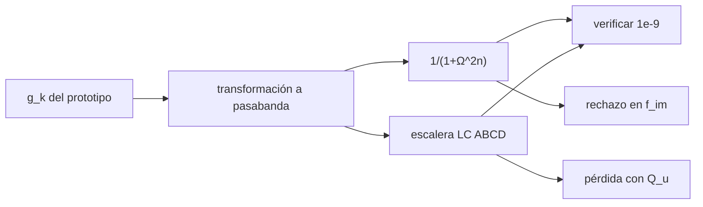

# B49-C10 — Filtros de radiofrecuencia pasabanda y rechazo de banda imagen

<!-- nav:top -->
[🏠 Programa](../../../../README.md) · [📚 Bloque B49](../../../tronco-comun/B49-antenas-y-receptores-de-radioastronomia.md) · [← Anterior: B49-C09 — Linealidad, compresión e intermodulación de receptores de RF](../B49-C09-linealidad-compresion-e-intermodulacion-de-receptores-de-rf/CLASE.md) · [Siguiente: B49-C11 — Mezcladores de frecuencia: pérdida de conversión y productos espurios →](../B49-C11-mezcladores-de-frecuencia-perdida-de-conversion-y-productos-espurios/CLASE.md)
<!-- /nav -->

## 1. Ubicación, nivel y alcance

Clase 10 del bloque B49. Nivel N3. El filtro deja pasar la banda deseada y rechaza lo demás, sobre todo la **banda imagen** de un receptor superheterodino. Aquí calculas la respuesta de Butterworth, la verificas con una escalera LC de resonadores (matrices ABCD), obtienes el rechazo de la imagen para varios órdenes y la pérdida de inserción con resonadores de `Q` finito. Usas [B10](../../../tronco-comun/B10-algebra-lineal-y-matematicas-geometricas.md), [B05](../../../tronco-comun/B05-fisica-fundamental-para-el-espacio.md) y [B12](../../../tronco-comun/B12-probabilidad-estadistica-e-incertidumbre.md). B15-C07 trata solo filtrado digital; aquí es radiofrecuencia.

## 2. Por qué esta clase existe

Más orden rechaza más, pero también pierde más señal. La decisión central: **¿qué orden y qué ancho de banda dan el rechazo de imagen necesario con una pérdida aceptable?**

## 3. Lo que podrás hacer al terminar

1. Calcular el prototipo `g_k` de Butterworth.
2. Transformarlo a pasabanda.
3. Verificar la respuesta con la escalera ABCD.
4. Calcular el rechazo de la imagen para varios órdenes.
5. Estimar la pérdida de inserción con `Q` finito.
6. Ver cómo la frecuencia intermedia aleja la imagen.

La evidencia es la **ficha del filtro pasabanda** del ejercicio 12 (sección 20).

## 4. Con qué llegas y cómo comprobarlo

1. ¿Qué es una incertidumbre?
2. ¿Qué es una simulación Monte Carlo?
3. ¿Qué es una tabla de resultados?
4. ¿Qué es un valor ilustrativo?
5. ¿Qué es una verificación?

<details>
<summary>Ver respuestas</summary>

1. Un intervalo en que se espera el valor verdadero. 2. Repetir con números aleatorios de semilla fija. 3. Un resumen ordenado de cálculos. 4. Un valor propuesto para el ejemplo, no medido. 5. Comparar un cálculo con un caso independiente.
</details>

Con cuatro o cinco aciertos, sigue; si no, repasa los prerrequisitos.

## 5. Un caso de contexto y casos de referencia

Con `f₀ = 1420 MHz`, `BW = 200 MHz` y `f_FI = 100 MHz`, la imagen está en `1220 MHz` (`Ω = −2,1639`). El rechazo es `13,603; 20,157; 33,526; 46,934 dB` para `n = 2; 3; 5; 7`, y la pérdida de inserción con `Q_u = 200` es `0,4359; 0,6166; 0,9977; 1,3855 dB`. Es el **ejemplo conductor**; valores ilustrativos.

## 6. Vocabulario

El **filtro de Butterworth** es el de respuesta plana en la banda. El **prototipo pasabajos** `g_k = 2 sin((2k−1)π/2n)`. La **banda imagen** `f_RF − 2 f_FI` también cae en la FI. La **pérdida de inserción** es la atenuación en la banda. El **factor de calidad sin carga** `Q_u` mide las pérdidas del resonador. La **matriz ABCD** describe un bipuerto.

## 7. Modelo mental: un colador de fideos

Como un colador: deja pasar lo que cabe y detiene lo demás; uno más fino detiene mejor pero deja pasar menos agua.



*Descripción textual:* el orden fija la pendiente del filtro y su pérdida; la FI fija a qué distancia cae la imagen.

Analogía: un colador de fideos. Límite: elementos concentrados, resonadores aislados.

## 8. La explicación, paso a paso

### 8.1 Orden, rechazo y pérdida

`Δ = 0,14085`. La escalera LC coincide con la fórmula en `|S21|²` con diferencia máxima menor que `10⁻¹⁴`.

| n | suma de g | rechazo en la imagen (dB) | pérdida central, Q=200 (dB) | aproximación (dB) |
|---|---|---|---|---|
| 2 | 2,8284 | 13,603 | 0,4359 | 0,4361 |
| 3 | 4,0000 | 20,157 | 0,6166 | 0,6167 |
| 5 | 6,4721 | 33,526 | 0,9977 | 0,9979 |
| 7 | 8,9879 | 46,934 | 1,3855 | 1,3857 |

Los puntos de −3 dB están en `1323,517` y `1523,517 MHz`.

### 8.2 Efecto de la frecuencia intermedia (n = 5)

| f_FI (MHz) | imagen (MHz) | rechazo (dB) |
|---|---|---|
| 20 | 1380 | 0,001 |
| 50 | 1320 | 3,892 |
| 100 | 1220 | 33,526 |
| 200 | 1020 | 67,982 |

### 8.3 Lectura

Pasar de `n = 5` a `n = 7` gana 13,4 dB de rechazo y cuesta 0,39 dB de pérdida. Con una FI de 20 MHz la imagen cae dentro de la banda y ningún filtro razonable la rechaza: hay que subir la FI o usar un receptor de rechazo de imagen. El filtro es de prototipo, no un diseño de fabricación.

## 9. Magnitudes, símbolos y unidades

| Símbolo | Qué es | Unidad | Valor / nota |
|---|---|---|---|
| `n` | orden | — | 5 |
| `Δ` | ancho fraccional `BW/f₀` | — | 0,14085 |
| `Ω` | variable pasabanda | — | −2,1639 |
| `Q_u` | factor de calidad sin carga | — | 200 |
| `f_im` | frecuencia imagen | MHz | 1220 |

## 10. Convenciones y referencias

Sin constantes; frecuencias, ancho de banda y `Q_u` **ilustrativos**.

## 11. De dónde sale lo que afirmamos

| ID | Fuente | Localizador | Respalda | Estado |
|---|---|---|---|---|
| — | Sin fuente externa | — | relaciones estándar que verifica el laboratorio | No se consultó una fuente para esta clase |

Límites: El prototipo de Butterworth y la transformación son resultados estándar (texto no consultado); se verificaron con la escalera ABCD independiente. Ningún filtro real.

## 12. Cómo ver el rechazo de la imagen

| n | rechazo (dB) | pérdida (dB) |
|---|---|---|
| 3 | 20,157 | 0,6166 |
| 5 | 33,526 | 0,9977 |
| 7 | 46,934 | 1,3855 |

Descripción larga: más orden da más rechazo y más pérdida.

## 13. Ejemplo trabajado: el rechazo de la imagen de orden 3

**Paso 1 · Imagen.** `1420 − 2 × 100 = 1220 MHz`.

**Paso 2 · Omega.** `(1220/1420 − 1420/1220)/0,14085 = −2,1639`.

**Paso 3 · Potencia.** `1 + 2,1639⁶ = 103,7`.

**Paso 4 · Rechazo.** `10 log₁₀ 103,7 = 20,16 dB`.

## 14. Distintas formas de describir el mismo resultado

**Por fórmula:** `1 + Ω^(2n)`. **Por escalera:** ABCD. **Por tabla:** orden. **Por código:** `filtro_pasabanda.py`.

## 15. Práctica guiada

**Ejercicio 1 · con los pasos indicados.** Ancho fraccional. *Pasos:* ejemplo 13.

<details><summary>Solución comentada</summary>

`200/1420 = 0,14085`.
</details>

**Ejercicio 2 · con una pista.** Frecuencia imagen.

<details><summary>Solución comentada</summary>

`1220 MHz`.
</details>

**Ejercicio 3 · casi autónomo.** `Ω` en la imagen.

<details><summary>Solución comentada</summary>

`−2,1639`.
</details>

## 16. Práctica autónoma, transferencia e integrador

**Ejercicio 4.** Rechazo con `n = 5`.

<details><summary>Solución comentada</summary>

`1 + 2,1639¹⁰ ≈ 2252`, `33,53 dB`.
</details>

**Ejercicio 5.** Pérdida con `Q_u = 400` y `n = 5`.

<details><summary>Solución comentada</summary>

La mitad: `0,499 dB`.
</details>

**Ejercicio 6.** Ganancia de rechazo de `n = 5` a `7`.

<details><summary>Solución comentada</summary>

`46,934 − 33,526 = 13,41 dB`.
</details>

**Ejercicio 7.** Costo en pérdida de ese cambio.

<details><summary>Solución comentada</summary>

`1,3855 − 0,9977 = 0,388 dB`.
</details>

**Ejercicio 8.** Rechazo con FI de 50 MHz y `n = 5`.

<details><summary>Solución comentada</summary>

`3,892 dB`.
</details>

**Ejercicio 9 · transferencia.** **Transferencia.** Un compañero dice que con n = 7 sobra un filtro de FI alta. Responde.

<details><summary>Solución comentada</summary>

Una FI alta da el mismo rechazo con menos orden: 33,5 dB con n = 5 a 100 MHz, 68 dB a 200 MHz.
</details>

**Ejercicio 10 · transferencia.** **Transferencia.** ¿Por qué la pérdida sube con el orden?

<details><summary>Solución comentada</summary>

La suma de `g_k` crece y cada resonador disipa.
</details>

**Ejercicio 11 · transferencia.** **Transferencia.** ¿Qué limita el modelo?

<details><summary>Solución comentada</summary>

Elementos concentrados y resonadores sin acoplos parásitos.
</details>

**Ejercicio 12.** **Integrador.** Elabora tu *ficha del filtro pasabanda*: orden, rechazo de imagen y pérdida.

<details><summary>Solución comentada</summary>

Secciones 8.1–8.3.
</details>

**Ejercicio 12 · integrador.** **Integrador.** Elabora tu *ficha del filtro pasabanda*: orden, rechazo de imagen y pérdida.

<details><summary>Solución modelo</summary>

Secciones 8.1–8.3.
</details>

## 17. Laboratorio: filtro de Butterworth

El script [filtro_pasabanda.py](filtro_pasabanda.py) verifica la fórmula con una escalera ABCD y calcula rechazo y pérdida (**comprueba** `10⁻⁹` y 5 %).

**Datos:** sin constantes; filtro **ilustrativo**. **Predice antes de ejecutar:** ¿qué orden da más de 30 dB? (n = 5.) **Ejecución del 2026-11-09 (Python 3.12.9):**

```text
Python 3.12.9 (biblioteca estandar)
f0 = 1420.0 MHz ; BW = 200.0 MHz ; Delta = 0.14085 ; f_FI = 100.0 MHz ; banda imagen en 1220.0 MHz ; Omega_im = -2.1639
 n   suma g  rechazo imagen (dB)  escalera (dB)  dif max |S21|^2  IL centro Qu=200 (dB)  aprox. (dB)
 2   2.8284               13.603         13.603         2.05e-15                 0.4359       0.4361
 3   4.0000               20.157         20.157         4.44e-15                 0.6166       0.6167
 5   6.4721               33.526         33.526         7.11e-15                 0.9977       0.9979
 7   8.9879               46.934         46.934         7.66e-15                 1.3855       1.3857
Puntos de -3 dB: f = f0 sqrt(1 + (Delta/2)^2) +- f0 Delta/2
  f_inf = 1323.517 MHz ; f_sup = 1523.517 MHz ; |S21|^2 en ambos (n = 5) = 0.50000 y 0.50000
Efecto de la frecuencia intermedia en el rechazo de la imagen (n = 5, BW = 200 MHz):
  f_FI =    20 MHz -> imagen en   1380 MHz ; rechazo =    0.001 dB
  f_FI =    50 MHz -> imagen en   1320 MHz ; rechazo =    3.892 dB
  f_FI =   100 MHz -> imagen en   1220 MHz ; rechazo =   33.526 dB
  f_FI =   200 MHz -> imagen en   1020 MHz ; rechazo =   67.982 dB
Pruebas superadas.
```

```bash
python programa/clases/B49/B49-C10-filtros-de-radiofrecuencia-pasabanda-y-rechazo-de-banda-imagen/filtro_pasabanda.py
```

**Límites:** elementos concentrados, resonadores aislados.

## 18. Errores frecuentes y cómo corregirlos

**Olvidar la pérdida de inserción.** Se corrige con 8.1.

**Usar una FI baja.** Se corrige con 8.2.

**Confundir la imagen con la frecuencia RF.** Se corrige con la sección 6.

**Tomar el filtro de prototipo por un diseño real.** Se corrige con la sección 10.

## 19. Cómo sabrás que vas bien

Tras la sección 8: ¿qué resultado esperabas y cuál obtuviste? Si dudas, repasa el ejemplo 13. Tras el laboratorio: ¿qué comprueba? (ver la sección 17).

## 20. Qué entregas y cómo se evalúa

El producto es tu **ficha del filtro pasabanda** (ejercicio 12).

| Criterio | Inicial | En desarrollo | Logrado | Destacado |
|---|---|---|---|---|
| Conceptos | Los confunde | Parciales | conceptos de la clase | Explica los límites |
| Cálculo | Sin unidades | Con errores | Tablas completas | Calcula casos nuevos |
| Numérico | Sin comprobar | Un caso | Contraste con el análisis | Interpreta las diferencias |
| Fuentes | Sin fuente | Sin fecha | fuentes con fecha | Declara lo ilustrativo |
| Límites | No los nombra | Uno | Tres | Discute qué falta del modelo |

**Condiciones críticas (no se compensan con promedio):** rotular el filtro como de prototipo; no atribuirlo a un componente real; no citar fuentes no consultadas.

## 21. Ética, seguridad y límites

Clase educativa: los modelos son simplificados. Accesibilidad: tablas equivalentes a las gráficas, fórmulas en texto, ejercicios sin conexión.

## 22. Para cerrar y seguir

Un filtro de orden 5 rechaza 33,5 dB la imagen y pierde 1 dB; una FI mayor rechaza más sin subir el orden. Queda una pregunta: ¿cómo convierte frecuencias el mezclador?

**Glosario español–inglés.** filtro pasabanda · *bandpass filter*; banda imagen · *image band*; pérdida de inserción · *insertion loss*; Butterworth · *Butterworth*; frecuencia intermedia · *intermediate frequency*.

**Continuidad.** [B49-C11](../B49-C11-mezcladores-de-frecuencia-perdida-de-conversion-y-productos-espurios/CLASE.md) estudia los mezcladores de frecuencia.

**Referencias:** ver sección 11.

<!-- nav:bottom -->
---

[← Anterior: B49-C09 — Linealidad, compresión e intermodulación de receptores de RF](../B49-C09-linealidad-compresion-e-intermodulacion-de-receptores-de-rf/CLASE.md) · [📚 Bloque B49](../../../tronco-comun/B49-antenas-y-receptores-de-radioastronomia.md) · [Siguiente: B49-C11 — Mezcladores de frecuencia: pérdida de conversión y productos espurios →](../B49-C11-mezcladores-de-frecuencia-perdida-de-conversion-y-productos-espurios/CLASE.md)
<!-- /nav -->
