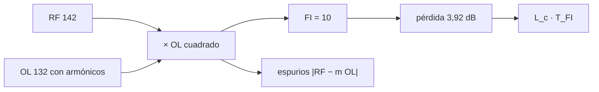

# B49-C11 — Mezcladores de frecuencia: pérdida de conversión y productos espurios

<!-- nav:top -->
[🏠 Programa](../../../../README.md) · [📚 Bloque B49](../../../tronco-comun/B49-antenas-y-receptores-de-radioastronomia.md) · [← Anterior: B49-C10 — Filtros de radiofrecuencia pasabanda y rechazo de banda imagen](../B49-C10-filtros-de-radiofrecuencia-pasabanda-y-rechazo-de-banda-imagen/CLASE.md) · [Siguiente: B50-C01 — Trazado exacto de rayos y aberraciones de orden superior →](../../../tronco-comun/B50-diseno-optico-computacional-y-tolerancias.md#b50-c01)
<!-- /nav -->

## 1. Ubicación, nivel y alcance

Clase 11 del bloque B49. Nivel N3. El mezclador traslada la señal de radio a una frecuencia intermedia multiplicándola por el oscilador local, y crea además productos no deseados. Aquí simulas un **mezclador de conmutación** con transformada discreta, mides la **pérdida de conversión** ideal, los **armónicos** del oscilador local, la fuga en un mezclador no balanceado y la tabla de productos, y sumas el aporte de ruido de la FI. Usas [B10](../../../tronco-comun/B10-algebra-lineal-y-matematicas-geometricas.md), [B05](../../../tronco-comun/B05-fisica-fundamental-para-el-espacio.md) y [B12](../../../tronco-comun/B12-probabilidad-estadistica-e-incertidumbre.md). B46-C07 presenta la conversión en general; aquí se detalla.

## 2. Por qué esta clase existe

Cada producto no deseado puede caer en la banda de FI. La decisión central: **¿qué pérdida de conversión tiene el mezclador y dónde caen sus productos?**

## 3. Lo que podrás hacer al terminar

1. Mezclar una RF con un oscilador cuadrado.
2. Medir la FI y la pérdida de conversión.
3. Medir los espurios por armónicos del oscilador.
4. Comparar un mezclador no balanceado.
5. Enumerar los productos hasta orden 5.
6. Calcular el ruido que añade la pérdida de conversión.

La evidencia es la **ficha del mezclador de frecuencia** del ejercicio 12 (sección 20).

## 4. Con qué llegas y cómo comprobarlo

1. ¿Qué es una incertidumbre?
2. ¿Qué es una simulación Monte Carlo?
3. ¿Qué es una tabla de resultados?
4. ¿Qué es un valor ilustrativo?
5. ¿Qué es una verificación?

<details>
<summary>Ver respuestas</summary>

1. Un intervalo en que se espera el valor verdadero. 2. Repetir con números aleatorios de semilla fija. 3. Un resumen ordenado de cálculos. 4. Un valor propuesto para el ejemplo, no medido. 5. Comparar un cálculo con un caso independiente.
</details>

Con cuatro o cinco aciertos, sigue; si no, repasa los prerrequisitos.

## 5. Un caso de contexto y casos de referencia

Con RF = 142, OL = 132 y FI = 10 (unidades de 10 MHz), la FI mide `0,636620 = 2/π`, es decir una pérdida de conversión de `3,9224 dB`. Los armónicos 3, 5, 7 y 9 dan espurios `0,333; 0,200; 0,143; 0,111` de la FI. Con 7 dB de pérdida y una FI de 100 K, `L_c T_FI = 501,2 K`. Es el **ejemplo conductor**; valores ilustrativos.

## 6. Vocabulario

La **pérdida de conversión** es la relación entre la potencia de RF y la de FI. El **oscilador local** (OL) es la señal con que se mezcla. Un **espurio** es un producto no deseado `|m f_RF ± n f_OL|`. La **fuga** es la señal que pasa al puerto de salida sin mezclar. El mezclador **balanceado** cancela la fuga del OL o de la RF. La **imagen** es la otra frecuencia que cae en la FI.

## 7. Modelo mental: dos diapasones

Como dos diapasones cercanos: se oye el batido (la diferencia), pero también otros tonos que nacen de la mezcla.



*Descripción textual:* la multiplicación crea suma y diferencia; los armónicos del OL crean espurios; la pérdida de conversión escala el ruido de la FI.

Analogía: dos diapasones. Límite: conmutación ideal, sin saturación de la FI.

## 8. La explicación, paso a paso

### 8.1 FI y espurios

`RF = 142`, `OL = 132`, `FI = |RF − OL| = 10` (unidades de 10 MHz; 100 MHz). Amplitud de la FI: `0,636619772 = 2/π`; pérdida de conversión: `3,9224 dB = 20 log₁₀(π/2)`.

| armónico m | frecuencia del espurio (RF − m OL en valor absoluto) | amplitud | relativa a la FI | 1/m |
|---|---|---|---|---|
| 1 | 10 | 0,636620 | 1,000000 | 1,0000 |
| 3 | 254 | 0,212207 | 0,333333 | 0,3333 |
| 5 | 518 | 0,127324 | 0,200000 | 0,2000 |
| 7 | 782 | 0,090946 | 0,142857 | 0,1429 |
| 9 | 1046 | 0,070736 | 0,111111 | 0,1111 |

### 8.2 Imagen, fuga y productos

Una señal en la imagen `f = 2 OL − RF = 122` también cae en la FI (`10`). En un mezclador no balanceado (OL de 0 a 1) la salida contiene una **fuga** de RF de `0,4995` y la FI baja a `0,3183`. De todos los productos de orden hasta 5, el único con frecuencia entre 5 y 15 es `1RF − 1OL` (10).

### 8.3 Ruido

Con 7 dB de pérdida de conversión (`5,0119` veces), una FI de 100 K aporta `L_c T_FI = 501,2 K` y la cadena `1664,2 K` con un mezclador de 1163 K. Con la pérdida ideal de 3,922 dB, `1409,7 K`.

### 8.4 Lectura

La pérdida ideal del conmutador de 3,92 dB es un mínimo: los mezcladores reales pierden más (aquí se usan 7 dB). Cada decibelio de pérdida de conversión multiplica el aporte de la FI; por eso un LNA con ganancia previa (B49-C06) protege el ruido del receptor. Los mezcladores SIS y HEB no se calculan en este laboratorio.

## 9. Magnitudes, símbolos y unidades

| Símbolo | Qué es | Unidad | Valor / nota |
|---|---|---|---|
| `f_RF, f_OL` | frecuencias de RF y de OL | 10 MHz | 142; 132 |
| `f_FI` | frecuencia intermedia | 10 MHz | 10 |
| `L_c` | pérdida de conversión | dB | 3,9224 (ideal) |
| `m` | armónico del OL | — | 1, 3, 5, 7, 9 |
| `T_FI` | temperatura de ruido de la FI | K | 100 (ilustrativo) |

## 10. Convenciones y referencias

Sin constantes; frecuencias, pérdida de 7 dB y temperaturas **ilustrativas**.

## 11. De dónde sale lo que afirmamos

| ID | Fuente | Localizador | Respalda | Estado |
|---|---|---|---|---|
| — | Sin fuente externa | — | relaciones estándar que verifica el laboratorio | No se consultó una fuente para esta clase |

Límites: La pérdida ideal de un mezclador de conmutación y los armónicos 1/m son resultados estándar (texto no consultado) y se verificaron con la simulación y la DFT. Los mezcladores SIS y HEB no se calcularon ni se consultaron.

## 12. Cómo ver los espurios

| m | frecuencia | relativa |
|---|---|---|
| 1 | 10 | 1,0000 |
| 3 | 254 | 0,3333 |
| 5 | 518 | 0,2000 |

Descripción larga: los espurios lejanos de la FI bajan como 1/m.

## 13. Ejemplo trabajado: la pérdida de conversión

**Paso 1 · Fundamental.** El OL cuadrado tiene fundamental `4/π`.

**Paso 2 · Producto.** `cos a sen b` da `(1/2)(4/π) = 2/π` en la diferencia.

**Paso 3 · Pérdida.** `20 log₁₀(π/2) = 3,922 dB`.

**Paso 4 · Espurio m = 3.** `(2/π)/3 = 0,2122`.

## 14. Distintas formas de describir el mismo resultado

**Por fórmula:** `2/π`. **Por DFT:** bins enteros. **Por tabla:** armónicos. **Por código:** `mezclador.py`.

## 15. Práctica guiada

**Ejercicio 1 · con los pasos indicados.** FI en MHz. *Pasos:* ejemplo 13.

<details><summary>Solución comentada</summary>

`10 × 10 = 100 MHz`.
</details>

**Ejercicio 2 · con una pista.** Frecuencia de la imagen en MHz.

<details><summary>Solución comentada</summary>

`1220 MHz`.
</details>

**Ejercicio 3 · casi autónomo.** Pérdida de conversión ideal.

<details><summary>Solución comentada</summary>

`3,922 dB`.
</details>

## 16. Práctica autónoma, transferencia e integrador

**Ejercicio 4.** Espurio del armónico 3 respecto de la FI en dB.

<details><summary>Solución comentada</summary>

`20 log₁₀(1/3) = −9,54 dB`.
</details>

**Ejercicio 5.** Ídem para el armónico 5.

<details><summary>Solución comentada</summary>

`−13,98 dB`.
</details>

**Ejercicio 6.** Frecuencia del espurio del armónico 3 en MHz.

<details><summary>Solución comentada</summary>

`254 × 10 = 2540 MHz`.
</details>

**Ejercicio 7.** `L_c` de 7 dB en veces.

<details><summary>Solución comentada</summary>

`5,0119`.
</details>

**Ejercicio 8.** Cociente fuga/FI del mezclador no balanceado.

<details><summary>Solución comentada</summary>

`0,4995/0,3183 = 1,57`.
</details>

**Ejercicio 9 · transferencia.** **Transferencia.** Un compañero dice que el mezclador ideal no pierde nada. Responde.

<details><summary>Solución comentada</summary>

Un conmutador ideal ya pierde 3,92 dB.
</details>

**Ejercicio 10 · transferencia.** **Transferencia.** ¿Por qué importa la pérdida de conversión para el ruido?

<details><summary>Solución comentada</summary>

Multiplica el aporte de la FI: `L_c T_FI`.
</details>

**Ejercicio 11 · transferencia.** **Transferencia.** ¿Qué no calcula este laboratorio?

<details><summary>Solución comentada</summary>

Mezclas SIS o HEB, aislamiento finito ni saturación.
</details>

**Ejercicio 12.** **Integrador.** Elabora tu *ficha del mezclador de frecuencia*: FI, pérdida, espurios y ruido.

<details><summary>Solución comentada</summary>

Secciones 8.1–8.4.
</details>

**Ejercicio 12 · integrador.** **Integrador.** Elabora tu *ficha del mezclador de frecuencia*: FI, pérdida, espurios y ruido.

<details><summary>Solución modelo</summary>

Secciones 8.1–8.4.
</details>

## 17. Laboratorio: mezclador de conmutación

El script [mezclador.py](mezclador.py) simula la mezcla y mide FI, armónicos y fuga con DFT (**comprueba** `10⁻⁹`).

**Datos:** sin constantes; mezclador **ilustrativo**. **Predice antes de ejecutar:** ¿cuánto pierde un conmutador ideal? (3,92 dB.) **Ejecución del 2026-11-09 (Python 3.12.9):**

```text
Python 3.12.9 (biblioteca estandar)
RF = 142 ; OL = 132 ; FI = |RF - OL| = 10 (unidades de 10 MHz)
Amplitud de la FI = 0.636619772 ; 2/pi = 0.636619772 ; perdida de conversion = 3.9224 dB ; 20 log10(pi/2) = 3.9224 dB
armonico m  frecuencia |RF - m OL|   amplitud  relativa a la FI      1/m
         1                      10   0.636620          1.000000   1.0000
         3                     254   0.212207          0.333333   0.3333
         5                     518   0.127324          0.200000   0.2000
         7                     782   0.090946          0.142857   0.1429
         9                    1046   0.070736          0.111111   0.1111
Una senal en la imagen f = 2 OL - RF = 122 tambien cae en la FI = 10
Mezclador no balanceado (OL de 0 a 1): fuga de RF en la salida = 0.4995 ; FI = 0.3183
Productos de orden <= 5 con frecuencia entre 5 y 15 (banda de FI de 5 a 15 unidades):
    10: 1RF-1OL
Perdida de conversion de 7 dB = 5.0119 veces ; aporte de la FI referido a la entrada = L_c T_FI = 501.2 K ; T_mezclador + L_c T_FI = 1664.2 K
Con la perdida ideal de 3,922 dB y el mismo T_mezclador: 1409.7 K
Pruebas superadas.
```

```bash
python programa/clases/B49/B49-C11-mezcladores-de-frecuencia-perdida-de-conversion-y-productos-espurios/mezclador.py
```

**Límites:** conmutación ideal.

## 18. Errores frecuentes y cómo corregirlos

**Confundir FI con imagen.** Se corrige con 8.2.

**Olvidar los armónicos del OL.** Se corrige con 8.1.

**Ignorar la pérdida en el presupuesto de ruido.** Se corrige con 8.3.

**Tomar el mezclador ideal por real.** Se corrige con 8.4.

## 19. Cómo sabrás que vas bien

Tras la sección 8: ¿qué resultado esperabas y cuál obtuviste? Si dudas, repasa el ejemplo 13. Tras el laboratorio: ¿qué comprueba? (ver la sección 17).

## 20. Qué entregas y cómo se evalúa

El producto es tu **ficha del mezclador de frecuencia** (ejercicio 12).

| Criterio | Inicial | En desarrollo | Logrado | Destacado |
|---|---|---|---|---|
| Conceptos | Los confunde | Parciales | conceptos de la clase | Explica los límites |
| Cálculo | Sin unidades | Con errores | Tablas completas | Calcula casos nuevos |
| Numérico | Sin comprobar | Un caso | Contraste con el análisis | Interpreta las diferencias |
| Fuentes | Sin fuente | Sin fecha | fuentes con fecha | Declara lo ilustrativo |
| Límites | No los nombra | Uno | Tres | Discute qué falta del modelo |

**Condiciones críticas (no se compensan con promedio):** rotular el mezclador como ideal; no afirmar nada sobre mezcladores SIS o HEB no calculados; citar solo lo consultado.

## 21. Ética, seguridad y límites

Clase educativa: los modelos son simplificados. Accesibilidad: tablas equivalentes a las gráficas, fórmulas en texto, ejercicios sin conexión.

## 22. Para cerrar y seguir

Un conmutador ideal pierde 3,92 dB, genera espurios 1/m y escala el ruido de la FI por la pérdida de conversión. Con este bloque cierras la cadena de la antena a la frecuencia intermedia.

**Glosario español–inglés.** mezclador · *mixer*; pérdida de conversión · *conversion loss*; oscilador local · *local oscillator*; espurio · *spur*; fuga · *leakage*.

**Continuidad.** cierra el bloque: ya tienes la cadena completa de la antena a la frecuencia intermedia.

**Referencias:** ver sección 11.

<!-- nav:bottom -->
---

[← Anterior: B49-C10 — Filtros de radiofrecuencia pasabanda y rechazo de banda imagen](../B49-C10-filtros-de-radiofrecuencia-pasabanda-y-rechazo-de-banda-imagen/CLASE.md) · [📚 Bloque B49](../../../tronco-comun/B49-antenas-y-receptores-de-radioastronomia.md) · [Siguiente: B50-C01 — Trazado exacto de rayos y aberraciones de orden superior →](../../../tronco-comun/B50-diseno-optico-computacional-y-tolerancias.md#b50-c01)
<!-- /nav -->
