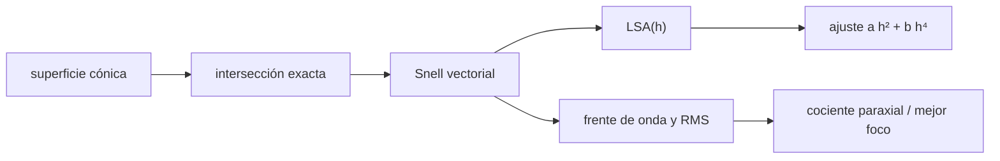

# B50-C01 — Trazado exacto de rayos y aberraciones de orden superior

<!-- nav:top -->
[🏠 Programa](../../../../README.md) · [📚 Bloque B50](../../../tronco-comun/B50-diseno-optico-computacional-y-tolerancias.md) · [← Anterior: B49-C11 — Mezcladores de frecuencia: pérdida de conversión y productos espurios](../../B49/B49-C11-mezcladores-de-frecuencia-perdida-de-conversion-y-productos-espurios/CLASE.md) · [Siguiente: B50-C02 — Optimización de superficies: función de mérito y restricciones →](../B50-C02-optimizacion-de-superficies-funcion-de-merito-y-restricciones/CLASE.md)
<!-- /nav -->

## 1. Ubicación, nivel y alcance

Clase 1 del bloque B50. Nivel N3. El trazado paraxial de B41-C08 reemplaza `sin i` por `i` y por eso no ve las aberraciones. Aquí trazas rayos **exactos** (ley de Snell vectorial) por superficies cónicas, mides la **aberración esférica longitudinal** de una superficie y de una lente biconvexa, separas el término de tercer orden (`h²`) del de quinto (`h⁴`) y comparas el frente de onda en el foco paraxial y en el mejor foco. Usas [B10](../../../tronco-comun/B10-algebra-lineal-y-matematicas-geometricas.md) para los vectores. La lente es ilustrativa y no corresponde a ningún instrumento.

## 2. Por qué esta clase existe

Un diseño que solo se calcula en aproximación paraxial es optimista: ignora lo que ocurre lejos del eje. La decisión central: **¿cuánta de la aberración de una lente es de tercer orden y cuánta es de orden superior?**

## 3. Lo que podrás hacer al terminar

1. Aplicar la ley de Snell en forma vectorial a una superficie cónica.
2. Calcular el cruce con el eje de un rayo de altura h y compararlo con la solución cerrada.
3. Medir la aberración esférica longitudinal y ajustar `a h² + b h⁴`.
4. Estimar la fracción de orden superior para una apertura dada.
5. Calcular el RMS del frente de onda en el foco paraxial y en el mejor foco.
6. Reconocer cuándo el cociente teórico de 4 deja de cumplirse.

La evidencia es la **ficha del trazado exacto** del ejercicio 12 (sección 20).

## 4. Con qué llegas y cómo comprobarlo

1. ¿Qué es una incertidumbre?
2. ¿Qué es una simulación Monte Carlo?
3. ¿Qué es una tabla de resultados?
4. ¿Qué es un valor ilustrativo?
5. ¿Qué es una verificación?

<details>
<summary>Ver respuestas</summary>

1. Un intervalo en que se espera el valor verdadero. 2. Repetir con números aleatorios de semilla fija. 3. Un resumen ordenado de cálculos. 4. Un valor propuesto para el ejemplo, no medido. 5. Comparar un cálculo con un caso independiente.
</details>

Con cuatro o cinco aciertos, sigue; si no, repasa los prerrequisitos.

## 5. Un caso de contexto y casos de referencia

Una superficie esférica de radio 50 mm e índice 1,5 tiene un cruce paraxial en `150,000 mm`; un rayo a `h = 10 mm` cruza el eje `1,344 mm` antes. Una lente biconvexa de radios 100 mm, espesor 5 mm e índice 1,5 tiene su foco paraxial en `104,1597 mm`. Es el **ejemplo conductor**. Todo es **ilustrativo**.

## 6. Vocabulario

El **trazado exacto** resuelve la intersección rayo–superficie sin aproximar. La **aberración esférica longitudinal** (`LSA`) es la diferencia entre el cruce con el eje de un rayo de altura `h` y el paraxial. El **tercer orden** es el término en `h²`; el **quinto orden**, el de `h⁴`. El **foco paraxial** es el límite `h → 0`. El **mejor foco** minimiza el RMS del frente de onda.

## 7. Modelo mental: medir un balcón con regla y con plomada

Como medir un balcón con una regla recta (paraxial) o siguiendo su curva real (exacto): cerca del eje coinciden; lejos del eje la regla se equivoca.



*Descripción textual:* cada rayo se intersecta con las superficies, se refracta con Snell, y de su cruce con el eje y de su camino óptico salen la aberración longitudinal y el frente de onda.

Analogía: medir un balcón con regla y con plomada. Límite: luz monocromática, índice constante y objeto en el infinito.

## 8. La explicación, paso a paso

### 8.1 Una superficie esférica contra la solución cerrada

Para un rayo paralelo al eje a altura `h`, el ángulo de incidencia cumple `sen i = h/R`, el refractado `sen i' = sen i / n` y el cruce con el eje está en `z = R(1 − cos i) + h / tan(i − i')`.

| `h` (mm) | cruce cerrado (mm) | cruce trazado (mm) | LSA (mm) |
|---|---|---|---|
| 2,0 | 149,946650 | 149,946650 | −0,05335 |
| 4,0 | 149,786400 | 149,786400 | −0,21360 |
| 6,0 | 149,518647 | 149,518647 | −0,48135 |
| 8,0 | 149,142371 | 149,142371 | −0,85763 |
| 10,0 | 148,656111 | 148,656111 | −1,34389 |

La diferencia máxima entre el trazador y la fórmula cerrada es `5,68 × 10⁻¹⁴ mm`: el trazador es exacto hasta el error de redondeo. La LSA a `h = 4` es `4,004` veces la de `h = 2` (la teoría de tercer orden da 4) y a `h = 10`, `25,19` veces (la de tercer orden daría 25): la diferencia es el orden superior.

### 8.2 Lente biconvexa

El foco paraxial está en `104,1597 mm`. El ajuste de la LSA entre `h = 1` y `h = 18 mm` da `a = -1,611 × 10⁻² mm⁻¹` y `b = -2,452 × 10⁻⁶ mm⁻³`. Con `h = 18 mm` la LSA total es `−5,4792 mm` y el término `h⁴` aporta el `4,7 %`.

### 8.3 Frente de onda

Para aberración esférica pura `W = A ρ⁴`, el RMS en el foco paraxial es `A√(4/45)` y con el mejor enfoque (`ρ⁴ − ρ²`) es `A/(6√5)`: el cociente vale exactamente 4.

| apertura (radio) | RMS paraxial (ondas) | RMS mejor foco (ondas) | cociente |
|---|---|---|---|
| 3,0 mm | 0,0172 | 0,0043 | 4,002 |
| 18,0 mm | 22,67 | 5,71 | 3,969 |

### 8.4 Lectura

Con apertura pequeña el cociente es `4,002`, casi el 4 teórico. A f/2,8 aparece el orden superior (`3,969`) y la aberración deja de ser un simple `ρ⁴`. Los valores en ondas de la apertura grande son enormes porque una lente simple no está diseñada: sirve para ver el efecto, no como diseño.

## 9. Magnitudes, símbolos y unidades

| Símbolo | Qué es | Unidad | Valor / nota |
|---|---|---|---|
| `LSA` | aberración esférica longitudinal | mm | −5,479 (h = 18) |
| `h` | altura del rayo | mm | 1–18 |
| `a`, `b` | coeficientes de tercer y quinto orden | mm⁻¹, mm⁻³ | -1,61 × 10⁻²; -2,45 × 10⁻⁶ |
| `W` | frente de onda | ondas de 550 nm | — |

## 10. Convenciones y referencias

Sistema de coordenadas con el eje óptico en `z`, luz hacia `+z`, radios positivos si el centro está hacia `+z`; longitud de onda de 550 nm ilustrativa.

## 11. De dónde sale lo que afirmamos

| ID | Fuente | Localizador | Respalda | Estado |
|---|---|---|---|---|
| — | Sin fuente externa | — | relaciones estándar que verifica el laboratorio | No se consultó una fuente para esta clase |

Límites: no se consultó ninguna fuente para esta clase y la lente no es real.

## 12. Cómo ver el trazado exacto

| Magnitud | Valor |
|---|---|
| cruce paraxial (superficie) | 150,000 mm |
| LSA a h = 10 mm | −1,344 mm |
| fracción de orden `h⁴` a h = 18 mm | 4,7 % |
| cociente de RMS (apertura pequeña) | 4,002 |

Descripción larga: la LSA crece casi con el cuadrado de la altura y el orden superior la desvía de esa ley.

## 13. Ejemplo trabajado: la LSA a 6 mm

**Paso 1 · Ángulos.** `sen i = 6/50 = 0,12`, `i = 6,8921°`.

**Paso 2 · Refracción.** `sen i' = 0,12/1,5 = 0,08`, `i' = 4,5886°`.

**Paso 3 · Cruce.** `z = 50(1 − cos i) + 6 / tan(i − i') = 149,518647 mm`.

**Paso 4 · LSA.** `149,518647 − 150 = −0,48135 mm`.

## 14. Distintas formas de describir la aberración esférica

**Por rayo:** cruce con el eje. **Por ley:** serie `a h² + b h⁴`. **Por frente de onda:** RMS en ondas. **Por cociente:** paraxial entre mejor foco.

## 15. Práctica guiada

**Ejercicio 1 · con los pasos indicados.** Calcula `sen i` para `h = 4` mm y `R = 50` mm. *Pasos:* divide.

<details><summary>Solución comentada</summary>

`0,08`.
</details>

**Ejercicio 2 · con una pista.** La LSA de `h = 2` es `−0,05335`. Predice la de `h = 4` con la ley `h²`. *Pista:* factor 4.

<details><summary>Solución comentada</summary>

`−0,2134`; el trazado da `−0,21360`.
</details>

**Ejercicio 3 · casi autónomo.** ¿Por qué no basta el trazado paraxial para un diseño rápido?

<details><summary>Solución comentada</summary>

Porque ignora los términos de orden superior que crecen con la altura.
</details>

## 16. Práctica autónoma, transferencia e integrador

**Ejercicio 4.** Cociente `LSA(10)/LSA(2)`.

<details><summary>Solución comentada</summary>

`25,19`; la ley `h²` daría 25.
</details>

**Ejercicio 5.** RMS paraxial de `A ρ⁴` con `A = 1`.

<details><summary>Solución comentada</summary>

`√(4/45) = 0,298`.
</details>

**Ejercicio 6.** RMS con mejor enfoque de `A ρ⁴`.

<details><summary>Solución comentada</summary>

`1/(6√5) = 0,0745`.
</details>

**Ejercicio 7.** Cociente teórico entre ambos.

<details><summary>Solución comentada</summary>

`4`.
</details>

**Ejercicio 8.** Fracción de orden `h⁴` con `h = 18`.

<details><summary>Solución comentada</summary>

`4,7 %`.
</details>

**Ejercicio 9 · transferencia.** **Transferencia.** Un colega dice que su lente es perfecta porque el cálculo paraxial no muestra aberración. Responde.

<details><summary>Solución comentada</summary>

Un cálculo paraxial no puede mostrar aberraciones; hay que trazar rayos exactos.
</details>

**Ejercicio 10 · transferencia.** **Transferencia.** ¿Qué cambia si la luz va desde el lado de radio mayor?

<details><summary>Solución comentada</summary>

La LSA cambia de valor (la lente no es simétrica en su uso); se traza de nuevo.
</details>

**Ejercicio 11 · transferencia.** **Transferencia.** ¿Por qué el cociente de 4 se aleja con la apertura?

<details><summary>Solución comentada</summary>

Porque aparecen términos de orden superior: pasa de 4,002 a 3,969.
</details>

**Ejercicio 12.** **Integrador.** Elabora tu *ficha del trazado exacto*: tabla de LSA, ajuste y cociente de RMS.

<details><summary>Solución comentada</summary>

Secciones 8.1–8.4.
</details>

**Ejercicio 12 · integrador.** **Integrador.** Elabora tu *ficha del trazado exacto*: tabla de LSA, ajuste y cociente de RMS.

<details><summary>Solución modelo</summary>

Secciones 8.1–8.4.
</details>

## 17. Laboratorio: trazado exacto de una lente

El script [trazado.py](trazado.py) traza rayos exactos, contrasta con la solución cerrada de una superficie y mide el orden superior de una lente (**comprueba** la diferencia < 1e-9 mm y el cociente de 4).

**Datos:** sin constantes; lente y longitud de onda **ilustrativas**. **Predice antes de ejecutar:** ¿qué cociente tendrá la apertura pequeña? (casi 4: 4,002.) **Ejecución del 2026-11-09 (Python 3.12.9):**

```text
Python 3.12.9 (biblioteca estandar)
Superficie unica R = 50 mm, n = 1.5: cruce paraxial = 150.000000 mm
 h [mm]  cruce cerrado [mm]  cruce trazado [mm]   LSA [mm]
    2.0       149.946650062       149.946650062   -0.05335
    4.0       149.786400441       149.786400441   -0.21360
    6.0       149.518647480       149.518647480   -0.48135
    8.0       149.142370774       149.142370774   -0.85763
   10.0       148.656110874       148.656110874   -1.34389
Diferencia maxima trazado - cerrada = 5.68e-14 mm
Lente biconvexa: foco paraxial z = 104.1597 mm
Ajuste LSA = a h^2 + b h^4: a = -1.611352e-02 mm^-1 ; b = -2.451674e-06 mm^-3
Con h = 18.0 mm: LSA = -5.4792 mm ; fraccion de orden h^4 = 0.0470
Apertura pequena (radio 3.0 mm): RMS foco paraxial = 0.0172 ondas ; mejor foco = 0.0043 ondas ; cociente = 4.002
Apertura grande (radio 18.0 mm): RMS foco paraxial = 22.6655 ondas ; mejor foco = 5.7102 ondas ; cociente = 3.969
Pruebas superadas.
```

```bash
python programa/clases/B50/B50-C01-trazado-exacto-de-rayos-y-aberraciones-de-orden-superior/trazado.py
```

**Límites:** luz monocromática y lente simple.

## 18. Errores frecuentes y cómo corregirlos

**Usar `i` en lugar de `sen i` y creer que el diseño es exacto.** Se corrige con 8.1.

**Olvidar que el signo de la LSA depende de la convención.** Se corrige con la tabla 8.1.

**Tomar los ondas enormes de una lente simple como un diseño.** Se corrige con 8.4.

**Presentar la lente como real.** Se corrige con la sección 10.

## 19. Cómo sabrás que vas bien

Tras la sección 8: ¿qué resultado esperabas y cuál obtuviste? Si dudas, repasa el ejemplo 13. Tras el laboratorio: ¿qué comprueba? (ver la sección 17).

## 20. Qué entregas y cómo se evalúa

El producto es tu **ficha del trazado exacto** (ejercicio 12).

| Criterio | Inicial | En desarrollo | Logrado | Destacado |
|---|---|---|---|---|
| Conceptos | Los confunde | Parciales | conceptos de la clase | Explica los límites |
| Cálculo | Sin unidades | Con errores | Tablas completas | Calcula casos nuevos |
| Numérico | Sin comprobar | Un caso | Contraste con el análisis | Interpreta las diferencias |
| Fuentes | Sin fuente | Sin fecha | fuentes con fecha | Declara lo ilustrativo |
| Límites | No los nombra | Uno | Tres | Discute qué falta del modelo |

**Condiciones críticas (no se compensan con promedio):** rotular la lente como ilustrativa; no inferir el desempeño de un instrumento real; citar solo lo consultado.

## 21. Ética, seguridad y límites

Clase educativa: los modelos son simplificados. Accesibilidad: tablas equivalentes a las gráficas, fórmulas en texto, ejercicios sin conexión.

## 22. Para cerrar y seguir

Una lente simple tiene LSA de `−1,344 mm` a 10 mm en una superficie, y el orden superior explica el `4,7 %` de la LSA de la lente a 18 mm. Queda una pregunta: ¿cómo se mejora el diseño de forma sistemática?

**Glosario español–inglés.** trazado exacto de rayos · *exact ray tracing*; aberración esférica · *spherical aberration*; ley de Snell · *Snell's law*; foco paraxial · *paraxial focus*; mejor foco · *best focus*.

**Continuidad.** [B50-C02](../B50-C02-optimizacion-de-superficies-funcion-de-merito-y-restricciones/CLASE.md) estudia la optimización de superficies.

**Referencias:** ver sección 11.

<!-- nav:bottom -->
---

[← Anterior: B49-C11 — Mezcladores de frecuencia: pérdida de conversión y productos espurios](../../B49/B49-C11-mezcladores-de-frecuencia-perdida-de-conversion-y-productos-espurios/CLASE.md) · [📚 Bloque B50](../../../tronco-comun/B50-diseno-optico-computacional-y-tolerancias.md) · [Siguiente: B50-C02 — Optimización de superficies: función de mérito y restricciones →](../B50-C02-optimizacion-de-superficies-funcion-de-merito-y-restricciones/CLASE.md)
<!-- /nav -->
