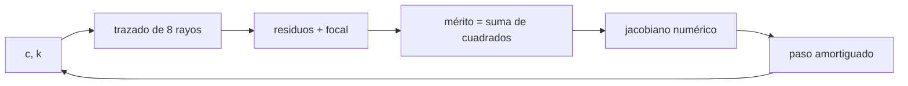

# B50-C02 — Optimización de superficies: función de mérito y restricciones

<!-- nav:top -->
[🏠 Programa](../../../../README.md) · [📚 Bloque B50](../../../tronco-comun/B50-diseno-optico-computacional-y-tolerancias.md) · [← Anterior: B50-C01 — Trazado exacto de rayos y aberraciones de orden superior](../B50-C01-trazado-exacto-de-rayos-y-aberraciones-de-orden-superior/CLASE.md) · [Siguiente: B50-C03 — Sistemas catadióptricos: Schmidt y Maksutov →](../B50-C03-sistemas-catadioptricos-schmidt-y-maksutov/CLASE.md)
<!-- /nav -->

## 1. Ubicación, nivel y alcance

Clase 2 del bloque B50. Nivel N3. Optimizar un diseño es minimizar una **función de mérito** moviendo **variables** sujetas a **restricciones**. Aquí defines la función de mérito como la suma de cuadrados de la posición transversal de ocho rayos en el plano focal más un residuo de distancia focal, y la minimizas con **mínimos cuadrados amortiguados (Levenberg–Marquardt)** variando la curvatura y la constante cónica de un espejo. El caso analítico es el paraboloide (`k = −1`, `R = −2f`). Usas [B12](../../../tronco-comun/B12-probabilidad-estadistica-e-incertidumbre.md) y B41-C08. El espejo es ilustrativo.

## 2. Por qué esta clase existe

Un diseñador no ajusta curvaturas a mano: define qué es «bueno» como un número y deja que el cálculo busque. La decisión central: **¿qué mide la función de mérito y qué fija la restricción?**

## 3. Lo que podrás hacer al terminar

1. Escribir una función de mérito como suma de residuos al cuadrado.
2. Agregar una restricción como un residuo ponderado.
3. Aplicar mínimos cuadrados amortiguados con jacobiano numérico.
4. Reconocer la convergencia y la monotonía del mérito.
5. Contrastar con el óptimo analítico (paraboloide).
6. Distinguir lo que cambia si se fija una variable (esfera).

La evidencia es la **ficha de la optimización de superficies** del ejercicio 12 (sección 20).

## 4. Con qué llegas y cómo comprobarlo

1. ¿Qué es una incertidumbre?
2. ¿Qué es una simulación Monte Carlo?
3. ¿Qué es una tabla de resultados?
4. ¿Qué es un valor ilustrativo?
5. ¿Qué es una verificación?

<details>
<summary>Ver respuestas</summary>

1. Un intervalo en que se espera el valor verdadero. 2. Repetir con números aleatorios de semilla fija. 3. Un resumen ordenado de cálculos. 4. Un valor propuesto para el ejemplo, no medido. 5. Comparar un cálculo con un caso independiente.
</details>

Con cuatro o cinco aciertos, sigue; si no, repasa los prerrequisitos.

## 5. Un caso de contexto y casos de referencia

Un espejo de apertura 400 mm y focal objetivo 1000 mm parte de `R = −2100 mm` y `k = 0` con mérito `2757,93 mm²`. En 4 iteraciones llega a `R = -2000,000000 mm` y `k = −1,00000000`. Es el **ejemplo conductor**. Todo es **ilustrativo**.

## 6. Vocabulario

La **función de mérito** es el número que se minimiza. Una **variable de diseño** es un parámetro libre (aquí `c` y `k`). Un **residuo** es una diferencia con el objetivo. **Levenberg–Marquardt** mezcla Gauss–Newton con descenso de gradiente mediante un amortiguamiento `λ`. Una **restricción** se impone como residuo ponderado o como límite.

## 7. Modelo mental: buscar el fondo de un valle con niebla

Como bajar a un valle con niebla: con pasos grandes si la pendiente es clara y pasos cortos si el terreno cambia; el amortiguamiento decide el tamaño del paso.



*Descripción textual:* las variables generan residuos mediante el trazado, el jacobiano numérico y el paso amortiguado actualizan las variables hasta que el mérito deja de bajar.

Analogía: buscar el fondo de un valle con niebla. Límite: residuos casi lineales cerca del óptimo.

## 8. La explicación, paso a paso

### 8.1 Convergencia

| iteración | mérito (mm²) | `R` (mm) | `k` |
|---|---|---|---|
| 0 | 2,758 × 10³ | -2100,00000 | 0,0000000 |
| 1 | 5,332 × 10⁰ | -2004,57072 | −0,4768398 |
| 2 | 3,830 × 10⁻⁵ | -2000,01142 | −1,0002722 |
| 3 | 8,998 × 10⁻¹⁴ | -2000,00000 | −0,9999999 |
| 4 | 1,499 × 10⁻²³ | -2000,00000 | −1,0000000 |

El mérito baja en cada paso aceptado y la solución coincide con el paraboloide: `k = −1,00000000` y `R = -2000,000000 mm`.

### 8.2 Qué cambia al fijar una variable

Si solo se deja libre la curvatura (`k = 0`, esfera), el mejor radio es `R = -2000,786 mm` y el mérito queda en `1,5983 mm²`: la aberración esférica no se elimina con la curvatura.

### 8.3 La restricción

Sin el residuo de focal el óptimo es el mismo (`R = -2000,000000 mm`, `k = −1,00000000`), porque el plano focal ya está fijo en 1000 mm. La restricción importa cuando el plano de imagen también es variable: entonces sin ella el cálculo podría «ganar» desplazando el foco.

### 8.4 Lectura

El mérito pasó de `2757,9` a menos de `10⁻²²` mm²: el optimizador encuentra el paraboloide sin que nadie le diga que lo es.

## 9. Magnitudes, símbolos y unidades

| Símbolo | Qué es | Unidad | Valor / nota |
|---|---|---|---|
| `c` | curvatura del espejo | mm⁻¹ | -5,0000 × 10⁻⁴ |
| `k` | constante cónica | — | −1,000000 |
| `λ` | amortiguamiento de LM | — | adaptativo |
| `M` | función de mérito | mm² | 1,50 × 10⁻²³ |

## 10. Convenciones y referencias

Residuo transversal en el plano z = −1000 mm; radio negativo = cóncavo hacia la luz; jacobiano por diferencias finitas.

## 11. De dónde sale lo que afirmamos

| ID | Fuente | Localizador | Respalda | Estado |
|---|---|---|---|---|
| — | Sin fuente externa | — | relaciones estándar que verifica el laboratorio | No se consultó una fuente para esta clase |

Límites: no se consultó ninguna fuente y el espejo no es real.

## 12. Cómo ver la convergencia

| Caso | `R` (mm) | mérito (mm²) |
|---|---|---|
| inicio | −2100 | 2757,93 |
| esfera óptima | -2000,786 | 1,5983 |
| `c` y `k` libres | -2000,0000 | 1,50 × 10⁻²³ |

Descripción larga: liberar la constante cónica reduce el mérito unos 24 órdenes de magnitud respecto de la esfera.

## 13. Ejemplo trabajado: el primer paso

**Paso 1 · Estado.** `R = −2100`, `k = 0`, mérito `2757,93`.

**Paso 2 · Jacobiano.** Se perturba cada variable y se mide el cambio de los 9 residuos.

**Paso 3 · Paso amortiguado.** Se resuelve `(JᵀJ + λ diag) Δ = −Jᵀ r`.

**Paso 4 · Resultado.** `R = -2004,571`, `k = −0,4768`, mérito `5,332`.

## 14. Distintas formas de describir una optimización

**Por residuos:** vector de diferencias. **Por mérito:** un solo número. **Por derivadas:** jacobiano. **Por trayectoria:** tabla de iteraciones.

## 15. Práctica guiada

**Ejercicio 1 · con los pasos indicados.** Calcula el mérito de un residuo único de `0,3 mm`. *Pasos:* eleva al cuadrado.

<details><summary>Solución comentada</summary>

`0,09 mm²`.
</details>

**Ejercicio 2 · con una pista.** Si el mérito baja de 100 a 25, ¿en qué factor bajó el RMS de los residuos? *Pista:* raíz.

<details><summary>Solución comentada</summary>

En 2.
</details>

**Ejercicio 3 · casi autónomo.** ¿Por qué LM aumenta `λ` tras un paso que empeora el mérito?

<details><summary>Solución comentada</summary>

Porque acerca el paso al descenso de gradiente, más cauto.
</details>

## 16. Práctica autónoma, transferencia e integrador

**Ejercicio 4.** ¿Cuántos residuos hay con 8 rayos y 1 restricción?

<details><summary>Solución comentada</summary>

`9`.
</details>

**Ejercicio 5.** Mérito final del caso con `k` fijo.

<details><summary>Solución comentada</summary>

`1,5983 mm²`.
</details>

**Ejercicio 6.** ¿Por qué la esfera no llega a cero?

<details><summary>Solución comentada</summary>

Porque su aberración esférica no se anula cambiando solo `R`.
</details>

**Ejercicio 7.** `R` óptimo del paraboloide si `f = 1000`.

<details><summary>Solución comentada</summary>

`−2000 mm`.
</details>

**Ejercicio 8.** Iteraciones usadas.

<details><summary>Solución comentada</summary>

`4`.
</details>

**Ejercicio 9 · transferencia.** **Transferencia.** Un colega añade 100 rayos y el mérito sube. ¿Está peor el diseño?

<details><summary>Solución comentada</summary>

No: el mérito es una suma y depende del número de residuos; hay que normalizar.
</details>

**Ejercicio 10 · transferencia.** **Transferencia.** ¿Qué pasaría si el plano de imagen fuera variable y sin restricción?

<details><summary>Solución comentada</summary>

El cálculo podría reducir el mérito moviendo el foco y no la forma.
</details>

**Ejercicio 11 · transferencia.** **Transferencia.** ¿Qué variables añadirías para un espejo secundario?

<details><summary>Solución comentada</summary>

Su curvatura, su constante cónica y su distancia al primario.
</details>

**Ejercicio 12.** **Integrador.** Elabora tu *ficha de la optimización de superficies*: mérito, variables, restricción y trayectoria.

<details><summary>Solución comentada</summary>

Secciones 8.1–8.4.
</details>

**Ejercicio 12 · integrador.** **Integrador.** Elabora tu *ficha de la optimización de superficies*: mérito, variables, restricción y trayectoria.

<details><summary>Solución modelo</summary>

Secciones 8.1–8.4.
</details>

## 17. Laboratorio: optimización de un espejo

El script [optimizacion.py](optimizacion.py) optimiza la curvatura y la constante cónica de un espejo y compara con el paraboloide (**comprueba** `k = −1` y `R = −2000` a 1e-6).

**Datos:** sin constantes; espejo **ilustrativo**. **Predice antes de ejecutar:** ¿a qué valor convergerá `k`? (a −1.) **Ejecución del 2026-11-09 (Python 3.12.9):**

```text
Python 3.12.9 (biblioteca estandar)
Inicio: R = -2100 mm, k = 0 ; merito = 2757.9335 mm^2
iter   merito [mm^2]       R [mm]            k
   0    2.757934e+03  -2100.00000    0.0000000
   1    5.331785e+00  -2004.57072   -0.4768398
   2    3.830414e-05  -2000.01142   -1.0002722
   3    8.998477e-14  -2000.00000   -0.9999999
   4    1.498893e-23  -2000.00000   -1.0000000
Optimo con restriccion: R = -2000.000000 mm ; k = -1.00000000 ; merito = 1.499e-23 mm^2
Solo curvatura (k = 0 fijo): R = -2000.786 mm ; merito = 1.5983 mm^2
Sin restriccion de focal: R = -2000.000000 mm ; k = -1.00000000 ; merito = 5.931e-24 mm^2
Pruebas superadas.
```

```bash
python programa/clases/B50/B50-C02-optimizacion-de-superficies-funcion-de-merito-y-restricciones/optimizacion.py
```

**Límites:** abanico meridional y objeto en el infinito.

## 18. Errores frecuentes y cómo corregirlos

**Poner pesos arbitrarios y creer que el óptimo es único.** Se corrige con 8.3.

**Confundir un mínimo local con el global.** Se corrige probando inicios distintos.

**Optimizar sin restricción de focal.** Se corrige con 8.3.

**Presentar el espejo como real.** Se corrige con la sección 10.

## 19. Cómo sabrás que vas bien

Tras la sección 8: ¿qué resultado esperabas y cuál obtuviste? Si dudas, repasa el ejemplo 13. Tras el laboratorio: ¿qué comprueba? (ver la sección 17).

## 20. Qué entregas y cómo se evalúa

El producto es tu **ficha de la optimización de superficies** (ejercicio 12).

| Criterio | Inicial | En desarrollo | Logrado | Destacado |
|---|---|---|---|---|
| Conceptos | Los confunde | Parciales | conceptos de la clase | Explica los límites |
| Cálculo | Sin unidades | Con errores | Tablas completas | Calcula casos nuevos |
| Numérico | Sin comprobar | Un caso | Contraste con el análisis | Interpreta las diferencias |
| Fuentes | Sin fuente | Sin fecha | fuentes con fecha | Declara lo ilustrativo |
| Límites | No los nombra | Uno | Tres | Discute qué falta del modelo |

**Condiciones críticas (no se compensan con promedio):** rotular el espejo como ilustrativo; no presentar el resultado como un diseño real; citar solo lo consultado.

## 21. Ética, seguridad y límites

Clase educativa: los modelos son simplificados. Accesibilidad: tablas equivalentes a las gráficas, fórmulas en texto, ejercicios sin conexión.

## 22. Para cerrar y seguir

La optimización llevó el mérito de `2757,9` a menos de `10⁻²²` mm² y recuperó el paraboloide. Queda una pregunta: ¿cómo se combinan espejos y lentes para ganar campo?

**Glosario español–inglés.** función de mérito · *merit function*; mínimos cuadrados amortiguados · *damped least squares*; restricción · *constraint*; variable de diseño · *design variable*; jacobiano · *Jacobian*.

**Continuidad.** [B50-C03](../B50-C03-sistemas-catadioptricos-schmidt-y-maksutov/CLASE.md) estudia los sistemas catadióptricos.

**Referencias:** ver sección 11.

<!-- nav:bottom -->
---

[← Anterior: B50-C01 — Trazado exacto de rayos y aberraciones de orden superior](../B50-C01-trazado-exacto-de-rayos-y-aberraciones-de-orden-superior/CLASE.md) · [📚 Bloque B50](../../../tronco-comun/B50-diseno-optico-computacional-y-tolerancias.md) · [Siguiente: B50-C03 — Sistemas catadióptricos: Schmidt y Maksutov →](../B50-C03-sistemas-catadioptricos-schmidt-y-maksutov/CLASE.md)
<!-- /nav -->
