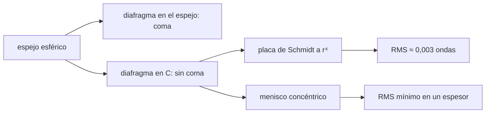

# B50-C03 — Sistemas catadióptricos: Schmidt y Maksutov

<!-- nav:top -->
[🏠 Programa](../../../../README.md) · [📚 Bloque B50](../../../tronco-comun/B50-diseno-optico-computacional-y-tolerancias.md) · [← Anterior: B50-C02 — Optimización de superficies: función de mérito y restricciones](../B50-C02-optimizacion-de-superficies-funcion-de-merito-y-restricciones/CLASE.md) · [Siguiente: B50-C04 — Telecentricidad, viñeteo y diseño del campo →](../B50-C04-telecentricidad-vineteo-y-diseno-del-campo/CLASE.md)
<!-- /nav -->

## 1. Ubicación, nivel y alcance

Clase 3 del bloque B50. Nivel N3. Un espejo esférico no tiene eje privilegiado si su **diafragma está en el centro de curvatura**: todos los haces de campo ven un espejo «en el eje». Su único defecto es la aberración esférica, que un corrector (la **placa de Schmidt** o el **menisco de tipo Maksutov**) elimina. Aquí trazas el espejo con el diafragma en el espejo y en el centro, ajustas una placa delgada y barres el espesor de un menisco concéntrico. Usas B41-C08 y [B10](../../../tronco-comun/B10-algebra-lineal-y-matematicas-geometricas.md). Los sistemas son ilustrativos.

## 2. Por qué esta clase existe

Combinar espejos y elementos refractivos permite campos amplios con superficies fáciles de fabricar. La decisión central: **¿dónde va el diafragma y qué corrige el elemento refractivo?**

## 3. Lo que podrás hacer al terminar

1. Calcular el RMS de frente de onda de un espejo esférico según el campo y la posición del diafragma.
2. Modelar una placa de Schmidt delgada y hallar su coeficiente.
3. Comparar el coeficiente con la teoría de tercer orden.
4. Barrer el espesor de un menisco concéntrico y hallar el mínimo.
5. Verificar que el campo se conserva con el diafragma en el centro.
6. Reconocer los límites de la placa delgada y del menisco simplificado.

La evidencia es la **ficha de los sistemas catadióptricos** del ejercicio 12 (sección 20).

## 4. Con qué llegas y cómo comprobarlo

1. ¿Qué es una incertidumbre?
2. ¿Qué es una simulación Monte Carlo?
3. ¿Qué es una tabla de resultados?
4. ¿Qué es un valor ilustrativo?
5. ¿Qué es una verificación?

<details>
<summary>Ver respuestas</summary>

1. Un intervalo en que se espera el valor verdadero. 2. Repetir con números aleatorios de semilla fija. 3. Un resumen ordenado de cálculos. 4. Un valor propuesto para el ejemplo, no medido. 5. Comparar un cálculo con un caso independiente.
</details>

Con cuatro o cinco aciertos, sigue; si no, repasa los prerrequisitos.

## 5. Un caso de contexto y casos de referencia

Un espejo esférico `R = 2000 mm`, `f/5`, tiene un RMS sin enfoque de `0,427` ondas en el eje. Con el diafragma en el espejo sube a `2,87` a 2°; con el diafragma en el centro de curvatura queda en `0,428`. Una placa de Schmidt lo lleva a `0,0031` ondas en el eje. Es el **ejemplo conductor**. Todo es **ilustrativo**.

## 6. Vocabulario

El **centro de curvatura** `C` es el centro de la esfera del espejo. El **diafragma** limita el haz. La **placa de Schmidt** es un elemento delgado cuya forma `s(r) = a r⁴ + b r²` desvía los rayos en `−(n − 1) ∇s`. El **menisco** concéntrico es una lámina curva con las dos caras centradas en `C`. El **RMS sin enfoque** quita el pistón, la inclinación y el desenfoque.

## 7. Modelo mental: una lupa con la pupila en su centro

Como mirar por un agujero situado en el centro de una esfera hueca: todas las direcciones se ven igual, y solo hay que corregir la forma de la esfera.



*Descripción textual:* colocar el diafragma en el centro de curvatura conserva el campo, y un corrector pequeño elimina la esférica.

Analogía: una lupa con la pupila en su centro. Límite: placa delgada sin dispersión y menisco monocromático.

## 8. La explicación, paso a paso

### 8.1 Posición del diafragma

| campo (°) | RMS con el diafragma en el espejo | RMS con el diafragma en `C` |
|---|---|---|
| 0,0 | 0,4273 | 0,4273 |
| 0,5 | 0,6414 | 0,4274 |
| 1,0 | 1,1477 | 0,4276 |
| 2,0 | 2,8701 | 0,4284 |

Con el diafragma en el espejo el RMS crece con el campo (coma); en `C` es prácticamente constante.

### 8.2 Placa de Schmidt

El coeficiente ajustado es `a = 6,1798 × 10⁻¹¹ mm⁻³` y la teoría de tercer orden da `a = 1/(8 (n − 1) R² f) = 6,2500 × 10⁻¹¹ mm⁻³`; el cociente es `0,9888`. En el eje, en el foco paraxial, el RMS pasa de `1,713` a `0,0079` ondas. Con enfoque libre (`a = 6,138 × 10⁻¹¹`, `b = 4,483 × 10⁻⁹`) queda en `0,00311` ondas.

| campo (°) | RMS con la placa óptima |
|---|---|
| 0 | 0,00311 |
| 1 | 0,00251 |
| 2 | 0,00179 |

### 8.3 Menisco concéntrico

| espesor (mm) | RMS sin enfoque (ondas) |
|---|---|
| 0 | 0,4273 |
| 5 | 0,3483 |
| 10 | 0,2634 |
| 15 | 0,1733 |
| 20 | 0,0787 |
| 25 | 0,0202 |
| 30 | 0,1220 |
| 40 | 0,3347 |
| 50 | 0,5559 |
| 60 | 0,7831 |

El mínimo está en `25 mm` con `0,0202` ondas (sin menisco: `0,4273`). El campo conserva la calidad: `0,0202`, `0,0245` y `0,0362` ondas a 0°, 1° y 2°.

### 8.4 Lectura

La placa de Schmidt aquí es un modelo de espesor delgado (desviación y camino óptico), no una placa trazada superficie por superficie. El menisco sí se traza exactamente, pero con radio frontal fijo de 500 mm y un solo espesor libre: su mínimo no es un diseño completo.

## 9. Magnitudes, símbolos y unidades

| Símbolo | Qué es | Unidad | Valor / nota |
|---|---|---|---|
| `R` | radio del espejo | mm | 2000 |
| `a` | coeficiente de la placa | mm⁻³ | 6,180 × 10⁻¹¹ |
| `t` | espesor del menisco | mm | 25 (óptimo del barrido) |
| `n` | índice del corrector | — | 1,5 (ilustrativo) |

## 10. Convenciones y referencias

Luz monocromática de 550 nm; diafragma en `z = −2000 mm` (centro de curvatura); placa como perfil de espesor con `n = 1,5` ilustrativo.

## 11. De dónde sale lo que afirmamos

| ID | Fuente | Localizador | Respalda | Estado |
|---|---|---|---|---|
| S1 | Wikipedia, *Schmidt camera* | https://en.wikipedia.org/wiki/Schmidt_camera | placa correctora en el centro de curvatura del espejo esférico, que actúa como diafragma | Consultada el 2026-11-09 (artículo de enciclopedia, no revisado por pares) |
| S2 | Wikipedia, *Maksutov telescope* | https://en.wikipedia.org/wiki/Maksutov_telescope | corrector de menisco débilmente negativo con superficies esféricas | Consultada el 2026-11-09 (artículo de enciclopedia, no revisado por pares) |

Límites: S1 y S2 solo respaldan la descripción cualitativa; las cifras son del laboratorio y el índice 1,5 es ilustrativo.

## 12. Cómo ver la posición del diafragma

| campo (°) | diafragma en espejo | diafragma en C |
|---|---|---|
| 0,0 | 0,4273 | 0,4273 |
| 0,5 | 0,6414 | 0,4274 |
| 1,0 | 1,1477 | 0,4276 |
| 2,0 | 2,8701 | 0,4284 |

Descripción larga: el RMS crece con el campo si el diafragma está en el espejo y es constante si está en el centro de curvatura.

## 13. Ejemplo trabajado: el coeficiente de la placa

**Paso 1 · Datos.** `n = 1,5`, `R = 2000`, `f = 1000`.

**Paso 2 · Producto.** `R² f = 2000² × 1000 = 4 × 10⁹ mm³` y `8 × 0,5 × 4 × 10⁹ = 1,6 × 10¹⁰`.

**Paso 3 · Cociente.** `a = 1/(1,6 × 10¹⁰) = 6,25 × 10⁻¹¹ mm⁻³`.

**Paso 4 · Contraste.** El ajuste da `6,180 × 10⁻¹¹`, `-1,12 %` de diferencia.

## 14. Distintas formas de describir un corrector

**Por posición:** diafragma en el espejo o en `C`. **Por perfil:** `a r⁴ + b r²`. **Por espesor:** barrido. **Por campo:** RMS a 0°, 1° y 2°.

## 15. Práctica guiada

**Ejercicio 1 · con los pasos indicados.** Con `n = 1,5`, `R = 2000` y `f = 1000`, calcula `R² f`. *Pasos:* eleva y multiplica.

<details><summary>Solución comentada</summary>

`4 × 10⁹ mm³`.
</details>

**Ejercicio 2 · con una pista.** Calcula `a` teórico. *Pista:* `1/(8 (n − 1) R² f)`.

<details><summary>Solución comentada</summary>

`6,250 × 10⁻¹¹ mm⁻³`.
</details>

**Ejercicio 3 · casi autónomo.** ¿Cuál es la diferencia entre el ajuste y la teoría?

<details><summary>Solución comentada</summary>

`-1,12 %`.
</details>

## 16. Práctica autónoma, transferencia e integrador

**Ejercicio 4.** RMS a 2° con el diafragma en el espejo y en `C`.

<details><summary>Solución comentada</summary>

`2,870` y `0,428`.
</details>

**Ejercicio 5.** Factor de reducción de la placa en el eje (foco paraxial).

<details><summary>Solución comentada</summary>

`217` veces.
</details>

**Ejercicio 6.** ¿Qué espesor minimiza el menisco?

<details><summary>Solución comentada</summary>

`25 mm`.
</details>

**Ejercicio 7.** RMS del menisco a 2°.

<details><summary>Solución comentada</summary>

`0,0362` ondas.
</details>

**Ejercicio 8.** ¿Por qué el RMS del menisco crece rápido más allá del mínimo?

<details><summary>Solución comentada</summary>

Porque la aberración del menisco cambia de signo y se suma a la del espejo.
</details>

**Ejercicio 9 · transferencia.** **Transferencia.** Un colega afirma que la placa corrige también la coma. Responde.

<details><summary>Solución comentada</summary>

No: la coma se evita por la posición del diafragma, la placa corrige la esférica.
</details>

**Ejercicio 10 · transferencia.** **Transferencia.** ¿Qué otra variable libre añadirías al menisco?

<details><summary>Solución comentada</summary>

El radio frontal y la distancia al espejo.
</details>

**Ejercicio 11 · transferencia.** **Transferencia.** ¿Qué aberración queda en estos sistemas?

<details><summary>Solución comentada</summary>

La curvatura de campo (clase siguiente) y la cromática.
</details>

**Ejercicio 12.** **Integrador.** Elabora tu *ficha de los sistemas catadióptricos*: RMS por campo, coeficiente de la placa y barrido del menisco.

<details><summary>Solución comentada</summary>

Secciones 8.1–8.4.
</details>

**Ejercicio 12 · integrador.** **Integrador.** Elabora tu *ficha de los sistemas catadióptricos*: RMS por campo, coeficiente de la placa y barrido del menisco.

<details><summary>Solución modelo</summary>

Secciones 8.1–8.4.
</details>

## 17. Laboratorio: espejo esférico con corrector

El script [catadioptrico.py](catadioptrico.py) traza el espejo esférico, ajusta la placa de Schmidt por mínimos cuadrados y barre el espesor del menisco (**comprueba** el coeficiente a 6 % de la teoría).

**Datos:** sin constantes; sistemas **ilustrativos**; semilla no necesaria. **Predice antes de ejecutar:** ¿qué cociente tendrá el coeficiente? (≈ 0,989.) **Ejecución del 2026-11-09 (Python 3.12.9):**

```text
Python 3.12.9 (biblioteca estandar)
RMS de frente de onda sin enfoque del espejo esferico (R = 2000 mm, f/5) [ondas de 550 nm]
campo [grados]  diafragma en espejo   diafragma en C
           0.0               0.4273           0.4273
           0.5               0.6414           0.4274
           1.0               1.1477           0.4276
           2.0               2.8701           0.4284
Placa de Schmidt (b = 0): a ajustado = 6.1798e-11 mm^-3 ; teoria de tercer orden = 6.2500e-11 mm^-3 ; cociente = 0.9888
RMS en el eje en el foco paraxial: sin placa = 1.713 ondas ; con placa = 0.0079 ondas
Placa con enfoque libre: a = 6.1382e-11 ; b = 4.4828e-09 ; RMS sin enfoque = 0.00311 ondas
RMS con la placa optima segun el campo: 0 grados = 0.00311 ; 1 grados = 0.00251 ; 2 grados = 0.00179
espesor [mm]  RMS [ondas]
           0       0.4273
           5       0.3483
          10       0.2634
          15       0.1733
          20       0.0787
          25       0.0202
          30       0.1220
          40       0.3347
          50       0.5559
          60       0.7831
Menisco: minimo en t = 25 mm con RMS = 0.0202 ondas
RMS del menisco segun el campo: 0 grados = 0.0202 ; 1 grados = 0.0245 ; 2 grados = 0.0362
Pruebas superadas.
```

```bash
python programa/clases/B50/B50-C03-sistemas-catadioptricos-schmidt-y-maksutov/catadioptrico.py
```

**Límites:** placa delgada y radio frontal fijo del menisco.

## 18. Errores frecuentes y cómo corregirlos

**Poner el diafragma en el espejo y esperar campo plano.** Se corrige con 8.1.

**Creer que la placa de Schmidt es una lente trazada.** Se corrige con 8.4.

**Tomar el mínimo del barrido por un diseño completo.** Se corrige con 8.4.

**Presentar los sistemas como reales.** Se corrige con la sección 10.

## 19. Cómo sabrás que vas bien

Tras la sección 8: ¿qué resultado esperabas y cuál obtuviste? Si dudas, repasa el ejemplo 13. Tras el laboratorio: ¿qué comprueba? (ver la sección 17).

## 20. Qué entregas y cómo se evalúa

El producto es tu **ficha de los sistemas catadióptricos** (ejercicio 12).

| Criterio | Inicial | En desarrollo | Logrado | Destacado |
|---|---|---|---|---|
| Conceptos | Los confunde | Parciales | conceptos de la clase | Explica los límites |
| Cálculo | Sin unidades | Con errores | Tablas completas | Calcula casos nuevos |
| Numérico | Sin comprobar | Un caso | Contraste con el análisis | Interpreta las diferencias |
| Fuentes | Sin fuente | Sin fecha | fuentes con fecha | Declara lo ilustrativo |
| Límites | No los nombra | Uno | Tres | Discute qué falta del modelo |

**Condiciones críticas (no se compensan con promedio):** rotular los sistemas como ilustrativos; no inferir el desempeño de un telescopio real; citar solo lo consultado.

## 21. Ética, seguridad y límites

Clase educativa: los modelos son simplificados. Accesibilidad: tablas equivalentes a las gráficas, fórmulas en texto, ejercicios sin conexión.

## 22. Para cerrar y seguir

Con el diafragma en el centro de curvatura el RMS es casi independiente del campo (`0,427` a `0,428` ondas) y una placa lo lleva a `0,0031`. Queda una pregunta: ¿cómo se diseña el campo y el viñeteo?

**Glosario español–inglés.** catadióptrico · *catadioptric*; placa correctora · *corrector plate*; menisco · *meniscus*; centro de curvatura · *center of curvature*; diafragma · *aperture stop*.

**Continuidad.** [B50-C04](../B50-C04-telecentricidad-vineteo-y-diseno-del-campo/CLASE.md) estudia la telecentricidad y el viñeteo.

**Referencias:** ver sección 11.

<!-- nav:bottom -->
---

[← Anterior: B50-C02 — Optimización de superficies: función de mérito y restricciones](../B50-C02-optimizacion-de-superficies-funcion-de-merito-y-restricciones/CLASE.md) · [📚 Bloque B50](../../../tronco-comun/B50-diseno-optico-computacional-y-tolerancias.md) · [Siguiente: B50-C04 — Telecentricidad, viñeteo y diseño del campo →](../B50-C04-telecentricidad-vineteo-y-diseno-del-campo/CLASE.md)
<!-- /nav -->
