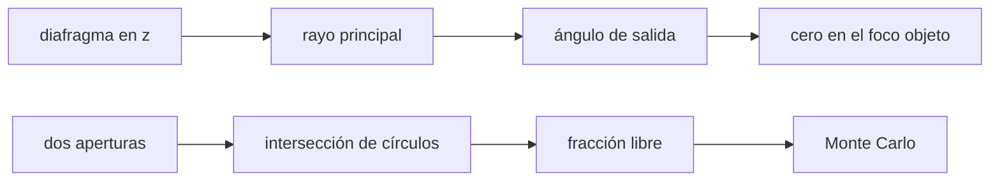

# B50-C04 — Telecentricidad, viñeteo y diseño del campo

<!-- nav:top -->
[🏠 Programa](../../../../README.md) · [📚 Bloque B50](../../../tronco-comun/B50-diseno-optico-computacional-y-tolerancias.md) · [← Anterior: B50-C03 — Sistemas catadióptricos: Schmidt y Maksutov](../B50-C03-sistemas-catadioptricos-schmidt-y-maksutov/CLASE.md) · [Siguiente: B50-C05 — Luz parásita y análisis de rayos dispersos →](../B50-C05-luz-parasita-y-analisis-de-rayos-dispersos/CLASE.md)
<!-- /nav -->

## 1. Ubicación, nivel y alcance

Clase 4 del bloque B50. Nivel N3. La posición del diafragma decide el **ángulo del rayo principal** en el espacio imagen y qué parte del haz llega a cada punto del campo. Aquí buscas el diafragma que hace el sistema **telecéntrico** (rayo principal paralelo al eje) con trazado exacto y con una segunda vía (el foco objeto trazado en sentido inverso), y calculas el **viñeteo** de dos aperturas con el área de intersección de dos círculos y con Monte Carlo. Usas B41-C08 y [B12](../../../tronco-comun/B12-probabilidad-estadistica-e-incertidumbre.md). La lente y las aperturas son ilustrativas.

## 2. Por qué esta clase existe

En un detector la luz que llega muy inclinada se pierde o se mezcla; en un espectrógrafo o un mosaico el viñeteo cambia el brillo según el campo. La decisión central: **¿dónde va el diafragma y cuánto campo se acepta con viñeteo?**

## 3. Lo que podrás hacer al terminar

1. Calcular el ángulo de salida del rayo principal para varias posiciones del diafragma.
2. Hallar el diafragma telecéntrico por dos vías.
3. Relacionar la pendiente con la distancia focal.
4. Calcular la fracción no viñeteada con el área de dos círculos.
5. Comprobarla con Monte Carlo.
6. Reconocer lo que no incluye el viñeteo geométrico.

La evidencia es la **ficha de telecentricidad y viñeteo** del ejercicio 12 (sección 20).

## 4. Con qué llegas y cómo comprobarlo

1. ¿Qué es una incertidumbre?
2. ¿Qué es una simulación Monte Carlo?
3. ¿Qué es una tabla de resultados?
4. ¿Qué es un valor ilustrativo?
5. ¿Qué es una verificación?

<details>
<summary>Ver respuestas</summary>

1. Un intervalo en que se espera el valor verdadero. 2. Repetir con números aleatorios de semilla fija. 3. Un resumen ordenado de cálculos. 4. Un valor propuesto para el ejemplo, no medido. 5. Comparar un cálculo con un caso independiente.
</details>

Con cuatro o cinco aciertos, sigue; si no, repasa los prerrequisitos.

## 5. Un caso de contexto y casos de referencia

Una lente biconvexa de focal `100,671 mm` es telecéntrica en el espacio objeto cuando el diafragma está en `z = -99,3289 mm`, su foco objeto; la bisección sobre el trazado lo da con `1,63 × 10⁻⁸ mm` de diferencia. Con aperturas de 50 y 55 mm separadas 300 mm, la fracción libre cae a `0,3457` para un campo de `0,20 rad`. Es el **ejemplo conductor**. Todo es **ilustrativo**.

## 6. Vocabulario

El **rayo principal** pasa por el centro del diafragma. Un sistema es **telecéntrico** si ese rayo es paralelo al eje (en el espacio objeto, imagen o ambos). El **foco objeto** es el punto del eje conjugado con el infinito imagen. El **viñeteo** es la pérdida de parte del haz por aperturas distintas del diafragma. El **área de intersección** de dos círculos da la fracción libre.

## 7. Modelo mental: mirar por dos agujeros alineados

Como mirar por dos agujeros en fila: de frente ves el círculo completo; de lado, solo la parte común de los dos.



*Descripción textual:* el ángulo del rayo principal depende de dónde se ponga el diafragma, y la fracción de haz libre es la intersección de dos círculos desplazados por el campo.

Analogía: mirar por dos agujeros alineados. Límite: aproximación geométrica y campo pequeño en el primer caso.

## 8. La explicación, paso a paso

### 8.1 Telecentricidad

El foco objeto trazado en sentido inverso está en `z = -99,32886 mm`; el diafragma que anula el ángulo de salida, hallado por bisección, en `z = -99,32886 mm`. El foco imagen está en `z = 103,3289 mm`.

| posición del diafragma respecto de la telecéntrica (mm) | ángulo de salida por 0,01 rad (mrad) | cociente |
|---|---|---|
| -60,0 | −5,9649 | −0,5965 |
| -30,0 | −2,9829 | −0,2983 |
| 0,0 | −0,0016 | −0,0002 |
| 30,0 | 2,9791 | 0,2979 |
| 60,0 | 5,9596 | 0,5960 |

Con una lente delgada ideal el ángulo sería `θ(1 − s/f)`: la pendiente respecto del desplazamiento es `1/f`. Para `60 mm` da `60/100,6711 = 0,5960`, igual al cociente trazado (`0,5960`).

### 8.2 Viñeteo

| campo (rad) | desplazamiento (mm) | fracción analítica | Monte Carlo |
|---|---|---|---|
| 0,00 | 0,00 | 1,0000 | 1,0000 |
| 0,05 | 15,00 | 0,8938 | 0,8938 |
| 0,10 | 30,00 | 0,7036 | 0,7046 |
| 0,15 | 45,00 | 0,5183 | 0,5170 |
| 0,20 | 60,00 | 0,3457 | 0,3469 |
| 0,25 | 75,00 | 0,1929 | 0,1950 |
| 0,30 | 90,00 | 0,0698 | 0,0700 |
| 0,35 | 105,00 | 0,0000 | 0,0000 |

### 8.3 Lectura

El ángulo de salida cambia de signo al cruzar el foco objeto. La fracción libre llega a cero cuando el desplazamiento iguala la suma de los radios (105 mm). El viñeteo geométrico no incluye la caída `cos⁴` ni la transmitancia.

## 9. Magnitudes, símbolos y unidades

| Símbolo | Qué es | Unidad | Valor / nota |
|---|---|---|---|
| `s` | posición del diafragma | mm | -99,329 (telecéntrica) |
| `f` | focal paraxial | mm | 100,671 |
| `d` | separación de las aperturas | mm | 300 |
| `F` | fracción libre | — | 0–1 |

## 10. Convenciones y referencias

Eje óptico en `z`; ángulos en radianes; aperturas circulares coaxiales.

## 11. De dónde sale lo que afirmamos

| ID | Fuente | Localizador | Respalda | Estado |
|---|---|---|---|---|
| — | Sin fuente externa | — | relaciones estándar que verifica el laboratorio | No se consultó una fuente para esta clase |

Límites: no se consultó ninguna fuente; lente y aperturas ilustrativas.

## 12. Cómo ver la telecentricidad y el viñeteo

| Magnitud | Valor |
|---|---|
| diafragma telecéntrico | -99,329 mm |
| fracción a 0,10 rad | 0,7036 |
| fracción a 0,20 rad | 0,3457 |
| fracción a 0,35 rad | 0,0000 |

Descripción larga: la fracción libre cae de 1 a 0 al crecer el campo.

## 13. Ejemplo trabajado: la fracción a 0,10 rad

**Paso 1 · Desplazamiento.** `300 × 0,10 = 30 mm`.

**Paso 2 · Área.** Intersección de círculos de radios 50 y 55 con centros a 30 mm.

**Paso 3 · Fracción.** Área entre `π × 50²`.

**Paso 4 · Resultado.** `0,7036` (Monte Carlo: `0,7046`).

## 14. Distintas formas de describir un haz

**Por ángulo:** salida del rayo principal. **Por posición:** diafragma. **Por área:** dos círculos. **Por muestreo:** Monte Carlo.

## 15. Práctica guiada

**Ejercicio 1 · con los pasos indicados.** Desplazamiento a 0,15 rad con `d = 300`. *Pasos:* multiplica.

<details><summary>Solución comentada</summary>

`45 mm`.
</details>

**Ejercicio 2 · con una pista.** ¿Se anula el viñeteo cuando el desplazamiento es 0?

<details><summary>Solución comentada</summary>

Sí, la fracción es 1.
</details>

**Ejercicio 3 · casi autónomo.** Pendiente teórica del cociente para 60 mm.

<details><summary>Solución comentada</summary>

`60/f = 0,5960`.
</details>

## 16. Práctica autónoma, transferencia e integrador

**Ejercicio 4.** Fracción analítica a 0,25 rad.

<details><summary>Solución comentada</summary>

`0,1929`.
</details>

**Ejercicio 5.** Diferencia con Monte Carlo a 0,25 rad.

<details><summary>Solución comentada</summary>

`0,0021`.
</details>

**Ejercicio 6.** ¿A qué campo cae a cero con `d = 300`?

<details><summary>Solución comentada</summary>

`105/300 = 0,35 rad`.
</details>

**Ejercicio 7.** ¿Dónde está el foco objeto?

<details><summary>Solución comentada</summary>

`z = -99,329 mm`.
</details>

**Ejercicio 8.** ¿Qué signo tiene el ángulo con el diafragma 30 mm más lejos?

<details><summary>Solución comentada</summary>

Positivo.
</details>

**Ejercicio 9 · transferencia.** **Transferencia.** ¿Qué ventaja tiene un sistema telecéntrico en el espacio imagen para un detector?

<details><summary>Solución comentada</summary>

Todos los píxeles reciben la luz con el mismo ángulo, y el brillo no depende del enfoque.
</details>

**Ejercicio 10 · transferencia.** **Transferencia.** El viñeteo, ¿es un defecto del diseño o un criterio?

<details><summary>Solución comentada</summary>

Es un criterio: se acepta una fracción mínima en el borde del campo.
</details>

**Ejercicio 11 · transferencia.** **Transferencia.** ¿Qué falta en el viñeteo geométrico?

<details><summary>Solución comentada</summary>

La caída `cos⁴`, la transmitancia y la difracción en los bordes.
</details>

**Ejercicio 12.** **Integrador.** Elabora tu *ficha de telecentricidad y viñeteo*: diafragma telecéntrico, tabla de ángulo y fracción libre.

<details><summary>Solución comentada</summary>

Secciones 8.1–8.3.
</details>

**Ejercicio 12 · integrador.** **Integrador.** Elabora tu *ficha de telecentricidad y viñeteo*: diafragma telecéntrico, tabla de ángulo y fracción libre.

<details><summary>Solución modelo</summary>

Secciones 8.1–8.3.
</details>

## 17. Laboratorio: telecentricidad y viñeteo

El script [telecentrico.py](telecentrico.py) halla el diafragma telecéntrico por dos vías y compara la fracción libre analítica con Monte Carlo (**comprueba** 1e-3 mm y 0,004).

**Datos:** sin constantes; lente y aperturas **ilustrativas**; semilla `20261109`. **Predice antes de ejecutar:** ¿en qué posición se anula el ángulo? (en el foco objeto.) **Ejecución del 2026-11-09 (Python 3.12.9):**

```text
Python 3.12.9 (biblioteca estandar)
Foco objeto por el trazado inverso: z = -99.32886 mm ; foco imagen: z = 103.32886 mm
Diafragma telecentrico por biseccion (angulo de salida nulo): z = -99.32886 mm ; diferencia = 1.63e-08 mm
 z diafragma - z telec. [mm]     angulo de salida [mrad por 0.01 rad]   cociente
                       -60.0                                 -5.96486    -0.5965
                       -30.0                                 -2.98291    -0.2983
                         0.0                                 -0.00164    -0.0002
                        30.0                                  2.97913     0.2979
                        60.0                                  5.95958     0.5960
Focal paraxial analitica de la lente gruesa = 100.6711 mm ; 60 / f = 0.5960
Vineteo por dos aperturas (R = 50 mm, b = 55 mm, d = 300 mm)
campo [rad]  desplaz. [mm]  analitica  Monte Carlo
       0.00           0.00     1.0000       1.0000
       0.05          15.00     0.8938       0.8938
       0.10          30.00     0.7036       0.7046
       0.15          45.00     0.5183       0.5170
       0.20          60.00     0.3457       0.3469
       0.25          75.00     0.1929       0.1950
       0.30          90.00     0.0698       0.0700
       0.35         105.00     0.0000       0.0000
Pruebas superadas.
```

```bash
python programa/clases/B50/B50-C04-telecentricidad-vineteo-y-diseno-del-campo/telecentrico.py
```

**Límites:** geometría pura, sin `cos⁴` ni transmitancia.

## 18. Errores frecuentes y cómo corregirlos

**Creer que cualquier diafragma da rayo principal paralelo.** Se corrige con 8.1.

**Sumar áreas en vez de intersectar círculos.** Se corrige con 8.2.

**Olvidar la caída `cos⁴`.** Se corrige con 8.3.

**Presentar la lente como real.** Se corrige con la sección 10.

## 19. Cómo sabrás que vas bien

Tras la sección 8: ¿qué resultado esperabas y cuál obtuviste? Si dudas, repasa el ejemplo 13. Tras el laboratorio: ¿qué comprueba? (ver la sección 17).

## 20. Qué entregas y cómo se evalúa

El producto es tu **ficha de telecentricidad y viñeteo** (ejercicio 12).

| Criterio | Inicial | En desarrollo | Logrado | Destacado |
|---|---|---|---|---|
| Conceptos | Los confunde | Parciales | conceptos de la clase | Explica los límites |
| Cálculo | Sin unidades | Con errores | Tablas completas | Calcula casos nuevos |
| Numérico | Sin comprobar | Un caso | Contraste con el análisis | Interpreta las diferencias |
| Fuentes | Sin fuente | Sin fecha | fuentes con fecha | Declara lo ilustrativo |
| Límites | No los nombra | Uno | Tres | Discute qué falta del modelo |

**Condiciones críticas (no se compensan con promedio):** rotular la lente y las aperturas como ilustrativas; no inferir el viñeteo de un instrumento real; citar solo lo consultado.

## 21. Ética, seguridad y límites

Clase educativa: los modelos son simplificados. Accesibilidad: tablas equivalentes a las gráficas, fórmulas en texto, ejercicios sin conexión.

## 22. Para cerrar y seguir

El diafragma en el foco objeto (`-99,33 mm`) da un rayo principal paralelo al eje, y dos aperturas dejan libre `0,346` del haz a 0,20 rad. Queda una pregunta: ¿qué ocurre con la luz que no sigue el camino previsto?

**Glosario español–inglés.** telecentricidad · *telecentricity*; rayo principal · *chief ray*; viñeteo · *vignetting*; diafragma · *aperture stop*; foco objeto · *front focal point*.

**Continuidad.** [B50-C05](../B50-C05-luz-parasita-y-analisis-de-rayos-dispersos/CLASE.md) estudia la luz parásita.

**Referencias:** ver sección 11.

<!-- nav:bottom -->
---

[← Anterior: B50-C03 — Sistemas catadióptricos: Schmidt y Maksutov](../B50-C03-sistemas-catadioptricos-schmidt-y-maksutov/CLASE.md) · [📚 Bloque B50](../../../tronco-comun/B50-diseno-optico-computacional-y-tolerancias.md) · [Siguiente: B50-C05 — Luz parásita y análisis de rayos dispersos →](../B50-C05-luz-parasita-y-analisis-de-rayos-dispersos/CLASE.md)
<!-- /nav -->
