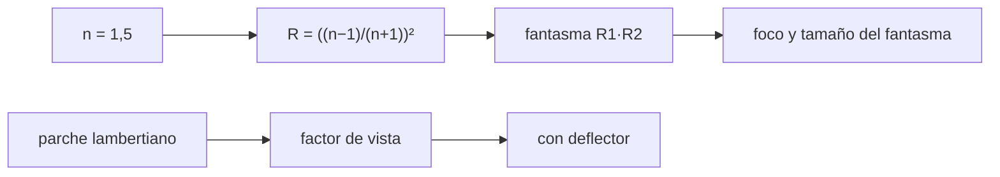

# B50-C05 — Luz parásita y análisis de rayos dispersos

<!-- nav:top -->
[🏠 Programa](../../../../README.md) · [📚 Bloque B50](../../../tronco-comun/B50-diseno-optico-computacional-y-tolerancias.md) · [← Anterior: B50-C04 — Telecentricidad, viñeteo y diseño del campo](../B50-C04-telecentricidad-vineteo-y-diseno-del-campo/CLASE.md) · [Siguiente: B50-C06 — Software de diseño óptico: modelos reproducibles y verificación →](../B50-C06-software-de-diseno-optico-modelos-reproducibles-y-verificacion/CLASE.md)
<!-- /nav -->

## 1. Ubicación, nivel y alcance

Clase 5 del bloque B50. Nivel N3. La luz que no sigue el camino previsto limita el contraste: **reflexiones fantasma** entre superficies de una lente y **luz dispersa** por las paredes del tubo. Aquí calculas la reflectancia de Fresnel y la potencia relativa del fantasma de doble reflexión, localizas el fantasma con el trazado exacto y con una matriz paraxial, y calculas el **factor de vista** de un parche lambertiano de la pared al detector con cuadratura y con Monte Carlo, con y sin deflector. Usas [B12](../../../tronco-comun/B12-probabilidad-estadistica-e-incertidumbre.md). Los valores son ilustrativos.

## 2. Por qué esta clase existe

El contraste de un instrumento no depende solo de la imagen: depende de cuánta luz llega por caminos no deseados. La decisión central: **¿qué fracción de luz llega por un camino parásito y cómo se reduce?**

## 3. Lo que podrás hacer al terminar

1. Calcular la reflectancia de Fresnel a incidencia normal.
2. Estimar la potencia relativa de un fantasma de doble reflexión.
3. Localizar el foco del fantasma por trazado exacto y por matriz paraxial.
4. Calcular el tamaño del fantasma en el plano de imagen.
5. Calcular un factor de vista por cuadratura y Monte Carlo.
6. Medir el efecto de un deflector.

La evidencia es la **ficha de la luz parásita** del ejercicio 12 (sección 20).

## 4. Con qué llegas y cómo comprobarlo

1. ¿Qué es una incertidumbre?
2. ¿Qué es una simulación Monte Carlo?
3. ¿Qué es una tabla de resultados?
4. ¿Qué es un valor ilustrativo?
5. ¿Qué es una verificación?

<details>
<summary>Ver respuestas</summary>

1. Un intervalo en que se espera el valor verdadero. 2. Repetir con números aleatorios de semilla fija. 3. Un resumen ordenado de cálculos. 4. Un valor propuesto para el ejemplo, no medido. 5. Comparar un cálculo con un caso independiente.
</details>

Con cuatro o cinco aciertos, sigue; si no, repasa los prerrequisitos.

## 5. Un caso de contexto y casos de referencia

En un vidrio de índice 1,5 cada superficie sin recubrir refleja el `4,0 %`; el fantasma de doble reflexión tiene una potencia relativa de `1,6 × 10⁻³` y, con recubrimiento de 1 %, de `1,0 × 10⁻⁴`. Un parche de la pared de un tubo de 60 mm de radio y 300 mm envía al detector el `0,689 %` de su emisión; un deflector de 30 mm lo baja a `0,386 %`. Es el **ejemplo conductor**. Todo es **ilustrativo**.

## 6. Vocabulario

Un **fantasma** es una imagen de un objeto brillante producida por dos reflexiones internas. La **reflectancia de Fresnel** es la fracción de potencia reflejada en una interfaz. Una superficie **lambertiana** dispersa con intensidad proporcional al coseno. El **factor de vista** es la fracción de la emisión de un elemento que llega a otro. Un **deflector** es un anillo que bloquea trayectorias directas.

## 7. Modelo mental: ecos en un pasillo

Como los ecos de un pasillo: cada rebote reduce el sonido, pero el eco que llega por un camino corto todavía se oye.



*Descripción textual:* la reflectancia fija la potencia del fantasma, el trazado fija su foco y tamaño, y el factor de vista mide la luz dispersa que llega al detector.

Analogía: ecos en un pasillo. Límite: incidencia casi normal, sin polarización detallada.

## 8. La explicación, paso a paso

### 8.1 Reflectancia y potencia del fantasma

La fórmula cerrada `((n − 1)/(n + 1))²` da `0,040000` y el cálculo con las amplitudes de Fresnel `rs` y `rp` a un ángulo casi nulo da `0,040000`. El fantasma pasa por dos reflexiones, así que su potencia relativa es `R₁R₂ = 1,60 × 10⁻³` sin recubrir y `1,00 × 10⁻⁴` con `R = 0,01`: el recubrimiento reduce el fantasma 16 veces.

### 8.2 Posición y tamaño del fantasma

El foco del fantasma por la matriz paraxial es `z = 15,22505 mm` y por el trazado exacto `15,22505 mm`; la imagen real está en `103,3289 mm`. Como el fantasma está muy desenfocado en el plano de imagen, su radio para un haz de altura `1 mm` es `5,7477 mm` por trazado y `5,7342 mm` por la matriz. Con `10 mm` de altura el radio sube a `78,18 mm` por la aberración esférica del propio fantasma.

### 8.3 Luz dispersa

| caso | cuadratura | Monte Carlo |
|---|---|---|
| sin deflector | 0,00689 | 0,00681 |
| deflector de 30 mm a 150 mm | 0,00386 | 0,00387 |

El deflector reduce la luz dispersa que llega al detector en un factor de `1,78`.

### 8.4 Lectura

Un recubrimiento reduce el fantasma en potencia y un deflector, la dispersión directa; ninguno elimina la luz que rebota dos veces en la pared. Los números son un modelo de un parche y una lente, no un análisis de luz parásita de un instrumento.

## 9. Magnitudes, símbolos y unidades

| Símbolo | Qué es | Unidad | Valor / nota |
|---|---|---|---|
| `R` | reflectancia | — | 0,0400 |
| `G` | potencia relativa del fantasma | — | 1,60 × 10⁻³ |
| `F` | factor de vista | — | 0,00689 |
| `b` | radio interior del deflector | mm | 30 |

## 10. Convenciones y referencias

Reflectancia a incidencia casi normal; pared absorbente tras el primer rebote; parche pequeño.

## 11. De dónde sale lo que afirmamos

| ID | Fuente | Localizador | Respalda | Estado |
|---|---|---|---|---|
| S1 | Wikipedia, *Fresnel equations* | https://en.wikipedia.org/wiki/Fresnel_equations | reflectancia a incidencia normal `((n1−n2)/(n1+n2))²` (≈ 4 % en vidrio común) | Consultada el 2026-11-09 (artículo de enciclopedia, no revisado por pares) |
| — | Sin fuente externa para el resto | — | relaciones que verifica el laboratorio con una segunda vía de cálculo | No se consultó una fuente para esta parte |

Límites: S1 solo respalda la fórmula de la reflectancia; la lente, los recubrimientos y el tubo son ilustrativos.

## 12. Cómo ver la luz parásita

| Magnitud | Valor |
|---|---|
| reflectancia R | 0,0400 |
| fantasma sin recubrir | 1,60 × 10⁻³ |
| fantasma recubierto | 1,00 × 10⁻⁴ |
| factor de vista sin deflector | 0,00689 |
| con deflector | 0,00386 |

Descripción larga: el recubrimiento y el deflector reducen la luz parásita.

## 13. Ejemplo trabajado: el fantasma recubierto

**Paso 1 · Reflectancia.** `R = 0,01` en cada cara.

**Paso 2 · Producto.** `R₁R₂ = 0,01 × 0,01`.

**Paso 3 · Resultado.** `1,0 × 10⁻⁴`.

**Paso 4 · Comparación.** Sin recubrir es `1,6 × 10⁻³`.

## 14. Distintas formas de describir un fantasma

**Por fórmula:** Fresnel. **Por matriz:** foco del fantasma. **Por integral:** factor de vista. **Por muestreo:** Monte Carlo.

## 15. Práctica guiada

**Ejercicio 1 · con los pasos indicados.** Calcula `R` para `n = 1,5`. *Pasos:* `(0,5/2,5)²`.

<details><summary>Solución comentada</summary>

`0,04`.
</details>

**Ejercicio 2 · con una pista.** Potencia relativa del fantasma sin recubrir.

<details><summary>Solución comentada</summary>

`1,6 × 10⁻³`.
</details>

**Ejercicio 3 · casi autónomo.** ¿Cuántas veces menor es con recubrimiento de 1 %?

<details><summary>Solución comentada</summary>

`16`.
</details>

## 16. Práctica autónoma, transferencia e integrador

**Ejercicio 4.** ¿Dónde está el foco del fantasma?

<details><summary>Solución comentada</summary>

`z = 15,225 mm`.
</details>

**Ejercicio 5.** Diferencia entre el trazado y la matriz.

<details><summary>Solución comentada</summary>

`2,1 × 10⁻¹⁰ mm`.
</details>

**Ejercicio 6.** Factor de vista con deflector.

<details><summary>Solución comentada</summary>

`0,00386`.
</details>

**Ejercicio 7.** Razón sin/con deflector.

<details><summary>Solución comentada</summary>

`1,78`.
</details>

**Ejercicio 8.** Diferencia cuadratura–Monte Carlo sin deflector.

<details><summary>Solución comentada</summary>

`0,00007`.
</details>

**Ejercicio 9 · transferencia.** **Transferencia.** Un colega recubre una lente y espera que el fantasma desaparezca. Responde.

<details><summary>Solución comentada</summary>

Lo reduce en potencia, pero sigue ahí y ahora está más desenfocado o más enfocado según el diseño.
</details>

**Ejercicio 10 · transferencia.** **Transferencia.** ¿Por qué un deflector reduce menos que lo esperado?

<details><summary>Solución comentada</summary>

Porque la luz puede llegar por trayectorias que no atraviesa el anillo.
</details>

**Ejercicio 11 · transferencia.** **Transferencia.** ¿Qué parte de la luz parásita no cubre este modelo?

<details><summary>Solución comentada</summary>

La dispersión de las superficies ópticas, la polarización y los rebotes múltiples.
</details>

**Ejercicio 12.** **Integrador.** Elabora tu *ficha de la luz parásita*: reflectancia, fantasma y factor de vista con y sin deflector.

<details><summary>Solución comentada</summary>

Secciones 8.1–8.4.
</details>

**Ejercicio 12 · integrador.** **Integrador.** Elabora tu *ficha de la luz parásita*: reflectancia, fantasma y factor de vista con y sin deflector.

<details><summary>Solución modelo</summary>

Secciones 8.1–8.4.
</details>

## 17. Laboratorio: fantasmas y luz dispersa

El script [luz_parasita.py](luz_parasita.py) calcula la reflectancia, localiza el fantasma por dos vías y compara el factor de vista por cuadratura y Monte Carlo (**comprueba** 1e-3 mm y 0,003).

**Datos:** sin constantes; lente, reflectancias y tubo **ilustrativos**; semilla `20261109`. **Predice antes de ejecutar:** ¿cuánto reducirá el deflector? (cerca de 1,8 veces.) **Ejecución del 2026-11-09 (Python 3.12.9):**

```text
Python 3.12.9 (biblioteca estandar)
Fresnel a incidencia normal, n = 1.5: formula cerrada = 0.040000 ; por amplitudes rs y rp a 1e-6 rad = 0.040000
Fantasma de doble reflexion (razon de potencia R1 R2): sin recubrir = 1.60e-03 ; con R = 0.01 = 1.00e-04
Foco del fantasma: matriz paraxial z = 15.22505 mm ; trazado exacto z = 15.22505 mm ; imagen real z = 103.3289 mm
Radio del fantasma en el plano de imagen (h = 1 mm): trazado = 5.7477 mm ; paraxial = 5.7342 mm
Mismo fantasma con h = 10 mm (aberracion esferica del fantasma): radio = 78.1835 mm
Factor de vista parche-detector sin deflector: cuadratura = 0.00689 ; Monte Carlo = 0.00681
Factor de vista con deflector de 30 mm a 150 mm: cuadratura = 0.00386 ; Monte Carlo = 0.00387
Reduccion por el deflector = 1.78 veces
Pruebas superadas.
```

```bash
python programa/clases/B50/B50-C05-luz-parasita-y-analisis-de-rayos-dispersos/luz_parasita.py
```

**Límites:** parche pequeño y pared absorbente.

## 18. Errores frecuentes y cómo corregirlos

**Sumar reflectancias en vez de multiplicarlas.** Se corrige con 8.1.

**Olvidar que el fantasma está desenfocado.** Se corrige con 8.2.

**Esperar que un deflector elimine toda la dispersión.** Se corrige con 8.4.

**Presentar los números como de un instrumento.** Se corrige con la sección 10.

## 19. Cómo sabrás que vas bien

Tras la sección 8: ¿qué resultado esperabas y cuál obtuviste? Si dudas, repasa el ejemplo 13. Tras el laboratorio: ¿qué comprueba? (ver la sección 17).

## 20. Qué entregas y cómo se evalúa

El producto es tu **ficha de la luz parásita** (ejercicio 12).

| Criterio | Inicial | En desarrollo | Logrado | Destacado |
|---|---|---|---|---|
| Conceptos | Los confunde | Parciales | conceptos de la clase | Explica los límites |
| Cálculo | Sin unidades | Con errores | Tablas completas | Calcula casos nuevos |
| Numérico | Sin comprobar | Un caso | Contraste con el análisis | Interpreta las diferencias |
| Fuentes | Sin fuente | Sin fecha | fuentes con fecha | Declara lo ilustrativo |
| Límites | No los nombra | Uno | Tres | Discute qué falta del modelo |

**Condiciones críticas (no se compensan con promedio):** rotular los números como ilustrativos; no inferir el contraste de un instrumento real; citar solo lo consultado.

## 21. Ética, seguridad y límites

Clase educativa: los modelos son simplificados. Accesibilidad: tablas equivalentes a las gráficas, fórmulas en texto, ejercicios sin conexión.

## 22. Para cerrar y seguir

El fantasma de doble reflexión vale `1,6 × 10⁻³` sin recubrir y `1,0 × 10⁻⁴` recubierto; el deflector reduce la dispersión 1,8 veces. Queda una pregunta: ¿cómo se guarda un modelo de diseño para poder repetirlo?

**Glosario español–inglés.** luz parásita · *stray light*; fantasma · *ghost*; factor de vista · *view factor*; deflector · *baffle*; lambertiano · *Lambertian*.

**Continuidad.** [B50-C06](../B50-C06-software-de-diseno-optico-modelos-reproducibles-y-verificacion/CLASE.md) estudia los modelos de diseño reproducibles.

**Referencias:** ver sección 11.

<!-- nav:bottom -->
---

[← Anterior: B50-C04 — Telecentricidad, viñeteo y diseño del campo](../B50-C04-telecentricidad-vineteo-y-diseno-del-campo/CLASE.md) · [📚 Bloque B50](../../../tronco-comun/B50-diseno-optico-computacional-y-tolerancias.md) · [Siguiente: B50-C06 — Software de diseño óptico: modelos reproducibles y verificación →](../B50-C06-software-de-diseno-optico-modelos-reproducibles-y-verificacion/CLASE.md)
<!-- /nav -->
