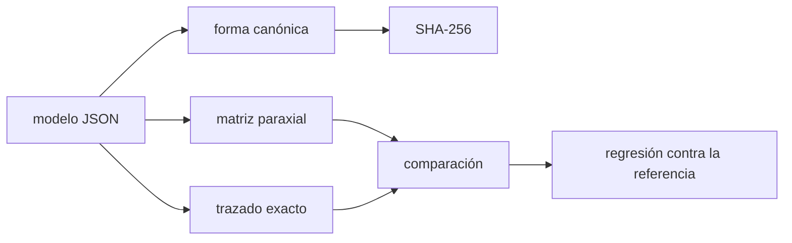

# B50-C06 — Software de diseño óptico: modelos reproducibles y verificación

<!-- nav:top -->
[🏠 Programa](../../../../README.md) · [📚 Bloque B50](../../../tronco-comun/B50-diseno-optico-computacional-y-tolerancias.md) · [← Anterior: B50-C05 — Luz parásita y análisis de rayos dispersos](../B50-C05-luz-parasita-y-analisis-de-rayos-dispersos/CLASE.md) · [Siguiente: B50-C07 — Curvatura de campo y aplanadores →](../B50-C07-curvatura-de-campo-y-aplanadores/CLASE.md)
<!-- /nav -->

## 1. Ubicación, nivel y alcance

Clase 6 del bloque B50. Nivel N3. Un diseño óptico es un archivo: si no se puede repetir el cálculo, no se puede revisar. Aquí guardas un doblete de aire en un texto **JSON** con unidades explícitas, le calculas una **huella SHA-256**, verificas la focal con dos vías (matriz paraxial y trazado exacto), comparas con valores de referencia guardados (**regresión**) y compruebas que una modificación del 0,01 % cambia la huella y rompe la regresión. Usas [B12](../../../tronco-comun/B12-probabilidad-estadistica-e-incertidumbre.md). El doblete es ilustrativo.

## 2. Por qué esta clase existe

Los programas de diseño óptico son cajas con muchas opciones: lo que hace reproducible un diseño es el archivo, sus unidades, su versión y sus pruebas. La decisión central: **¿cómo se demuestra que un modelo sigue siendo el mismo y sigue dando lo mismo?**

## 3. Lo que podrás hacer al terminar

1. Escribir un modelo óptico en JSON con unidades y versión.
2. Calcular una huella canónica independiente del orden de las claves.
3. Calcular la focal con la matriz paraxial y con el trazado.
4. Guardar valores de referencia y comprobar la regresión.
5. Detectar una modificación del modelo.
6. Comprobar la reversibilidad del trazado.

La evidencia es la **ficha de un modelo reproducible** del ejercicio 12 (sección 20).

## 4. Con qué llegas y cómo comprobarlo

1. ¿Qué es una incertidumbre?
2. ¿Qué es una simulación Monte Carlo?
3. ¿Qué es una tabla de resultados?
4. ¿Qué es un valor ilustrativo?
5. ¿Qué es una verificación?

<details>
<summary>Ver respuestas</summary>

1. Un intervalo en que se espera el valor verdadero. 2. Repetir con números aleatorios de semilla fija. 3. Un resumen ordenado de cálculos. 4. Un valor propuesto para el ejemplo, no medido. 5. Comparar un cálculo con un caso independiente.
</details>

Con cuatro o cinco aciertos, sigue; si no, repasa los prerrequisitos.

## 5. Un caso de contexto y casos de referencia

El doblete de aire (radios 80, −60, −50 y −200 mm) tiene `EFL = 167,548929 mm` por la matriz y `167,548929 mm` por el trazado; su huella empieza en `55fd423e3763`. Un radio alterado 0,01 % cambia la focal a `167,572321 mm`. Es el **ejemplo conductor**. Todo es **ilustrativo**.

## 6. Vocabulario

Un **modelo reproducible** es un archivo de texto con todos los datos necesarios. Una **huella** (*hash*) es un resumen que cambia si cambia el contenido. La **forma canónica** ordena las claves y fija los separadores. Una **regresión** compara resultados nuevos con valores de referencia. La **reversibilidad** es que el trazado de vuelta recupere el rayo de entrada.

## 7. Modelo mental: una receta con sello

Como una receta con sello de lacre: si alguien cambia un ingrediente, el sello se rompe y se nota.



*Descripción textual:* el modelo se resume en una huella y sus resultados se contrastan por dos vías y con una referencia guardada.

Analogía: una receta con sello. Límite: luz monocromática, índices constantes y sin tolerancias.

## 8. La explicación, paso a paso

### 8.1 Huella y orden de las claves

La huella SHA-256 del modelo es `55fd423e3763097e1f0ec4b974aaddd9e3002488c4c3ed9dc5898ba242ae8a6e`. Con las claves en otro orden la huella es la misma, porque se serializa en forma canónica. El diccionario `referencia` no entra en la huella para que guardar los resultados no cambie la identidad del diseño.

### 8.2 Dos vías para la focal

| magnitud | matriz paraxial | trazado exacto |
|---|---|---|
| EFL (mm) | 167,548929 | 167,548929 |
| BFL (mm) | 155,816795 | 155,816795 |

### 8.3 Regresión y modificación

La regresión del modelo original da una diferencia máxima de `3,86 × 10⁻⁷ mm` con la referencia redondeada a 6 decimales. Con `R₂` alterado 0,01 % la huella cambia (`4a5add1ff58e…`), la focal pasa a `167,572321 mm` y la regresión falla por `2,34 × 10⁻² mm`.

### 8.4 Reversibilidad y lectura

La desviación del trazado de ida y vuelta es `0,0 × 10⁰ mm`. El archivo, la huella y la regresión no prueban que el diseño sea bueno; prueban que es el mismo y que sigue calculándose igual.

## 9. Magnitudes, símbolos y unidades

| Símbolo | Qué es | Unidad | Valor / nota |
|---|---|---|---|
| `EFL` | distancia focal efectiva | mm | 167,5489 |
| `BFL` | distancia focal posterior | mm | 155,8168 |
| `H` | huella SHA-256 | — | 55fd423e3763… |
| `ε` | tolerancia de la regresión | mm | 1e-6 |

## 10. Convenciones y referencias

Unidades en mm, longitud de onda en nm, versión semántica del modelo; JSON canónico con claves ordenadas y separadores `,` y `:`.

## 11. De dónde sale lo que afirmamos

| ID | Fuente | Localizador | Respalda | Estado |
|---|---|---|---|---|
| — | Sin fuente externa | — | relaciones estándar que verifica el laboratorio | No se consultó una fuente para esta clase |

Límites: no se consultó ninguna fuente; el doblete no corresponde a vidrios de catálogo.

## 12. Cómo ver el modelo y su huella

| Magnitud | Valor |
|---|---|
| EFL | 167,5489 mm |
| BFL | 155,8168 mm |
| huella | 55fd423e3763… |
| EFL con R₂ alterado | 167,5723 mm |

Descripción larga: un cambio del 0,01 % en un radio modifica la huella y la focal.

## 13. Ejemplo trabajado: la regresión

**Paso 1 · Referencia.** `EFL = 167,548929 mm`.

**Paso 2 · Modelo alterado.** `EFL = 167,572321 mm`.

**Paso 3 · Diferencia.** `2,34 × 10⁻² mm`.

**Paso 4 · Decisión.** Mayor que `10⁻⁶ mm`: la regresión falla.

## 14. Distintas formas de describir un modelo

**Por archivo:** JSON. **Por resumen:** huella. **Por cálculo:** matriz y trazado. **Por prueba:** regresión.

## 15. Práctica guiada

**Ejercicio 1 · con los pasos indicados.** ¿Por qué las claves se ordenan antes de calcular la huella? *Pasos:* piensa en dos archivos iguales.

<details><summary>Solución comentada</summary>

Para que dos archivos con el mismo contenido tengan la misma huella.
</details>

**Ejercicio 2 · con una pista.** ¿Entra `referencia` en la huella?

<details><summary>Solución comentada</summary>

No.
</details>

**Ejercicio 3 · casi autónomo.** Diferencia de EFL entre las dos vías.

<details><summary>Solución comentada</summary>

`2,2 × 10⁻⁸ mm`.
</details>

## 16. Práctica autónoma, transferencia e integrador

**Ejercicio 4.** Cambio de EFL por alterar `R₂` 0,01 %.

<details><summary>Solución comentada</summary>

`0,02339 mm`.
</details>

**Ejercicio 5.** ¿Falla la regresión con ese cambio?

<details><summary>Solución comentada</summary>

Sí.
</details>

**Ejercicio 6.** ¿Cuál es la desviación de la reversibilidad?

<details><summary>Solución comentada</summary>

`0,0 × 10⁰ mm`.
</details>

**Ejercicio 7.** ¿Qué pasa si cambias solo las unidades a metros y no los valores?

<details><summary>Solución comentada</summary>

El modelo es otro y debe tener otra versión y otra huella.
</details>

**Ejercicio 8.** BFL por la matriz.

<details><summary>Solución comentada</summary>

`155,8168 mm`.
</details>

**Ejercicio 9 · transferencia.** **Transferencia.** Un colega comparte una captura de pantalla de su diseño. Responde.

<details><summary>Solución comentada</summary>

Una captura no es un modelo: falta el archivo, las unidades y la versión.
</details>

**Ejercicio 10 · transferencia.** **Transferencia.** ¿Qué otra comprobación añadirías?

<details><summary>Solución comentada</summary>

La conservación del camino óptico o la comparación con otro programa.
</details>

**Ejercicio 11 · transferencia.** **Transferencia.** ¿Qué no prueba una regresión verde?

<details><summary>Solución comentada</summary>

Que el diseño cumpla su función.
</details>

**Ejercicio 12.** **Integrador.** Elabora tu *ficha de un modelo reproducible*: JSON, huella, dos vías y regresión.

<details><summary>Solución comentada</summary>

Secciones 8.1–8.4.
</details>

**Ejercicio 12 · integrador.** **Integrador.** Elabora tu *ficha de un modelo reproducible*: JSON, huella, dos vías y regresión.

<details><summary>Solución modelo</summary>

Secciones 8.1–8.4.
</details>

## 17. Laboratorio: modelo, huella y regresión

El script [modelo.py](modelo.py) construye el modelo, calcula su huella, contrasta la focal por dos vías y comprueba la regresión (**comprueba** 1e-6 y la reversibilidad 1e-9).

**Datos:** sin constantes; doblete **ilustrativo**. **Predice antes de ejecutar:** ¿cambiará la huella al alterar un radio? (sí.) **Ejecución del 2026-11-09 (Python 3.12.9):**

```text
Python 3.12.9 (biblioteca estandar)
Modelo: doblete de aire de ejemplo (unidades mm, version 1.0.0)
Huella SHA-256 del modelo: 55fd423e3763097e1f0ec4b974aaddd9e3002488c4c3ed9dc5898ba242ae8a6e
  magnitud  matriz paraxial  trazado exacto
  EFL [mm]       167.548929      167.548929
  BFL [mm]       155.816795      155.816795
Regresion del modelo original: diferencia maxima con la referencia = 3.86e-07 mm
Huella con las claves en otro orden: igual
Modelo con R2 alterado 0.01 %: huella distinta (4a5add1ff58e...) ; EFL = 167.572321 mm ; diferencia con la referencia = 2.34e-02 mm
Reversibilidad del trazado (ida y vuelta): desviacion = 0.00e+00 mm
Pruebas superadas.
```

```bash
python programa/clases/B50/B50-C06-software-de-diseno-optico-modelos-reproducibles-y-verificacion/modelo.py
```

**Límites:** sin tolerancias ni dispersión.

## 18. Errores frecuentes y cómo corregirlos

**Guardar el modelo sin unidades.** Se corrige con la sección 10.

**Incluir los resultados en la huella.** Se corrige con 8.1.

**Confiar en una sola vía de cálculo.** Se corrige con 8.2.

**Creer que una regresión verde prueba un buen diseño.** Se corrige con 8.4.

## 19. Cómo sabrás que vas bien

Tras la sección 8: ¿qué resultado esperabas y cuál obtuviste? Si dudas, repasa el ejemplo 13. Tras el laboratorio: ¿qué comprueba? (ver la sección 17).

## 20. Qué entregas y cómo se evalúa

El producto es tu **ficha de un modelo reproducible** (ejercicio 12).

| Criterio | Inicial | En desarrollo | Logrado | Destacado |
|---|---|---|---|---|
| Conceptos | Los confunde | Parciales | conceptos de la clase | Explica los límites |
| Cálculo | Sin unidades | Con errores | Tablas completas | Calcula casos nuevos |
| Numérico | Sin comprobar | Un caso | Contraste con el análisis | Interpreta las diferencias |
| Fuentes | Sin fuente | Sin fecha | fuentes con fecha | Declara lo ilustrativo |
| Límites | No los nombra | Uno | Tres | Discute qué falta del modelo |

**Condiciones críticas (no se compensan con promedio):** rotular el doblete como ilustrativo; no presentar el modelo como un instrumento; citar solo lo consultado.

## 21. Ética, seguridad y límites

Clase educativa: los modelos son simplificados. Accesibilidad: tablas equivalentes a las gráficas, fórmulas en texto, ejercicios sin conexión.

## 22. Para cerrar y seguir

El modelo tiene huella `55fd423e3763…`, focal `167,5489 mm` por dos vías y una regresión que detecta un cambio del 0,01 %. Queda una pregunta: ¿cómo se corrige la curvatura de campo?

**Glosario español–inglés.** modelo reproducible · *reproducible model*; huella · *hash*; regresión · *regression test*; forma canónica · *canonical form*; reversibilidad · *reversibility*.

**Continuidad.** [B50-C07](../B50-C07-curvatura-de-campo-y-aplanadores/CLASE.md) estudia la curvatura de campo y los aplanadores.

**Referencias:** ver sección 11.

<!-- nav:bottom -->
---

[← Anterior: B50-C05 — Luz parásita y análisis de rayos dispersos](../B50-C05-luz-parasita-y-analisis-de-rayos-dispersos/CLASE.md) · [📚 Bloque B50](../../../tronco-comun/B50-diseno-optico-computacional-y-tolerancias.md) · [Siguiente: B50-C07 — Curvatura de campo y aplanadores →](../B50-C07-curvatura-de-campo-y-aplanadores/CLASE.md)
<!-- /nav -->
