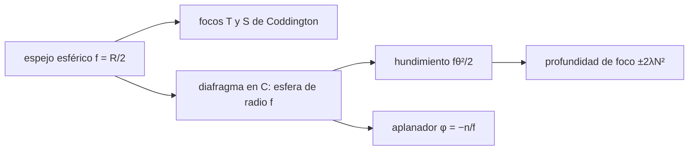

# B50-C07 — Curvatura de campo y aplanadores

<!-- nav:top -->
[🏠 Programa](../../../../README.md) · [📚 Bloque B50](../../../tronco-comun/B50-diseno-optico-computacional-y-tolerancias.md) · [← Anterior: B50-C06 — Software de diseño óptico: modelos reproducibles y verificación](../B50-C06-software-de-diseno-optico-modelos-reproducibles-y-verificacion/CLASE.md) · [Siguiente: B50-C08 — Distorsión geométrica y su calibración →](../B50-C08-distorsion-geometrica-y-su-calibracion/CLASE.md)
<!-- /nav -->

## 1. Ubicación, nivel y alcance

Clase 7 del bloque B50. Nivel N3. El mejor foco de los puntos del campo no cae en un plano sino en una superficie curva. Aquí mides con haces estrechos trazados exactamente los **focos tangencial y sagital** de un espejo esférico (fórmulas de Coddington), la **superficie de enfoque** con el diafragma en el centro de curvatura, la **profundidad de foco** que tolera un detector plano y el efecto de un **aplanador** (lente negativa cerca del foco) según la suma de Petzval. Usas B41-C08 y [B10](../../../tronco-comun/B10-algebra-lineal-y-matematicas-geometricas.md). Los valores son ilustrativos.

## 2. Por qué esta clase existe

Un detector plano mal enfocado en el borde pierde resolución: hay que decidir si se acepta, se curva el detector o se agrega un aplanador. La decisión central: **¿cuánto se hunde el foco en el borde y qué lo corrige?**

## 3. Lo que podrás hacer al terminar

1. Calcular los focos tangencial y sagital de un espejo esférico fuera de eje.
2. Comprobar que con el diafragma en `C` la superficie de enfoque es una esfera de radio `f`.
3. Calcular el hundimiento `fθ²/2` y compararlo con la profundidad de foco.
4. Hallar el campo máximo con un detector plano.
5. Barrer la focal de un aplanador.
6. Comparar el óptimo con la suma de Petzval.

La evidencia es la **ficha de la curvatura de campo** del ejercicio 12 (sección 20).

## 4. Con qué llegas y cómo comprobarlo

1. ¿Qué es una incertidumbre?
2. ¿Qué es una simulación Monte Carlo?
3. ¿Qué es una tabla de resultados?
4. ¿Qué es un valor ilustrativo?
5. ¿Qué es una verificación?

<details>
<summary>Ver respuestas</summary>

1. Un intervalo en que se espera el valor verdadero. 2. Repetir con números aleatorios de semilla fija. 3. Un resumen ordenado de cálculos. 4. Un valor propuesto para el ejemplo, no medido. 5. Comparar un cálculo con un caso independiente.
</details>

Con cuatro o cinco aciertos, sigue; si no, repasa los prerrequisitos.

## 5. Un caso de contexto y casos de referencia

Un espejo esférico de `f = 1000 mm`, `f/5`, tiene un foco hundido `−0,1523 mm` a 1° del eje, mientras la tolerancia de foco `±2λN²` es `0,0275 mm` y deja un campo plano de solo `0,425°`. Un aplanador de focal `-1863 mm` anula el hundimiento. Es el **ejemplo conductor**. Todo es **ilustrativo**.

## 6. Vocabulario

El foco **tangencial** está en el plano del campo; el **sagital**, perpendicular a él. La **superficie de Petzval** es la superficie de enfoque sin astigmatismo; su curvatura es la **suma de Petzval** `Σ φᵢ/nᵢ` (con `n = −1` en un espejo). El **aplanador** es un elemento cercano al foco que anula esa suma. La **profundidad de foco** es `±2λN²`.

## 7. Modelo mental: una pantalla esférica

Como una pantalla de cine curva: las butacas del centro y del borde ven nítido solo si la pantalla sigue la superficie de enfoque.



*Descripción textual:* las superficies de enfoque se obtienen de trazar haces estrechos, y el aplanador anula la suma de Petzval.

Analogía: una pantalla esférica. Límite: haces estrechos y monocromáticos.

## 8. La explicación, paso a paso

### 8.1 Coddington (diafragma en el vértice)

| campo (°) | tangencial trazado (mm) | `f cos θ` | sagital trazado (mm) | `f / cos θ` |
|---|---|---|---|---|
| 5 | 996,1947 | 996,1947 | 1003,8198 | 1003,8198 |
| 10 | 984,8077 | 984,8078 | 1015,4266 | 1015,4266 |
| 20 | 939,6926 | 939,6926 | 1064,1778 | 1064,1778 |

### 8.2 Diafragma en el centro de curvatura

| campo (°) | distancia de `C` al foco (mm) |
|---|---|
| 0,0 | 1000,0748 |
| 0,5 | 1000,0748 |
| 1,0 | 1000,0748 |
| 2,0 | 1000,0748 |

La distancia es constante (`1000,0748 mm`, con 0,075 mm de aberración esférica residual): la superficie de enfoque es una esfera de radio `f` centrada en `C`.

### 8.3 Hundimiento y profundidad de foco

A 1° el foco se hunde `−0,1523 mm` (analítico `fθ²/2 = 0,1523 mm`). La tolerancia `±2λN² = 0,0275 mm` limita el campo plano a `0,425°`.

### 8.4 Aplanador

| focal del aplanador (mm) | `z(1°) − z(0)` (mm) |
|---|---|
| -400 | 34,3549 |
| -600 | 8,3930 |
| -900 | 1,8608 |
| -1200 | 0,5330 |
| -1500 | 0,1377 |
| -2000 | −0,0519 |
| -3000 | −0,1127 |
| -5000 | −0,1197 |

El cero se interpola en `-1863 mm`; la regla de Petzval `φ = −n/f` da `-1500 mm`. La diferencia (`24 %`) viene de que la lente está a 20 mm del foco y tiene espesor, no de un error de la teoría de tercer orden.

## 9. Magnitudes, símbolos y unidades

| Símbolo | Qué es | Unidad | Valor / nota |
|---|---|---|---|
| `f` | distancia focal | mm | 1000 |
| `θ` | ángulo de campo | rad | 0,0175 (1°) |
| `δ` | tolerancia de foco `2λN²` | mm | 0,0275 |
| `φ` | potencia del aplanador | mm⁻¹ | 5,37 × 10⁻⁴ (óptimo) |

## 10. Convenciones y referencias

Haces estrechos de 0,3 mm de radio (Coddington) y de 30 mm (superficie de enfoque); λ = 550 nm; N = 5.

## 11. De dónde sale lo que afirmamos

| ID | Fuente | Localizador | Respalda | Estado |
|---|---|---|---|---|
| S1 | Wikipedia, *Petzval field curvature* | https://en.wikipedia.org/wiki/Petzval_field_curvature | definición de la curvatura de campo, suma de Petzval y aplanador de campo | Consultada el 2026-11-09 (artículo de enciclopedia, no revisado por pares) |
| — | Sin fuente externa para el resto | — | relaciones que verifica el laboratorio con una segunda vía de cálculo | No se consultó una fuente para esta parte |

Límites: S1 solo respalda la definición cualitativa; las fórmulas de Coddington y de Petzval las verifica el laboratorio contra el trazado.

## 12. Cómo ver la superficie de enfoque

| Magnitud | Valor |
|---|---|
| hundimiento a 1° | −0,1523 mm |
| tolerancia de foco | 0,0275 mm |
| campo plano máximo | 0,425° |
| focal óptima del aplanador | -1863 mm |

Descripción larga: el hundimiento del foco supera la tolerancia mucho antes del borde del campo.

## 13. Ejemplo trabajado: el campo plano máximo

**Paso 1 · Tolerancia.** `2 × 550·10⁻⁶ × 5² = 0,0275 mm`.

**Paso 2 · Ecuación.** `fθ²/2 = δ`.

**Paso 3 · Ángulo.** `θ = √(2δ/f) = 0,00742 rad`.

**Paso 4 · Grados.** `0,425°`.

## 14. Distintas formas de describir una superficie de enfoque

**Por radio:** esfera de radio `f`. **Por sagita:** `fθ²/2`. **Por potencia:** suma de Petzval. **Por barrido:** focal del aplanador.

## 15. Práctica guiada

**Ejercicio 1 · con los pasos indicados.** Calcula `f cos θ` para `θ = 10°`. *Pasos:* coseno por 1000.

<details><summary>Solución comentada</summary>

`984,8078 mm`.
</details>

**Ejercicio 2 · con una pista.** Calcula `f / cos θ` para `θ = 10°`.

<details><summary>Solución comentada</summary>

`1015,4266 mm`.
</details>

**Ejercicio 3 · casi autónomo.** Diferencia astigmática a 10°.

<details><summary>Solución comentada</summary>

`30,619 mm`.
</details>

## 16. Práctica autónoma, transferencia e integrador

**Ejercicio 4.** Hundimiento a 0,5° (`fθ²/2`).

<details><summary>Solución comentada</summary>

`0,0381 mm`.
</details>

**Ejercicio 5.** Tolerancia de foco para `N = 8`.

<details><summary>Solución comentada</summary>

`0,0704 mm`.
</details>

**Ejercicio 6.** Distancia constante `|F − C|`.

<details><summary>Solución comentada</summary>

`1000,07 mm ≈ f`.
</details>

**Ejercicio 7.** Focal teórica del aplanador.

<details><summary>Solución comentada</summary>

`-1500 mm`.
</details>

**Ejercicio 8.** Diferencia entre el óptimo y la teoría.

<details><summary>Solución comentada</summary>

`24 %`.
</details>

**Ejercicio 9 · transferencia.** **Transferencia.** Un colega curva el detector con radio `f`. ¿Resuelve el problema?

<details><summary>Solución comentada</summary>

Sí, la superficie de enfoque queda en el detector; cuesta una fabricación curva.
</details>

**Ejercicio 10 · transferencia.** **Transferencia.** ¿Por qué un aplanador cerca del foco cambia poco la focal?

<details><summary>Solución comentada</summary>

Porque su potencia es pequeña y actúa donde el haz es estrecho.
</details>

**Ejercicio 11 · transferencia.** **Transferencia.** ¿Qué otra aberración introduce un aplanador?

<details><summary>Solución comentada</summary>

Distorsión, y color si es refractivo.
</details>

**Ejercicio 12.** **Integrador.** Elabora tu *ficha de la curvatura de campo*: Coddington, esfera de enfoque, hundimiento y aplanador.

<details><summary>Solución comentada</summary>

Secciones 8.1–8.4.
</details>

**Ejercicio 12 · integrador.** **Integrador.** Elabora tu *ficha de la curvatura de campo*: Coddington, esfera de enfoque, hundimiento y aplanador.

<details><summary>Solución modelo</summary>

Secciones 8.1–8.4.
</details>

## 17. Laboratorio: superficies de enfoque y aplanador

El script [curvatura_campo.py](curvatura_campo.py) mide los focos de Coddington, la esfera de enfoque y el efecto de un aplanador (**comprueba** 1e-3 relativo en Coddington y 30 % en el aplanador).

**Datos:** sin constantes; espejo y aplanador **ilustrativos**. **Predice antes de ejecutar:** ¿cuánto se hunde el foco a 1°? (−0,152 mm.) **Ejecución del 2026-11-09 (Python 3.12.9):**

```text
Python 3.12.9 (biblioteca estandar)
A. Diafragma en el vertice: focos de Coddington del espejo esferico (distancia al vertice a lo largo del rayo principal)
campo [grados]  T trazado [mm]  f cos(th)  S trazado [mm]  f/cos(th)
           5.0        996.1947   996.1947       1003.8198  1003.8198
          10.0        984.8077   984.8078       1015.4266  1015.4266
          20.0        939.6926   939.6926       1064.1778  1064.1778
B. Diafragma en el centro de curvatura C: distancia de C al foco
campo [grados]   |F - C| [mm]  z del foco [mm]
           0.0      1000.0748        -999.9252
           0.5      1000.0748        -999.9633
           1.0      1000.0748       -1000.0775
           2.0      1000.0748       -1000.5344
Tolerancia de foco +-2 lambda N^2 = 0.0275 mm ; campo maximo con detector plano = 0.425 grados
Hundimiento del foco a 1 grado sin aplanador = -0.1523 mm ; analitico f theta^2 / 2 = 0.1523 mm
 focal del aplanador [mm]   z(1 grado) - z(0) [mm]
                   -400.0                  34.3549
                   -600.0                   8.3930
                   -900.0                   1.8608
                  -1200.0                   0.5330
                  -1500.0                   0.1377
                  -2000.0                  -0.0519
                  -3000.0                  -0.1127
                  -5000.0                  -0.1197
Focal optima interpolada = -1863.1 mm ; teoria de Petzval phi = -n_lente / f ==> f_l = -1500.0 mm
Pruebas superadas.
```

```bash
python programa/clases/B50/B50-C07-curvatura-de-campo-y-aplanadores/curvatura_campo.py
```

**Límites:** haces estrechos; aplanador a 20 mm del foco.

## 18. Errores frecuentes y cómo corregirlos

**Usar un haz ancho para hallar el foco de Coddington.** Se corrige con la sección 10.

**Olvidar que el foco sagital y el tangencial difieren.** Se corrige con 8.1.

**Esperar que la regla `φ = −n/f` valga exacta lejos del foco.** Se corrige con 8.4.

**Presentar el espejo como real.** Se corrige con la sección 10.

## 19. Cómo sabrás que vas bien

Tras la sección 8: ¿qué resultado esperabas y cuál obtuviste? Si dudas, repasa el ejemplo 13. Tras el laboratorio: ¿qué comprueba? (ver la sección 17).

## 20. Qué entregas y cómo se evalúa

El producto es tu **ficha de la curvatura de campo** (ejercicio 12).

| Criterio | Inicial | En desarrollo | Logrado | Destacado |
|---|---|---|---|---|
| Conceptos | Los confunde | Parciales | conceptos de la clase | Explica los límites |
| Cálculo | Sin unidades | Con errores | Tablas completas | Calcula casos nuevos |
| Numérico | Sin comprobar | Un caso | Contraste con el análisis | Interpreta las diferencias |
| Fuentes | Sin fuente | Sin fecha | fuentes con fecha | Declara lo ilustrativo |
| Límites | No los nombra | Uno | Tres | Discute qué falta del modelo |

**Condiciones críticas (no se compensan con promedio):** rotular el espejo y el aplanador como ilustrativos; no inferir el campo de un telescopio real; citar solo lo consultado.

## 21. Ética, seguridad y límites

Clase educativa: los modelos son simplificados. Accesibilidad: tablas equivalentes a las gráficas, fórmulas en texto, ejercicios sin conexión.

## 22. Para cerrar y seguir

Con el diafragma en `C` el foco cae en una esfera de radio `f`, se hunde `−0,152 mm` a 1° y un aplanador de `-1863 mm` lo anula. Queda una pregunta: ¿cómo se mide y se calibra la distorsión del campo?

**Glosario español–inglés.** curvatura de campo · *field curvature*; suma de Petzval · *Petzval sum*; aplanador · *field flattener*; foco tangencial · *tangential focus*; foco sagital · *sagittal focus*.

**Continuidad.** [B50-C08](../B50-C08-distorsion-geometrica-y-su-calibracion/CLASE.md) estudia la distorsión.

**Referencias:** ver sección 11.

<!-- nav:bottom -->
---

[← Anterior: B50-C06 — Software de diseño óptico: modelos reproducibles y verificación](../B50-C06-software-de-diseno-optico-modelos-reproducibles-y-verificacion/CLASE.md) · [📚 Bloque B50](../../../tronco-comun/B50-diseno-optico-computacional-y-tolerancias.md) · [Siguiente: B50-C08 — Distorsión geométrica y su calibración →](../B50-C08-distorsion-geometrica-y-su-calibracion/CLASE.md)
<!-- /nav -->
