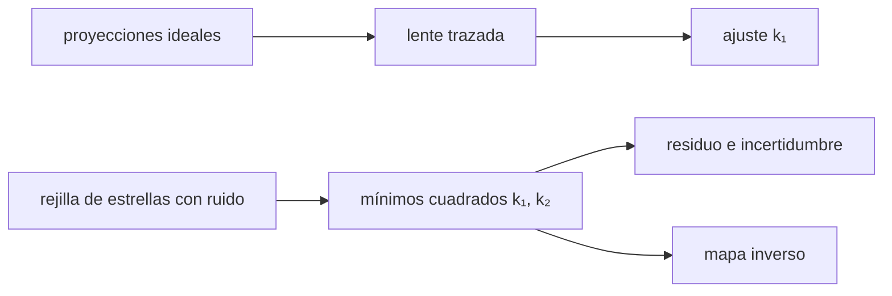

# B50-C08 — Distorsión geométrica y su calibración

<!-- nav:top -->
[🏠 Programa](../../../../README.md) · [📚 Bloque B50](../../../tronco-comun/B50-diseno-optico-computacional-y-tolerancias.md) · [← Anterior: B50-C07 — Curvatura de campo y aplanadores](../B50-C07-curvatura-de-campo-y-aplanadores/CLASE.md) · [Siguiente: B50-C09 — Asignación y balance de tolerancias ópticas →](../B50-C09-asignacion-y-balance-de-tolerancias-opticas/CLASE.md)
<!-- /nav -->

## 1. Ubicación, nivel y alcance

Clase 8 del bloque B50. Nivel N3. La **distorsión** deforma el mapa del cielo sin desenfocarlo: una estrella cae donde no debe. Aquí comparas las proyecciones ideales (tangente, equidistante, estereográfica, equisólida, ortográfica), mides la distorsión de una lente trazada con el diafragma en tres posiciones y **calibras** un modelo polinómico radial con una rejilla de estrellas con ruido, con su incertidumbre, el residuo y el mapa inverso. Usas [B10](../../../tronco-comun/B10-algebra-lineal-y-matematicas-geometricas.md) y [B12](../../../tronco-comun/B12-probabilidad-estadistica-e-incertidumbre.md). Los coeficientes verdaderos son sintéticos.

## 2. Por qué esta clase existe

En astrometría y en mosaicos una distorsión de 0,1 % mueve las estrellas decenas de píxeles. La decisión central: **¿qué modelo describe la distorsión y con qué precisión se puede calibrar?**

## 3. Lo que podrás hacer al terminar

1. Comparar las proyecciones ideales entre sí.
2. Medir la distorsión de una lente trazada y ajustar `k₁`.
3. Relacionar la distorsión con la posición del diafragma.
4. Ajustar `k₁` y `k₂` por mínimos cuadrados a una rejilla con ruido.
5. Calcular el residuo y la incertidumbre de los coeficientes.
6. Invertir el modelo por iteración.

La evidencia es la **ficha de la distorsión y su calibración** del ejercicio 12 (sección 20).

## 4. Con qué llegas y cómo comprobarlo

1. ¿Qué es una incertidumbre?
2. ¿Qué es una simulación Monte Carlo?
3. ¿Qué es una tabla de resultados?
4. ¿Qué es un valor ilustrativo?
5. ¿Qué es una verificación?

<details>
<summary>Ver respuestas</summary>

1. Un intervalo en que se espera el valor verdadero. 2. Repetir con números aleatorios de semilla fija. 3. Un resumen ordenado de cálculos. 4. Un valor propuesto para el ejemplo, no medido. 5. Comparar un cálculo con un caso independiente.
</details>

Con cuatro o cinco aciertos, sigue; si no, repasa los prerrequisitos.

## 5. Un caso de contexto y casos de referencia

La lente trazada con el diafragma a 80 mm tiene `−3,32 %` de distorsión a 10°; la calibración de 120 estrellas con ruido de 0,005 mm recupera `k₁ = -3,922 × 10⁻⁵` (verdad `−4,0 × 10⁻⁵`) y deja un residuo de `0,00546 mm`. Es el **ejemplo conductor**. Todo es **ilustrativo** o **sintético**.

## 6. Vocabulario

La **distorsión** es la desviación de la altura de imagen respecto de `f tan θ`. Es **de barril** si es negativa y **de cojín** si es positiva. El **modelo radial** es `r_d = r(1 + k₁r² + k₂r⁴)`. La **calibración** estima los coeficientes. El **mapa inverso** pasa de la imagen distorsionada a la ideal. El **residuo** es lo que queda tras el ajuste.

## 7. Modelo mental: una rejilla en una lámina elástica

Como una rejilla dibujada en una lámina elástica: se estira más hacia el borde, y conociendo cuánto se puede deshacer el estiramiento.



*Descripción textual:* se compara la proyección ideal con la real, se ajusta un polinomio radial a una rejilla y se invierte el modelo.

Analogía: una rejilla en una lámina elástica. Límite: distorsión radial pura, sin descentrado.

## 8. La explicación, paso a paso

### 8.1 Proyecciones ideales (campo de 10°, `r/f`)

| proyección | `r/f` | respecto de la tangente |
|---|---|---|
| tan | 0,176327 | 0,000 % |
| equi | 0,174533 | −1,017 % |
| estereo | 0,174977 | −0,765 % |
| equisolida | 0,174311 | −1,143 % |
| orto | 0,173648 | −1,519 % |

### 8.2 Lente trazada

| diafragma antes de la lente (mm) | `k₁` ajustado (mm⁻²) | distorsión a 10° |
|---|---|---|
| 0 | -2,67 × 10⁻⁶ | −0,084 % |
| 40 | -5,30 × 10⁻⁵ | −1,625 % |
| 80 | -1,11 × 10⁻⁴ | −3,319 % |

Todas son de barril y crecen con la distancia del diafragma a la lente.

### 8.3 Calibración

Con `120` estrellas y ruido `0,005 mm`: `k₁ = -3,9219 × 10⁻⁵ ± 4,6 × 10⁻⁷` (verdad `−4,0 × 10⁻⁵`) y `k₂ = 2,7133 × 10⁻⁸ ± 1,4 × 10⁻⁹` (verdad `3,0 × 10⁻⁸`). El residuo RMS es `0,00546 mm`. En la esquina (15, 15) mm la distorsión desplaza la estrella `0,2578 mm` y el mapa inverso la recupera con error `2,5 × 10⁻¹⁵ mm`.

### 8.4 Lectura

Los coeficientes verdaderos caen dentro de 3 incertidumbres; el residuo es un 9 % mayor que el ruido porque el modelo es un polinomio truncado. La lente es solo una lente: una cámara real tendría además descentrado y tangencial.

## 9. Magnitudes, símbolos y unidades

| Símbolo | Qué es | Unidad | Valor / nota |
|---|---|---|---|
| `k₁`, `k₂` | coeficientes radiales | mm⁻², mm⁻⁴ | -3,92 × 10⁻⁵; 2,71 × 10⁻⁸ |
| `σ` | ruido de posición | mm | 0,005 |
| `r` | distancia al centro | mm | 0–21 |
| `D` | distorsión | % | −3,32 (80 mm, 10°) |

## 10. Convenciones y referencias

Altura de imagen en mm; el centro de distorsión se supone conocido; ruido gaussiano independiente en `x` e `y`.

## 11. De dónde sale lo que afirmamos

| ID | Fuente | Localizador | Respalda | Estado |
|---|---|---|---|---|
| — | Sin fuente externa | — | relaciones estándar que verifica el laboratorio | No se consultó una fuente para esta clase |

Límites: no se consultó ninguna fuente; los coeficientes y el ruido son sintéticos.

## 12. Cómo ver la calibración

| Magnitud | Valor |
|---|---|
| `k₁` ajustado | -3,922 × 10⁻⁵ |
| `k₂` ajustado | 2,713 × 10⁻⁸ |
| residuo RMS | 0,00546 mm |
| desplazamiento en la esquina | 0,2578 mm |

Descripción larga: los coeficientes recuperados están dentro de la incertidumbre de los verdaderos.

## 13. Ejemplo trabajado: el desplazamiento de una esquina

**Paso 1 · Radio.** `r = √(15² + 15²) = 21,21 mm`.

**Paso 2 · Factor.** `f = 1 + k₁r² + k₂r⁴ = 1 −0,0176 + 0,0055 = 0,98785` con los coeficientes ajustados (`r² = 450 mm²`).

**Paso 3 · Desplazamiento.** `(f − 1) r = 0,2578 mm`.

**Paso 4 · Contraste.** El laboratorio da `0,2578 mm`.

## 14. Distintas formas de describir una distorsión

**Por proyección:** tabla ideal. **Por modelo:** polinomio radial. **Por ajuste:** mínimos cuadrados. **Por inversa:** punto fijo.

## 15. Práctica guiada

**Ejercicio 1 · con los pasos indicados.** Calcula `tan 10°` y compárala con `10° en rad`. *Pasos:* tangente y radianes.

<details><summary>Solución comentada</summary>

`0,176327` frente a `0,174533`.
</details>

**Ejercicio 2 · con una pista.** Distorsión de la proyección equidistante a 10°.

<details><summary>Solución comentada</summary>

`−1,017 %`.
</details>

**Ejercicio 3 · casi autónomo.** ¿Qué signo tiene la distorsión de barril?

<details><summary>Solución comentada</summary>

Negativo.
</details>

## 16. Práctica autónoma, transferencia e integrador

**Ejercicio 4.** Distorsión de la lente con el diafragma a 40 mm y 10°.

<details><summary>Solución comentada</summary>

`−1,625 %`.
</details>

**Ejercicio 5.** ¿Está `k₁` verdadero dentro de 3σ?

<details><summary>Solución comentada</summary>

Sí.
</details>

**Ejercicio 6.** Residuo frente al ruido.

<details><summary>Solución comentada</summary>

`0,00546` frente a `0,005`.
</details>

**Ejercicio 7.** Error de la inversa.

<details><summary>Solución comentada</summary>

`2,5 × 10⁻¹⁵ mm`.
</details>

**Ejercicio 8.** Cociente de distorsiones 80 mm / 40 mm a 10°.

<details><summary>Solución comentada</summary>

`2,04`.
</details>

**Ejercicio 9 · transferencia.** **Transferencia.** Un colega calibra con estrellas solo en el centro. Responde.

<details><summary>Solución comentada</summary>

No determina `k₂`: la rejilla debe cubrir todo el campo.
</details>

**Ejercicio 10 · transferencia.** **Transferencia.** ¿Por qué mover el diafragma cambia la distorsión?

<details><summary>Solución comentada</summary>

Porque cambia la altura a la que los rayos principales cruzan la lente.
</details>

**Ejercicio 11 · transferencia.** **Transferencia.** ¿Qué falta en un modelo radial?

<details><summary>Solución comentada</summary>

El descentrado, el término tangencial y la variación con la temperatura.
</details>

**Ejercicio 12.** **Integrador.** Elabora tu *ficha de la distorsión y su calibración*: proyecciones, lente y ajuste con incertidumbre.

<details><summary>Solución comentada</summary>

Secciones 8.1–8.4.
</details>

**Ejercicio 12 · integrador.** **Integrador.** Elabora tu *ficha de la distorsión y su calibración*: proyecciones, lente y ajuste con incertidumbre.

<details><summary>Solución modelo</summary>

Secciones 8.1–8.4.
</details>

## 17. Laboratorio: distorsión y calibración

El script [distorsion.py](distorsion.py) compara proyecciones, mide la distorsión de la lente y calibra un modelo polinómico (**comprueba** 3σ, residuo cercano al ruido e inversa 1e-9).

**Datos:** sin constantes; lente y coeficientes **ilustrativos**; ruido sintético; semilla `20261109`. **Predice antes de ejecutar:** ¿recuperará `k₁`? (sí, dentro de 3σ.) **Ejecución del 2026-11-09 (Python 3.12.9):**

```text
Python 3.12.9 (biblioteca estandar)
A. Proyecciones (r / f) para un campo de 10 grados
         tan: 0.176327  (+0.000 % respecto de la tangente)
        equi: 0.174533  (-1.017 % respecto de la tangente)
     estereo: 0.174977  (-0.765 % respecto de la tangente)
  equisolida: 0.174311  (-1.143 % respecto de la tangente)
        orto: 0.173648  (-1.519 % respecto de la tangente)
  Identidad tan(theta) = 2 t / (1 - t^2), t = tan(theta/2): diferencia = 0.0e+00
B. Distorsion del rayo principal de la lente trazada (lente biconvexa), segun la posicion del diafragma
  Diafragma a 0 mm ante la lente (f = 100.671 mm, plano de imagen z = 103.329 mm): k1 ajustado = -2.667e-06 mm^-2
    campo  2.0 grados: h =   3.51540 mm ; f tan =   3.51551 mm ; distorsion = -0.0033 %
    campo  4.0 grados: h =   7.03868 mm ; f tan =   7.03961 mm ; distorsion = -0.0132 %
    campo  6.0 grados: h =  10.57781 mm ; f tan =  10.58096 mm ; distorsion = -0.0298 %
    campo  8.0 grados: h =  14.14086 mm ; f tan =  14.14841 mm ; distorsion = -0.0533 %
    campo 10.0 grados: h =  17.73614 mm ; f tan =  17.75104 mm ; distorsion = -0.0839 %
  Diafragma a 40 mm ante la lente (f = 100.671 mm, plano de imagen z = 103.329 mm): k1 ajustado = -5.302e-05 mm^-2
    campo  2.0 grados: h =   3.51327 mm ; f tan =   3.51551 mm ; distorsion = -0.0638 %
    campo  4.0 grados: h =   7.02161 mm ; f tan =   7.03961 mm ; distorsion = -0.2558 %
    campo  6.0 grados: h =  10.51983 mm ; f tan =  10.58096 mm ; distorsion = -0.5778 %
    campo  8.0 grados: h =  14.00228 mm ; f tan =  14.14841 mm ; distorsion = -1.0328 %
    campo 10.0 grados: h =  17.46254 mm ; f tan =  17.75104 mm ; distorsion = -1.6253 %
  Diafragma a 80 mm ante la lente (f = 100.671 mm, plano de imagen z = 103.329 mm): k1 ajustado = -1.111e-04 mm^-2
    campo  2.0 grados: h =   3.51102 mm ; f tan =   3.51551 mm ; distorsion = -0.1278 %
    campo  4.0 grados: h =   7.00346 mm ; f tan =   7.03961 mm ; distorsion = -0.5135 %
    campo  6.0 grados: h =  10.45775 mm ; f tan =  10.58096 mm ; distorsion = -1.1645 %
    campo  8.0 grados: h =  13.85223 mm ; f tan =  14.14841 mm ; distorsion = -2.0933 %
    campo 10.0 grados: h =  17.16181 mm ; f tan =  17.75104 mm ; distorsion = -3.3194 %
C. Calibracion con 120 estrellas (ruido 0.005 mm)
  k1 = -3.9219e-05 +- 4.6e-07 (verdad -4.0e-05) ; k2 = 2.7133e-08 +- 1.4e-09 (verdad 3.0e-08)
  Residuo RMS = 0.00546 mm (ruido 0.005 mm)
  Esquina (15, 15) mm: desplazamiento por la distorsion = 0.2578 mm ; error de la inversa = 2.5e-15 mm
Pruebas superadas.
```

```bash
python programa/clases/B50/B50-C08-distorsion-geometrica-y-su-calibracion/distorsion.py
```

**Límites:** centro conocido y distorsión radial pura.

## 18. Errores frecuentes y cómo corregirlos

**Calibrar con una rejilla que no cubre el borde.** Se corrige con 8.3.

**Confundir barril y cojín.** Se corrige con 8.2.

**Ignorar el descentrado.** Se corrige con 8.4.

**Presentar los coeficientes como de una cámara real.** Se corrige con la sección 10.

## 19. Cómo sabrás que vas bien

Tras la sección 8: ¿qué resultado esperabas y cuál obtuviste? Si dudas, repasa el ejemplo 13. Tras el laboratorio: ¿qué comprueba? (ver la sección 17).

## 20. Qué entregas y cómo se evalúa

El producto es tu **ficha de la distorsión y su calibración** (ejercicio 12).

| Criterio | Inicial | En desarrollo | Logrado | Destacado |
|---|---|---|---|---|
| Conceptos | Los confunde | Parciales | conceptos de la clase | Explica los límites |
| Cálculo | Sin unidades | Con errores | Tablas completas | Calcula casos nuevos |
| Numérico | Sin comprobar | Un caso | Contraste con el análisis | Interpreta las diferencias |
| Fuentes | Sin fuente | Sin fecha | fuentes con fecha | Declara lo ilustrativo |
| Límites | No los nombra | Uno | Tres | Discute qué falta del modelo |

**Condiciones críticas (no se compensan con promedio):** rotular la lente y los coeficientes como ilustrativos; no calibrar ni evaluar una cámara real con estos números; citar solo lo consultado.

## 21. Ética, seguridad y límites

Clase educativa: los modelos son simplificados. Accesibilidad: tablas equivalentes a las gráficas, fórmulas en texto, ejercicios sin conexión.

## 22. Para cerrar y seguir

La distorsión es de barril, crece con la distancia del diafragma (hasta `−3,32 %` a 10°) y se calibra con una rejilla hasta un residuo de `0,0055 mm`. Queda una pregunta: ¿cómo se reparte la tolerancia entre los elementos?

**Glosario español–inglés.** distorsión · *distortion*; barril · *barrel*; cojín · *pincushion*; calibración · *calibration*; mapa inverso · *inverse map*.

**Continuidad.** [B50-C09](../B50-C09-asignacion-y-balance-de-tolerancias-opticas/CLASE.md) estudia la asignación de tolerancias.

**Referencias:** ver sección 11.

<!-- nav:bottom -->
---

[← Anterior: B50-C07 — Curvatura de campo y aplanadores](../B50-C07-curvatura-de-campo-y-aplanadores/CLASE.md) · [📚 Bloque B50](../../../tronco-comun/B50-diseno-optico-computacional-y-tolerancias.md) · [Siguiente: B50-C09 — Asignación y balance de tolerancias ópticas →](../B50-C09-asignacion-y-balance-de-tolerancias-opticas/CLASE.md)
<!-- /nav -->
