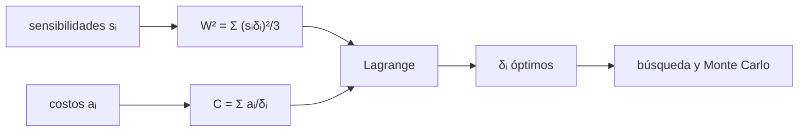

# B50-C09 — Asignación y balance de tolerancias ópticas

<!-- nav:top -->
[🏠 Programa](../../../../README.md) · [📚 Bloque B50](../../../tronco-comun/B50-diseno-optico-computacional-y-tolerancias.md) · [← Anterior: B50-C08 — Distorsión geométrica y su calibración](../B50-C08-distorsion-geometrica-y-su-calibracion/CLASE.md) · [Siguiente: B50-C10 — Errores de centrado y su efecto en el desempeño →](../B50-C10-errores-de-centrado-y-su-efecto-en-el-desempeno/CLASE.md)
<!-- /nav -->

## 1. Ubicación, nivel y alcance

Clase 9 del bloque B50. Nivel N3. Una tolerancia estrecha cuesta más que una holgada, pero no todas aportan igual al error de frente de onda. Aquí repartes un presupuesto de `0.05 ondas RMS` entre cinco parámetros con el criterio de **costo mínimo**: minimizas `Σ aᵢ/δᵢ` con la restricción de suma cuadrática mediante **multiplicadores de Lagrange**, lo comparas con la asignación igual, con una búsqueda aleatoria y con un Monte Carlo del RMS resultante. Usas [B12](../../../tronco-comun/B12-probabilidad-estadistica-e-incertidumbre.md) y B41-C08. Las sensibilidades y los costos son ilustrativos.

## 2. Por qué esta clase existe

Repartir la tolerancia por igual es simple pero caro: pide más precisión justo donde cuesta más. La decisión central: **¿cuánta tolerancia le toca a cada parámetro para el menor costo con el mismo desempeño?**

## 3. Lo que podrás hacer al terminar

1. Modelar el RMS de cada parámetro como `sᵢδᵢ/√3`.
2. Sumar los aportes en cuadratura.
3. Plantear el costo `Σ aᵢ/δᵢ`.
4. Resolver el óptimo con Lagrange: `δᵢ ∝ (aᵢ/sᵢ²)^(1/3)`.
5. Comprobar el óptimo con una búsqueda aleatoria y Monte Carlo.
6. Calcular el ahorro frente a la asignación igual.

La evidencia es la **ficha de la asignación de tolerancias** del ejercicio 12 (sección 20).

## 4. Con qué llegas y cómo comprobarlo

1. ¿Qué es una incertidumbre?
2. ¿Qué es una simulación Monte Carlo?
3. ¿Qué es una tabla de resultados?
4. ¿Qué es un valor ilustrativo?
5. ¿Qué es una verificación?

<details>
<summary>Ver respuestas</summary>

1. Un intervalo en que se espera el valor verdadero. 2. Repetir con números aleatorios de semilla fija. 3. Un resumen ordenado de cálculos. 4. Un valor propuesto para el ejemplo, no medido. 5. Comparar un cálculo con un caso independiente.
</details>

Con cuatro o cinco aciertos, sigue; si no, repasa los prerrequisitos.

## 5. Un caso de contexto y casos de referencia

Con cinco parámetros ilustrativos y un objetivo de `0.05` ondas RMS, la asignación igual cuesta `230,44` y la óptima `214,31`, un ahorro del `7,0 %`. La tolerancia de separación baja de `0,1549` a `0,0654` y la de descentramiento casi no cambia. Es el **ejemplo conductor**. Todo es **ilustrativo**.

## 6. Vocabulario

La **sensibilidad** `s` es el RMS del frente de onda por unidad de error. Una **tolerancia uniforme** `±δ` tiene desviación `δ/√3`. La **suma cuadrática** combina aportes independientes. El **multiplicador de Lagrange** convierte un problema con restricción en uno sin ella. Un **óptimo** de costo tiene `a/(s²δ³)` igual en todos los parámetros.

## 7. Modelo mental: repartir un presupuesto de ruido

Como repartir un presupuesto de ruido entre vecinos: conviene dejar más ruido a quien silenciarse cuesta más y molesta menos.



*Descripción textual:* las sensibilidades y los costos determinan, con Lagrange, la tolerancia de cada parámetro, que se verifica con una búsqueda aleatoria y un Monte Carlo.

Analogía: repartir un presupuesto de ruido. Límite: respuesta lineal y errores independientes de media cero.

## 8. La explicación, paso a paso

### 8.1 Asignación

| parámetro | `s` (ondas/unidad) | `a` | `δ` igual | `δ` óptima |
|---|---|---|---|---|
| descentramiento de L1 [mm] | 2,00 | 1,00 | 0,01936 | 0,02061 |
| inclinacion de L2 [mrad] | 0,50 | 4,00 | 0,07746 | 0,08242 |
| espesor de L1 [mm] | 1,20 | 2,00 | 0,03227 | 0,03649 |
| separacion L1-L2 [mm] | 0,25 | 0,50 | 0,15492 | 0,06542 |
| radio de la cara 3 [franjas] | 0,80 | 3,00 | 0,04841 | 0,05474 |

Ambas asignaciones dan `0.05` ondas RMS. Se aprieta lo que cuesta poco apretar (la separación, `a` = 0,5) y se afloja lo caro (inclinación, espesor y radio).

### 8.2 Costo

| asignación | costo |
|---|---|
| igual | 230,4425 |
| óptima (Lagrange) | 214,3086 |
| búsqueda aleatoria | 214,3086 |

El ahorro es del `7,00 %`. La condición de optimalidad `a/(s²δ³)` vale `28574,474` en los cinco parámetros.

### 8.3 Monte Carlo

Con 200 000 ensayos uniformes dentro de las tolerancias óptimas, el RMS es `0,05000` ondas.

### 8.4 Lectura

El ahorro depende de qué tan distintas son las sensibilidades y los costos; si fueran iguales, el óptimo sería la asignación igual. El modelo supone una respuesta lineal y costos del tipo `a/δ`, que son hipótesis, no medidas de ningún proveedor.

## 9. Magnitudes, símbolos y unidades

| Símbolo | Qué es | Unidad | Valor / nota |
|---|---|---|---|
| `s` | sensibilidad | ondas RMS por unidad | 0,25–2,0 (ilustrativo) |
| `δ` | semiancho de la tolerancia | unidad del parámetro | 0,0206–0,0654 |
| `a` | coeficiente de costo | costo × unidad | 0,5–4,0 |
| `W₀` | objetivo | ondas RMS | 0.05 |

## 10. Convenciones y referencias

Tolerancias uniformes `±δ`; costo `a/δ` (más precisión, más costo); respuesta lineal.

## 11. De dónde sale lo que afirmamos

| ID | Fuente | Localizador | Respalda | Estado |
|---|---|---|---|---|
| — | Sin fuente externa | — | relaciones estándar que verifica el laboratorio | No se consultó una fuente para esta clase |

Límites: no se consultó ninguna fuente; sensibilidades y costos son sintéticos.

## 12. Cómo ver el reparto

| Magnitud | Valor |
|---|---|
| costo con asignación igual | 230,44 |
| costo óptimo | 214,31 |
| ahorro | 7,0 % |
| RMS por Monte Carlo | 0,0500 ondas |

Descripción larga: la asignación óptima cuesta menos y cumple el mismo desempeño.

## 13. Ejemplo trabajado: la tolerancia óptima de la separación

**Paso 1 · Cociente.** `a/s² = 8,000` para la separación.

**Paso 2 · Raíz cúbica.** `2,0000`.

**Paso 3 · Escala.** Se multiplica por el factor que da `0.05` ondas.

**Paso 4 · Resultado.** `δ = 0,06542`.

## 14. Distintas formas de describir una asignación

**Por reparto:** δᵢ. **Por costo:** suma. **Por optimalidad:** invariante de Lagrange. **Por simulación:** Monte Carlo.

## 15. Práctica guiada

**Ejercicio 1 · con los pasos indicados.** RMS de una tolerancia uniforme de `±0,03`. *Pasos:* divide por √3.

<details><summary>Solución comentada</summary>

`0,01732`.
</details>

**Ejercicio 2 · con una pista.** Con `s = 2`, ¿cuál es el aporte de `δ = 0,01936`?

<details><summary>Solución comentada</summary>

`0,02236 ondas`.
</details>

**Ejercicio 3 · casi autónomo.** ¿Cuántos parámetros hay?

<details><summary>Solución comentada</summary>

`5`.
</details>

## 16. Práctica autónoma, transferencia e integrador

**Ejercicio 4.** Costo de la asignación igual.

<details><summary>Solución comentada</summary>

`230,44`.
</details>

**Ejercicio 5.** Costo óptimo.

<details><summary>Solución comentada</summary>

`214,31`.
</details>

**Ejercicio 6.** Ahorro porcentual.

<details><summary>Solución comentada</summary>

`7,0 %`.
</details>

**Ejercicio 7.** ¿Qué parámetro cambia más respecto de la asignación igual?

<details><summary>Solución comentada</summary>

La separación: pasa de `0,1549` a `0,0654`, un factor `0,42`.
</details>

**Ejercicio 8.** RMS de Monte Carlo.

<details><summary>Solución comentada</summary>

`0,05000`.
</details>

**Ejercicio 9 · transferencia.** **Transferencia.** Un colega propone `δᵢ` iguales para simplificar. Responde.

<details><summary>Solución comentada</summary>

Cumple el desempeño pero cuesta `7,0 %` más.
</details>

**Ejercicio 10 · transferencia.** **Transferencia.** ¿Qué pasa si un costo sube al doble?

<details><summary>Solución comentada</summary>

La tolerancia óptima de ese parámetro crece en un factor `2^(1/3) = 1,26` antes de reescalar.
</details>

**Ejercicio 11 · transferencia.** **Transferencia.** ¿Qué hipótesis puede fallar?

<details><summary>Solución comentada</summary>

La linealidad y el modelo de costo `a/δ`.
</details>

**Ejercicio 12.** **Integrador.** Elabora tu *ficha de la asignación de tolerancias*: tabla, costo, invariante y Monte Carlo.

<details><summary>Solución comentada</summary>

Secciones 8.1–8.4.
</details>

**Ejercicio 12 · integrador.** **Integrador.** Elabora tu *ficha de la asignación de tolerancias*: tabla, costo, invariante y Monte Carlo.

<details><summary>Solución modelo</summary>

Secciones 8.1–8.4.
</details>

## 17. Laboratorio: asignación de tolerancias

El script [asignacion.py](asignacion.py) calcula la asignación igual y la óptima, la verifica con una búsqueda aleatoria y un Monte Carlo (**comprueba** 1e-3 y 0,5 %).

**Datos:** sin constantes; sensibilidades y costos **ilustrativos**; semilla `20261109`. **Predice antes de ejecutar:** ¿costará menos la óptima? (sí, cerca de 7 %.) **Ejecución del 2026-11-09 (Python 3.12.9):**

```text
Python 3.12.9 (biblioteca estandar)
Objetivo: 0.05 ondas RMS (suma cuadratica); costo C = suma de a_i / delta_i
                     parametro    s_i    a_i  delta igual  delta optima
    descentramiento de L1 [mm]   2.00   1.00      0.01936       0.02061
      inclinacion de L2 [mrad]   0.50   4.00      0.07746       0.08242
            espesor de L1 [mm]   1.20   2.00      0.03227       0.03649
         separacion L1-L2 [mm]   0.25   0.50      0.15492       0.06542
  radio de la cara 3 [franjas]   0.80   3.00      0.04841       0.05474
RMS con asignacion igual = 0.05000 ; con la optima = 0.05000 ondas
Costo con asignacion igual = 230.4425 ; optimo analitico = 214.3086 ; busqueda aleatoria = 214.3086
Ahorro del optimo frente a la asignacion igual = 7.00 %
Invariante de Lagrange a_i / (s_i^2 delta_i^3): 28574.474077 ; 28574.474077 ; 28574.474077 ; 28574.474077 ; 28574.474077
RMS por Monte Carlo (200 000 ensayos, uniformes) = 0.05000 ondas
Pruebas superadas.
```

```bash
python programa/clases/B50/B50-C09-asignacion-y-balance-de-tolerancias-opticas/asignacion.py
```

**Límites:** respuesta lineal y costos a/δ.

## 18. Errores frecuentes y cómo corregirlos

**Repartir por igual sin mirar costos.** Se corrige con 8.2.

**Sumar tolerancias en vez de varianzas.** Se corrige con 8.1.

**Creer que el óptimo es el mismo con otros costos.** Se corrige con 8.4.

**Presentar los costos como reales.** Se corrige con la sección 10.

## 19. Cómo sabrás que vas bien

Tras la sección 8: ¿qué resultado esperabas y cuál obtuviste? Si dudas, repasa el ejemplo 13. Tras el laboratorio: ¿qué comprueba? (ver la sección 17).

## 20. Qué entregas y cómo se evalúa

El producto es tu **ficha de la asignación de tolerancias** (ejercicio 12).

| Criterio | Inicial | En desarrollo | Logrado | Destacado |
|---|---|---|---|---|
| Conceptos | Los confunde | Parciales | conceptos de la clase | Explica los límites |
| Cálculo | Sin unidades | Con errores | Tablas completas | Calcula casos nuevos |
| Numérico | Sin comprobar | Un caso | Contraste con el análisis | Interpreta las diferencias |
| Fuentes | Sin fuente | Sin fecha | fuentes con fecha | Declara lo ilustrativo |
| Límites | No los nombra | Uno | Tres | Discute qué falta del modelo |

**Condiciones críticas (no se compensan con promedio):** rotular sensibilidades y costos como ilustrativos; no asignar tolerancias de un instrumento real con estos números; citar solo lo consultado.

## 21. Ética, seguridad y límites

Clase educativa: los modelos son simplificados. Accesibilidad: tablas equivalentes a las gráficas, fórmulas en texto, ejercicios sin conexión.

## 22. Para cerrar y seguir

Lagrange reparte las tolerancias y ahorra el `7,0 %` frente a la asignación igual con el mismo RMS de `0.05` ondas. Queda una pregunta: ¿qué sensibilidad concreta tiene un descentramiento?

**Glosario español–inglés.** asignación de tolerancias · *tolerance allocation*; multiplicador de Lagrange · *Lagrange multiplier*; sensibilidad · *sensitivity*; suma cuadrática · *root-sum-square*; costo · *cost*.

**Continuidad.** [B50-C10](../B50-C10-errores-de-centrado-y-su-efecto-en-el-desempeno/CLASE.md) estudia los errores de centrado.

**Referencias:** ver sección 11.

<!-- nav:bottom -->
---

[← Anterior: B50-C08 — Distorsión geométrica y su calibración](../B50-C08-distorsion-geometrica-y-su-calibracion/CLASE.md) · [📚 Bloque B50](../../../tronco-comun/B50-diseno-optico-computacional-y-tolerancias.md) · [Siguiente: B50-C10 — Errores de centrado y su efecto en el desempeño →](../B50-C10-errores-de-centrado-y-su-efecto-en-el-desempeno/CLASE.md)
<!-- /nav -->
