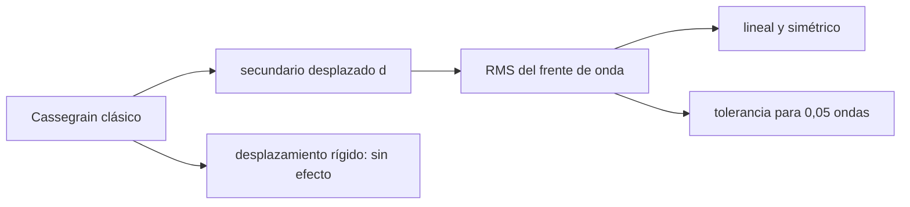

# B50-C10 — Errores de centrado y su efecto en el desempeño

<!-- nav:top -->
[🏠 Programa](../../../../README.md) · [📚 Bloque B50](../../../tronco-comun/B50-diseno-optico-computacional-y-tolerancias.md) · [← Anterior: B50-C09 — Asignación y balance de tolerancias ópticas](../B50-C09-asignacion-y-balance-de-tolerancias-opticas/CLASE.md) · [Siguiente: B50-C11 — Errores de inclinación de elementos y superficies →](../B50-C11-errores-de-inclinacion-de-elementos-y-superficies/CLASE.md)
<!-- /nav -->

## 1. Ubicación, nivel y alcance

Clase 10 del bloque B50. Nivel N3. Desplazar un espejo de lado no lo desenfoca: produce **coma**. Aquí desplazas el secundario de un Cassegrain clásico (primario parabólico de 400 mm, f/2, focal final 4000 mm) y mides con el trazador exacto el RMS del frente de onda en el eje, su **linealidad** y **simetría**, la invariancia a un desplazamiento rígido de todo el telescopio y la **tolerancia** para `0,05` ondas. Usas [B10](../../../tronco-comun/B10-algebra-lineal-y-matematicas-geometricas.md). El telescopio es ilustrativo.

## 2. Por qué esta clase existe

El descentramiento es una de las tolerancias de montaje que más pesan en un telescopio. La decisión central: **¿cuánto puede desplazarse el secundario antes de degradar la imagen?**

## 3. Lo que podrás hacer al terminar

1. Construir un Cassegrain clásico con parámetros verificados.
2. Medir el RMS del frente de onda con el secundario desplazado.
3. Comprobar la linealidad y la simetría.
4. Comprobar que solo importa el descentramiento relativo.
5. Obtener la tolerancia para un RMS dado.
6. Relacionar el descentramiento con un campo equivalente.

La evidencia es la **ficha del descentramiento** del ejercicio 12 (sección 20).

## 4. Con qué llegas y cómo comprobarlo

1. ¿Qué es una incertidumbre?
2. ¿Qué es una simulación Monte Carlo?
3. ¿Qué es una tabla de resultados?
4. ¿Qué es un valor ilustrativo?
5. ¿Qué es una verificación?

<details>
<summary>Ver respuestas</summary>

1. Un intervalo en que se espera el valor verdadero. 2. Repetir con números aleatorios de semilla fija. 3. Un resumen ordenado de cálculos. 4. Un valor propuesto para el ejemplo, no medido. 5. Comparar un cálculo con un caso independiente.
</details>

Con cuatro o cinco aciertos, sigue; si no, repasa los prerrequisitos.

## 5. Un caso de contexto y casos de referencia

El Cassegrain nominal tiene `7,7 × 10⁻¹⁰` ondas de RMS en el eje. Con el secundario desplazado `0,1 mm` el RMS vale `0,0794` ondas, `0,7945` ondas por mm; la tolerancia para `0,05` ondas es `0,0629 mm`. Es el **ejemplo conductor**. Todo es **ilustrativo**.

## 6. Vocabulario

El **descentramiento** es un desplazamiento lateral de una superficie respecto del eje. La **coma** es una aberración de forma `ρ³ cos φ`. El **RMS del frente de onda** se calcula quitando pistón, inclinación y enfoque. Una **respuesta lineal** crece proporcionalmente al error. El **campo equivalente** es el ángulo del sistema nominal con el mismo RMS.

## 7. Modelo mental: inclinar un cuadro apoyado en dos clavos

Como correr un clavo de lado: el cuadro se tuerce proporcionalmente y no importa si lo corres a la izquierda o a la derecha.



*Descripción textual:* un descentramiento lateral del secundario produce coma proporcional al desplazamiento.

Analogía: inclinar un cuadro apoyado en dos clavos. Límite: luz monocromática sobre el eje y un solo error.

## 8. La explicación, paso a paso

### 8.1 Telescopio nominal

Primario con `f₁ = 800 mm`; secundario a `633,333 mm`, `R₂ = 416,667 mm`, `k₂ = −2,250` (clásico), focal final 4000 mm. El RMS nominal en el eje es `7,7 × 10⁻¹⁰` ondas.

### 8.2 Respuesta al descentramiento

| `d` (mm) | RMS con `+d` | RMS con `−d` | RMS/d (ondas/mm) |
|---|---|---|---|
| 0,02 | 0,01589 | 0,01589 | 0,7945 |
| 0,05 | 0,03972 | 0,03972 | 0,7945 |
| 0,10 | 0,07945 | 0,07945 | 0,7945 |
| 0,20 | 0,15889 | 0,15889 | 0,7945 |
| 0,50 | 0,39723 | 0,39723 | 0,7945 |

La respuesta es lineal (el cociente RMS/d es constante) y simétrica en `±d`.

### 8.3 Tolerancia e invariancia

Para `0,05` ondas RMS la tolerancia lineal es `0,0629 mm`; el trazado a ese valor da `0,05000` ondas. Un desplazamiento rígido de todo el telescopio de 7 mm cambia el RMS en `2,0 × 10⁻⁷` ondas: solo importa el desplazamiento relativo. Sin quitar el enfoque, `d = 0,2 mm` da `0,15890` (casi igual: el desplazamiento no introduce desenfoque).

### 8.4 Campo equivalente

Un descentramiento de 0,1 mm del secundario equivale a observar con el sistema nominal a `0,1408°` de campo: la coma por descentramiento imita a la coma de campo.

## 9. Magnitudes, símbolos y unidades

| Símbolo | Qué es | Unidad | Valor / nota |
|---|---|---|---|
| `d` | descentramiento del secundario | mm | 0,02–0,5 |
| `RMS/d` | sensibilidad | ondas/mm | 0,7945 |
| `d_tol` | tolerancia para 0,05 ondas | mm | 0,0629 |
| `θ_eq` | campo equivalente de 0,1 mm | grados | 0,1408 |

## 10. Convenciones y referencias

Primario parabólico `k₁ = −1`; secundario hiperbólico clásico; λ = 550 nm; pupila anular de 45 a 200 mm de radio.

## 11. De dónde sale lo que afirmamos

| ID | Fuente | Localizador | Respalda | Estado |
|---|---|---|---|---|
| — | Sin fuente externa | — | relaciones estándar que verifica el laboratorio | No se consultó una fuente para esta clase |

Límites: no se consultó ninguna fuente; el telescopio no es real.

## 12. Cómo ver la sensibilidad al descentramiento

| `d` (mm) | RMS (ondas) |
|---|---|
| 0,02 | 0,01589 |
| 0,05 | 0,03972 |
| 0,10 | 0,07945 |
| 0,20 | 0,15889 |
| 0,50 | 0,39723 |

Descripción larga: el RMS crece en proporción directa al descentramiento.

## 13. Ejemplo trabajado: la tolerancia

**Paso 1 · Sensibilidad.** `0,7945 ondas/mm`.

**Paso 2 · Objetivo.** `0,05 ondas`.

**Paso 3 · Cociente.** `0,05 / 0,7945`.

**Paso 4 · Resultado.** `0,0629 mm`.

## 14. Distintas formas de describir un descentramiento

**Por tabla:** RMS contra d. **Por pendiente:** ondas por mm. **Por tolerancia:** cociente. **Por equivalencia:** campo.

## 15. Práctica guiada

**Ejercicio 1 · con los pasos indicados.** RMS esperado para `d = 0,3 mm`. *Pasos:* pendiente por 0,3.

<details><summary>Solución comentada</summary>

`0,2383`.
</details>

**Ejercicio 2 · con una pista.** RMS esperado para `d = −0,3 mm`.

<details><summary>Solución comentada</summary>

El mismo valor.
</details>

**Ejercicio 3 · casi autónomo.** Tolerancia para `0,03` ondas.

<details><summary>Solución comentada</summary>

`0,0378 mm`.
</details>

## 16. Práctica autónoma, transferencia e integrador

**Ejercicio 4.** RMS medido a 0,5 mm.

<details><summary>Solución comentada</summary>

`0,3972`.
</details>

**Ejercicio 5.** Cociente RMS/d a 0,02 y 0,5 mm.

<details><summary>Solución comentada</summary>

`0,7945` y `0,7945`.
</details>

**Ejercicio 6.** Cambio por desplazar todo el telescopio.

<details><summary>Solución comentada</summary>

`2,0 × 10⁻⁷ ondas`.
</details>

**Ejercicio 7.** Campo equivalente de 0,1 mm.

<details><summary>Solución comentada</summary>

`0,1408°`.
</details>

**Ejercicio 8.** ¿Cuántos mm de descentramiento dan 1 onda RMS?

<details><summary>Solución comentada</summary>

`1,259 mm`.
</details>

**Ejercicio 9 · transferencia.** **Transferencia.** Un colega mueve primario y secundario juntos 5 mm. ¿Hay coma?

<details><summary>Solución comentada</summary>

No: solo importa el desplazamiento relativo.
</details>

**Ejercicio 10 · transferencia.** **Transferencia.** ¿Por qué el descentramiento y la inclinación se compensan?

<details><summary>Solución comentada</summary>

Ambos producen coma y pueden cancelarse (clase siguiente).
</details>

**Ejercicio 11 · transferencia.** **Transferencia.** ¿Qué error no incluye esta clase?

<details><summary>Solución comentada</summary>

Inclinación, espaciado, conicidades y térmicos.
</details>

**Ejercicio 12.** **Integrador.** Elabora tu *ficha del descentramiento*: tabla, linealidad, tolerancia e invariancia.

<details><summary>Solución comentada</summary>

Secciones 8.1–8.4.
</details>

**Ejercicio 12 · integrador.** **Integrador.** Elabora tu *ficha del descentramiento*: tabla, linealidad, tolerancia e invariancia.

<details><summary>Solución modelo</summary>

Secciones 8.1–8.4.
</details>

## 17. Laboratorio: descentramiento del secundario

El script [descentramiento.py](descentramiento.py) desplaza el secundario y mide el RMS del frente de onda (**comprueba** linealidad a 2 %, simetría a 1e-9 e invariancia a 1e-6 ondas).

**Datos:** sin constantes; telescopio **ilustrativo**. **Predice antes de ejecutar:** ¿será lineal la respuesta? (sí.) **Ejecución del 2026-11-09 (Python 3.12.9):**

```text
Python 3.12.9 (biblioteca estandar)
Cassegrain clasico: d = 633.333 mm ; R2 = 416.667 mm ; k2 = -2.250 ; RMS nominal en el eje = 7.65e-10 ondas
 d [mm]   RMS(+d)   RMS(-d)  RMS/d [ondas/mm]
   0.02   0.01589   0.01589            0.7945
   0.05   0.03972   0.03972            0.7945
   0.10   0.07945   0.07945            0.7945
   0.20   0.15889   0.15889            0.7945
   0.50   0.39723   0.39723            0.7945
Tolerancia de descentramiento para 0.05 ondas RMS (lineal) = 0.0629 mm ; RMS trazado a ese valor = 0.05000 ondas
Desplazamiento rigido de todo el telescopio 7 mm: cambio del RMS = 2.0e-07 ondas
Con d = 0.2 mm sin quitar el enfoque: RMS = 0.15890 ondas
Campo equivalente del sistema nominal con el mismo RMS que d = 0.1 mm: 0.14075 grados
Pruebas superadas.
```

```bash
python programa/clases/B50/B50-C10-errores-de-centrado-y-su-efecto-en-el-desempeno/descentramiento.py
```

**Límites:** un solo error y luz sobre el eje.

## 18. Errores frecuentes y cómo corregirlos

**Creer que el descentramiento desenfoca.** Se corrige con 8.3.

**Usar una tolerancia sin comprobar la linealidad.** Se corrige con 8.2.

**Confundir descentramiento relativo y absoluto.** Se corrige con 8.3.

**Presentar el telescopio como real.** Se corrige con la sección 10.

## 19. Cómo sabrás que vas bien

Tras la sección 8: ¿qué resultado esperabas y cuál obtuviste? Si dudas, repasa el ejemplo 13. Tras el laboratorio: ¿qué comprueba? (ver la sección 17).

## 20. Qué entregas y cómo se evalúa

El producto es tu **ficha del descentramiento** (ejercicio 12).

| Criterio | Inicial | En desarrollo | Logrado | Destacado |
|---|---|---|---|---|
| Conceptos | Los confunde | Parciales | conceptos de la clase | Explica los límites |
| Cálculo | Sin unidades | Con errores | Tablas completas | Calcula casos nuevos |
| Numérico | Sin comprobar | Un caso | Contraste con el análisis | Interpreta las diferencias |
| Fuentes | Sin fuente | Sin fecha | fuentes con fecha | Declara lo ilustrativo |
| Límites | No los nombra | Uno | Tres | Discute qué falta del modelo |

**Condiciones críticas (no se compensan con promedio):** rotular el telescopio como ilustrativo; no fijar tolerancias de un telescopio real con estos números; citar solo lo consultado.

## 21. Ética, seguridad y límites

Clase educativa: los modelos son simplificados. Accesibilidad: tablas equivalentes a las gráficas, fórmulas en texto, ejercicios sin conexión.

## 22. Para cerrar y seguir

El secundario produce `0,794` ondas RMS de coma por milímetro de descentramiento, con una tolerancia de `0,063 mm` para `0,05` ondas. Queda una pregunta: ¿y la inclinación?

**Glosario español–inglés.** descentramiento · *decenter*; coma · *coma*; frente de onda · *wavefront*; sensibilidad · *sensitivity*; Cassegrain · *Cassegrain*.

**Continuidad.** [B50-C11](../B50-C11-errores-de-inclinacion-de-elementos-y-superficies/CLASE.md) estudia la inclinación de elementos.

**Referencias:** ver sección 11.

<!-- nav:bottom -->
---

[← Anterior: B50-C09 — Asignación y balance de tolerancias ópticas](../B50-C09-asignacion-y-balance-de-tolerancias-opticas/CLASE.md) · [📚 Bloque B50](../../../tronco-comun/B50-diseno-optico-computacional-y-tolerancias.md) · [Siguiente: B50-C11 — Errores de inclinación de elementos y superficies →](../B50-C11-errores-de-inclinacion-de-elementos-y-superficies/CLASE.md)
<!-- /nav -->
