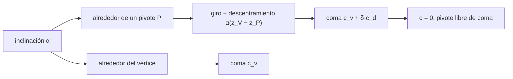

# B50-C11 — Errores de inclinación de elementos y superficies

<!-- nav:top -->
[🏠 Programa](../../../../README.md) · [📚 Bloque B50](../../../tronco-comun/B50-diseno-optico-computacional-y-tolerancias.md) · [← Anterior: B50-C10 — Errores de centrado y su efecto en el desempeño](../B50-C10-errores-de-centrado-y-su-efecto-en-el-desempeno/CLASE.md) · [Siguiente: B50-C12 — Sensibilidad térmica del desempeño óptico y atermalización →](../B50-C12-sensibilidad-termica-del-desempeno-optico-y-atermalizacion/CLASE.md)
<!-- /nav -->

## 1. Ubicación, nivel y alcance

Clase 11 del bloque B50. Nivel N3. Inclinar un espejo desvía la luz y, si el espejo tiene potencia, también la deforma. Aquí compruebas que un espejo plano inclinado `α` gira el rayo `2α`, inclinas el secundario del Cassegrain de la clase anterior alrededor de varios pivotes y buscas el **pivote libre de coma**: el punto del eje alrededor del cual inclinar no introduce coma. Lo hallas por barrido con secante y por una predicción lineal basada en la coma por descentramiento. Usas [B10](../../../tronco-comun/B10-algebra-lineal-y-matematicas-geometricas.md). El telescopio es ilustrativo.

## 2. Por qué esta clase existe

Un telescopio se alinea corrigiendo inclinaciones y descentramientos. La decisión central: **¿alrededor de qué punto conviene inclinar el secundario para no generar coma?**

## 3. Lo que podrás hacer al terminar

1. Comprobar la regla de `2α` del espejo plano.
2. Descomponer una inclinación en rotación y descentramiento.
3. Medir la coma firmada para varios pivotes.
4. Hallar el pivote libre de coma por secante.
5. Predecirlo con la coma por descentramiento.
6. Comparar el RMS en el vértice y en el pivote libre.

La evidencia es la **ficha de la inclinación** del ejercicio 12 (sección 20).

## 4. Con qué llegas y cómo comprobarlo

1. ¿Qué es una incertidumbre?
2. ¿Qué es una simulación Monte Carlo?
3. ¿Qué es una tabla de resultados?
4. ¿Qué es un valor ilustrativo?
5. ¿Qué es una verificación?

<details>
<summary>Ver respuestas</summary>

1. Un intervalo en que se espera el valor verdadero. 2. Repetir con números aleatorios de semilla fija. 3. Un resumen ordenado de cálculos. 4. Un valor propuesto para el ejemplo, no medido. 5. Comparar un cálculo con un caso independiente.
</details>

Con cuatro o cinco aciertos, sigue; si no, repasa los prerrequisitos.

## 5. Un caso de contexto y casos de referencia

Inclinar `0,5 mrad` el secundario alrededor de su vértice produce `0,0662` ondas RMS; alrededor del punto libre de coma, `z = -800,000 mm`, queda en `1,2 × 10⁻⁸`. Es el **ejemplo conductor**. Todo es **ilustrativo**.

## 6. Vocabulario

La **inclinación** es un giro `α` de la superficie. El **pivote** es el punto fijo del giro. Inclinar alrededor de un punto del eje equivale a girar alrededor del vértice y **descentrarlo** `δ = α (z_V − z_P)`. El **coeficiente de coma firmado** es el del término `x(x² + y²)` del ajuste del frente de onda. El **pivote libre de coma** anula ese coeficiente.

## 7. Modelo mental: mover un péndulo por su punto de suspensión

Como un péndulo: girar por el punto de suspensión correcto mueve el extremo sin cambiar su altura; con otro punto, además sube.



*Descripción textual:* una inclinación se descompone en giro y descentramiento, y la coma total se anula en un pivote.

Analogía: mover un péndulo por su punto de suspensión. Límite: inclinaciones pequeñas y luz sobre el eje.

## 8. La explicación, paso a paso

### 8.1 Espejo plano

| `α` (rad) | giro del rayo (rad) | `2α` | diferencia |
|---|---|---|---|
| 1 × 10⁻⁴ | 0,000200000000 | 0,000200000000 | 0,0 × 10⁰ |
| 1 × 10⁻³ | 0,002000000000 | 0,002000000000 | 4,3 × 10⁻¹⁹ |
| 1 × 10⁻² | 0,020000000000 | 0,020000000000 | 0,0 × 10⁰ |

### 8.2 Pivotes del secundario (`α = 0,5 mrad`)

| pivote `z` (mm) | coeficiente de coma | RMS (ondas) | desplazamiento de la imagen (mm) |
|---|---|---|---|
| -633,33 | −0,55726 | 0,06621 | 0,8333 |
| -833,33 | 0,11145 | 0,01324 | 0,4333 |
| -1050,00 | 0,83589 | 0,09931 | 0,0000 |
| -433,33 | −1,22598 | 0,14565 | 1,2333 |
| 0,00 | −2,67485 | 0,31778 | 2,1000 |

La coma varía linealmente con el pivote y cambia de signo entre el vértice (`z = -633,33`) y los pivotes más lejanos.

### 8.3 Pivote libre de coma

La secante da `z = -800,000 mm`; la predicción lineal con la coma por descentramiento (`6,6872` ondas por mm) da `z = -800,000 mm`. El valor coincide con el foco del primario (`z = −800 mm`), un resultado que el laboratorio verifica numéricamente y que no se contrastó con la literatura. En ese pivote el coeficiente es `2,7 × 10⁻¹⁰` y el RMS `0,00000` ondas (vértice: `0,0662`).

### 8.4 Lectura

Se anuló la coma, no toda la aberración: la imagen sí se desplaza (`0,833 mm` con pivote en el vértice) y por eso la alineación real combina inclinación y traslación.

## 9. Magnitudes, símbolos y unidades

| Símbolo | Qué es | Unidad | Valor / nota |
|---|---|---|---|
| `α` | inclinación | rad | 5 × 10⁻⁴ |
| `z_P` | pivote | mm | -800,0 (libre de coma) |
| `δ` | descentramiento equivalente | mm | `α (z_V − z_P)` |
| `c` | coeficiente de coma | ondas | −0,5573 (vértice) |

## 10. Convenciones y referencias

Giro alrededor del eje `y`; vértice del secundario en `z = −633,33 mm`; coordenadas de pupila normalizadas por 200 mm.

## 11. De dónde sale lo que afirmamos

| ID | Fuente | Localizador | Respalda | Estado |
|---|---|---|---|---|
| — | Sin fuente externa | — | relaciones estándar que verifica el laboratorio | No se consultó una fuente para esta clase |

Límites: no se consultó ninguna fuente; el telescopio no es real y el pivote libre de coma no se contrastó con la literatura.

## 12. Cómo ver la inclinación y los pivotes

| Magnitud | Valor |
|---|---|
| RMS con pivote en el vértice | 0,0662 ondas |
| pivote libre de coma | -800,00 mm |
| RMS en ese pivote | 0,00000 ondas |

Descripción larga: elegir bien el pivote anula la coma que genera la inclinación.

## 13. Ejemplo trabajado: el descentramiento equivalente

**Paso 1 · Datos.** `α = 5 × 10⁻⁴ rad`, `z_V = −633,33`, `z_P = -800,0`.

**Paso 2 · Diferencia.** `z_V − z_P = 166,67 mm`.

**Paso 3 · Producto.** `δ = α (z_V − z_P) = 0,0833 mm`.

**Paso 4 · Lectura.** El vértice se desplaza ese valor; su coma compensa la del giro.

## 14. Distintas formas de describir una inclinación

**Por regla:** 2α. **Por descomposición:** giro + descentramiento. **Por tabla:** coma y RMS por pivote. **Por cero:** secante.

## 15. Práctica guiada

**Ejercicio 1 · con los pasos indicados.** ¿Cuánto gira el rayo reflejado si el espejo plano se inclina 3 mrad? *Pasos:* 2α.

<details><summary>Solución comentada</summary>

`6 mrad`.
</details>

**Ejercicio 2 · con una pista.** Descentramiento equivalente con pivote a 100 mm del vértice y `α = 0,5 mrad`.

<details><summary>Solución comentada</summary>

`0,05 mm`.
</details>

**Ejercicio 3 · casi autónomo.** RMS con pivote en el vértice.

<details><summary>Solución comentada</summary>

`0,0662`.
</details>

## 16. Práctica autónoma, transferencia e integrador

**Ejercicio 4.** RMS con pivote en `z = −1050`.

<details><summary>Solución comentada</summary>

`0,0993`.
</details>

**Ejercicio 5.** Pivote libre de coma.

<details><summary>Solución comentada</summary>

`-800,00 mm`.
</details>

**Ejercicio 6.** Diferencia entre secante y predicción lineal.

<details><summary>Solución comentada</summary>

`8,7 × 10⁻⁵ mm`.
</details>

**Ejercicio 7.** Desplazamiento de la imagen con pivote en `z = 0`.

<details><summary>Solución comentada</summary>

`2,100 mm`.
</details>

**Ejercicio 8.** Reducción del RMS en el pivote libre de coma.

<details><summary>Solución comentada</summary>

Más de 10 000 veces (queda en el ruido numérico).
</details>

**Ejercicio 9 · transferencia.** **Transferencia.** Un colega dice que el pivote libre de coma es un hecho de todo Cassegrain. Responde.

<details><summary>Solución comentada</summary>

Aquí se verificó solo para un diseño; otros requieren su cálculo.
</details>

**Ejercicio 10 · transferencia.** **Transferencia.** ¿Qué corrige la inclinación del secundario además de la coma?

<details><summary>Solución comentada</summary>

El desplazamiento de la imagen, con la traslación del detector.
</details>

**Ejercicio 11 · transferencia.** **Transferencia.** ¿Qué error queda tras anular la coma?

<details><summary>Solución comentada</summary>

Astigmatismo de segundo orden y los términos que no son lineales.
</details>

**Ejercicio 12.** **Integrador.** Elabora tu *ficha de la inclinación*: regla 2α, pivotes y pivote libre de coma.

<details><summary>Solución comentada</summary>

Secciones 8.1–8.4.
</details>

**Ejercicio 12 · integrador.** **Integrador.** Elabora tu *ficha de la inclinación*: regla 2α, pivotes y pivote libre de coma.

<details><summary>Solución modelo</summary>

Secciones 8.1–8.4.
</details>

## 17. Laboratorio: inclinación y pivote libre de coma

El script [inclinacion.py](inclinacion.py) comprueba 2α, inclina el secundario alrededor de varios pivotes y halla el pivote libre de coma por dos vías (**comprueba** 0,5 mm y una reducción de más de 10 veces).

**Datos:** sin constantes; telescopio **ilustrativo**. **Predice antes de ejecutar:** ¿anulará la coma el pivote? (sí, en `z = −800 mm`.) **Ejecución del 2026-11-09 (Python 3.12.9):**

```text
Python 3.12.9 (biblioteca estandar)
Espejo plano inclinado: giro del rayo reflejado
  alpha = 1e-04 rad ; giro = 0.000200000000 rad ; 2 alpha = 0.000200000000 ; diferencia = 0.0e+00
  alpha = 1e-03 rad ; giro = 0.002000000000 rad ; 2 alpha = 0.002000000000 ; diferencia = -4.3e-19
  alpha = 1e-02 rad ; giro = 0.020000000000 rad ; 2 alpha = 0.020000000000 ; diferencia = 0.0e+00
Coma por descentramiento del secundario: 6.6872 ondas por mm de descentramiento (coeficiente de x r^2, pupila normalizada)
Inclinacion alpha = 0.0005 rad del secundario alrededor de su vertice (z = -633.33 mm): RMS = 0.06621 ondas ; coeficiente de coma = -0.55726
 pivote z [mm]  coef. coma  RMS [ondas]  desplaz. imagen [mm]
       -633.33    -0.55726      0.06621                0.8333
       -833.33     0.11145      0.01324                0.4333
      -1050.00     0.83589      0.09931                0.0000
       -433.33    -1.22598      0.14565                1.2333
          0.00    -2.67485      0.31778                2.1000
Pivote libre de coma: secante sobre el trazado z = -800.000 mm ; prediccion lineal z = -800.000 mm
En el pivote libre de coma: coeficiente = 2.71e-10 ; RMS = 0.00000 ondas (vertice: 0.06621)
Pruebas superadas.
```

```bash
python programa/clases/B50/B50-C11-errores-de-inclinacion-de-elementos-y-superficies/inclinacion.py
```

**Límites:** inclinaciones pequeñas y un solo diseño.

## 18. Errores frecuentes y cómo corregirlos

**Inclinar siempre alrededor del vértice.** Se corrige con 8.2.

**Olvidar el desplazamiento de la imagen.** Se corrige con 8.4.

**Generalizar el pivote a otros diseños.** Se corrige con 8.3.

**Presentar el telescopio como real.** Se corrige con la sección 10.

## 19. Cómo sabrás que vas bien

Tras la sección 8: ¿qué resultado esperabas y cuál obtuviste? Si dudas, repasa el ejemplo 13. Tras el laboratorio: ¿qué comprueba? (ver la sección 17).

## 20. Qué entregas y cómo se evalúa

El producto es tu **ficha de la inclinación** (ejercicio 12).

| Criterio | Inicial | En desarrollo | Logrado | Destacado |
|---|---|---|---|---|
| Conceptos | Los confunde | Parciales | conceptos de la clase | Explica los límites |
| Cálculo | Sin unidades | Con errores | Tablas completas | Calcula casos nuevos |
| Numérico | Sin comprobar | Un caso | Contraste con el análisis | Interpreta las diferencias |
| Fuentes | Sin fuente | Sin fecha | fuentes con fecha | Declara lo ilustrativo |
| Límites | No los nombra | Uno | Tres | Discute qué falta del modelo |

**Condiciones críticas (no se compensan con promedio):** rotular el telescopio como ilustrativo; no alinear un telescopio real con estos números; citar solo lo consultado.

## 21. Ética, seguridad y límites

Clase educativa: los modelos son simplificados. Accesibilidad: tablas equivalentes a las gráficas, fórmulas en texto, ejercicios sin conexión.

## 22. Para cerrar y seguir

Inclinar el secundario alrededor de su vértice produce `0,066` ondas RMS de coma; alrededor de `z = -800 mm` se anula. Queda una pregunta: ¿qué hace la temperatura con el foco?

**Glosario español–inglés.** inclinación · *tilt*; pivote · *pivot*; coma · *coma*; punto libre de coma · *coma-free point*; espejo plano · *flat mirror*.

**Continuidad.** [B50-C12](../B50-C12-sensibilidad-termica-del-desempeno-optico-y-atermalizacion/CLASE.md) estudia la sensibilidad térmica.

**Referencias:** ver sección 11.

<!-- nav:bottom -->
---

[← Anterior: B50-C10 — Errores de centrado y su efecto en el desempeño](../B50-C10-errores-de-centrado-y-su-efecto-en-el-desempeno/CLASE.md) · [📚 Bloque B50](../../../tronco-comun/B50-diseno-optico-computacional-y-tolerancias.md) · [Siguiente: B50-C12 — Sensibilidad térmica del desempeño óptico y atermalización →](../B50-C12-sensibilidad-termica-del-desempeno-optico-y-atermalizacion/CLASE.md)
<!-- /nav -->
