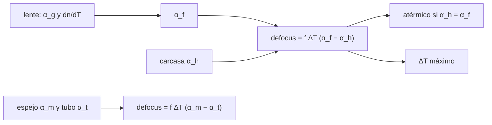

# B50-C12 — Sensibilidad térmica del desempeño óptico y atermalización

<!-- nav:top -->
[🏠 Programa](../../../../README.md) · [📚 Bloque B50](../../../tronco-comun/B50-diseno-optico-computacional-y-tolerancias.md) · [← Anterior: B50-C11 — Errores de inclinación de elementos y superficies](../B50-C11-errores-de-inclinacion-de-elementos-y-superficies/CLASE.md) · [Siguiente: B50-C13 — Análisis Monte Carlo de tolerancias ópticas →](../B50-C13-analisis-monte-carlo-de-tolerancias-opticas/CLASE.md)
<!-- /nav -->

## 1. Ubicación, nivel y alcance

Clase 12 del bloque B50. Nivel N3. La temperatura cambia el foco: las superficies se dilatan, el índice varía y la carcasa mueve el detector. Aquí calculas el cambio de focal de una lente con `d ln f/dT = α_g − (dn/dT)/(n − 1)`, lo contrastas con el trazado exacto de la lente dilatada, hallas la **dilatación de la carcasa atérmica** y el defocus de un espejo con su tubo, y el intervalo de temperatura que cabe en la profundidad de foco. Usas B41-C08. Los coeficientes son órdenes de magnitud ilustrativos.

## 2. Por qué esta clase existe

Un telescopio que se enfría de noche se desenfoca si sus materiales se dilatan distinto. La decisión central: **¿qué dilatación debe tener la estructura para que el foco no se mueva?**

## 3. Lo que podrás hacer al terminar

1. Calcular el cambio térmico de la focal de una lente.
2. Contrastarlo con el trazado de la lente dilatada.
3. Calcular el defocus con una carcasa dada.
4. Hallar la dilatación atérmica de la carcasa.
5. Calcular el defocus de un espejo con un tubo.
6. Convertir el defocus en un intervalo de temperatura.

La evidencia es la **ficha de la sensibilidad térmica** del ejercicio 12 (sección 20).

## 4. Con qué llegas y cómo comprobarlo

1. ¿Qué es una incertidumbre?
2. ¿Qué es una simulación Monte Carlo?
3. ¿Qué es una tabla de resultados?
4. ¿Qué es un valor ilustrativo?
5. ¿Qué es una verificación?

<details>
<summary>Ver respuestas</summary>

1. Un intervalo en que se espera el valor verdadero. 2. Repetir con números aleatorios de semilla fija. 3. Un resumen ordenado de cálculos. 4. Un valor propuesto para el ejemplo, no medido. 5. Comparar un cálculo con un caso independiente.
</details>

Con cuatro o cinco aciertos, sigue; si no, repasa los prerrequisitos.

## 5. Un caso de contexto y casos de referencia

Una lente con `α_g = 7 × 10⁻⁶ K⁻¹` y `dn/dT = 1,5 × 10⁻⁶ K⁻¹` cambia su focal `0,008010 mm` con `+20 K`, igual a la fórmula (`0,008007 mm`). Con carcasa de aluminio el foco se desplaza `−0,0381 mm`; con la dilatación atérmica de `4,0 × 10⁻⁶ K⁻¹`, `2,6 × 10⁻⁵ mm`. Es el **ejemplo conductor**. Los coeficientes son **ilustrativos**.

## 6. Vocabulario

El **coeficiente térmico de la focal** es `α_f = α_g − (dn/dT)/(n − 1)`. La **carcasa atérmica** tiene `α_h = α_f`. El **defocus** es la diferencia entre el foco y la posición del detector. La **profundidad de foco** es `±2λN²`. El **tubo** sostiene el detector respecto del espejo.

## 7. Modelo mental: un puente con juntas de dilatación

Como un puente con vigas de materiales distintos: si una crece más que otra, el conjunto se curva; se elige el material para que crezcan igual.



*Descripción textual:* la dilatación de vidrio, índice y carcasa determina el defocus; la atermalización iguala el crecimiento de la focal y de la carcasa.

Analogía: un puente con juntas de dilatación. Límite: temperatura uniforme y sin esfuerzos.

## 8. La explicación, paso a paso

### 8.1 Lente

La focal de referencia es `100,0834 mm` y `α_f = 4,00 × 10⁻⁶ K⁻¹`. Con `ΔT = 20 K`: trazado `0,008010 mm`, fórmula `0,008007 mm`.

### 8.2 Carcasa

| carcasa | `α_h` (K⁻¹) | defocus trazado (mm) | `f ΔT (α_f − α_h)` (mm) |
|---|---|---|---|
| aluminio | 2,30 × 10⁻⁵ | −0,038132 | −0,038158 |
| atermica | 4,00 × 10⁻⁶ | 0,000026 | 0,000000 |
| Invar (1.2e-6) | 1,20 × 10⁻⁶ | 0,005650 | 0,005623 |

La tolerancia de foco con `N = 4` es `0,01760 mm`; con carcasa de aluminio el foco queda dentro de ella solo para `±9,2 K`.

### 8.3 Espejo y tubo

| espejo / tubo | defocus trazado (mm) | `f ΔT (α_m − α_t)` (mm) |
|---|---|---|
| vitroceramica / tubo de 4e-6 | −0,079000 | −0,079000 |
| aluminio / aluminio | 0,000000 | 0,000000 |
| aluminio / tubo de 4e-6 | 0,380000 | 0,380000 |

Un espejo y un tubo del mismo material (homólogo) no se desenfocan.

### 8.4 Lectura

La atermalización exige un material de carcasa con una dilatación concreta; en la práctica se logra con combinaciones de materiales. Los coeficientes son órdenes de magnitud, no datos de catálogo.

## 9. Magnitudes, símbolos y unidades

| Símbolo | Qué es | Unidad | Valor / nota |
|---|---|---|---|
| `α_g` | dilatación del vidrio | K⁻¹ | 7,0 × 10⁻⁶ (ilustrativo) |
| `dn/dT` | variación del índice | K⁻¹ | 1,5 × 10⁻⁶ (ilustrativo) |
| `α_f` | coeficiente térmico de la focal | K⁻¹ | 4,00 × 10⁻⁶ |
| `δ` | profundidad de foco | mm | 0,01760 (N = 4) |

## 10. Convenciones y referencias

Referencia a ΔT = 0; el detector se une al vértice de la lente por la carcasa; λ = 550 nm.

## 11. De dónde sale lo que afirmamos

| ID | Fuente | Localizador | Respalda | Estado |
|---|---|---|---|---|
| — | Sin fuente externa | — | relaciones estándar que verifica el laboratorio | No se consultó una fuente para esta clase |

Límites: no se consultó ninguna fuente; los coeficientes son órdenes de magnitud sintéticos.

## 12. Cómo ver el defocus térmico

| Carcasa | Defocus (mm) |
|---|---|
| aluminio | −0,03813 |
| atermica | 0,00003 |
| Invar (1.2e-6) | 0,00565 |

Descripción larga: la carcasa atérmica casi anula el defocus.

## 13. Ejemplo trabajado: el defocus con aluminio

**Paso 1 · Diferencia.** `α_f − α_h = 4,0 × 10⁻⁶ − 2,3 × 10⁻⁵`.

**Paso 2 · Producto.** `f ΔT = 100,08 mm × 20 K`.

**Paso 3 · Defocus.** `−0,03803 mm`.

**Paso 4 · Contraste.** El trazado da `−0,03813 mm`.

## 14. Distintas formas de describir un cambio de foco

**Por fórmula:** α_f. **Por trazado:** lente dilatada. **Por material:** carcasa. **Por temperatura:** ΔT máximo.

## 15. Práctica guiada

**Ejercicio 1 · con los pasos indicados.** Calcula `α_f` con los valores del texto. *Pasos:* `7·10⁻⁶ − 1,5·10⁻⁶/0,5`.

<details><summary>Solución comentada</summary>

`4,0 × 10⁻⁶ K⁻¹`.
</details>

**Ejercicio 2 · con una pista.** Cambio de focal para `ΔT = 20 K` (fórmula).

<details><summary>Solución comentada</summary>

`0,00801 mm`.
</details>

**Ejercicio 3 · casi autónomo.** Defocus con carcasa de aluminio.

<details><summary>Solución comentada</summary>

`−0,0381 mm`.
</details>

## 16. Práctica autónoma, transferencia e integrador

**Ejercicio 4.** Intervalo de temperatura con aluminio.

<details><summary>Solución comentada</summary>

`±9,2 K`.
</details>

**Ejercicio 5.** Defocus con carcasa de Invar.

<details><summary>Solución comentada</summary>

`0,0056 mm`.
</details>

**Ejercicio 6.** Defocus espejo vitrocerámico y tubo de `4 × 10⁻⁶`.

<details><summary>Solución comentada</summary>

`−0,0790 mm`.
</details>

**Ejercicio 7.** Defocus aluminio y aluminio.

<details><summary>Solución comentada</summary>

`0,00000 mm`.
</details>

**Ejercicio 8.** Defocus aluminio y tubo de `4 × 10⁻⁶`.

<details><summary>Solución comentada</summary>

`0,3800 mm`.
</details>

**Ejercicio 9 · transferencia.** **Transferencia.** Un colega usa una carcasa de aluminio para un espejo de aluminio. ¿Se desenfoca?

<details><summary>Solución comentada</summary>

No: son homólogos y el defocus es nulo.
</details>

**Ejercicio 10 · transferencia.** **Transferencia.** ¿Por qué una lente sola puede ser atérmica con una carcasa de dilatación pequeña?

<details><summary>Solución comentada</summary>

Porque `α_f` es pequeño si la variación del índice compensa la dilatación.
</details>

**Ejercicio 11 · transferencia.** **Transferencia.** ¿Qué efectos térmicos no cubre este modelo?

<details><summary>Solución comentada</summary>

Gradientes, esfuerzos y aberraciones inducidas.
</details>

**Ejercicio 12.** **Integrador.** Elabora tu *ficha de la sensibilidad térmica*: α_f, tabla de carcasas y espejo con tubo.

<details><summary>Solución comentada</summary>

Secciones 8.1–8.4.
</details>

**Ejercicio 12 · integrador.** **Integrador.** Elabora tu *ficha de la sensibilidad térmica*: α_f, tabla de carcasas y espejo con tubo.

<details><summary>Solución modelo</summary>

Secciones 8.1–8.4.
</details>

## 17. Laboratorio: desplazamiento térmico del foco

El script [termico.py](termico.py) contrasta el cambio de focal con el trazado de la lente dilatada y calcula el defocus con varias carcasas (**comprueba** 1 % y el defocus nulo del espejo homólogo).

**Datos:** sin constantes; coeficientes **ilustrativos**. **Predice antes de ejecutar:** ¿cuánto se desplaza el foco con aluminio? (≈ −0,038 mm.) **Ejecución del 2026-11-09 (Python 3.12.9):**

```text
Python 3.12.9 (biblioteca estandar)
Lente: EFL = 100.0834 mm a 20 C de referencia ; alpha_f = alpha_g - (dn/dT)/(n-1) = 4.000e-06 K^-1
Para dT = 20 K: variacion de EFL por el trazado = 0.008010 mm ; por la formula = 0.008007 mm
           carcasa  alpha_h [1/K]  defocus trazado [mm]  f dT (alpha_f - alpha_h)
          aluminio      2.300e-05             -0.038132                 -0.038158
          atermica      4.000e-06              0.000026                  0.000000
    Invar (1.2e-6)      1.200e-06              0.005650                  0.005623
Tolerancia de foco +-2 lambda N^2 (N = 4) = 0.01760 mm ; intervalo de temperatura con carcasa de aluminio = +-9.2 K
Espejo parabolico f = 1000.0000 mm con el detector sobre un tubo (dT = 20 K)
                 espejo / tubo  defocus trazado [mm]  f dT (alpha_m - alpha_t)
  vitroceramica / tubo de 4e-6             -0.079000                 -0.079000
           aluminio / aluminio              0.000000                  0.000000
       aluminio / tubo de 4e-6              0.380000                  0.380000
Pruebas superadas.
```

```bash
python programa/clases/B50/B50-C12-sensibilidad-termica-del-desempeno-optico-y-atermalizacion/termico.py
```

**Límites:** temperatura uniforme y sin esfuerzos.

## 18. Errores frecuentes y cómo corregirlos

**Olvidar el cambio de índice.** Se corrige con 8.1.

**Creer que más dilatación siempre desenfoca.** Se corrige con 8.3.

**Tomar los coeficientes como de catálogo.** Se corrige con la sección 10.

**Ignorar la profundidad de foco.** Se corrige con 8.2.

## 19. Cómo sabrás que vas bien

Tras la sección 8: ¿qué resultado esperabas y cuál obtuviste? Si dudas, repasa el ejemplo 13. Tras el laboratorio: ¿qué comprueba? (ver la sección 17).

## 20. Qué entregas y cómo se evalúa

El producto es tu **ficha de la sensibilidad térmica** (ejercicio 12).

| Criterio | Inicial | En desarrollo | Logrado | Destacado |
|---|---|---|---|---|
| Conceptos | Los confunde | Parciales | conceptos de la clase | Explica los límites |
| Cálculo | Sin unidades | Con errores | Tablas completas | Calcula casos nuevos |
| Numérico | Sin comprobar | Un caso | Contraste con el análisis | Interpreta las diferencias |
| Fuentes | Sin fuente | Sin fecha | fuentes con fecha | Declara lo ilustrativo |
| Límites | No los nombra | Uno | Tres | Discute qué falta del modelo |

**Condiciones críticas (no se compensan con promedio):** rotular los coeficientes como ilustrativos; no atermalizar un instrumento real con estos números; citar solo lo consultado.

## 21. Ética, seguridad y límites

Clase educativa: los modelos son simplificados. Accesibilidad: tablas equivalentes a las gráficas, fórmulas en texto, ejercicios sin conexión.

## 22. Para cerrar y seguir

Con aluminio la lente se desenfoca `−0,038 mm` por cada +20 K y solo `±9 K` caben en la profundidad de foco; una carcasa con `4,0 × 10⁻⁶ K⁻¹` lo anula. Queda una pregunta: ¿cómo se combinan todas las tolerancias?

**Glosario español–inglés.** sensibilidad térmica · *thermal sensitivity*; atérmico · *athermal*; defocus · *defocus*; carcasa · *housing*; profundidad de foco · *depth of focus*.

**Continuidad.** [B50-C13](../B50-C13-analisis-monte-carlo-de-tolerancias-opticas/CLASE.md) estudia el Monte Carlo de tolerancias.

**Referencias:** ver sección 11.

<!-- nav:bottom -->
---

[← Anterior: B50-C11 — Errores de inclinación de elementos y superficies](../B50-C11-errores-de-inclinacion-de-elementos-y-superficies/CLASE.md) · [📚 Bloque B50](../../../tronco-comun/B50-diseno-optico-computacional-y-tolerancias.md) · [Siguiente: B50-C13 — Análisis Monte Carlo de tolerancias ópticas →](../B50-C13-analisis-monte-carlo-de-tolerancias-opticas/CLASE.md)
<!-- /nav -->
