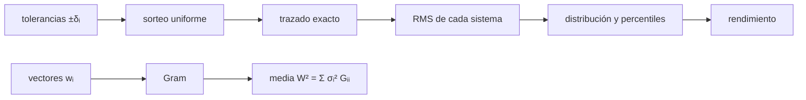

# B50-C13 — Análisis Monte Carlo de tolerancias ópticas

<!-- nav:top -->
[🏠 Programa](../../../../README.md) · [📚 Bloque B50](../../../tronco-comun/B50-diseno-optico-computacional-y-tolerancias.md) · [← Anterior: B50-C12 — Sensibilidad térmica del desempeño óptico y atermalización](../B50-C12-sensibilidad-termica-del-desempeno-optico-y-atermalizacion/CLASE.md) · [Siguiente: B50-C14 — Criterios de aceptación: Strehl, error de frente de onda y especificaciones →](../B50-C14-criterios-de-aceptacion-strehl-error-de-frente-de-onda-y-especificaciones/CLASE.md)
<!-- /nav -->

## 1. Ubicación, nivel y alcance

Clase 13 del bloque B50. Nivel N3. Cuando varios errores actúan a la vez, el desempeño es una **distribución**, no un número. Aquí sorteas 600 Cassegrain con cinco errores uniformes independientes (descentramientos del secundario, inclinación, espaciado y error de cónica del primario), trazas cada uno con el trazador exacto, y comparas la media de `W²` con la **suma cuadrática** de las sensibilidades, cada `W²` con la superposición lineal y el **rendimiento** `P(RMS ≤ 0,04)` con un modelo lineal de 200 000 ensayos. Usas [B12](../../../tronco-comun/B12-probabilidad-estadistica-e-incertidumbre.md). Las tolerancias son ilustrativas.

## 2. Por qué esta clase existe

Una tolerancia individual no dice cuántos instrumentos cumplirán. La decisión central: **¿qué fracción de los telescopios construidos con estas tolerancias cumple el requisito?**

## 3. Lo que podrás hacer al terminar

1. Obtener la sensibilidad de cada error por diferencias centrales.
2. Construir la matriz de Gram de los vectores de frente de onda.
3. Predecir la media de `W²` como suma de varianzas.
4. Muestrear sistemas y trazarlos.
5. Comparar la media con su error típico.
6. Estimar el rendimiento y sus percentiles.

La evidencia es la **ficha del Monte Carlo de tolerancias** del ejercicio 12 (sección 20).

## 4. Con qué llegas y cómo comprobarlo

1. ¿Qué es una incertidumbre?
2. ¿Qué es una simulación Monte Carlo?
3. ¿Qué es una tabla de resultados?
4. ¿Qué es un valor ilustrativo?
5. ¿Qué es una verificación?

<details>
<summary>Ver respuestas</summary>

1. Un intervalo en que se espera el valor verdadero. 2. Repetir con números aleatorios de semilla fija. 3. Un resumen ordenado de cálculos. 4. Un valor propuesto para el ejemplo, no medido. 5. Comparar un cálculo con un caso independiente.
</details>

Con cuatro o cinco aciertos, sigue; si no, repasa los prerrequisitos.

## 5. Un caso de contexto y casos de referencia

Con las tolerancias del ejemplo, la predicción es `W² = 1,112 × 10⁻³ ondas²` (RMS típico `0,0333`), el Monte Carlo de 600 sistemas da `1,096 × 10⁻³ ± 3,5 × 10⁻⁵` y el rendimiento de `RMS ≤ 0,04` es `0,773` (`0,770` con el modelo lineal). Es el **ejemplo conductor**. Todo es **ilustrativo**.

## 6. Vocabulario

El **método de Monte Carlo** sortea los errores y calcula el resultado de cada sorteo. La **matriz de Gram** `G` reúne los productos de los vectores de frente de onda. La media de `W²` es `Σ σᵢ² Gᵢᵢ` porque los términos cruzados se anulan en media. El **rendimiento** es la fracción de sistemas que cumple. Un **percentil** es el valor bajo el cual cae esa fracción.

## 7. Modelo mental: lanzar muchos dados cargados

Como lanzar muchos dados cargados: cada uno tiene su sesgo, el total varía de tirada en tirada, y se cuenta cuántas tiradas pasan el umbral.



*Descripción textual:* los errores sorteados se trazan y se resumen en una distribución que se contrasta con la suma cuadrática de las sensibilidades.

Analogía: lanzar muchos dados cargados. Límite: errores independientes, de media cero y respuesta casi lineal.

## 8. La explicación, paso a paso

### 8.1 Sensibilidades

| error | tolerancia ± | ondas RMS por unidad | aporte a `W²` |
|---|---|---|---|
| descentramiento x del secundario [mm] | 0,030 | 0,8077 | 1,96 × 10⁻⁴ |
| descentramiento y del secundario [mm] | 0,030 | 0,8077 | 1,96 × 10⁻⁴ |
| inclinacion del secundario [rad] | 3,00 × 10⁻⁴ | 134,6089 | 5,44 × 10⁻⁴ |
| espaciado del secundario [mm] | 0,050 | 0,0572 | 2,72 × 10⁻⁶ |
| error de conica del primario | 0,002 | 11,4180 | 1,74 × 10⁻⁴ |

La inclinación aporta 49 % de `W²`; el espaciado, menos del 1 %.

### 8.2 Comparación

La media de `W²` predicha es `1,1115 × 10⁻³` y la medida por Monte Carlo `1,0955 × 10⁻³ ± 3,5 × 10⁻⁵`: la diferencia es de `−0,46` errores típicos. Cada `W²` trazado se aparta de la superposición lineal como máximo `0,23 %`.

### 8.3 Distribución y rendimiento

| percentil | RMS (ondas) |
|---|---|
| 5 % | 0,01325 |
| 50 % | 0,02897 |
| 95 % | 0,05396 |
| 99 % | 0,06015 |

El rendimiento de `RMS ≤ 0,04` es `0,7733` por el trazado y `0,7700` por el modelo lineal, coherentes dentro del error binomial.

### 8.4 Lectura

Con una tolerancia que cumple en promedio, un 23 % de los sistemas no cumple `0,04` ondas. El Monte Carlo informa del riesgo; la decisión de aceptarlo no se toma aquí. Las tolerancias son sintéticas y la respuesta casi lineal, así que el resultado no se extiende a errores grandes.

## 9. Magnitudes, símbolos y unidades

| Símbolo | Qué es | Unidad | Valor / nota |
|---|---|---|---|
| `σᵢ` | desviación de cada error | unidad del error | `δᵢ/√3` |
| `G` | matriz de Gram | ondas² por unidad² | 5 × 5 |
| `P` | rendimiento | — | 0,773 |
| `N` | sistemas sorteados | — | 600 |

## 10. Convenciones y referencias

Errores uniformes e independientes; semilla `20261109`; pupila anular de 45 a 200 mm; λ = 550 nm.

## 11. De dónde sale lo que afirmamos

| ID | Fuente | Localizador | Respalda | Estado |
|---|---|---|---|---|
| — | Sin fuente externa | — | relaciones estándar que verifica el laboratorio | No se consultó una fuente para esta clase |

Límites: no se consultó ninguna fuente; las tolerancias son sintéticas.

## 12. Cómo ver la distribución del desempeño

| Magnitud | Valor |
|---|---|
| `W²` predicha | 1,112 × 10⁻³ ondas² |
| `W²` Monte Carlo | 1,096 × 10⁻³ ondas² |
| mediana del RMS | 0,0290 ondas |
| percentil 95 | 0,0540 ondas |
| rendimiento (≤ 0,04) | 0,773 |

Descripción larga: el 95 % de los sistemas queda por debajo de 0,054 ondas.

## 13. Ejemplo trabajado: el aporte de la inclinación

**Paso 1 · Tolerancia.** `δ = 3 × 10⁻⁴ rad`, `σ² = δ²/3 = 3 × 10⁻⁸`.

**Paso 2 · Sensibilidad².** `G = 18119,56 ondas²/rad²`.

**Paso 3 · Producto.** `σ² G = 5,44 × 10⁻⁴`.

**Paso 4 · Fracción.** `49 %` de `1,11 × 10⁻³`.

## 14. Distintas formas de describir una distribución

**Por tabla:** aportes. **Por suma:** `Σ σᵢ² Gᵢᵢ`. **Por simulación:** Monte Carlo. **Por rendimiento:** fracción.

## 15. Práctica guiada

**Ejercicio 1 · con los pasos indicados.** RMS típico a partir de `W²`. *Pasos:* raíz.

<details><summary>Solución comentada</summary>

`0,0333`.
</details>

**Ejercicio 2 · con una pista.** Aporte del descentramiento x.

<details><summary>Solución comentada</summary>

`1,96 × 10⁻⁴`.
</details>

**Ejercicio 3 · casi autónomo.** Suma de los aportes.

<details><summary>Solución comentada</summary>

`1,112 × 10⁻³`.
</details>

## 16. Práctica autónoma, transferencia e integrador

**Ejercicio 4.** Diferencia con Monte Carlo en errores típicos.

<details><summary>Solución comentada</summary>

`−0,46`.
</details>

**Ejercicio 5.** Desviación máxima de la linealidad.

<details><summary>Solución comentada</summary>

`0,23 %`.
</details>

**Ejercicio 6.** Mediana del RMS.

<details><summary>Solución comentada</summary>

`0,0290`.
</details>

**Ejercicio 7.** Rendimiento por trazado.

<details><summary>Solución comentada</summary>

`0,773`.
</details>

**Ejercicio 8.** Fracción que no cumple.

<details><summary>Solución comentada</summary>

`23 %`.
</details>

**Ejercicio 9 · transferencia.** **Transferencia.** Un colega suma las tolerancias en vez de combinarlas en cuadratura. Responde.

<details><summary>Solución comentada</summary>

Sobreestima el error; los errores independientes se combinan en cuadratura.
</details>

**Ejercicio 10 · transferencia.** **Transferencia.** ¿Cuántos sorteos hacen falta para estimar un rendimiento de 0,77 con error de 0,02?

<details><summary>Solución comentada</summary>

`≈ 0,77 × 0,23 / 0,02² = 443`.
</details>

**Ejercicio 11 · transferencia.** **Transferencia.** ¿Qué haría que la media de `W²` no fuera la suma cuadrática?

<details><summary>Solución comentada</summary>

Errores correlacionados o respuesta no lineal.
</details>

**Ejercicio 12.** **Integrador.** Elabora tu *ficha del Monte Carlo de tolerancias*: sensibilidades, comparación, percentiles y rendimiento.

<details><summary>Solución comentada</summary>

Secciones 8.1–8.4.
</details>

**Ejercicio 12 · integrador.** **Integrador.** Elabora tu *ficha del Monte Carlo de tolerancias*: sensibilidades, comparación, percentiles y rendimiento.

<details><summary>Solución modelo</summary>

Secciones 8.1–8.4.
</details>

## 17. Laboratorio: Monte Carlo de tolerancias

El script [montecarlo.py](montecarlo.py) sortea 600 sistemas con errores uniformes, los traza y los compara con la suma cuadrática y con el modelo lineal (**comprueba** 3 errores típicos y 3 % de linealidad).

**Datos:** sin constantes; tolerancias **ilustrativas**; semilla `20261109`. **Predice antes de ejecutar:** ¿coincidirá la media de W² con la suma cuadrática? (dentro de 1 error típico.) **Ejecución del 2026-11-09 (Python 3.12.9):**

```text
Python 3.12.9 (biblioteca estandar)
                                   error  tolerancia +- ondas por unidad  aporte a W^2
   descentramiento x del secundario [mm]           0.03          0.8077     1.957e-04
   descentramiento y del secundario [mm]           0.03          0.8077     1.957e-04
        inclinacion del secundario [rad]         0.0003           134.6     5.436e-04
           espaciado del secundario [mm]           0.05         0.05718     2.725e-06
            error de conica del primario          0.002           11.42     1.738e-04
Prediccion: media de W^2 = 1.1115e-03 ondas^2 (RMS tipico 0.03334)
Monte Carlo (600 sistemas): media de W^2 = 1.0955e-03 +- 3.5e-05 ; diferencia = -0.46 errores tipicos
Desviacion maxima del W^2 trazado frente a la superposicion lineal = 0.23 %
Percentiles del RMS (5, 50, 95, 99 %): 0.01325 ; 0.02897 ; 0.05396 ; 0.06015 ondas
Rendimiento P(RMS <= 0.04 ondas): Monte Carlo trazado = 0.7733 ; modelo lineal (200 000) = 0.7700
Pruebas superadas.
```

```bash
python programa/clases/B50/B50-C13-analisis-monte-carlo-de-tolerancias-opticas/montecarlo.py
```

**Límites:** errores independientes y respuesta casi lineal.

## 18. Errores frecuentes y cómo corregirlos

**Sumar tolerancias en vez de varianzas.** Se corrige con 8.2.

**Confundir la tolerancia con la desviación.** Se corrige con 8.1.

**Creer que cumplir en promedio es cumplir siempre.** Se corrige con 8.4.

**Presentar las tolerancias como reales.** Se corrige con la sección 10.

## 19. Cómo sabrás que vas bien

Tras la sección 8: ¿qué resultado esperabas y cuál obtuviste? Si dudas, repasa el ejemplo 13. Tras el laboratorio: ¿qué comprueba? (ver la sección 17).

## 20. Qué entregas y cómo se evalúa

El producto es tu **ficha del Monte Carlo de tolerancias** (ejercicio 12).

| Criterio | Inicial | En desarrollo | Logrado | Destacado |
|---|---|---|---|---|
| Conceptos | Los confunde | Parciales | conceptos de la clase | Explica los límites |
| Cálculo | Sin unidades | Con errores | Tablas completas | Calcula casos nuevos |
| Numérico | Sin comprobar | Un caso | Contraste con el análisis | Interpreta las diferencias |
| Fuentes | Sin fuente | Sin fecha | fuentes con fecha | Declara lo ilustrativo |
| Límites | No los nombra | Uno | Tres | Discute qué falta del modelo |

**Condiciones críticas (no se compensan con promedio):** rotular las tolerancias como ilustrativas; no declarar el rendimiento de un telescopio real; citar solo lo consultado.

## 21. Ética, seguridad y límites

Clase educativa: los modelos son simplificados. Accesibilidad: tablas equivalentes a las gráficas, fórmulas en texto, ejercicios sin conexión.

## 22. Para cerrar y seguir

El Monte Carlo reproduce la suma cuadrática (`1,11 × 10⁻³` frente a `1,10 × 10⁻³`) y da un rendimiento de `0,77` para `0,04` ondas. Queda una pregunta: ¿cómo se convierte el frente de onda en una especificación aceptable?

**Glosario español–inglés.** Monte Carlo · *Monte Carlo*; rendimiento · *yield*; suma cuadrática · *root-sum-square*; percentil · *percentile*; matriz de Gram · *Gram matrix*.

**Continuidad.** [B50-C14](../B50-C14-criterios-de-aceptacion-strehl-error-de-frente-de-onda-y-especificaciones/CLASE.md) estudia los criterios de aceptación.

**Referencias:** ver sección 11.

<!-- nav:bottom -->
---

[← Anterior: B50-C12 — Sensibilidad térmica del desempeño óptico y atermalización](../B50-C12-sensibilidad-termica-del-desempeno-optico-y-atermalizacion/CLASE.md) · [📚 Bloque B50](../../../tronco-comun/B50-diseno-optico-computacional-y-tolerancias.md) · [Siguiente: B50-C14 — Criterios de aceptación: Strehl, error de frente de onda y especificaciones →](../B50-C14-criterios-de-aceptacion-strehl-error-de-frente-de-onda-y-especificaciones/CLASE.md)
<!-- /nav -->
