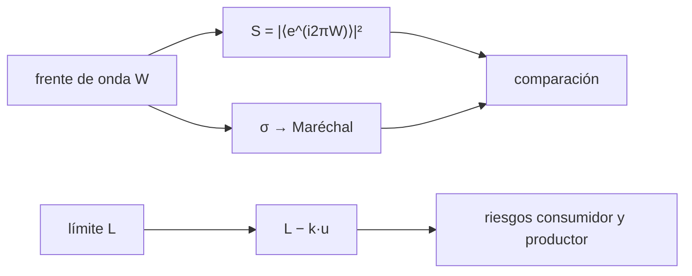

# B50-C14 — Criterios de aceptación: Strehl, error de frente de onda y especificaciones

<!-- nav:top -->
[🏠 Programa](../../../../README.md) · [📚 Bloque B50](../../../tronco-comun/B50-diseno-optico-computacional-y-tolerancias.md) · [← Anterior: B50-C13 — Análisis Monte Carlo de tolerancias ópticas](../B50-C13-analisis-monte-carlo-de-tolerancias-opticas/CLASE.md) · [Siguiente: B50-C15 — Presupuesto de error de frente de onda de un instrumento →](../B50-C15-presupuesto-de-error-de-frente-de-onda-de-un-instrumento/CLASE.md)
<!-- /nav -->

## 1. Ubicación, nivel y alcance

Clase 14 del bloque B50. Nivel N3. Un instrumento se acepta con un número: el **RMS del frente de onda**, la **razón de Strehl** o un PV. Aquí calculas el Strehl exacto de la intensidad central (`S = |⟨e^(i2πW)⟩|²`) frente a la aproximación `e^(−(2πσ)²)`, el caso analítico del desenfoque, el criterio de Rayleigh y las decisiones de aceptación con **banda de guarda**, con riesgos del consumidor y del productor por Monte Carlo y por cuadratura. Usas [B12](../../../tronco-comun/B12-probabilidad-estadistica-e-incertidumbre.md) y B42-C06. La población y los límites son ilustrativos.

## 2. Por qué esta clase existe

Una especificación solo sirve si se puede verificar con una medida que tiene incertidumbre. La decisión central: **¿cuánto margen se deja para que una medida incierta no acepte una unidad mala?**

## 3. Lo que podrás hacer al terminar

1. Calcular el Strehl exacto de una aberración sobre una pupila circular.
2. Comparar con la aproximación de Maréchal.
3. Verificar el caso del desenfoque con la fórmula analítica.
4. Relacionar el criterio de Rayleigh con el Strehl.
5. Definir una banda de guarda.
6. Calcular los riesgos del consumidor y del productor.

La evidencia es la **ficha de los criterios de aceptación** del ejercicio 12 (sección 20).

## 4. Con qué llegas y cómo comprobarlo

1. ¿Qué es una incertidumbre?
2. ¿Qué es una simulación Monte Carlo?
3. ¿Qué es una tabla de resultados?
4. ¿Qué es un valor ilustrativo?
5. ¿Qué es una verificación?

<details>
<summary>Ver respuestas</summary>

1. Un intervalo en que se espera el valor verdadero. 2. Repetir con números aleatorios de semilla fija. 3. Un resumen ordenado de cálculos. 4. Un valor propuesto para el ejemplo, no medido. 5. Comparar un cálculo con un caso independiente.
</details>

Con cuatro o cinco aciertos, sigue; si no, repasa los prerrequisitos.

## 5. Un caso de contexto y casos de referencia

Una aberración esférica de `0,05` ondas RMS tiene Strehl exacto `0,9053` y Maréchal `0,9060`; la esférica de una onda con el mejor enfoque tiene PV `0,250` (Rayleigh), RMS `0,0746` y Strehl `0,800`. Con límite de 0,05 ondas e incertidumbre de medida 0,005, una banda de guarda de 1,645 baja el riesgo del consumidor de `3,51 %` a `0,22 %`. Es el **ejemplo conductor**. Todo es **ilustrativo**.

## 6. Vocabulario

La **razón de Strehl** es la intensidad central del sistema aberrado entre la ideal. La **aproximación de Maréchal** es `S ≈ e^(−(2πσ)²)` con `σ` en ondas. El **criterio de Rayleigh** es un PV de λ/4. Una **banda de guarda** resta `k u` al límite de aceptación. El **riesgo del consumidor** es aceptar una unidad mala; el **del productor**, rechazar una buena.

## 7. Modelo mental: una balanza con margen

Como pesar un producto en una balanza con error: si el límite es 100 g y la balanza falla 5 g, aceptar solo hasta 95 g protege al comprador pero rechaza buenos productos.



*Descripción textual:* el Strehl exacto se compara con Maréchal y la medida con incertidumbre se traduce en una decisión con banda de guarda.

Analogía: una balanza con margen. Límite: aberración pequeña, simétrica y población normal.

## 8. La explicación, paso a paso

### 8.1 Esférica de Zernike `Z(4,0)`

| RMS (ondas) | `S` exacto | `e^(−(2πσ)²)` | `1 − (2πσ)²` |
|---|---|---|---|
| 0,0250 | 0,9756 | 0,9756 | 0,9753 |
| 0,0500 | 0,9053 | 0,9060 | 0,9013 |
| 0,0750 | 0,7980 | 0,8008 | 0,7778 |
| 0,1000 | 0,6663 | 0,6737 | 0,6050 |
| 0,1500 | 0,3898 | 0,4112 | 0,1113 |
| 0,2001 | 0,1815 | 0,2060 | −0,5799 |

Hasta `σ = 0,10` Maréchal acierta con menos de 1,5 % de error; la versión truncada `1 − (2πσ)²` se hace negativa para `σ` grande.

### 8.2 Desenfoque puro

| `a` (ondas PV) | `S` numérico | `(sen πa / πa)²` | RMS | `a/(2√3)` |
|---|---|---|---|---|
| 0,10 | 0,967523 | 0,967531 | 0,02887 | 0,02887 |
| 0,25 | 0,810525 | 0,810569 | 0,07218 | 0,07217 |
| 0,50 | 0,405182 | 0,405285 | 0,14436 | 0,14434 |

### 8.3 Rayleigh

La esférica de una onda con el mejor enfoque tiene PV `0,2500`, RMS `0,0746`, `S = 0,8002` y Maréchal `0,8030`: el criterio de Rayleigh (λ/4 PV) y el de Maréchal (`S ≈ 0,8`) coinciden. La fuente S1 cita el umbral 0,8.

### 8.4 Aceptación con banda de guarda

El límite es `L = 0,050` ondas RMS, la incertidumbre `u = 0,005` y la fracción realmente fuera de especificación es `0,1592`.

| `k` | límite de medida | consumidor (MC) | consumidor (cuadratura) | productor (MC) | productor (cuadratura) |
|---|---|---|---|---|---|
| 0,000 | 0,05000 | 0,03510 | 0,03463 | 0,06060 | 0,06128 |
| 1,000 | 0,04500 | 0,00821 | 0,00797 | 0,17530 | 0,17644 |
| 1,645 | 0,04178 | 0,00225 | 0,00209 | 0,27862 | 0,28012 |

La banda de guarda protege al consumidor y cuesta rechazos buenos.

## 9. Magnitudes, símbolos y unidades

| Símbolo | Qué es | Unidad | Valor / nota |
|---|---|---|---|
| `σ` | RMS del frente de onda | ondas | 0,025–0,2 |
| `S` | razón de Strehl | — | 0,905 (σ = 0,05) |
| `L` | límite de aceptación | ondas RMS | 0,050 |
| `u` | incertidumbre de medida | ondas RMS | 0,005 |

## 10. Convenciones y referencias

Pupila circular unidad; malla de 401 × 401; semilla `20261109` para la población; λ cancelada al medir en ondas.

## 11. De dónde sale lo que afirmamos

| ID | Fuente | Localizador | Respalda | Estado |
|---|---|---|---|---|
| S1 | Wikipedia, *Strehl ratio* | https://en.wikipedia.org/wiki/Strehl_ratio | definición de S como módulo al cuadrado del promedio de `e^(iφ)`, aproximación `e^(−σ²)` y umbral 0,8 de «limitado por difracción» | Consultada el 2026-11-09 (artículo de enciclopedia, no revisado por pares) |
| — | Sin fuente externa para el resto | — | relaciones que verifica el laboratorio con una segunda vía de cálculo | No se consultó una fuente para esta parte |

Límites: S1 respalda la definición, la aproximación y el umbral 0,8; las cifras, la población y los límites son del laboratorio y sintéticos.

## 12. Cómo ver el Strehl y la aceptación

| Magnitud | Valor |
|---|---|
| S exacto (σ = 0,05) | 0,9053 |
| Maréchal (σ = 0,05) | 0,9060 |
| S de Rayleigh | 0,800 |
| consumidor con k = 1,645 | 0,22 % |

Descripción larga: la banda de guarda reduce el riesgo del consumidor y aumenta el del productor.

## 13. Ejemplo trabajado: el Strehl de Maréchal

**Paso 1 · Fase.** `2π × 0,05 = 0,3142`.

**Paso 2 · Cuadrado.** `0,0987`.

**Paso 3 · Exponencial.** `e^(−0,0987) = 0,9060`.

**Paso 4 · Contraste.** El Strehl exacto es `0,9053`.

## 14. Distintas formas de describir un criterio

**Por razón:** Strehl. **Por RMS:** Maréchal. **Por PV:** Rayleigh. **Por riesgo:** banda de guarda.

## 15. Práctica guiada

**Ejercicio 1 · con los pasos indicados.** Strehl de Maréchal para `σ = 0,075`. *Pasos:* `exp(−(2π·0,075)²)`.

<details><summary>Solución comentada</summary>

`0,8008`.
</details>

**Ejercicio 2 · con una pista.** Strehl exacto para `σ = 0,075`.

<details><summary>Solución comentada</summary>

`0,7980`.
</details>

**Ejercicio 3 · casi autónomo.** Error relativo de Maréchal.

<details><summary>Solución comentada</summary>

`0,35 %`.
</details>

## 16. Práctica autónoma, transferencia e integrador

**Ejercicio 4.** RMS de un desenfoque de 0,25 ondas PV.

<details><summary>Solución comentada</summary>

`0,0722`.
</details>

**Ejercicio 5.** Strehl de ese desenfoque.

<details><summary>Solución comentada</summary>

`0,8106`.
</details>

**Ejercicio 6.** Riesgo del consumidor sin banda de guarda.

<details><summary>Solución comentada</summary>

`3,51 %`.
</details>

**Ejercicio 7.** Riesgo del productor con `k = 1,645`.

<details><summary>Solución comentada</summary>

`27,9 %`.
</details>

**Ejercicio 8.** Límite de medida con `k = 1`.

<details><summary>Solución comentada</summary>

`0,0450`.
</details>

**Ejercicio 9 · transferencia.** **Transferencia.** Un colega acepta todo lo que mide ≤ 0,05. Responde.

<details><summary>Solución comentada</summary>

Acepta un `3,5 %` de unidades malas; conviene una banda de guarda.
</details>

**Ejercicio 10 · transferencia.** **Transferencia.** ¿Por qué Maréchal falla para σ grande?

<details><summary>Solución comentada</summary>

Porque supone aberraciones pequeñas; la serie de `S` deja de ser válida.
</details>

**Ejercicio 11 · transferencia.** **Transferencia.** ¿Qué parte de la especificación depende de la longitud de onda?

<details><summary>Solución comentada</summary>

El RMS en ondas; en nanómetros cambia con λ.
</details>

**Ejercicio 12.** **Integrador.** Elabora tu *ficha de los criterios de aceptación*: Strehl exacto, Maréchal, Rayleigh y riesgos.

<details><summary>Solución comentada</summary>

Secciones 8.1–8.4.
</details>

**Ejercicio 12 · integrador.** **Integrador.** Elabora tu *ficha de los criterios de aceptación*: Strehl exacto, Maréchal, Rayleigh y riesgos.

<details><summary>Solución modelo</summary>

Secciones 8.1–8.4.
</details>

## 17. Laboratorio: Strehl y banda de guarda

El script [aceptacion.py](aceptacion.py) calcula el Strehl exacto, lo compara con Maréchal y la fórmula del desenfoque, y evalúa los riesgos de aceptación (**comprueba** 1,5 %, 3e-4 y 3 errores binomiales).

**Datos:** sin constantes; aberraciones, población y límites **ilustrativos**; semilla `20261109`. **Predice antes de ejecutar:** ¿acertará Maréchal hasta σ = 0,1? (con menos de 1,5 %.) **Ejecución del 2026-11-09 (Python 3.12.9):**

```text
Python 3.12.9 (biblioteca estandar)
Esferica de Zernike Z(4,0): Strehl exacto (intensidad central) frente a la aproximacion de Marechal
RMS [ondas]  S exacto  exp(-(2 pi s)^2)  1-(2 pi s)^2
     0.0250    0.9756            0.9756        0.9753
     0.0500    0.9053            0.9060        0.9013
     0.0750    0.7980            0.8008        0.7778
     0.1000    0.6663            0.6737        0.6050
     0.1500    0.3898            0.4112        0.1113
     0.2001    0.1815            0.2060       -0.5799
Desenfoque puro: numerico frente a (sin(pi a)/(pi a))^2
  a = 0.10 ondas PV: S numerico = 0.967523 ; formula = 0.967531 ; RMS = 0.02887 (a / (2 raiz 3) = 0.02887)
  a = 0.25 ondas PV: S numerico = 0.810525 ; formula = 0.810569 ; RMS = 0.07218 (a / (2 raiz 3) = 0.07217)
  a = 0.50 ondas PV: S numerico = 0.405182 ; formula = 0.405285 ; RMS = 0.14436 (a / (2 raiz 3) = 0.14434)
Rayleigh: esferica de 1 onda con el mejor enfoque: PV = 0.2500 ondas ; RMS = 0.0746 ; S exacto = 0.8002 ; Marechal = 0.8030
Aceptacion con limite L = 0.05 ondas RMS, incertidumbre u = 0.005 ; fraccion verdaderamente fuera de especificacion = 0.1592
     k  limite de medida  consumidor MC  consumidor Q  productor MC  productor Q
 0.000           0.05000        0.03510       0.03463       0.06060      0.06128
 1.000           0.04500        0.00821       0.00797       0.17530      0.17644
 1.645           0.04178        0.00225       0.00209       0.27862      0.28012
Pruebas superadas.
```

```bash
python programa/clases/B50/B50-C14-criterios-de-aceptacion-strehl-error-de-frente-de-onda-y-especificaciones/aceptacion.py
```

**Límites:** aberración pequeña y población normal.

## 18. Errores frecuentes y cómo corregirlos

**Usar la fórmula truncada con σ grande.** Se corrige con 8.1.

**Aceptar sin considerar la incertidumbre de medida.** Se corrige con 8.4.

**Confundir PV y RMS.** Se corrige con 8.3.

**Presentar la población como real.** Se corrige con la sección 10.

## 19. Cómo sabrás que vas bien

Tras la sección 8: ¿qué resultado esperabas y cuál obtuviste? Si dudas, repasa el ejemplo 13. Tras el laboratorio: ¿qué comprueba? (ver la sección 17).

## 20. Qué entregas y cómo se evalúa

El producto es tu **ficha de los criterios de aceptación** (ejercicio 12).

| Criterio | Inicial | En desarrollo | Logrado | Destacado |
|---|---|---|---|---|
| Conceptos | Los confunde | Parciales | conceptos de la clase | Explica los límites |
| Cálculo | Sin unidades | Con errores | Tablas completas | Calcula casos nuevos |
| Numérico | Sin comprobar | Un caso | Contraste con el análisis | Interpreta las diferencias |
| Fuentes | Sin fuente | Sin fecha | fuentes con fecha | Declara lo ilustrativo |
| Límites | No los nombra | Uno | Tres | Discute qué falta del modelo |

**Condiciones críticas (no se compensan con promedio):** rotular la población y los límites como ilustrativos; no aceptar ni rechazar un instrumento real; citar solo lo consultado.

## 21. Ética, seguridad y límites

Clase educativa: los modelos son simplificados. Accesibilidad: tablas equivalentes a las gráficas, fórmulas en texto, ejercicios sin conexión.

## 22. Para cerrar y seguir

Maréchal reproduce el Strehl exacto con menos de 1,5 % hasta 0,1 ondas RMS (`0,666` frente a `0,674`), y una banda de guarda de 1,645 baja el riesgo del consumidor a `0,22 %`. Queda una pregunta: ¿cómo se reparte el error de frente de onda de todo el instrumento?

**Glosario español–inglés.** razón de Strehl · *Strehl ratio*; banda de guarda · *guard band*; criterio de Rayleigh · *Rayleigh criterion*; riesgo del consumidor · *consumer's risk*; especificación · *specification*.

**Continuidad.** [B50-C15](../B50-C15-presupuesto-de-error-de-frente-de-onda-de-un-instrumento/CLASE.md) estudia el presupuesto de frente de onda.

**Referencias:** ver sección 11.

<!-- nav:bottom -->
---

[← Anterior: B50-C13 — Análisis Monte Carlo de tolerancias ópticas](../B50-C13-analisis-monte-carlo-de-tolerancias-opticas/CLASE.md) · [📚 Bloque B50](../../../tronco-comun/B50-diseno-optico-computacional-y-tolerancias.md) · [Siguiente: B50-C15 — Presupuesto de error de frente de onda de un instrumento →](../B50-C15-presupuesto-de-error-de-frente-de-onda-de-un-instrumento/CLASE.md)
<!-- /nav -->
