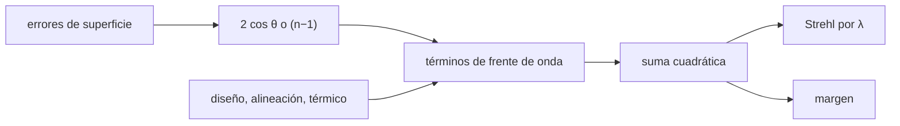

# B50-C15 — Presupuesto de error de frente de onda de un instrumento

<!-- nav:top -->
[🏠 Programa](../../../../README.md) · [📚 Bloque B50](../../../tronco-comun/B50-diseno-optico-computacional-y-tolerancias.md) · [← Anterior: B50-C14 — Criterios de aceptación: Strehl, error de frente de onda y especificaciones](../B50-C14-criterios-de-aceptacion-strehl-error-de-frente-de-onda-y-especificaciones/CLASE.md) · [Siguiente: B51-C01 — Calibración de amplitud y escala de flujo con calibradores primarios →](../../../tronco-comun/B51-interferometria-avanzada-y-reduccion-de-datos-de-radio.md#b51-c01)
<!-- /nav -->

## 1. Ubicación, nivel y alcance

Clase 15 del bloque B50. Nivel N3. El error de frente de onda de un instrumento es la suma cuadrática de sus partes: figura de los espejos, diseño, alineación, térmico y pulido. Aquí conviertes errores de **superficie** en errores de **frente de onda** (el factor `2 cos θ` de un espejo y `n − 1` de una cara refractiva, verificados por trazado), sumas los términos en cuadratura, calculas el Strehl a tres longitudes de onda, el margen frente al requisito y lo que queda para la alineación, y lo contrastas con un Monte Carlo. Usas [B12](../../../tronco-comun/B12-probabilidad-estadistica-e-incertidumbre.md). Todos los términos son ilustrativos.

## 2. Por qué esta clase existe

El requisito de un instrumento se cumple o no según cómo se reparta el error entre diseño, fabricación y alineación. La decisión central: **¿cuánto frente de onda se puede gastar en cada etapa sin superar el requisito?**

## 3. Lo que podrás hacer al terminar

1. Convertir un error de superficie en error de frente de onda.
2. Sumar términos independientes en cuadratura.
3. Calcular el Strehl de Maréchal a varias longitudes de onda.
4. Calcular el margen frente a un requisito.
5. Calcular lo que queda para un término.
6. Contrastar la suma con un Monte Carlo.

La evidencia es la **ficha del presupuesto de frente de onda** del ejercicio 12 (sección 20).

## 4. Con qué llegas y cómo comprobarlo

1. ¿Qué es una incertidumbre?
2. ¿Qué es una simulación Monte Carlo?
3. ¿Qué es una tabla de resultados?
4. ¿Qué es un valor ilustrativo?
5. ¿Qué es una verificación?

<details>
<summary>Ver respuestas</summary>

1. Un intervalo en que se espera el valor verdadero. 2. Repetir con números aleatorios de semilla fija. 3. Un resumen ordenado de cálculos. 4. Un valor propuesto para el ejemplo, no medido. 5. Comparar un cálculo con un caso independiente.
</details>

Con cuatro o cinco aciertos, sigue; si no, repasa los prerrequisitos.

## 5. Un caso de contexto y casos de referencia

Con seis términos ilustrativos el total es `53,15 nm` RMS y el requisito `S ≥ 0.8` a `1000 nm` pide `≤ 75,18 nm`: el margen es `22,03 nm`. El Strehl es `0,692` a 550 nm, `0,894` a 1000 nm y `0,977` a 2200 nm. Es el **ejemplo conductor**. Todo es **ilustrativo**.

## 6. Vocabulario

El **presupuesto de error de frente de onda** reparte el RMS total entre términos. La **conversión superficie–frente de onda** es `2 cos θ` en un espejo y `(n − 1)` en una cara refractiva con aire. La **suma cuadrática** combina términos independientes. El **margen** es el requisito menos el total. El **Strehl** escala con `λ⁻²`.

## 7. Modelo mental: un presupuesto de gastos

Como un presupuesto familiar: cada gasto se suma en cuadratura en vez de aritméticamente porque son independientes, y se mira cuánto queda del límite.



*Descripción textual:* los errores de superficie y los directos se convierten a frente de onda, se suman en cuadratura y se comparan con el requisito.

Analogía: un presupuesto de gastos. Límite: términos independientes y Maréchal válido.

## 8. La explicación, paso a paso

### 8.1 Conversión superficie a frente de onda (por trazado)

| caso | factor trazado | teoría |
|---|---|---|
| espejo, incidencia normal | 2,000000000 | 2 |
| espejo, 30° | 1,732050808 | 1,732050808 |
| cara refractiva, `n = 1,5` | 0,500000000 | 0,5 |

### 8.2 Presupuesto

| término | frente de onda (nm RMS) |
|---|---|
| figura del primario (superficie 18 nm RMS, factor 2) | 36,00 |
| figura del secundario (superficie 12 nm RMS, factor 2) | 24,00 |
| residuo del diseno nominal (frente de onda directo) | 10,00 |
| alineacion (frente de onda directo) | 22,00 |
| termico y gravedad (frente de onda directo) | 15,00 |
| pulido de media frecuencia (superficie 6 nm RMS, factor 2) | 12,00 |
| **total (suma cuadrática)** | **53,15** |

### 8.3 Strehl y margen

| λ (nm) | Strehl de Maréchal |
|---|---|
| 550 | 0,6916 |
| 1000 | 0,8945 |
| 2200 | 0,9772 |

El requisito `S ≥ 0.8` a 1000 nm equivale a `75,18 nm` RMS; el margen es `22,03 nm`. Con todo lo demás fijo, la alineación podría llegar a `57,54 nm`.

### 8.4 Monte Carlo y lectura

Con 20 000 sistemas la media de `W²` es `2812,6 ± 8,9 nm²` y la suma cuadrática da `2825,0 nm²`. El presupuesto es una herramienta de reparto; su validez depende de que los términos sean independientes y de que el Strehl de Maréchal valga (`σ` pequeño).

## 9. Magnitudes, símbolos y unidades

| Símbolo | Qué es | Unidad | Valor / nota |
|---|---|---|---|
| `σᵢ` | frente de onda del término i | nm RMS | 10–36 |
| `σ` | total | nm RMS | 53,15 |
| `S` | Strehl de Maréchal | — | 0,894 (1000 nm) |
| `M` | margen | nm RMS | 22,03 |

## 10. Convenciones y referencias

Términos independientes; factores `2` (espejo normal) y `n − 1` (cara refractiva); Strehl `exp(−(2πσ/λ)²)`.

## 11. De dónde sale lo que afirmamos

| ID | Fuente | Localizador | Respalda | Estado |
|---|---|---|---|---|
| S1 | Wikipedia, *Strehl ratio* | https://en.wikipedia.org/wiki/Strehl_ratio | definición de S como módulo al cuadrado del promedio de `e^(iφ)`, aproximación `e^(−σ²)` y umbral 0,8 de «limitado por difracción» | Consultada el 2026-11-09 (artículo de enciclopedia, no revisado por pares) |
| — | Sin fuente externa para el resto | — | relaciones que verifica el laboratorio con una segunda vía de cálculo | No se consultó una fuente para esta parte |

Límites: S1 respalda la aproximación de Strehl; los términos del presupuesto y el requisito son sintéticos.

## 12. Cómo ver el presupuesto

| Magnitud | Valor |
|---|---|
| total | 53,15 nm RMS |
| Strehl a 1000 nm | 0,894 |
| requisito | 75,18 nm RMS |
| margen | 22,03 nm |

Descripción larga: el instrumento cumple con un margen de 22 nm.

## 13. Ejemplo trabajado: el total

**Paso 1 · Cuadrados.** 36² + 24² + 10² + 22² + 15² + 12².

**Paso 2 · Suma.** `2825 nm²`.

**Paso 3 · Raíz.** `√2825 = 53,15 nm`.

**Paso 4 · Strehl.** `exp(−(2π × 53,15/1000)²) = 0,8945`.

## 14. Distintas formas de describir un presupuesto

**Por conversión:** factores. **Por suma:** cuadratura. **Por λ:** Strehl. **Por margen:** requisito menos total.

## 15. Práctica guiada

**Ejercicio 1 · con los pasos indicados.** Frente de onda de una figura de 18 nm RMS en un espejo. *Pasos:* ×2.

<details><summary>Solución comentada</summary>

`36 nm`.
</details>

**Ejercicio 2 · con una pista.** Frente de onda de 20 nm de superficie en una cara de vidrio (n = 1,5).

<details><summary>Solución comentada</summary>

`10 nm`.
</details>

**Ejercicio 3 · casi autónomo.** Suma cuadrática de 30 y 40 nm.

<details><summary>Solución comentada</summary>

`50 nm`.
</details>

## 16. Práctica autónoma, transferencia e integrador

**Ejercicio 4.** Total del presupuesto.

<details><summary>Solución comentada</summary>

`53,15 nm`.
</details>

**Ejercicio 5.** Strehl a 550 nm.

<details><summary>Solución comentada</summary>

`0,692`.
</details>

**Ejercicio 6.** Margen.

<details><summary>Solución comentada</summary>

`22,03 nm`.
</details>

**Ejercicio 7.** Alineación máxima manteniendo lo demás.

<details><summary>Solución comentada</summary>

`57,54 nm`.
</details>

**Ejercicio 8.** Diferencia de la media de Monte Carlo con la suma.

<details><summary>Solución comentada</summary>

`-12,4 nm²` (`1,40` errores típicos).
</details>

**Ejercicio 9 · transferencia.** **Transferencia.** Un colega suma las figuras en nanómetros sin el factor 2. Responde.

<details><summary>Solución comentada</summary>

Subestima el frente de onda a la mitad en un espejo.
</details>

**Ejercicio 10 · transferencia.** **Transferencia.** ¿Por qué el mismo instrumento tiene mejor Strehl en el infrarrojo?

<details><summary>Solución comentada</summary>

Porque el Strehl depende de `σ/λ` y λ es mayor.
</details>

**Ejercicio 11 · transferencia.** **Transferencia.** ¿Qué pasa si dos términos están correlacionados?

<details><summary>Solución comentada</summary>

No se suman en cuadratura; el total puede ser mayor o menor.
</details>

**Ejercicio 12.** **Integrador.** Elabora tu *ficha del presupuesto de frente de onda*: conversión, tabla, Strehl y margen.

<details><summary>Solución comentada</summary>

Secciones 8.1–8.4.
</details>

**Ejercicio 12 · integrador.** **Integrador.** Elabora tu *ficha del presupuesto de frente de onda*: conversión, tabla, Strehl y margen.

<details><summary>Solución modelo</summary>

Secciones 8.1–8.4.
</details>

## 17. Laboratorio: presupuesto de frente de onda

El script [presupuesto.py](presupuesto.py) verifica los factores de conversión por trazado, suma los términos en cuadratura y comprueba el Monte Carlo (**comprueba** 1e-9 y 3 errores típicos).

**Datos:** sin constantes; términos y requisito **ilustrativos**; semilla `20261109`. **Predice antes de ejecutar:** ¿cumple el instrumento? (sí, con 22 nm de margen.) **Ejecución del 2026-11-09 (Python 3.12.9):**

```text
Python 3.12.9 (biblioteca estandar)
A. Factores de superficie a frente de onda por trazado: reflexion normal = 1.999999999995 ; reflexion a 30 grados = 1.732050807561 (2 cos = 1.732050807569) ; refraccion (n = 1.5) = 0.500000000002
                                                       termino  frente de onda [nm RMS]
          figura del primario (superficie 18 nm RMS, factor 2)                    36.00
        figura del secundario (superficie 12 nm RMS, factor 2)                    24.00
           residuo del diseno nominal (frente de onda directo)                    10.00
                           alineacion (frente de onda directo)                    22.00
                   termico y gravedad (frente de onda directo)                    15.00
    pulido de media frecuencia (superficie 6 nm RMS, factor 2)                    12.00
Total (suma cuadratica) = 53.151 nm RMS
Strehl de Marechal: 550 nm = 0.6916 ; 1000 nm = 0.8945 ; 2200 nm = 0.9772
Requisito: Strehl >= 0.8 a 1000 nm => frente de onda <= 75.18 nm RMS ; margen = 22.03 nm ; cumple = True
Si todo lo demas queda fijo, la alineacion podria llegar a 57.54 nm RMS
Monte Carlo (20 000 sistemas): media de W^2 = 2812.63 +- 8.86 nm^2 ; suma cuadratica = 2825.00 nm^2
Pruebas superadas.
```

```bash
python programa/clases/B50/B50-C15-presupuesto-de-error-de-frente-de-onda-de-un-instrumento/presupuesto.py
```

**Límites:** términos independientes y σ pequeño.

## 18. Errores frecuentes y cómo corregirlos

**Omitir el factor 2 en espejos.** Se corrige con 8.1.

**Sumar términos en nanómetros.** Se corrige con 8.2.

**Usar el Strehl de una sola longitud de onda.** Se corrige con 8.3.

**Presentar el presupuesto como real.** Se corrige con la sección 10.

## 19. Cómo sabrás que vas bien

Tras la sección 8: ¿qué resultado esperabas y cuál obtuviste? Si dudas, repasa el ejemplo 13. Tras el laboratorio: ¿qué comprueba? (ver la sección 17).

## 20. Qué entregas y cómo se evalúa

El producto es tu **ficha del presupuesto de frente de onda** (ejercicio 12).

| Criterio | Inicial | En desarrollo | Logrado | Destacado |
|---|---|---|---|---|
| Conceptos | Los confunde | Parciales | conceptos de la clase | Explica los límites |
| Cálculo | Sin unidades | Con errores | Tablas completas | Calcula casos nuevos |
| Numérico | Sin comprobar | Un caso | Contraste con el análisis | Interpreta las diferencias |
| Fuentes | Sin fuente | Sin fecha | fuentes con fecha | Declara lo ilustrativo |
| Límites | No los nombra | Uno | Tres | Discute qué falta del modelo |

**Condiciones críticas (no se compensan con promedio):** rotular los términos y el requisito como ilustrativos; no declarar el cumplimiento de un instrumento real; citar solo lo consultado.

## 21. Ética, seguridad y límites

Clase educativa: los modelos son simplificados. Accesibilidad: tablas equivalentes a las gráficas, fórmulas en texto, ejercicios sin conexión.

## 22. Para cerrar y seguir

El presupuesto ilustrativo suma `53,2 nm` RMS (Strehl `0,89` a 1000 nm) frente a un requisito de `75,2 nm`. Con esto se cierra el bloque: el diseño nominal, sus tolerancias y su aceptación forman una sola cadena de decisiones.

**Glosario español–inglés.** presupuesto de frente de onda · *wavefront error budget*; suma cuadrática · *root-sum-square*; margen · *margin*; figura · *figure error*; alineación · *alignment*.

**Continuidad.** Con esta clase se cierra el bloque B50.

**Referencias:** ver sección 11.

<!-- nav:bottom -->
---

[← Anterior: B50-C14 — Criterios de aceptación: Strehl, error de frente de onda y especificaciones](../B50-C14-criterios-de-aceptacion-strehl-error-de-frente-de-onda-y-especificaciones/CLASE.md) · [📚 Bloque B50](../../../tronco-comun/B50-diseno-optico-computacional-y-tolerancias.md) · [Siguiente: B51-C01 — Calibración de amplitud y escala de flujo con calibradores primarios →](../../../tronco-comun/B51-interferometria-avanzada-y-reduccion-de-datos-de-radio.md#b51-c01)
<!-- /nav -->
