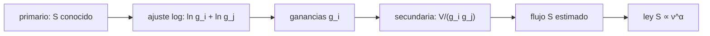

# B51-C01 — Calibración de amplitud y escala de flujo con calibradores primarios

<!-- nav:top -->
<!-- /nav -->

## 1. Ubicación, nivel y alcance

Clase 1 del bloque B51. Nivel N3. Un interferómetro mide amplitudes en unidades arbitrarias del correlador; para pasarlas a janskys hace falta un calibrador de flujo conocido. Aquí fijas la escala con un **calibrador primario**, resuelves la **ganancia de amplitud de cada antena** y la trasladas a una fuente secundaria (**bootstrap**). Usas [B46](../../../tronco-comun/B46-radioastronomia-e-interferometria.md) y [B12](../../../tronco-comun/B12-probabilidad-estadistica-e-incertidumbre.md). Todo el dato es sintético.

## 2. Por qué esta clase existe

Sin una escala de flujo, dos observaciones de la misma fuente en días distintos no se pueden comparar. La decisión central: **¿cómo se fija y se propaga una escala absoluta, y con qué incertidumbre?**

## 3. Lo que podrás hacer al terminar

1. Escribir la relación `|V_ij| = g_i g_j S` entre amplitud medida y flujo.
2. Resolver las ganancias de amplitud por mínimos cuadrados en logaritmos.
3. Escalar una fuente secundaria con las ganancias del primario (bootstrap).
4. Extrapolar un flujo con una ley de potencias `S ∝ ν^α`.
5. Pasar de flujo a temperatura de brillo de Rayleigh-Jeans y volver.
6. Reconocer qué incertidumbre hereda el bootstrap del calibrador primario.

La evidencia es la **ficha de la escala de flujo** del ejercicio 12 (sección 20).

## 4. Con qué llegas y cómo comprobarlo

1. ¿Qué es una incertidumbre?
2. ¿Qué es una simulación Monte Carlo?
3. ¿Qué es una tabla de resultados?
4. ¿Qué es un valor ilustrativo?
5. ¿Qué es una verificación?

<details>
<summary>Ver respuestas</summary>

1. Un intervalo en que se espera el valor verdadero. 2. Repetir con números aleatorios de semilla fija. 3. Un resumen ordenado de cálculos. 4. Un valor propuesto para el ejemplo, no medido. 5. Comparar un cálculo con un caso independiente.
</details>

Con cuatro o cinco aciertos, sigue; si no, repasa los prerrequisitos.

## 5. Un caso de contexto y casos de referencia

Con 8 antenas (28 bases), un primario de 10,0 Jy y un secundario verdadero de 2,50 Jy (ilustrativos), el bootstrap recupera 2,500000 Jy sin ruido y 2,4999 Jy en promedio con ruido de 0,05 Jy por base. Es el **ejemplo conductor**. Los valores no son de ninguna escala publicada.

## 6. Vocabulario

El **calibrador primario**: fuente de flujo conocido a la frecuencia de observación. La **ganancia de amplitud** `g_i`. El **janski** `1 Jy = 10⁻²⁶ W m⁻² Hz⁻¹` (definición). El **bootstrap de flujo**: transferir la escala de un calibrador a otro. El **índice espectral** `α` en `S ∝ ν^α`. La **temperatura de brillo** `T_b` de Rayleigh-Jeans.

## 7. Modelo mental: una regla graduada prestada

Como medir con una regla sin números: primero la comparas con una regla patrón (el primario) para saber cuánto vale cada marca (la ganancia), y después mides con ella el objeto desconocido.



*Descripción textual:* las amplitudes del primario se vuelven ganancias por antena; con ellas se escalan las amplitudes de la fuente secundaria y se promedian.

Analogía: una regla graduada prestada. Límite: ganancias constantes entre los dos barridos y amplitud pura.

## 8. La explicación, paso a paso

### 8.1 Recuperación sin ruido y con ruido

| Caso | S de la secundaria (Jy) | Comentario |
|---|---|---|
| Verdadera | 2,5000 | valor inyectado |
| Sin ruido | 2,500000000 | recuperación exacta (caso analítico) |
| Monte Carlo (2000 ensayos) | 2,4999 | media con ruido de 0,05 Jy por base |

La dispersión Monte Carlo es de 0,0095 Jy (0,38 %) y el error estándar de la media es 0,0002 Jy; el sesgo es -0,0001 Jy.

### 8.2 Por qué 0,38 %

El ruido relativo por base de la secundaria es `0,05 / 2,5 = 2 %`; al promediar 28 bases baja a `2 % / √28 = 0,378 %`, casi igual a lo medido. El primario aporta poco porque su ruido relativo (`0,5 %`) es cuatro veces menor.

### 8.3 Extrapolación espectral (índice −0,7)

| ν (GHz) | S (Jy) |
|---|---|
| 1,4 | 10,0000 |
| 2,0 | 7,7906 |
| 5,0 | 4,1021 |

### 8.4 Temperatura de brillo

Una fuente gaussiana de 1 segundo de arco de ancho a mitad de altura tiene `Ω = 2,6633 × 10⁻¹¹` sr; con 10,0 Jy a 1,4 GHz, `T_b = 6,2353 × 10⁶` K. La vuelta da 10,000000 Jy.

## 9. Magnitudes, símbolos y unidades

| Símbolo | Qué es | Unidad | Valor / nota |
|---|---|---|---|
| `S` | flujo | Jy | 10,0 (primario, ilustrativo) |
| `g_i` | ganancia de amplitud de la antena i | — | ≈ 1 ± 0,1 |
| `α` | índice espectral | — | −0,7 (ilustrativo) |
| `k_B` | constante de Boltzmann | J K⁻¹ | 1,380649 × 10⁻²³ (exacta, NIST) |
| `T_b` | temperatura de brillo | K | 6,235 × 10⁶ |

## 10. Convenciones y referencias

Magnitudes en SI salvo que se indique (flujos en Jy, fases en radianes, retardos en segundos); los laboratorios usan la semilla 20261109, coma decimal en el texto y punto decimal en las salidas.

## 11. De dónde sale lo que afirmamos

| ID | Fuente | Localizador | Respalda | Estado |
|---|---|---|---|---|
| S1 | NIST, *Fundamental Physical Constants* (CODATA 2022) | https://physics.nist.gov/cuu/Constants/Table/allascii.txt | constantes citadas en la sección 9 | Consultada el 2026-11-09 |
| S2 | Perley y Butler, *An Accurate Flux Density Scale from 50 MHz to 50 GHz* | https://arxiv.org/abs/1609.05940 | escala de flujo con polinomios para 20 fuentes, ancla en Cygnus A y Mars, exactitud de unos 3 a 5 % (resumen); el laboratorio NO usa sus polinomios | Solo resumen, consultado el 2026-11-09 |

Límites: la escala de Perley y Butler solo se leyó en el resumen: el laboratorio usa un primario inventado y no reproduce sus polinomios.

## 12. Cómo ver las cifras

| Símbolo | Qué es | Valor o nota |
|---|---|---|
| `S` | flujo | 10,0 (primario, ilustrativo) |
| `g_i` | ganancia de amplitud de la antena i | ≈ 1 ± 0,1 |
| `α` | índice espectral | −0,7 (ilustrativo) |
| `k_B` | constante de Boltzmann | 1,380649 × 10⁻²³ (exacta, NIST) |
| `T_b` | temperatura de brillo | 6,235 × 10⁶ |

Descripción larga: la tabla resume las magnitudes de la sección 9; las cifras completas del laboratorio están en las tablas de la sección 8 y en la salida de la sección 17.

## 13. Ejemplo trabajado: el bootstrap de la secundaria

**Paso 1 · Ganancias.** Con 28 amplitudes y 8 incógnitas `ln g_i`, el ajuste en logaritmos (ecuaciones normales) da `g_i` con error relativo del orden de `0,5 % / √7`.

**Paso 2 · Escala.** Cada base de la secundaria aporta `|V_ij| / (g_i g_j)`.

**Paso 3 · Promedio.** La media de las 28 bases es la estimación: 2,4999 Jy.

**Paso 4 · Incertidumbre.** `2 % / √28 = 0,38 %`, es decir 0,0094 Jy; el Monte Carlo da 0,0095 Jy.

## 14. Distintas formas de describir el resultado

**Por ecuación:** `|V_ij| = g_i g_j S`. **Por tabla:** 8.1 y 8.3. **Por fórmula:** `S(ν) = S₀ (ν/ν₀)^α`. **Por código:** `escala_de_flujo.py`.

## 15. Práctica guiada

**Ejercicio 1 · con los pasos indicados.** ¿Cuántas bases hay con 8 antenas y con 27? *Pasos:* `N(N−1)/2`.

<details><summary>Solución comentada</summary>

`28` y `351`.
</details>

**Ejercicio 2 · con una pista.** Flujo a 2,0 GHz con `α = −0,7` desde 10,0 Jy a 1,4 GHz. *Pasos:* `10 (2/1,4)^−0,7`.

<details><summary>Solución comentada</summary>

`7,7906 Jy`.
</details>

**Ejercicio 3 · casi autónomo.** Ruido relativo por base de la secundaria. *Pista:* `σ / S`.

<details><summary>Solución comentada</summary>

`0,05 / 2,5 = 2 %`.
</details>

## 16. Práctica autónoma, transferencia e integrador

**Ejercicio 4.** Ruido relativo esperado del promedio de 28 bases.

<details><summary>Solución comentada</summary>

`2 % / √28 = 0,38 %`.
</details>

**Ejercicio 5.** Si el primario estuviera sobrestimado 4 %, ¿cuánto vale la secundaria?

<details><summary>Solución comentada</summary>

`2,5 × 1,04 = 2,60 Jy`: el error de escala se hereda entero.
</details>

**Ejercicio 6.** Índice espectral entre 1,4 y 5,0 GHz con 10,0 y 4,1021 Jy.

<details><summary>Solución comentada</summary>

`ln(0,41021)/ln(5/1,4) = −0,70`.
</details>

**Ejercicio 7.** Dispersión Monte Carlo en porcentaje.

<details><summary>Solución comentada</summary>

`0,38 %`.
</details>

**Ejercicio 8.** Sesgo en errores estándar.

<details><summary>Solución comentada</summary>

`-0,26`: compatible con cero.
</details>

**Ejercicio 9 · transferencia.** **Transferencia.** Un compañero dice que «10 Jy» es el flujo real de 3C 286. Responde.

<details><summary>Solución comentada</summary>

Es un valor sintético del laboratorio; el flujo real sale de una escala publicada que aquí solo se leyó en resumen.
</details>

**Ejercicio 10 · transferencia.** **Transferencia.** El secundario varía 5 % entre el barrido del primario y el suyo. ¿Qué pasa?

<details><summary>Solución comentada</summary>

El bootstrap supone un secundario constante; la variación aparece como error de escala de 5 %.
</details>

**Ejercicio 11 · transferencia.** **Transferencia.** Las ganancias cambian 3 % entre barridos. ¿Qué error induce?

<details><summary>Solución comentada</summary>

Un error de escala de aproximadamente 3 %, por eso se intercalan calibradores en el tiempo.
</details>

**Ejercicio 12.** **Integrador.** Elabora tu *ficha de la escala de flujo*: ecuación, ganancias, bootstrap, incertidumbre y límites.

<details><summary>Solución comentada</summary>

Secciones 8.1–8.4.
</details>

**Ejercicio 12 · integrador.** **Integrador.** Elabora tu *ficha de la escala de flujo*: ecuación, ganancias, bootstrap, incertidumbre y límites.

<details><summary>Solución modelo</summary>

Secciones 8.1–8.4.
</details>

## 17. Laboratorio: escala de flujo y bootstrap

El script [escala_de_flujo.py](escala_de_flujo.py) resuelve las ganancias de un primario sintético y escala una secundaria (**comprueba** la recuperación exacta sin ruido y el sesgo de Monte Carlo menor que tres errores estándar).

**Datos:** constantes de NIST (`k_B`, `c`); todo lo demás **sintético**. **Predice antes de ejecutar:** ¿Qué desviación relativa tendrá el promedio de 28 bases con 2 % de ruido? (≈ 0,38 %.) **Ejecución del 2026-11-09 (Python 3.12.9):**

```text
Python 3.12.9 (biblioteca estandar)
sin ruido: S_secundaria recuperada = 2.500000000 Jy (verdadera 2.5)
Monte Carlo (2000 ensayos, ruido 0.05 Jy por base): media = 2.4999 Jy, desviacion = 0.0095 Jy (0.38 %), error estandar = 0.0002 Jy
sesgo = -0.0001 Jy = -0.26 errores estandar
S(nu) del primario con indice -0,7:
  nu = 1.4 GHz: S = 10.0000 Jy
  nu = 2.0 GHz: S = 7.7906 Jy
  nu = 5.0 GHz: S = 4.1021 Jy
Omega = 2.6633e-11 sr ; T_b (FWHM 1 arcsec, 10 Jy, 1,4 GHz) = 6.2353e+06 K ; S de vuelta = 10.000000 Jy
Pruebas superadas.
```

```bash
python programa/clases/B51/B51-C01-calibracion-de-amplitud-y-escala-de-flujo-con-calibradores-primarios/escala_de_flujo.py
```

**Límites:** amplitud pura, ganancias constantes, un solo primario.

## 18. Errores frecuentes y cómo corregirlos

**Creer que el flujo de 10 Jy es real.** Se corrige con la sección 5.

**Olvidar que el error del primario se hereda.** Se corrige con 8.1.

**Usar amplitudes sin quitar el sesgo de ruido en fuentes débiles.** Con SNR bajo la amplitud tiene sesgo positivo; ver C07.

**Confundir flujo con brillo.** Se corrige con 8.4.

## 19. Cómo sabrás que vas bien

Tras la sección 8: ¿qué resultado esperabas y cuál obtuviste? Si dudas, repasa el ejemplo 13. Tras el laboratorio: ¿qué comprueba? (ver la sección 17).

## 20. Qué entregas y cómo se evalúa

El producto es tu **ficha de la escala de flujo** (ejercicio 12).

| Criterio | Inicial | En desarrollo | Logrado | Destacado |
|---|---|---|---|---|
| Conceptos | Los confunde | Parciales | conceptos de la clase | Explica los límites |
| Cálculo | Sin unidades | Con errores | Tablas completas | Calcula casos nuevos |
| Numérico | Sin comprobar | Un caso | Contraste con el análisis | Interpreta las diferencias |
| Fuentes | Sin fuente | Sin fecha | fuentes con fecha | Declara lo ilustrativo |
| Límites | No los nombra | Uno | Tres | Discute qué falta del modelo |

**Condiciones críticas (no se compensan con promedio):** rotular lo sintético como sintético; no presentar la simulación como reducción de datos reales; citar solo lo consultado.

## 21. Ética, seguridad y límites

Clase educativa: los modelos son simplificados. Accesibilidad: tablas equivalentes a las gráficas, fórmulas en texto, ejercicios sin conexión.

## 22. Para cerrar y seguir

La escala de flujo se fija una vez con un primario y se propaga con ganancias; el error de 0,38 % del ejemplo viene casi todo del ruido de la secundaria. Queda una pregunta: ¿hay cantidades que no dependan de las ganancias?

**Glosario español–inglés.** calibrador primario · *primary calibrator*; escala de flujo · *flux scale*; ganancia · *gain*; janski · *jansky*; índice espectral · *spectral index*.

**Continuidad.** [B51-C02](../B51-C02-cantidades-de-cierre-fase-y-amplitud-de-cierre/CLASE.md) estudia las cantidades de cierre.

**Referencias:** ver sección 11.

<!-- nav:bottom -->
---

<!-- /nav -->
