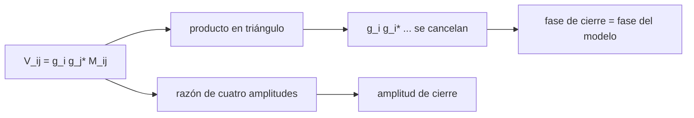

# B51-C02 — Cantidades de cierre: fase y amplitud de cierre

<!-- nav:top -->
<!-- /nav -->

## 1. Ubicación, nivel y alcance

Clase 2 del bloque B51. Nivel N3. Las ganancias de cada antena corrompen fase y amplitud, pero ciertas combinaciones de visibilidades no dependen de ellas: la **fase de cierre** (triángulo) y la **amplitud de cierre** (cuadrilátero). Aquí construyes ambas en un conjunto de 6 estaciones y compruebas que no cambian con las ganancias. Usas [B46](../../../tronco-comun/B46-radioastronomia-e-interferometria.md) y [B10](../../../tronco-comun/B10-algebra-lineal-y-matematicas-geometricas.md). Todo es sintético.

## 2. Por qué esta clase existe

Cuando las ganancias no se pueden calibrar (VLBI con atmósfera rápida, autocalibración), los cierres son los observables robustos. La decisión central: **¿qué información sobrevive a los errores por antena y cuánta se pierde?**

## 3. Lo que podrás hacer al terminar

1. Definir `ψ = arg(V_ij V_jk V_ki)` y `A = |V_ij||V_kl| / (|V_ik||V_jl|)`.
2. Demostrar que los factores de ganancia se cancelan.
3. Contar cierres independientes: `(N−1)(N−2)/2` y `N(N−3)/2`.
4. Comprobar la invariancia numéricamente.
5. Propagar el ruido a la fase de cierre.
6. Reconocer cuánta información de fase absoluta se pierde.

La evidencia es la **ficha de las cantidades de cierre** del ejercicio 12 (sección 20).

## 4. Con qué llegas y cómo comprobarlo

1. ¿Qué es una incertidumbre?
2. ¿Qué es una simulación Monte Carlo?
3. ¿Qué es una tabla de resultados?
4. ¿Qué es un valor ilustrativo?
5. ¿Qué es una verificación?

<details>
<summary>Ver respuestas</summary>

1. Un intervalo en que se espera el valor verdadero. 2. Repetir con números aleatorios de semilla fija. 3. Un resumen ordenado de cálculos. 4. Un valor propuesto para el ejemplo, no medido. 5. Comparar un cálculo con un caso independiente.
</details>

Con cuatro o cinco aciertos, sigue; si no, repasa los prerrequisitos.

## 5. Un caso de contexto y casos de referencia

Con 6 estaciones, ganancias con fase de 90,7° rms (sintéticas) y un cielo de dos fuentes, la diferencia entre los cierres de los datos corrompidos y los del modelo es de 2,22 × 10⁻¹⁶ rad en fase y 6,66 × 10⁻¹⁶ en amplitud. Es el **ejemplo conductor**.

## 6. Vocabulario

La **fase de cierre** (suma de fases en un triángulo). La **amplitud de cierre** (razón de cuatro amplitudes). El **cierre independiente**: los demás se obtienen de estos. La **ganancia compleja** `g_i`. El **modelo de cielo** `M_ij`.

## 7. Modelo mental: un perímetro que no depende del punto de partida

Como recorrer un triángulo de calles: no importa en qué esquina empieces ni cuánto se haya movido cada farola (la ganancia), la suma de las vueltas al recorrerlo es la misma.



*Descripción textual:* al multiplicar tres visibilidades en un triángulo, cada ganancia aparece una vez con su conjugada y se cancela.

Analogía: un perímetro que no depende del punto de partida. Límite: ganancias por estación y no por base.

## 8. La explicación, paso a paso

### 8.1 Cuenta de cierres

| Magnitud | Valor |
|---|---|
| Estaciones | 6 |
| Triángulos (fases de cierre) | 20 |
| Fases de cierre independientes `(N−1)(N−2)/2` | 10 |
| Cuadriláteros (una razón por cuaterna) | 15 |
| Amplitudes de cierre independientes `N(N−3)/2` | 9 |

### 8.2 Invariancia

| Triángulo | Fase de cierre del modelo (°) | Con ganancias (°) |
|---|---|---|
| 1 | +45,7583 | +45,7583 |
| 2 | +39,4786 | +39,4786 |
| 3 | -50,8168 | -50,8168 |
| 4 | -60,2352 | -60,2352 |

El máximo de diferencias en los 20 triángulos es 2,22 × 10⁻¹⁶ rad; en amplitud de cierre, 6,66 × 10⁻¹⁶.

### 8.3 Ruido

Con ruido de 0,15 por componente en el triángulo (0, 1, 2), la fórmula `σ_ψ = √(Σ σ²/|V|²)` da 16,216° y el Monte Carlo (20 000 ensayos) 16,681°. La pequeña diferencia (2,9 %) viene de la no linealidad de la fase cuando el ruido es grande.

## 9. Magnitudes, símbolos y unidades

| Símbolo | Qué es | Unidad | Valor / nota |
|---|---|---|---|
| `ψ` | fase de cierre | rad | 45,76° (triángulo 1) |
| `A` | amplitud de cierre | — | adimensional |
| `N` | número de estaciones | — | 6 |
| `σ_ψ` | ruido de la fase de cierre | rad | 16,22° (ejemplo) |

## 10. Convenciones y referencias

Magnitudes en SI salvo que se indique (flujos en Jy, fases en radianes, retardos en segundos); los laboratorios usan la semilla 20261109, coma decimal en el texto y punto decimal en las salidas.

## 11. De dónde sale lo que afirmamos

| ID | Fuente | Localizador | Respalda | Estado |
|---|---|---|---|---|
| S1 | Event Horizon Telescope Collaboration, *First M87 Event Horizon Telescope Results. III. Data Processing and Calibration* | https://arxiv.org/abs/1906.11240 | tres cadenas independientes de calibración de fase y búsqueda de franjas; sistemáticos acotados a cerca de 2 % en amplitud y 1 grado en fase (resumen) | Solo resumen, consultado el 2026-11-09 |

Límites: el resumen de la colaboración confirma que usan cantidades de cierre y calibración de fase en tres cadenas independientes; no se leyó el desarrollo. El cielo y las ganancias del laboratorio son sintéticos.

## 12. Cómo ver las cifras

| Símbolo | Qué es | Valor o nota |
|---|---|---|
| `ψ` | fase de cierre | 45,76° (triángulo 1) |
| `A` | amplitud de cierre | adimensional |
| `N` | número de estaciones | 6 |
| `σ_ψ` | ruido de la fase de cierre | 16,22° (ejemplo) |

Descripción larga: la tabla resume las magnitudes de la sección 9; las cifras completas del laboratorio están en las tablas de la sección 8 y en la salida de la sección 17.

## 13. Ejemplo trabajado: la invariancia de un triángulo

**Paso 1 · Producto.** `V_12 V_23 V_31 = g_1 g_2* g_2 g_3* g_3 g_1* M_12 M_23 M_31 = |g_1|²|g_2|²|g_3|² M_12 M_23 M_31`.

**Paso 2 · Fase.** El factor de ganancias es real y positivo: no cambia la fase.

**Paso 3 · Cuenta.** Con 6 estaciones: `(6−1)(6−2)/2 = 10` fases independientes y `6·3/2 = 9` amplitudes.

**Paso 4 · Información.** Hay `15` fases de visibilidad y `10` cierres: se pierden `5` fases (una por estación menos la referencia).

## 14. Distintas formas de describir el resultado

**Por ecuación:** `ψ = arg(V_ij V_jk V_ki)`. **Por tabla:** 8.1–8.2. **Por fórmula:** `σ_ψ² = Σ σ²/|V|²`. **Por código:** `cantidades_de_cierre.py`.

## 15. Práctica guiada

**Ejercicio 1 · con los pasos indicados.** Fases de cierre independientes con 27 estaciones. *Pasos:* `(N−1)(N−2)/2`.

<details><summary>Solución comentada</summary>

`26·25/2 = 325`.
</details>

**Ejercicio 2 · con una pista.** Amplitudes de cierre independientes con 27 estaciones.

<details><summary>Solución comentada</summary>

`27·24/2 = 324`.
</details>

**Ejercicio 3 · casi autónomo.** Fases de visibilidad que se pierden con 6 estaciones. *Pista:* `N−1`.

<details><summary>Solución comentada</summary>

`5`.
</details>

## 16. Práctica autónoma, transferencia e integrador

**Ejercicio 4.** Número de bases con 6 estaciones y fracción que recuperan los cierres de fase.

<details><summary>Solución comentada</summary>

`15` bases y `10/15 = 67 %` de las fases.
</details>

**Ejercicio 5.** Si cada visibilidad tiene SNR 5, ruido de la fase de cierre.

<details><summary>Solución comentada</summary>

`√(3/25) = 0,346 rad = 19,8°`.
</details>

**Ejercicio 6.** Con SNR 20.

<details><summary>Solución comentada</summary>

`√(3/400) = 0,0866 rad = 4,96°`.
</details>

**Ejercicio 7.** ¿Cambia la fase de cierre si una antena suma 90° a su fase?

<details><summary>Solución comentada</summary>

No: la fase aparece con signos opuestos en dos bases del triángulo.
</details>

**Ejercicio 8.** ¿Y si la fuente es un punto en el centro de fase?

<details><summary>Solución comentada</summary>

La fase de cierre es 0° o 180°: los cierres de una fuente simétrica son triviales.
</details>

**Ejercicio 9 · transferencia.** **Transferencia.** Un colega dice que los cierres «recuperan la imagen completa». Responde.

<details><summary>Solución comentada</summary>

No: recuperan `N(N−1)/2 − (N−1)` fases; las `N−1` restantes (una traslación en el cielo) se pierden.
</details>

**Ejercicio 10 · transferencia.** **Transferencia.** ¿Por qué se prefiere la amplitud de cierre a la amplitud calibrada en VLBI?

<details><summary>Solución comentada</summary>

Porque no depende de las ganancias de antena, que son inestables.
</details>

**Ejercicio 11 · transferencia.** **Transferencia.** ¿Qué pasa con los cierres si el error depende de la base y no de la antena?

<details><summary>Solución comentada</summary>

Ya no se cancelan: los errores de base sobreviven (por ejemplo, un error de correlación).
</details>

**Ejercicio 12.** **Integrador.** Elabora tu *ficha de las cantidades de cierre*: definiciones, cuenta, invariancia, ruido y límites.

<details><summary>Solución comentada</summary>

Secciones 8.1–8.3.
</details>

**Ejercicio 12 · integrador.** **Integrador.** Elabora tu *ficha de las cantidades de cierre*: definiciones, cuenta, invariancia, ruido y límites.

<details><summary>Solución modelo</summary>

Secciones 8.1–8.3.
</details>

## 17. Laboratorio: invariancia de los cierres

El script [cantidades_de_cierre.py](cantidades_de_cierre.py) construye cierres de 6 estaciones y comprueba su invariancia (**comprueba** diferencias menores que `10⁻⁹` y el ruido de la fase de cierre dentro de 5 % de la fórmula).

**Datos:** ninguna constante; cielo, posiciones y ganancias **sintéticos**. **Predice antes de ejecutar:** ¿En cuánto cambia la fase de cierre al aplicar ganancias? (en nada, hasta el redondeo). **Ejecución del 2026-11-09 (Python 3.12.9):**

```text
Python 3.12.9 (biblioteca estandar)
estaciones = 6 ; triangulos = 20 (independientes 10) ; cuadrangulos = 15 (amplitudes independientes 9)
rms de la fase de ganancia por estacion = 90.7 grados
  fase de cierre: modelo  +45.7583 grados ; datos con ganancias  +45.7583 grados
  fase de cierre: modelo  +39.4786 grados ; datos con ganancias  +39.4786 grados
  fase de cierre: modelo  -50.8168 grados ; datos con ganancias  -50.8168 grados
  fase de cierre: modelo  -60.2352 grados ; datos con ganancias  -60.2352 grados
max |cierre de fase datos - modelo| = 2.22e-16 rad ; max |cierre de amplitud datos/modelo - 1| = 6.66e-16
ruido de la fase de cierre (triangulo (0, 1, 2)): formula = 16.216 grados ; Monte Carlo = 16.681 grados
Pruebas superadas.
```

```bash
python programa/clases/B51/B51-C02-cantidades-de-cierre-fase-y-amplitud-de-cierre/cantidades_de_cierre.py
```

**Límites:** ganancias por estación, ruido independiente por base.

## 18. Errores frecuentes y cómo corregirlos

**Creer que los cierres dan la fase absoluta.** Se corrige con la sección 13.

**Contar todos los triángulos como independientes.** Se corrige con 8.1.

**Olvidar que los errores por base no se cancelan.** Se corrige con el ejercicio 11.

**Usar la fórmula del ruido con SNR bajo.** Con SNR menor que unos 3 la fase no es gaussiana.

## 19. Cómo sabrás que vas bien

Tras la sección 8: ¿qué resultado esperabas y cuál obtuviste? Si dudas, repasa el ejemplo 13. Tras el laboratorio: ¿qué comprueba? (ver la sección 17).

## 20. Qué entregas y cómo se evalúa

El producto es tu **ficha de las cantidades de cierre** (ejercicio 12).

| Criterio | Inicial | En desarrollo | Logrado | Destacado |
|---|---|---|---|---|
| Conceptos | Los confunde | Parciales | conceptos de la clase | Explica los límites |
| Cálculo | Sin unidades | Con errores | Tablas completas | Calcula casos nuevos |
| Numérico | Sin comprobar | Un caso | Contraste con el análisis | Interpreta las diferencias |
| Fuentes | Sin fuente | Sin fecha | fuentes con fecha | Declara lo ilustrativo |
| Límites | No los nombra | Uno | Tres | Discute qué falta del modelo |

**Condiciones críticas (no se compensan con promedio):** rotular lo sintético como sintético; no presentar la simulación como reducción de datos reales; citar solo lo consultado.

## 21. Ética, seguridad y límites

Clase educativa: los modelos son simplificados. Accesibilidad: tablas equivalentes a las gráficas, fórmulas en texto, ejercicios sin conexión.

## 22. Para cerrar y seguir

Los cierres sobreviven a las ganancias por antena y dan 10 fases y 9 amplitudes independientes con 6 estaciones. Queda una pregunta: ¿cómo se obtienen las propias ganancias?

**Glosario español–inglés.** fase de cierre · *closure phase*; amplitud de cierre · *closure amplitude*; ganancia · *gain*; estación · *station*.

**Continuidad.** [B51-C03](../B51-C03-ganancias-complejas-por-antena-y-soluciones-de-calibracion/CLASE.md) estudia las ganancias complejas por antena.

**Referencias:** ver sección 11.

<!-- nav:bottom -->
---

<!-- /nav -->
