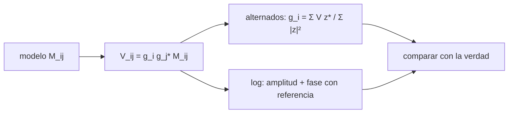

# B51-C03 — Ganancias complejas por antena y soluciones de calibración

<!-- nav:top -->
<!-- /nav -->

## 1. Ubicación, nivel y alcance

Clase 3 del bloque B51. Nivel N3. La ecuación de medida del interferómetro dice que cada visibilidad observada es la verdadera multiplicada por una ganancia compleja por antena: `V_ij = g_i g_j* M_ij`. Aquí resuelves las 7 ganancias de un conjunto con dos solucionadores independientes: **mínimos cuadrados alternados** y **logarítmico-lineal**. Usas [B46](../../../tronco-comun/B46-radioastronomia-e-interferometria.md) y [B10](../../../tronco-comun/B10-algebra-lineal-y-matematicas-geometricas.md). Los datos son sintéticos.

## 2. Por qué esta clase existe

Sin ganancias el conjunto de datos no sirve para formar imágenes. La decisión central: **¿cómo se estiman las ganancias a partir de un modelo de cielo conocido y qué precisión se alcanza?**

## 3. Lo que podrás hacer al terminar

1. Escribir `V_ij = g_i g_j* M_ij + ruido` como caso escalar de la RIME.
2. Resolver `g_i` por mínimos cuadrados alternados (iteración con promedio).
3. Resolver amplitud y fase por separado con ajuste logarítmico y antena de referencia.
4. Explicar por qué la fase absoluta no se determina.
5. Predecir el error de las ganancias a partir del ruido.
6. Reconocer los términos que el modelo escalar omite (polarización, dirección).

La evidencia es la **ficha de las ganancias complejas** del ejercicio 12 (sección 20).

## 4. Con qué llegas y cómo comprobarlo

1. ¿Qué es una incertidumbre?
2. ¿Qué es una simulación Monte Carlo?
3. ¿Qué es una tabla de resultados?
4. ¿Qué es un valor ilustrativo?
5. ¿Qué es una verificación?

<details>
<summary>Ver respuestas</summary>

1. Un intervalo en que se espera el valor verdadero. 2. Repetir con números aleatorios de semilla fija. 3. Un resumen ordenado de cálculos. 4. Un valor propuesto para el ejemplo, no medido. 5. Comparar un cálculo con un caso independiente.
</details>

Con cuatro o cinco aciertos, sigue; si no, repasa los prerrequisitos.

## 5. Un caso de contexto y casos de referencia

Con 7 antenas (21 bases), un cielo conocido de dos fuentes y ruido de 0,02 Jy, ambos métodos recuperan las ganancias sin ruido a 1,7 × 10⁻¹⁴ y 8,4 × 10⁻¹⁷ (amplitud relativa) y con ruido a 0,83 % y 0,95 %. Es el **ejemplo conductor**.

## 6. Vocabulario

La **ecuación de medida** (RIME) en su forma escalar. La **ganancia compleja** `g_i = |g_i| e^{iφ_i}`. La **antena de referencia** (fase 0). Los **mínimos cuadrados alternados** (tipo StefCal). El **modelo de cielo** `M_ij`. La **matriz de Jones**: generalización 2×2 de `g_i` que incluye polarización.

## 7. Modelo mental: un coro afinado por pares

Como afinar un coro escuchando solo dúos: cada medición mezcla dos voces (`g_i g_j*`); con muchos dúos se despeja cuánto desafina cada cantante, salvo el tono absoluto.



*Descripción textual:* dos solucionadores independientes resuelven las mismas ganancias a partir del mismo modelo y se comparan con la verdad.

Analogía: un coro afinado por pares. Límite: modelo conocido, una ganancia por antena y ruido gaussiano.

## 8. La explicación, paso a paso

### 8.1 Ganancias verdaderas (respecto a la antena 0)

| Antena | |g| | Fase (°) |
|---|---|---|
| 0 | 0,9460 | +0,000 |
| 1 | 0,7668 | +19,281 |
| 2 | 0,8710 | -10,286 |
| 3 | 0,9779 | -16,044 |
| 4 | 1,0968 | +74,979 |
| 5 | 1,1351 | +54,885 |
| 6 | 1,2027 | +44,645 |

### 8.2 Recuperación

| Caso | Método A (alternados) | Método B (log-lineal) |
|---|---|---|
| Sin ruido, error de amplitud | 1,70 × 10⁻¹⁴ | 8,39 × 10⁻¹⁷ |
| Sin ruido, error de fase (rad) | 5,97 × 10⁻¹⁷ | 3,60 × 10⁻¹⁶ |
| Con ruido, rms de amplitud relativa | 0,0083 | 0,0095 |
| Con ruido, rms de fase (rad) | 0,0114 | 0,0127 |

El método A converge en 41 iteraciones en el caso sin ruido.

### 8.3 Error predicho

Con ruido de 0,02 Jy y `|V|` medio de 1,048, el error esperado es `σ / (|V| √(N−1)) = 0,0078`. Los cuatro valores medidos están entre 1,0 y 1,7 veces ese número; el método logarítmico es algo menos eficiente porque pondera mal las bases débiles.

## 9. Magnitudes, símbolos y unidades

| Símbolo | Qué es | Unidad | Valor / nota |
|---|---|---|---|
| `g_i` | ganancia compleja de la antena i | — | ≈ 1 ± 0,15 en amplitud |
| `M_ij` | visibilidad del modelo | Jy | 1,4 Jy como máximo |
| `σ` | ruido por componente | Jy | 0,02 |
| `N` | antenas | — | 7 |

## 10. Convenciones y referencias

Magnitudes en SI salvo que se indique (flujos en Jy, fases en radianes, retardos en segundos); los laboratorios usan la semilla 20261109, coma decimal en el texto y punto decimal en las salidas.

## 11. De dónde sale lo que afirmamos

| ID | Fuente | Localizador | Respalda | Estado |
|---|---|---|---|---|
| S1 | Smirnov, *Revisiting the radio interferometer measurement equation. I. A full-sky Jones formalism* | https://arxiv.org/abs/1101.1764 | la ecuación de medida del interferómetro (RIME) con matrices de Jones y efectos dependientes de la dirección (resumen) | Solo resumen, consultado el 2026-11-09 |

Límites: el resumen de Smirnov respalda que la RIME se escribe con matrices de Jones y admite efectos dependientes de la dirección; la forma escalar del laboratorio es la más simple. No se leyó el desarrollo.

## 12. Cómo ver las cifras

| Símbolo | Qué es | Valor o nota |
|---|---|---|
| `g_i` | ganancia compleja de la antena i | ≈ 1 ± 0,15 en amplitud |
| `M_ij` | visibilidad del modelo | 1,4 Jy como máximo |
| `σ` | ruido por componente | 0,02 |
| `N` | antenas | 7 |

Descripción larga: la tabla resume las magnitudes de la sección 9; las cifras completas del laboratorio están en las tablas de la sección 8 y en la salida de la sección 17.

## 13. Ejemplo trabajado: una ganancia a mano

**Paso 1 · Par.** Para dos antenas `V_12 = g_1 g_2* M_12`.

**Paso 2 · Amplitud.** `ln|V_12/M_12| = ln|g_1| + ln|g_2|`.

**Paso 3 · Sistema.** Con 21 bases y 7 incógnitas el sistema es sobredeterminado y las ecuaciones normales lo resuelven.

**Paso 4 · Fase.** `arg(V_12/M_12) = φ_1 − φ_2`: solo hay diferencias; se fija `φ_0 = 0`.

## 14. Distintas formas de describir el resultado

**Por ecuación:** `V_ij = g_i g_j* M_ij`. **Por tabla:** 8.2. **Por fórmula:** `g_i = Σ_j V_ij z_ij* / Σ_j |z_ij|²` con `z_ij = g_j* M_ij`. **Por código:** `ganancias_complejas.py`.

## 15. Práctica guiada

**Ejercicio 1 · con los pasos indicados.** Incógnitas reales con 7 antenas si se fija la fase de una. *Pasos:* `2N − 1`.

<details><summary>Solución comentada</summary>

`13`.
</details>

**Ejercicio 2 · con una pista.** Bases de 7 antenas y ecuaciones reales.

<details><summary>Solución comentada</summary>

`21` bases, `42` ecuaciones reales.
</details>

**Ejercicio 3 · casi autónomo.** Grados de libertad sobrantes.

<details><summary>Solución comentada</summary>

`42 − 13 = 29`.
</details>

## 16. Práctica autónoma, transferencia e integrador

**Ejercicio 4.** Error esperado con `σ = 0,02` y `|V| = 1,05`.

<details><summary>Solución comentada</summary>

`0,02/(1,05·√6) = 0,0078`.
</details>

**Ejercicio 5.** Si `σ` se duplica, ¿qué pasa con el error?

<details><summary>Solución comentada</summary>

Se duplica.
</details>

**Ejercicio 6.** Si el número de antenas pasa de 7 a 28, ¿cómo cambia el factor `√(N−1)`?

<details><summary>Solución comentada</summary>

De `2,449` a `5,196`: mejora 2,12 veces.
</details>

**Ejercicio 7.** Fase de la antena 4 respecto a la 0.

<details><summary>Solución comentada</summary>

`74,979°`.
</details>

**Ejercicio 8.** Amplitud máxima y mínima del conjunto.

<details><summary>Solución comentada</summary>

`1,2027` y `0,7668`.
</details>

**Ejercicio 9 · transferencia.** **Transferencia.** Un colega fija la fase de la antena 3 en lugar de la 0. ¿Cambia la imagen?

<details><summary>Solución comentada</summary>

No: la referencia solo desplaza todas las fases por una constante, que equivale a una traslación en el cielo.
</details>

**Ejercicio 10 · transferencia.** **Transferencia.** El modelo de cielo es incompleto. ¿Qué ocurre con las ganancias?

<details><summary>Solución comentada</summary>

Se sesgan: absorben el error del modelo (ver C06 y C07).
</details>

**Ejercicio 11 · transferencia.** **Transferencia.** ¿Qué añade una matriz de Jones 2×2?

<details><summary>Solución comentada</summary>

Fugas entre polarizaciones y ganancias distintas por polarización.
</details>

**Ejercicio 12.** **Integrador.** Elabora tu *ficha de las ganancias complejas*: ecuación, dos métodos, referencia, error y límites.

<details><summary>Solución comentada</summary>

Secciones 8.1–8.3.
</details>

**Ejercicio 12 · integrador.** **Integrador.** Elabora tu *ficha de las ganancias complejas*: ecuación, dos métodos, referencia, error y límites.

<details><summary>Solución modelo</summary>

Secciones 8.1–8.3.
</details>

## 17. Laboratorio: ganancias por dos métodos

El script [ganancias_complejas.py](ganancias_complejas.py) resuelve las ganancias con alternados y log-lineal (**comprueba** recuperación exacta sin ruido y error con ruido entre 0,5 y 2 veces el predicho).

**Datos:** ninguna constante; todo **sintético**. **Predice antes de ejecutar:** ¿Qué error de amplitud esperas con `σ = 0,02`? (≈ 0,8 %.) **Ejecución del 2026-11-09 (Python 3.12.9):**

```text
Python 3.12.9 (biblioteca estandar)
antenas = 7 ; bases = 21 ; ganancias verdaderas (amp, fase respecto a la antena 0):
  antena 0: |g| = 0.9460 ; fase =   +0.000 grados
  antena 1: |g| = 0.7668 ; fase =  +19.281 grados
  antena 2: |g| = 0.8710 ; fase =  -10.286 grados
  antena 3: |g| = 0.9779 ; fase =  -16.044 grados
  antena 4: |g| = 1.0968 ; fase =  +74.979 grados
  antena 5: |g| = 1.1351 ; fase =  +54.885 grados
  antena 6: |g| = 1.2027 ; fase =  +44.645 grados
sin ruido: A (alternados) error amp = 1.70e-14, fase = 5.97e-17 rad en 41 iteraciones ; B (log-lineal) error amp = 8.39e-17, fase = 3.60e-16 rad
con ruido 0.02 Jy (200 ensayos): error predicho ~ 0.0078 (|V| medio 1.048)
  A: rms amp = 0.0083, rms fase = 0.0114 rad ; B: rms amp = 0.0095, rms fase = 0.0127 rad
Pruebas superadas.
```

```bash
python programa/clases/B51/B51-C03-ganancias-complejas-por-antena-y-soluciones-de-calibracion/ganancias_complejas.py
```

**Límites:** modelo conocido y escalar; sin polarización ni dependencia de la dirección.

## 18. Errores frecuentes y cómo corregirlos

**Creer que la fase absoluta se recupera.** Se corrige con 8.1 y el ejercicio 9.

**Usar un modelo de cielo equivocado sin avisar.** Se corrige con C07.

**Iterar sin promediar (oscila).** Se corrige con el promedio de iteraciones.

**Confundir ganancia de antena con ganancia de base.** Se corrige con la sección 7.

## 19. Cómo sabrás que vas bien

Tras la sección 8: ¿qué resultado esperabas y cuál obtuviste? Si dudas, repasa el ejemplo 13. Tras el laboratorio: ¿qué comprueba? (ver la sección 17).

## 20. Qué entregas y cómo se evalúa

El producto es tu **ficha de las ganancias complejas** (ejercicio 12).

| Criterio | Inicial | En desarrollo | Logrado | Destacado |
|---|---|---|---|---|
| Conceptos | Los confunde | Parciales | conceptos de la clase | Explica los límites |
| Cálculo | Sin unidades | Con errores | Tablas completas | Calcula casos nuevos |
| Numérico | Sin comprobar | Un caso | Contraste con el análisis | Interpreta las diferencias |
| Fuentes | Sin fuente | Sin fecha | fuentes con fecha | Declara lo ilustrativo |
| Límites | No los nombra | Uno | Tres | Discute qué falta del modelo |

**Condiciones críticas (no se compensan con promedio):** rotular lo sintético como sintético; no presentar la simulación como reducción de datos reales; citar solo lo consultado.

## 21. Ética, seguridad y límites

Clase educativa: los modelos son simplificados. Accesibilidad: tablas equivalentes a las gráficas, fórmulas en texto, ejercicios sin conexión.

## 22. Para cerrar y seguir

Con modelo conocido, dos métodos distintos recuperan las ganancias de 7 antenas con errores de 0,8 % a 0,9 %. Queda una pregunta: ¿qué pasa cuando la ganancia depende de la frecuencia?

**Glosario español–inglés.** ganancia compleja · *complex gain*; ecuación de medida · *measurement equation*; antena de referencia · *reference antenna*; matriz de Jones · *Jones matrix*.

**Continuidad.** [B51-C04](../B51-C04-respuesta-de-banda-y-errores-dependientes-de-la-frecuencia/CLASE.md) estudia la respuesta de banda.

**Referencias:** ver sección 11.

<!-- nav:bottom -->
---

<!-- /nav -->
