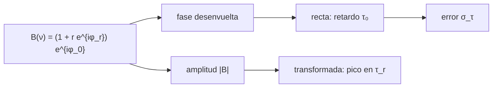

# B51-C04 — Respuesta de banda y errores dependientes de la frecuencia

<!-- nav:top -->
[🏠 Programa](../../../../README.md) · [📚 Bloque B51](../../../tronco-comun/B51-interferometria-avanzada-y-reduccion-de-datos-de-radio.md) · [← Anterior: B51-C03 — Ganancias complejas por antena y soluciones de calibración](../B51-C03-ganancias-complejas-por-antena-y-soluciones-de-calibracion/CLASE.md) · [Siguiente: B51-C05 — Efectos ionosféricos en radioastronomía: retardo, rotación de Faraday y su corrección →](../B51-C05-efectos-ionosfericos-en-radioastronomia-retardo-rotacion-de-faraday-y-su-correccion/CLASE.md)
<!-- /nav -->

## 1. Ubicación, nivel y alcance

Clase 4 del bloque B51. Nivel N3. Cada canal de frecuencia tiene su propia ganancia compleja: la **respuesta de banda** (*bandpass*). Un retardo residual produce una pendiente de fase a lo largo de la banda y una reflexión en el cable produce una ondulación de amplitud. Aquí ajustas ambas en una banda de 128 MHz con 256 canales. Usas [B46](../../../tronco-comun/B46-radioastronomia-e-interferometria.md) y [B49](../../../tronco-comun/B49-antenas-y-receptores-de-radioastronomia.md). Los datos son sintéticos.

## 2. Por qué esta clase existe

Un error de banda aparece en las líneas espectrales como una falsa estructura y limita el rango dinámico del continuo. La decisión central: **¿qué parte del error de banda es un retardo, qué parte una ondulación, y con qué precisión se miden?**

## 3. Lo que podrás hacer al terminar

1. Escribir `B(ν) = (1 + r e^{2πiντ_r}) e^{2πiντ₀}`.
2. Ajustar el retardo con una recta a la fase desenvuelta.
3. Predecir la precisión del retardo: `σ_τ = σ_φ / (2π σ_ν √N)`.
4. Hallar el retardo de una reflexión con la transformada de la amplitud.
5. Relacionar el periodo de la ondulación con `1/τ_r`.
6. Reconocer el sesgo que una ondulación introduce en el ajuste del retardo.

La evidencia es la **ficha de la respuesta de banda** del ejercicio 12 (sección 20).

## 4. Con qué llegas y cómo comprobarlo

1. ¿Qué es una incertidumbre?
2. ¿Qué es una simulación Monte Carlo?
3. ¿Qué es una tabla de resultados?
4. ¿Qué es un valor ilustrativo?
5. ¿Qué es una verificación?

<details>
<summary>Ver respuestas</summary>

1. Un intervalo en que se espera el valor verdadero. 2. Repetir con números aleatorios de semilla fija. 3. Un resumen ordenado de cálculos. 4. Un valor propuesto para el ejemplo, no medido. 5. Comparar un cálculo con un caso independiente.
</details>

Con cuatro o cinco aciertos, sigue; si no, repasa los prerrequisitos.

## 5. Un caso de contexto y casos de referencia

Con 256 canales sobre 128 MHz, un retardo residual inyectado de 3,0 ns y una reflexión de amplitud 0,05 a 40 ns (todo sintético), el ajuste da 3,0213 ns sin ruido y la ondulación aparece con periodo de 25,0 MHz. Es el **ejemplo conductor**.

## 6. Vocabulario

La **respuesta de banda** `B(ν)`. El **retardo residual** `τ₀`: pendiente de fase. La **ondulación** (*ripple*) por reflexión: periodo `1/τ_r`. El **ancho de banda** `Δν`. La **desviación típica de las frecuencias** `σ_ν = Δν/√12`.

## 7. Modelo mental: una cuerda con una vibración estacionaria

Como una cuerda tensada que además tiembla: la inclinación general es el retardo y el temblor regular es el eco del cable; cada uno se lee con su propia herramienta.



*Descripción textual:* la fase de la banda da una recta (retardo) y la amplitud da una ondulación cuyo pico en el dominio del retardo es la reflexión.

Analogía: una cuerda con una vibración estacionaria. Límite: ruido de fase igual en todos los canales y reflexión pequeña.

## 8. La explicación, paso a paso

### 8.1 Retardo

| Caso | Retardo (ns) |
|---|---|
| Inyectado | 3,0000 |
| Ajustado sin ruido | 3,0213 |
| Media con ruido de fase 0,05 rad (2000 ensayos) | 3,0213 |

El desplazamiento de +0,0213 ns aparece incluso sin ruido: la reflexión añade una oscilación de fase que la recta no absorbe del todo. Es un **sesgo de modelo**, no de ruido.

### 8.2 Precisión

La fórmula `σ_τ = σ_φ / (2π σ_ν √N)` da 13,46 ps; el Monte Carlo da 12,82 ps (-4,8 %).

### 8.3 Ondulación

| Magnitud | Valor |
|---|---|
| Periodo esperado `1/τ_r` | 25,0 MHz |
| Retardo del pico en la transformada | 41,02 ns |
| Retardo inyectado | 40,0 ns |
| Celda de retardo `1/Δν` | 7,81 ns |
| Amplitud pico a pico de la amplitud de B | 0,0998 (esperada `2 r = 0,10`) |

## 9. Magnitudes, símbolos y unidades

| Símbolo | Qué es | Unidad | Valor / nota |
|---|---|---|---|
| `τ₀` | retardo residual | ns | 3,0 (inyectado) |
| `r` | amplitud de la reflexión | — | 0,05 |
| `τ_r` | retardo de la reflexión | ns | 40 |
| `Δν` | ancho de banda | MHz | 128 |
| `σ_τ` | precisión del retardo | ps | 13,5 |

## 10. Convenciones y referencias

Magnitudes en SI salvo que se indique (flujos en Jy, fases en radianes, retardos en segundos); los laboratorios usan la semilla 20261109, coma decimal en el texto y punto decimal en las salidas.

## 11. De dónde sale lo que afirmamos

| ID | Fuente | Localizador | Respalda | Estado |
|---|---|---|---|---|
| S1 | Documentación de CASA/AIPS sobre bandpass | — | procedimientos de calibración de banda | No consultado |

Límites: no se consultó la documentación de ningún paquete: el modelo de banda es el de este laboratorio, no el de un instrumento real.

## 12. Cómo ver las cifras

| Símbolo | Qué es | Valor o nota |
|---|---|---|
| `τ₀` | retardo residual | 3,0 (inyectado) |
| `r` | amplitud de la reflexión | 0,05 |
| `τ_r` | retardo de la reflexión | 40 |
| `Δν` | ancho de banda | 128 |
| `σ_τ` | precisión del retardo | 13,5 |

Descripción larga: la tabla resume las magnitudes de la sección 9; las cifras completas del laboratorio están en las tablas de la sección 8 y en la salida de la sección 17.

## 13. Ejemplo trabajado: la precisión del retardo

**Paso 1 · Pendiente.** La fase es `2π ν τ₀`: una recta de pendiente `2π τ₀`.

**Paso 2 · Ruido.** Con `σ_φ = 0,05` rad y `σ_ν = 36,95` MHz, `σ_τ = 0,05 / (2π · 36950417 Hz · √256)`.

**Paso 3 · Valor.** `σ_τ = 13,46` ps.

**Paso 4 · Ondulación.** Una reflexión de retardo `τ_r = 40` ns repite la amplitud cada `1/τ_r = 25` MHz.

## 14. Distintas formas de describir el resultado

**Por ecuación:** `B(ν)`. **Por tabla:** 8.1–8.3. **Por fórmula:** `σ_τ = σ_φ/(2π σ_ν √N)`. **Por código:** `respuesta_de_banda.py`.

## 15. Práctica guiada

**Ejercicio 1 · con los pasos indicados.** Periodo de una ondulación causada por una reflexión de 40 ns. *Pasos:* `1/τ_r`.

<details><summary>Solución comentada</summary>

`25 MHz`.
</details>

**Ejercicio 2 · con una pista.** Fase total entre bordes de la banda con 3 ns y 128 MHz. *Pasos:* `2π τ₀ Δν`.

<details><summary>Solución comentada</summary>

`2,413 rad`.
</details>

**Ejercicio 3 · casi autónomo.** Resolución de retardo de una banda de 128 MHz.

<details><summary>Solución comentada</summary>

`1/Δν = 7,81 ns`.
</details>

## 16. Práctica autónoma, transferencia e integrador

**Ejercicio 4.** Precisión con `σ_φ = 0,1` rad y 256 canales. *Pista:* `σ_ν = 36,95 MHz`.

<details><summary>Solución comentada</summary>

`0,1/(2π·36,95e6·16) = 26,9 ps`.
</details>

**Ejercicio 5.** Si se cuadruplican los canales, ¿cómo cambia `σ_τ`?

<details><summary>Solución comentada</summary>

Baja a la mitad.
</details>

**Ejercicio 6.** Si se duplica el ancho de banda con los mismos canales, ¿cómo cambia?

<details><summary>Solución comentada</summary>

Baja a la mitad (`σ_ν` se duplica).
</details>

**Ejercicio 7.** Retardo que produce un cambio de fase de 1 rad en 1 MHz.

<details><summary>Solución comentada</summary>

`1/(2π·10⁶) = 159,2 ns`.
</details>

**Ejercicio 8.** Sesgo del retardo en el ejemplo, en ps.

<details><summary>Solución comentada</summary>

`21,3 ps`.
</details>

**Ejercicio 9 · transferencia.** **Transferencia.** Una línea espectral de 5 canales cae en un máximo de la ondulación. ¿Qué pasa?

<details><summary>Solución comentada</summary>

Se confunde con emisión; por eso se calibra la banda y se prueba con un calibrador.
</details>

**Ejercicio 10 · transferencia.** **Transferencia.** ¿Por qué el retardo ajustado se desplaza aun sin ruido?

<details><summary>Solución comentada</summary>

Porque la reflexión añade fase oscilante no modelada por la recta.
</details>

**Ejercicio 11 · transferencia.** **Transferencia.** ¿Qué condición debe cumplir la fase para desenvolverla?

<details><summary>Solución comentada</summary>

Que cambie menos de `π` entre canales vecinos.
</details>

**Ejercicio 12.** **Integrador.** Elabora tu *ficha de la respuesta de banda*: modelo, retardo, ondulación, precisión y límites.

<details><summary>Solución comentada</summary>

Secciones 8.1–8.3.
</details>

**Ejercicio 12 · integrador.** **Integrador.** Elabora tu *ficha de la respuesta de banda*: modelo, retardo, ondulación, precisión y límites.

<details><summary>Solución modelo</summary>

Secciones 8.1–8.3.
</details>

## 17. Laboratorio: retardo y ondulación de banda

El script [respuesta_de_banda.py](respuesta_de_banda.py) ajusta el retardo de la fase y halla la reflexión en la amplitud (**comprueba** el retardo a 0,05 ns, la dispersión Monte Carlo a 10 % de la fórmula y el pico a una celda).

**Datos:** ninguna constante; todo **sintético**. **Predice antes de ejecutar:** ¿Qué precisión de retardo esperas? (≈ 13 ps.) **Ejecución del 2026-11-09 (Python 3.12.9):**

```text
Python 3.12.9 (biblioteca estandar)
canales = 256 ; ancho de banda = 128 MHz ; retardo inyectado = 3.000 ns
sin ruido: retardo ajustado = 3.0213 ns
ruido de fase 0.05 rad por canal: formula sigma_tau = 13.46 ps ; Monte Carlo (2000) = 12.82 ps ; media = 3.0213 ns
ondulacion: periodo esperado = 25.0 MHz ; pico en tau = 41.02 ns (inyectado 40.0) ; amplitud pico a pico de |B| = 0.0998
Pruebas superadas.
```

```bash
python programa/clases/B51/B51-C04-respuesta-de-banda-y-errores-dependientes-de-la-frecuencia/respuesta_de_banda.py
```

**Límites:** ruido blanco de fase, reflexión pequeña, una sola ondulación.

## 18. Errores frecuentes y cómo corregirlos

**Ajustar la fase sin desenvolverla.** Se corrige con la sección 8.1.

**Confundir resolución con precisión del retardo.** La resolución es `1/Δν`; la precisión depende del SNR.

**Ignorar el sesgo de modelo.** Se corrige con el ejercicio 8.

**Leer el periodo en canales en lugar de MHz.** Se corrige con la sección 9.

## 19. Cómo sabrás que vas bien

Tras la sección 8: ¿qué resultado esperabas y cuál obtuviste? Si dudas, repasa el ejemplo 13. Tras el laboratorio: ¿qué comprueba? (ver la sección 17).

## 20. Qué entregas y cómo se evalúa

El producto es tu **ficha de la respuesta de banda** (ejercicio 12).

| Criterio | Inicial | En desarrollo | Logrado | Destacado |
|---|---|---|---|---|
| Conceptos | Los confunde | Parciales | conceptos de la clase | Explica los límites |
| Cálculo | Sin unidades | Con errores | Tablas completas | Calcula casos nuevos |
| Numérico | Sin comprobar | Un caso | Contraste con el análisis | Interpreta las diferencias |
| Fuentes | Sin fuente | Sin fecha | fuentes con fecha | Declara lo ilustrativo |
| Límites | No los nombra | Uno | Tres | Discute qué falta del modelo |

**Condiciones críticas (no se compensan con promedio):** rotular lo sintético como sintético; no presentar la simulación como reducción de datos reales; citar solo lo consultado.

## 21. Ética, seguridad y límites

Clase educativa: los modelos son simplificados. Accesibilidad: tablas equivalentes a las gráficas, fórmulas en texto, ejercicios sin conexión.

## 22. Para cerrar y seguir

La banda se separa en una pendiente de fase (retardo, precisión 13 ps) y una ondulación de periodo 25 MHz. Queda una pregunta: ¿qué añade la ionosfera?

**Glosario español–inglés.** respuesta de banda · *bandpass*; retardo · *delay*; ondulación · *ripple*; reflexión · *reflection*.

**Continuidad.** [B51-C05](../B51-C05-efectos-ionosfericos-en-radioastronomia-retardo-rotacion-de-faraday-y-su-correccion/CLASE.md) estudia los efectos ionosféricos.

**Referencias:** ver sección 11.

<!-- nav:bottom -->
---

[← Anterior: B51-C03 — Ganancias complejas por antena y soluciones de calibración](../B51-C03-ganancias-complejas-por-antena-y-soluciones-de-calibracion/CLASE.md) · [📚 Bloque B51](../../../tronco-comun/B51-interferometria-avanzada-y-reduccion-de-datos-de-radio.md) · [Siguiente: B51-C05 — Efectos ionosféricos en radioastronomía: retardo, rotación de Faraday y su corrección →](../B51-C05-efectos-ionosfericos-en-radioastronomia-retardo-rotacion-de-faraday-y-su-correccion/CLASE.md)
<!-- /nav -->
