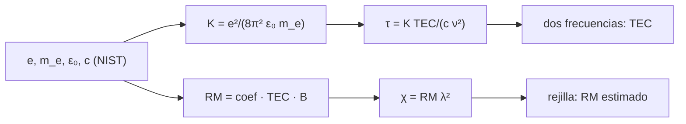

# B51-C05 — Efectos ionosféricos en radioastronomía: retardo, rotación de Faraday y su corrección

<!-- nav:top -->
[🏠 Programa](../../../../README.md) · [📚 Bloque B51](../../../tronco-comun/B51-interferometria-avanzada-y-reduccion-de-datos-de-radio.md) · [← Anterior: B51-C04 — Respuesta de banda y errores dependientes de la frecuencia](../B51-C04-respuesta-de-banda-y-errores-dependientes-de-la-frecuencia/CLASE.md) · [Siguiente: B51-C06 — Autocalibración iterativa con modelo de cielo →](../B51-C06-autocalibracion-iterativa-con-modelo-de-cielo/CLASE.md)
<!-- /nav -->

## 1. Ubicación, nivel y alcance

Clase 5 del bloque B51. Nivel N3. La ionosfera retrasa la señal de forma dispersiva (retardo `∝ 1/ν²`) y gira el plano de polarización (rotación de Faraday `∝ λ²`). Aquí **derivas las constantes** de las constantes de NIST, calculas retardos y giros, recuperas el contenido electrónico con dos frecuencias y la rotación `RM` con una rejilla. Usas [B46](../../../tronco-comun/B46-radioastronomia-e-interferometria.md) y [B05](../../../tronco-comun/B05-fisica-fundamental-para-el-espacio.md). Los datos son sintéticos.

## 2. Por qué esta clase existe

A frecuencias bajas la ionosfera domina el error de fase y de polarización. La decisión central: **¿cómo se mide y se quita el efecto con las propias frecuencias de la observación?**

## 3. Lo que podrás hacer al terminar

1. Derivar `K = e²/(8π² ε₀ m_e)` y el coeficiente de Faraday con constantes de NIST.
2. Calcular el retardo `τ = K·TEC/(c ν²)` y su fase.
3. Estimar el TEC con dos frecuencias y propagar su ruido.
4. Calcular el ángulo de Faraday `χ = RM λ²`.
5. Recuperar `RM` con una rejilla y reconocer la ambigüedad `nπ`.
6. Explicar por qué importa por debajo de 300 MHz.

La evidencia es la **ficha de los efectos ionosféricos** del ejercicio 12 (sección 20).

## 4. Con qué llegas y cómo comprobarlo

1. ¿Qué es una incertidumbre?
2. ¿Qué es una simulación Monte Carlo?
3. ¿Qué es una tabla de resultados?
4. ¿Qué es un valor ilustrativo?
5. ¿Qué es una verificación?

<details>
<summary>Ver respuestas</summary>

1. Un intervalo en que se espera el valor verdadero. 2. Repetir con números aleatorios de semilla fija. 3. Un resumen ordenado de cálculos. 4. Un valor propuesto para el ejemplo, no medido. 5. Comparar un cálculo con un caso independiente.
</details>

Con cuatro o cinco aciertos, sigue; si no, repasa los prerrequisitos.

## 5. Un caso de contexto y casos de referencia

Con 20 TECU y `B∥ = 4,0 × 10⁻⁵` T (sintéticos), el retardo a 150 MHz es 1195,1 ns (1126 rad) y a 8,4 GHz 0,381 ns. La constante derivada es `K = 40,3082` m³/s². Es el **ejemplo conductor**.

## 6. Vocabulario

El **contenido electrónico total** (TEC), en TECU (`1 TECU = 10¹⁶ m⁻²`). El **retardo dispersivo** `τ = K TEC/(c ν²)`. La **rotación de Faraday**: `χ = RM λ²`. La **medida de rotación** (RM). La **ambigüedad `nπ`** del ángulo de polarización. La **capa delgada**: toda la ionosfera en una lámina.

## 7. Modelo mental: un prisma para ondas de radio

Como un prisma que desvía más la luz azul que la roja: la ionosfera retrasa más las frecuencias bajas, y por eso dos frecuencias bastan para medir cuánto prisma hay en el camino.



*Descripción textual:* las constantes fundamentales fijan los coeficientes del retardo y del giro; con ellos se simulan y se invierten TEC y RM.

Analogía: un prisma para ondas de radio. Límite: plasma frío, capa delgada y campo constante.

## 8. La explicación, paso a paso

### 8.1 Constantes derivadas

`K = e²/(8π² ε₀ m_e) = 40,3082` m³/s² (se acepta 40,3). Coeficiente de Faraday `e³/(8π² ε₀ m_e² c³) = 2,6312 × 10⁻¹³` (SI, rad m⁻² por m⁻² T).

### 8.2 Retardo ionosférico (20 TECU)

| ν (GHz) | Retardo (ns) | Fase (rad) |
|---|---|---|
| 0,150 | 1195,1436 | 1126,4 |
| 1,400 | 13,7198 | 120,69 |
| 8,400 | 0,3811 | 20,11 |

### 8.3 TEC con dos frecuencias (1,4 y 1,7 GHz)

Sin ruido se recupera 20,000000 TECU. Con ruido de retardo de 0,05 ns: media 20,000 TECU, desviación Monte Carlo 0,331 y fórmula 0,320 TECU.

### 8.4 Faraday

`RM = coef · TEC · B∥ = 2,1050` rad/m². Ángulos: 752,7° a 120 MHz, 481,8° a 150 MHz y 334,6° a 180 MHz. Con 17 canales entre 120 y 180 MHz y ruido de 0,1 rad, la rejilla da 2,130 rad/m² (verdadero 2,105; sigma predicha 0,023). La ambigüedad `π/(Δλ²)` entre canales extremos es 0,91 rad/m².

## 9. Magnitudes, símbolos y unidades

| Símbolo | Qué es | Unidad | Valor / nota |
|---|---|---|---|
| `K` | constante del retardo dispersivo | m³ s⁻² | 40,3082 (derivada de NIST) |
| `TEC` | contenido electrónico total | m⁻² | 20 TECU (ilustrativo) |
| `RM` | medida de rotación | rad m⁻² | 2,105 |
| `e` | carga elemental | C | 1,602176634 × 10⁻¹⁹ (exacta) |
| `m_e` | masa del electrón | kg | 9,1093837139 × 10⁻³¹ |

## 10. Convenciones y referencias

Magnitudes en SI salvo que se indique (flujos en Jy, fases en radianes, retardos en segundos); los laboratorios usan la semilla 20261109, coma decimal en el texto y punto decimal en las salidas.

## 11. De dónde sale lo que afirmamos

| ID | Fuente | Localizador | Respalda | Estado |
|---|---|---|---|---|
| S1 | NIST, *Fundamental Physical Constants* (CODATA 2022) | https://physics.nist.gov/cuu/Constants/Table/allascii.txt | constantes citadas en la sección 9 | Consultada el 2026-11-09 |
| S2 | Intema et al., *Ionospheric Calibration of Low Frequency Radio Interferometric Observations using the Peeling Scheme* | https://arxiv.org/abs/0904.3975 | la ionosfera desplaza las fases de forma variable en tiempo, dirección y antena por debajo de unos 300 MHz (resumen) | Solo resumen, consultado el 2026-11-09 |

Límites: el resumen de Intema et al. respalda que la ionosfera desplaza las fases por debajo de unos 300 MHz; sus resultados de calibración no se reproducen aquí y el campo magnético y el TEC del laboratorio son inventados.

## 12. Cómo ver las cifras

| Símbolo | Qué es | Valor o nota |
|---|---|---|
| `K` | constante del retardo dispersivo | 40,3082 (derivada de NIST) |
| `TEC` | contenido electrónico total | 20 TECU (ilustrativo) |
| `RM` | medida de rotación | 2,105 |
| `e` | carga elemental | 1,602176634 × 10⁻¹⁹ (exacta) |
| `m_e` | masa del electrón | 9,1093837139 × 10⁻³¹ |

Descripción larga: la tabla resume las magnitudes de la sección 9; las cifras completas del laboratorio están en las tablas de la sección 8 y en la salida de la sección 17.

## 13. Ejemplo trabajado: el retardo a 150 MHz

**Paso 1 · Constante.** `K = 40,308` m³/s².

**Paso 2 · TEC.** `20 TECU = 2 × 10¹⁷ m⁻²`.

**Paso 3 · Retardo.** `τ = 40,308 · 2×10¹⁷ / (2,998×10⁸ · (1,5×10⁸)²) = 1195,1` ns.

**Paso 4 · Fase.** `2π ν τ = 1126` rad: muchos ciclos.

## 14. Distintas formas de describir el resultado

**Por ecuación:** `τ = K TEC/(c ν²)`, `χ = RM λ²`. **Por tabla:** 8.2. **Por fórmula:** `TEC = (τ₁−τ₂) c / (K (ν₁⁻²−ν₂⁻²))`. **Por código:** `ionosfera.py`.

## 15. Práctica guiada

**Ejercicio 1 · con los pasos indicados.** Retardo a 1,4 GHz con 20 TECU. *Pasos:* `K TEC/(c ν²)`.

<details><summary>Solución comentada</summary>

`13,7198 ns`.
</details>

**Ejercicio 2 · con una pista.** Cociente de retardos entre 150 MHz y 1,4 GHz. *Pista:* `(1,4/0,15)²`.

<details><summary>Solución comentada</summary>

`87,1`.
</details>

**Ejercicio 3 · casi autónomo.** Retardo a 8,4 GHz y cociente con el de 1,4 GHz.

<details><summary>Solución comentada</summary>

`0,3811 ns`; cociente `36,0`.
</details>

## 16. Práctica autónoma, transferencia e integrador

**Ejercicio 4.** `λ²` a 150 MHz.

<details><summary>Solución comentada</summary>

`3,994 m²`.
</details>

**Ejercicio 5.** Ángulo de Faraday a 150 MHz con `RM = 2,105`.

<details><summary>Solución comentada</summary>

`481,8°`.
</details>

**Ejercicio 6.** Si el TEC se duplica, ¿cómo cambia el RM?

<details><summary>Solución comentada</summary>

Se duplica.
</details>

**Ejercicio 7.** Ambigüedad `nπ` en `RM` entre 120 y 180 MHz.

<details><summary>Solución comentada</summary>

`0,91 rad/m²`.
</details>

**Ejercicio 8.** Desviación del TEC si el ruido de retardo se duplica.

<details><summary>Solución comentada</summary>

`0,641 TECU`.
</details>

**Ejercicio 9 · transferencia.** **Transferencia.** ¿Por qué dos frecuencias bastan para el TEC y no para el RM?

<details><summary>Solución comentada</summary>

El retardo es dispersivo con una sola incógnita; el RM suma una fase periódica con ambigüedad `nπ`.
</details>

**Ejercicio 10 · transferencia.** **Transferencia.** ¿Por qué una rejilla en vez de un ajuste lineal del ángulo?

<details><summary>Solución comentada</summary>

Porque el ángulo se mide módulo `π` y el ajuste lineal falla al saltar.
</details>

**Ejercicio 11 · transferencia.** **Transferencia.** Con 1,0 a 2,0 GHz el mismo RM casi no gira la polarización. ¿Por qué?

<details><summary>Solución comentada</summary>

Porque `λ²` es unos cuarenta veces menor que a 150 MHz.
</details>

**Ejercicio 12.** **Integrador.** Elabora tu *ficha de los efectos ionosféricos*: constantes, retardo, TEC, Faraday y límites.

<details><summary>Solución comentada</summary>

Secciones 8.1–8.4.
</details>

**Ejercicio 12 · integrador.** **Integrador.** Elabora tu *ficha de los efectos ionosféricos*: constantes, retardo, TEC, Faraday y límites.

<details><summary>Solución modelo</summary>

Secciones 8.1–8.4.
</details>

## 17. Laboratorio: constantes, TEC y RM

El script [ionosfera.py](ionosfera.py) deriva las constantes de NIST, calcula retardos y recupera TEC y RM (**comprueba** `K` entre 40,2 y 40,4, TEC exacto sin ruido y `RM` a tres sigma).

**Datos:** constantes de NIST; TEC, campo y ruido **sintéticos**. **Predice antes de ejecutar:** ¿Cuántos nanosegundos retrasa la ionosfera a 150 MHz con 20 TECU? (≈ 1195.) **Ejecución del 2026-11-09 (Python 3.12.9):**

```text
Python 3.12.9 (biblioteca estandar)
K = e^2/(8 pi^2 eps0 me) = 40.3082 m^3/s^2 ; coeficiente de Faraday = 2.6312e-13 (SI: rad m^-2 por m^-2 T)
TEC = 20 TECU ; B_par = 4.0e-05 T ; RM = 2.1050 rad/m^2
nu [GHz]  retardo [ns]  fase [rad]
   0.150     1195.1436    1126.396
   1.400       13.7198     120.685
   8.400        0.3811      20.114
TEC por dos frecuencias sin ruido = 20.000000000 TECU
con ruido de retardo 0,05 ns: media = 20.000 TECU ; desviacion MC = 0.331 ; formula = 0.320
angulo de Faraday a 0.12 GHz = 752.74 grados
angulo de Faraday a 0.15 GHz = 481.75 grados
angulo de Faraday a 0.18 GHz = 334.55 grados
angulo a 150 MHz = 481.8 grados ; ambiguedad n*pi entre canales extremos: Delta RM = 0.91 rad/m^2
RM recuperado por rejilla = 2.130 rad/m^2 (inyectado 2.105) ; sigma predicha = 0.023
Pruebas superadas.
```

```bash
python programa/clases/B51/B51-C05-efectos-ionosfericos-en-radioastronomia-retardo-rotacion-de-faraday-y-su-correccion/ionosfera.py
```

**Límites:** plasma frío, capa delgada, B constante.

## 18. Errores frecuentes y cómo corregirlos

**Confundir TECU con unidades SI.** `1 TECU = 10¹⁶ m⁻²`; ver la sección 9.

**Usar la fase sin considerar los ciclos enteros.** Se corrige con 8.2.

**Ajustar linealmente un ángulo que salta `π`.** Se corrige con la rejilla.

**Aplicar los valores del laboratorio a un día real.** Los datos son sintéticos.

## 19. Cómo sabrás que vas bien

Tras la sección 8: ¿qué resultado esperabas y cuál obtuviste? Si dudas, repasa el ejemplo 13. Tras el laboratorio: ¿qué comprueba? (ver la sección 17).

## 20. Qué entregas y cómo se evalúa

El producto es tu **ficha de los efectos ionosféricos** (ejercicio 12).

| Criterio | Inicial | En desarrollo | Logrado | Destacado |
|---|---|---|---|---|
| Conceptos | Los confunde | Parciales | conceptos de la clase | Explica los límites |
| Cálculo | Sin unidades | Con errores | Tablas completas | Calcula casos nuevos |
| Numérico | Sin comprobar | Un caso | Contraste con el análisis | Interpreta las diferencias |
| Fuentes | Sin fuente | Sin fecha | fuentes con fecha | Declara lo ilustrativo |
| Límites | No los nombra | Uno | Tres | Discute qué falta del modelo |

**Condiciones críticas (no se compensan con promedio):** rotular lo sintético como sintético; no presentar la simulación como reducción de datos reales; citar solo lo consultado.

## 21. Ética, seguridad y límites

Clase educativa: los modelos son simplificados. Accesibilidad: tablas equivalentes a las gráficas, fórmulas en texto, ejercicios sin conexión.

## 22. Para cerrar y seguir

El retardo ionosférico crece como `1/ν²` (1195 ns a 150 MHz) y la dispersión permite medir el TEC con dos frecuencias; el RM exige varias y una rejilla. Queda una pregunta: ¿cómo se refina la calibración iterando?

**Glosario español–inglés.** ionosfera · *ionosphere*; contenido electrónico total · *total electron content*; rotación de Faraday · *Faraday rotation*; medida de rotación · *rotation measure*.

**Continuidad.** [B51-C06](../B51-C06-autocalibracion-iterativa-con-modelo-de-cielo/CLASE.md) estudia la autocalibración.

**Referencias:** ver sección 11.

<!-- nav:bottom -->
---

[← Anterior: B51-C04 — Respuesta de banda y errores dependientes de la frecuencia](../B51-C04-respuesta-de-banda-y-errores-dependientes-de-la-frecuencia/CLASE.md) · [📚 Bloque B51](../../../tronco-comun/B51-interferometria-avanzada-y-reduccion-de-datos-de-radio.md) · [Siguiente: B51-C06 — Autocalibración iterativa con modelo de cielo →](../B51-C06-autocalibracion-iterativa-con-modelo-de-cielo/CLASE.md)
<!-- /nav -->
