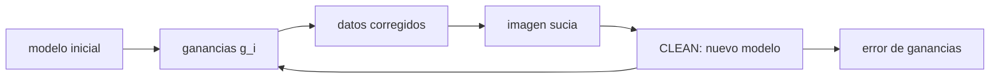

# B51-C06 — Autocalibración iterativa con modelo de cielo

<!-- nav:top -->
[🏠 Programa](../../../../README.md) · [📚 Bloque B51](../../../tronco-comun/B51-interferometria-avanzada-y-reduccion-de-datos-de-radio.md) · [← Anterior: B51-C05 — Efectos ionosféricos en radioastronomía: retardo, rotación de Faraday y su corrección](../B51-C05-efectos-ionosfericos-en-radioastronomia-retardo-rotacion-de-faraday-y-su-correccion/CLASE.md) · [Siguiente: B51-C07 — Evaluación de residuos y diagnóstico de calidad de calibración →](../B51-C07-evaluacion-de-residuos-y-diagnostico-de-calidad-de-calibracion/CLASE.md)
<!-- /nav -->

## 1. Ubicación, nivel y alcance

Clase 6 del bloque B51. Nivel N3. La autocalibración usa los propios datos: se parte de un modelo incompleto, se resuelven ganancias, se corrigen los datos, se forma una imagen y se mejora el modelo. Aquí lo haces en un cielo **unidimensional** con tres fuentes y 14 antenas, con imagen sucia por transformada y CLEAN de Högbom. Usas [B46](../../../tronco-comun/B46-radioastronomia-e-interferometria.md) y [B15](../../../tronco-comun/B15-senales-imagenes-y-estimacion-cientifica.md). Todo es sintético.

## 2. Por qué esta clase existe

Sin autocalibración, los errores de ganancia de la atmósfera limitan el rango dinámico. La decisión central: **¿converge el ciclo modelo–ganancias, a qué valor y con qué sesgo?**

## 3. Lo que podrás hacer al terminar

1. Describir el ciclo: modelo, ganancias, corrección, imagen, nuevo modelo.
2. Usar solo fase al inicio y amplitud y fase después.
3. Medir la convergencia de las ganancias frente a la verdad.
4. Comparar con el control del modelo verdadero.
5. Reconocer la degeneración entre escala de flujo y ganancia de amplitud.
6. Reconocer el sesgo hacia el modelo de partida.

La evidencia es la **ficha de la autocalibración** del ejercicio 12 (sección 20).

## 4. Con qué llegas y cómo comprobarlo

1. ¿Qué es una incertidumbre?
2. ¿Qué es una simulación Monte Carlo?
3. ¿Qué es una tabla de resultados?
4. ¿Qué es un valor ilustrativo?
5. ¿Qué es una verificación?

<details>
<summary>Ver respuestas</summary>

1. Un intervalo en que se espera el valor verdadero. 2. Repetir con números aleatorios de semilla fija. 3. Un resumen ordenado de cálculos. 4. Un valor propuesto para el ejemplo, no medido. 5. Comparar un cálculo con un caso independiente.
</details>

Con cuatro o cinco aciertos, sigue; si no, repasa los prerrequisitos.

## 5. Un caso de contexto y casos de referencia

Con 14 antenas, un cielo de 1,0, 0,4 y 0,2 Jy (sintético), ruido 0,01 Jy y modelo inicial de solo la fuente brillante, el error de fase de las ganancias baja de 37,1° a 3,0° y el flujo de la fuente de 0,4 Jy sube de 0 a 0,393 Jy. Es el **ejemplo conductor**.

## 6. Vocabulario

La **autocalibración** (*self-cal*). El **modelo de cielo** inicial. La **imagen sucia** y el **haz sucio**. **CLEAN** (Högbom): resta iterativa de componentes puntuales. La **solución de fase sola** frente a **amplitud y fase**. El **sesgo del modelo**: las ganancias absorben lo que el modelo no tiene.

## 7. Modelo mental: afinar un instrumento tocando su propia música

Como afinar un piano escuchando una melodía que no conoces del todo: primero ajustas lo grueso con lo que sí reconoces, escribes mejor la melodía y vuelves a afinar; cada vuelta mejora ambas cosas.



*Descripción textual:* cada vuelta resuelve ganancias con el modelo vigente, corrige, forma la imagen y limpia para obtener un modelo mejor.

Analogía: afinar un instrumento tocando su propia música. Límite: cielo 1D, ganancias constantes y fuentes puntuales.

## 8. La explicación, paso a paso

### 8.1 Convergencia

| Paso | Fase rms (°) | Amplitud rms (%) | S(0,4) hallada (Jy) | S(0,2) hallada (Jy) |
|---|---|---|---|---|
| modelo inicial | 37,099 | 6,922 | 0,000 | 0,000 |
| iter. 1 (fase) | 9,382 | 6,922 | 0,298 | 0,108 |
| iter. 2 (fase) | 7,976 | 6,922 | 0,314 | 0,132 |
| iter. 3 (fase) | 6,665 | 6,922 | 0,323 | 0,148 |
| iter. 4 (fase) | 5,673 | 6,922 | 0,329 | 0,160 |
| iter. 5 (fase) | 4,942 | 6,922 | 0,337 | 0,168 |
| iter. 6 (fase) | 4,408 | 6,922 | 0,341 | 0,174 |
| iter. 7 (amp+fase) | 4,024 | 2,463 | 0,360 | 0,178 |
| iter. 8 (amp+fase) | 3,716 | 1,513 | 0,370 | 0,182 |
| iter. 9 (amp+fase) | 3,494 | 1,060 | 0,378 | 0,185 |
| iter. 10 (amp+fase) | 3,339 | 0,858 | 0,382 | 0,187 |
| iter. 11 (amp+fase) | 3,232 | 0,778 | 0,386 | 0,189 |
| iter. 12 (amp+fase) | 3,156 | 0,751 | 0,388 | 0,190 |
| iter. 13 (amp+fase) | 3,104 | 0,743 | 0,390 | 0,191 |
| iter. 14 (amp+fase) | 3,068 | 0,742 | 0,392 | 0,191 |
| iter. 15 (amp+fase) | 3,044 | 0,743 | 0,393 | 0,192 |

### 8.2 Controles

Sin calibrar: 37,10° de error de fase. Con el modelo incompleto sin actualizar (solo fase): 9,38° y 6,92 % de amplitud. Con el modelo verdadero: 0,224° y 0,203 %.

### 8.3 Lectura

El ciclo reduce el error de 37,1° a 3,0°, pero se detiene por encima del control (0,22°): el modelo recuperado aún pierde flujo (0,393 de 0,4 Jy y 0,192 de 0,2 Jy) y las ganancias absorben la diferencia. El paso a amplitud y fase corrige la escala de 6,9 % a 0,74 %.

## 9. Magnitudes, símbolos y unidades

| Símbolo | Qué es | Unidad | Valor / nota |
|---|---|---|---|
| `g_i` | ganancia compleja | — | estimada en cada vuelta |
| `σ` | ruido por componente | Jy | 0,01 |
| `l` | coseno director (cielo 1D) | rad | 0; 1,2 × 10⁻³; −2,0 × 10⁻³ |
| `u` | frecuencia espacial | longitudes de onda | hasta ≈ 2000 |

## 10. Convenciones y referencias

Magnitudes en SI salvo que se indique (flujos en Jy, fases en radianes, retardos en segundos); los laboratorios usan la semilla 20261109, coma decimal en el texto y punto decimal en las salidas.

## 11. De dónde sale lo que afirmamos

| ID | Fuente | Localizador | Respalda | Estado |
|---|---|---|---|---|
| S1 | Smirnov, *Revisiting the radio interferometer measurement equation. I. A full-sky Jones formalism* | https://arxiv.org/abs/1101.1764 | la ecuación de medida del interferómetro (RIME) con matrices de Jones y efectos dependientes de la dirección (resumen) | Solo resumen, consultado el 2026-11-09 |

Límites: se citó solo el resumen de Smirnov (su trabajo se aplica a autocalibración con efectos dependientes de la dirección); el ciclo del laboratorio es un caso 1D didáctico y no se compara con ninguna cadena publicada.

## 12. Cómo ver las cifras

| Símbolo | Qué es | Valor o nota |
|---|---|---|
| `g_i` | ganancia compleja | estimada en cada vuelta |
| `σ` | ruido por componente | 0,01 |
| `l` | coseno director (cielo 1D) | 0; 1,2 × 10⁻³; −2,0 × 10⁻³ |
| `u` | frecuencia espacial | hasta ≈ 2000 |

Descripción larga: la tabla resume las magnitudes de la sección 9; las cifras completas del laboratorio están en las tablas de la sección 8 y en la salida de la sección 17.

## 13. Ejemplo trabajado: una vuelta del ciclo

**Paso 1 · Modelo.** Se parte de la fuente de 1,0 Jy en el centro.

**Paso 2 · Ganancias.** Solo fase: error 9,4° tras la primera vuelta.

**Paso 3 · Imagen.** La imagen sucia corregida revela una fuente cerca de 1,2 × 10⁻³; CLEAN le asigna 0,298 Jy.

**Paso 4 · Repetir.** Tras 15 vueltas el error es 3,0°.

## 14. Distintas formas de describir el resultado

**Por ecuación:** `V_ij = g_i g_j* M_ij`. **Por tabla:** 8.1. **Por fórmula:** error relativo del flujo `1 − S_hallada/S_verdadera`. **Por código:** `autocalibracion.py`.

## 15. Práctica guiada

**Ejercicio 1 · con los pasos indicados.** Reducción del error de fase del primer al último paso. *Pasos:* cociente.

<details><summary>Solución comentada</summary>

`37,1/3,0 = 12,2` veces.
</details>

**Ejercicio 2 · con una pista.** Flujo faltante de la fuente de 0,4 Jy al final.

<details><summary>Solución comentada</summary>

`0,007 Jy` (`2 %`).
</details>

**Ejercicio 3 · casi autónomo.** Flujo faltante de la fuente de 0,2 Jy.

<details><summary>Solución comentada</summary>

`0,008 Jy`.
</details>

## 16. Práctica autónoma, transferencia e integrador

**Ejercicio 4.** Vueltas con solo fase en la tabla.

<details><summary>Solución comentada</summary>

`6`.
</details>

**Ejercicio 5.** Bases con 14 antenas.

<details><summary>Solución comentada</summary>

`91`.
</details>

**Ejercicio 6.** Razón entre el error final y el del control.

<details><summary>Solución comentada</summary>

`13,6`.
</details>

**Ejercicio 7.** ¿Por qué la amplitud rms no cambia en las vueltas de solo fase?

<details><summary>Solución comentada</summary>

Porque se normaliza `|g| = 1`: la amplitud queda en su valor inicial.
</details>

**Ejercicio 8.** Cuántos grados de libertad reales de ganancia: `2N − 1`.

<details><summary>Solución comentada</summary>

`27`.
</details>

**Ejercicio 9 · transferencia.** **Transferencia.** Si el modelo inicial tuviera una fuente falsa, ¿qué ocurriría?

<details><summary>Solución comentada</summary>

Las ganancias la reforzarían: el ciclo puede congelar errores del modelo.
</details>

**Ejercicio 10 · transferencia.** **Transferencia.** ¿Por qué empezar con solo fase?

<details><summary>Solución comentada</summary>

Porque la amplitud de las ganancias y el flujo del modelo son degenerados al inicio.
</details>

**Ejercicio 11 · transferencia.** **Transferencia.** ¿Por qué no se llega al control?

<details><summary>Solución comentada</summary>

Porque el modelo recuperado todavía pierde flujo; el control usa el modelo verdadero.
</details>

**Ejercicio 12.** **Integrador.** Elabora tu *ficha de la autocalibración*: ciclo, tabla de convergencia, controles y límites.

<details><summary>Solución comentada</summary>

Secciones 8.1–8.3.
</details>

**Ejercicio 12 · integrador.** **Integrador.** Elabora tu *ficha de la autocalibración*: ciclo, tabla de convergencia, controles y límites.

<details><summary>Solución modelo</summary>

Secciones 8.1–8.3.
</details>

## 17. Laboratorio: ciclo de autocalibración 1D

El script [autocalibracion.py](autocalibracion.py) ejecuta 15 vueltas del ciclo y compara con controles (**comprueba** que el error de fase baja a menos de un tercio y los flujos quedan dentro de 15 %).

**Datos:** ninguna constante; cielo, ganancias y ruido **sintéticos**. **Predice antes de ejecutar:** ¿A cuántos grados bajará el error? (≈ 3.) **Ejecución del 2026-11-09 (Python 3.12.9):**

```text
Python 3.12.9 (biblioteca estandar)
antenas = 14 ; bases = 91 ; ruido = 0.01 Jy ; cielo: 1,0 Jy en l=0 ; 0,4 Jy en l=1,2e-3 ; 0,2 Jy en l=-2,0e-3
                paso  fase rms [gr]  amp rms [%]  S(0,4) hallado  S(0,2) hallado
      modelo inicial         37.099        6.922           0.000           0.000
      iter. 1 (fase)          9.382        6.922           0.298           0.108
      iter. 2 (fase)          7.976        6.922           0.314           0.132
      iter. 3 (fase)          6.665        6.922           0.323           0.148
      iter. 4 (fase)          5.673        6.922           0.329           0.160
      iter. 5 (fase)          4.942        6.922           0.337           0.168
      iter. 6 (fase)          4.408        6.922           0.341           0.174
  iter. 7 (amp+fase)          4.024        2.463           0.360           0.178
  iter. 8 (amp+fase)          3.716        1.513           0.370           0.182
  iter. 9 (amp+fase)          3.494        1.060           0.378           0.185
 iter. 10 (amp+fase)          3.339        0.858           0.382           0.187
 iter. 11 (amp+fase)          3.232        0.778           0.386           0.189
 iter. 12 (amp+fase)          3.156        0.751           0.388           0.190
 iter. 13 (amp+fase)          3.104        0.743           0.390           0.191
 iter. 14 (amp+fase)          3.068        0.742           0.392           0.191
 iter. 15 (amp+fase)          3.044        0.743           0.393           0.192
ganancias sin calibrar: fase rms = 37.10 grados ; modelo incompleto sin actualizar: fase rms = 9.38 grados, amp rms = 6.92 %
control con el modelo verdadero: fase rms = 0.224 grados, amp rms = 0.203 %
Pruebas superadas.
```

```bash
python programa/clases/B51/B51-C06-autocalibracion-iterativa-con-modelo-de-cielo/autocalibracion.py
```

**Límites:** cielo 1D, fuentes puntuales, sin dependencia de la dirección.

## 18. Errores frecuentes y cómo corregirlos

**Aceptar la convergencia como si fuera la verdad.** Se corrige con 8.2 y 8.3.

**Resolver amplitud con un modelo de flujo incompleto.** Se corrige con las vueltas de solo fase.

**Detener el ciclo sin mirar los residuos.** Ver C07.

**Olvidar que CLEAN agrega componentes espurias.** Se limita la ventana de CLEAN.

## 19. Cómo sabrás que vas bien

Tras la sección 8: ¿qué resultado esperabas y cuál obtuviste? Si dudas, repasa el ejemplo 13. Tras el laboratorio: ¿qué comprueba? (ver la sección 17).

## 20. Qué entregas y cómo se evalúa

El producto es tu **ficha de la autocalibración** (ejercicio 12).

| Criterio | Inicial | En desarrollo | Logrado | Destacado |
|---|---|---|---|---|
| Conceptos | Los confunde | Parciales | conceptos de la clase | Explica los límites |
| Cálculo | Sin unidades | Con errores | Tablas completas | Calcula casos nuevos |
| Numérico | Sin comprobar | Un caso | Contraste con el análisis | Interpreta las diferencias |
| Fuentes | Sin fuente | Sin fecha | fuentes con fecha | Declara lo ilustrativo |
| Límites | No los nombra | Uno | Tres | Discute qué falta del modelo |

**Condiciones críticas (no se compensan con promedio):** rotular lo sintético como sintético; no presentar la simulación como reducción de datos reales; citar solo lo consultado.

## 21. Ética, seguridad y límites

Clase educativa: los modelos son simplificados. Accesibilidad: tablas equivalentes a las gráficas, fórmulas en texto, ejercicios sin conexión.

## 22. Para cerrar y seguir

El ciclo bajó el error de fase de 37,1° a 3,0°, sin alcanzar el control de 0,22°. Queda una pregunta: ¿cómo saber si una calibración es buena?

**Glosario español–inglés.** autocalibración · *self-calibration*; imagen sucia · *dirty image*; CLEAN · *CLEAN*; componente · *component*.

**Continuidad.** [B51-C07](../B51-C07-evaluacion-de-residuos-y-diagnostico-de-calidad-de-calibracion/CLASE.md) estudia los residuos y el diagnóstico de calidad.

**Referencias:** ver sección 11.

<!-- nav:bottom -->
---

[← Anterior: B51-C05 — Efectos ionosféricos en radioastronomía: retardo, rotación de Faraday y su corrección](../B51-C05-efectos-ionosfericos-en-radioastronomia-retardo-rotacion-de-faraday-y-su-correccion/CLASE.md) · [📚 Bloque B51](../../../tronco-comun/B51-interferometria-avanzada-y-reduccion-de-datos-de-radio.md) · [Siguiente: B51-C07 — Evaluación de residuos y diagnóstico de calidad de calibración →](../B51-C07-evaluacion-de-residuos-y-diagnostico-de-calidad-de-calibracion/CLASE.md)
<!-- /nav -->
