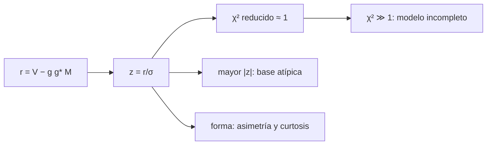

# B51-C07 — Evaluación de residuos y diagnóstico de calidad de calibración

<!-- nav:top -->
<!-- /nav -->

## 1. Ubicación, nivel y alcance

Clase 7 del bloque B51. Nivel N3. Después de calibrar, lo que sobra (los residuos) dice si el modelo y las ganancias son buenos. Aquí calculas el **χ² reducido**, los **residuos normalizados** y localizas un valor atípico, con 10 antenas. Usas [B12](../../../tronco-comun/B12-probabilidad-estadistica-e-incertidumbre.md) y [B46](../../../tronco-comun/B46-radioastronomia-e-interferometria.md). Los datos son sintéticos.

## 2. Por qué esta clase existe

Una calibración mala puede dar una imagen bonita. La decisión central: **¿qué valor de χ² reducido y qué forma de los residuos indican que el modelo es suficiente?**

## 3. Lo que podrás hacer al terminar

1. Calcular los residuos `r_ij = V_ij − g_i g_j* M_ij` y `z = r/σ`.
2. Contar grados de libertad `2N_b − (2N − 1)`.
3. Predecir la media y dispersión del χ² reducido: 1 y `√(2/dof)`.
4. Detectar un modelo incompleto por χ² alto.
5. Localizar una base atípica por su mayor |z|.
6. Explicar por qué la desviación de `z` es menor que 1 tras el ajuste.

La evidencia es la **ficha de los residuos de calibración** del ejercicio 12 (sección 20).

## 4. Con qué llegas y cómo comprobarlo

1. ¿Qué es una incertidumbre?
2. ¿Qué es una simulación Monte Carlo?
3. ¿Qué es una tabla de resultados?
4. ¿Qué es un valor ilustrativo?
5. ¿Qué es una verificación?

<details>
<summary>Ver respuestas</summary>

1. Un intervalo en que se espera el valor verdadero. 2. Repetir con números aleatorios de semilla fija. 3. Un resumen ordenado de cálculos. 4. Un valor propuesto para el ejemplo, no medido. 5. Comparar un cálculo con un caso independiente.
</details>

Con cuatro o cinco aciertos, sigue; si no, repasa los prerrequisitos.

## 5. Un caso de contexto y casos de referencia

Con 10 antenas (45 bases, 71 grados de libertad) y σ = 0,03 Jy sintéticos, el χ² reducido tiene media 1,023 y dispersión 0,167 (esperada 0,168). Con el modelo incompleto sube a 112,0. Es el **ejemplo conductor**.

## 6. Vocabulario

El **residuo** `r_ij`. El **residuo normalizado** `z = r/σ`. Los **grados de libertad** `dof`. El **χ² reducido**. El **valor atípico** (*outlier*). La **asimetría** y la **curtosis en exceso**: momentos de la forma de `z`.

## 7. Modelo mental: una balanza de cocina

Como pesar la bolsa vacía: si tras restar todo lo que explicas la balanza marca cero con el temblor esperado, lo explicaste; si marca de más, algo falta; si marca un salto en un solo plato, hay un dato malo.



*Descripción textual:* los residuos normalizados resumen en un número y en una forma la calidad del modelo y de las ganancias.

Analogía: una balanza de cocina. Límite: ruido gaussiano de σ conocida.

## 8. La explicación, paso a paso

### 8.1 χ² reducido

| Caso | χ² reducido |
|---|---|
| Modelo correcto, media de 300 ensayos | 1,0228 |
| Dispersión observada | 0,1674 |
| Dispersión esperada `√(2/dof)` | 0,1678 |
| Modelo incompleto (falta la fuente de 0,4 Jy) | 112,02 |
| Valor atípico de 10σ en la base (2, 7) | 1,975 |

El atípico se localiza porque el mayor |z| es 6,59 y cae en la base (2, 7).

### 8.2 Forma de los residuos

| Magnitud | Valor |
|---|---|
| Desviación de `z` | 0,8861 |
| Reducción esperada `√(dof / (2 N_b))` | 0,8882 |
| Asimetría | +0,0226 |
| Curtosis en exceso | +0,0994 |
| Cola |z| > 3 observada | 59,3 × 10⁻⁵ |
| Cola gaussiana ingenua | 270,0 × 10⁻⁵ |
| Cola gaussiana con σ reducida | 73,1 × 10⁻⁵ |

El ajuste «consume» grados de libertad: los residuos son menores que el ruido (`0,888 σ`), así que la cola ingenua sobrestima. La cola con σ reducida explica lo observado.

## 9. Magnitudes, símbolos y unidades

| Símbolo | Qué es | Unidad | Valor / nota |
|---|---|---|---|
| `r` | residuo | Jy | — |
| `dof` | grados de libertad | — | 71 |
| `χ²_red` | chi cuadrado reducido | — | 1 ± √(2/dof) |
| `σ` | ruido por componente | Jy | 0,03 |

## 10. Convenciones y referencias

Magnitudes en SI salvo que se indique (flujos en Jy, fases en radianes, retardos en segundos); los laboratorios usan la semilla 20261109, coma decimal en el texto y punto decimal en las salidas.

## 11. De dónde sale lo que afirmamos

| ID | Fuente | Localizador | Respalda | Estado |
|---|---|---|---|---|
| S1 | Estadística estándar del χ² (media dof, varianza 2 dof) | — | propiedades del χ² | No consultado |

Límites: es un resultado estándar de estadística que el laboratorio verifica numéricamente, no una fuente consultada.

## 12. Cómo ver las cifras

| Símbolo | Qué es | Valor o nota |
|---|---|---|
| `r` | residuo | — |
| `dof` | grados de libertad | 71 |
| `χ²_red` | chi cuadrado reducido | 1 ± √(2/dof) |
| `σ` | ruido por componente | 0,03 |

Descripción larga: la tabla resume las magnitudes de la sección 9; las cifras completas del laboratorio están en las tablas de la sección 8 y en la salida de la sección 17.

## 13. Ejemplo trabajado: los grados de libertad

**Paso 1 · Datos.** 45 bases dan `2·45 = 90` números reales.

**Paso 2 · Parámetros.** `2N − 1 = 19` (se fija una fase).

**Paso 3 · dof.** `90 − 19 = 71`.

**Paso 4 · Dispersión.** `√(2/71) = 0,168`.

## 14. Distintas formas de describir el resultado

**Por ecuación:** `χ²_red = Σ z² / dof`. **Por tabla:** 8.1–8.2. **Por fórmula:** `σ(χ²_red) = √(2/dof)`. **Por código:** `residuos_de_calibracion.py`.

## 15. Práctica guiada

**Ejercicio 1 · con los pasos indicados.** Grados de libertad con 10 antenas. *Pasos:* `2N_b − (2N − 1)`.

<details><summary>Solución comentada</summary>

`90 − 19 = 71`.
</details>

**Ejercicio 2 · con una pista.** Dispersión esperada del χ² reducido.

<details><summary>Solución comentada</summary>

`0,168`.
</details>

**Ejercicio 3 · casi autónomo.** Intervalo de ±3σ para el χ² reducido.

<details><summary>Solución comentada</summary>

`0,50` a `1,50`.
</details>

## 16. Práctica autónoma, transferencia e integrador

**Ejercicio 4.** ¿Un χ² reducido de 1,4 es aceptable con este dof? *Pista:* en σ.

<details><summary>Solución comentada</summary>

`(1,4−1)/0,168 = 2,4σ`: no.
</details>

**Ejercicio 5.** Dispersión esperada con 27 antenas.

<details><summary>Solución comentada</summary>

`dof = 702 − 53 = 649`; `0,056`.
</details>

**Ejercicio 6.** Valor de |z| del atípico (10σ inyectado) en el ejemplo.

<details><summary>Solución comentada</summary>

`6,59`.
</details>

**Ejercicio 7.** Factor de reducción de la desviación de `z`.

<details><summary>Solución comentada</summary>

`0,888`.
</details>

**Ejercicio 8.** ¿Qué indica un χ² reducido de 112?

<details><summary>Solución comentada</summary>

Un modelo muy incompleto.
</details>

**Ejercicio 9 · transferencia.** **Transferencia.** Un χ² reducido de 1,00 ¿prueba que el modelo es correcto?

<details><summary>Solución comentada</summary>

No: un error pequeño y estructurado puede quedar dentro del ruido.
</details>

**Ejercicio 10 · transferencia.** **Transferencia.** ¿Por qué mirar la forma de los residuos además del χ²?

<details><summary>Solución comentada</summary>

Porque estructuras (por antena, por tiempo) pueden dar χ² normal con residuos no gaussianos.
</details>

**Ejercicio 11 · transferencia.** **Transferencia.** Si `σ` está subestimada 20 %, ¿qué ve el χ²?

<details><summary>Solución comentada</summary>

Un χ² reducido de `1,44`.
</details>

**Ejercicio 12.** **Integrador.** Elabora tu *ficha de los residuos de calibración*: residuos, χ², localización, forma y límites.

<details><summary>Solución comentada</summary>

Secciones 8.1–8.2.
</details>

**Ejercicio 12 · integrador.** **Integrador.** Elabora tu *ficha de los residuos de calibración*: residuos, χ², localización, forma y límites.

<details><summary>Solución modelo</summary>

Secciones 8.1–8.2.
</details>

## 17. Laboratorio: diagnóstico de residuos

El script [residuos_de_calibracion.py](residuos_de_calibracion.py) resuelve ganancias, calcula residuos y diagnostica (**comprueba** media y dispersión del χ² reducido, el modelo incompleto, el atípico y la cola).

**Datos:** ninguna constante; todo **sintético**. **Predice antes de ejecutar:** ¿Qué χ² reducido esperas con el modelo correcto? (≈ 1 ± 0,17.) **Ejecución del 2026-11-09 (Python 3.12.9):**

```text
Python 3.12.9 (biblioteca estandar)
antenas = 10 ; bases = 45 ; grados de libertad = 71 ; sigma = 0.03 Jy
chi2 reducido (300 ensayos): media = 1.0228 ; desviacion = 0.1674 ; esperada sqrt(2/dof) = 0.1678
modelo incompleto (solo la fuente de 1,0 Jy): chi2 reducido = 112.02
valor atipico de 10 sigma en la base (2, 7): chi2 reducido = 1.975 ; mayor |z| = 6.59 en la base (2, 7)
cola |z| > 3: observada = 0.00059 ; gaussiana ingenua = 0.00270 ; gaussiana con sigma reducida 0.8882 = 0.00073
desviacion de z = 0.8861 ; asimetria = +0.0226 ; curtosis en exceso = +0.0994
Pruebas superadas.
```

```bash
python programa/clases/B51/B51-C07-evaluacion-de-residuos-y-diagnostico-de-calidad-de-calibracion/residuos_de_calibracion.py
```

**Límites:** ruido gaussiano de σ conocida.

## 18. Errores frecuentes y cómo corregirlos

**Usar `N_b` sin restar parámetros.** Se corrige con los grados de libertad.

**Esperar `z` con desviación 1 tras el ajuste.** Se corrige con 8.2.

**Aceptar χ² ≈ 1 sin mirar estructura.** Ver el ejercicio 10.

**Usar un σ equivocado.** Se corrige con el ejercicio 11.

## 19. Cómo sabrás que vas bien

Tras la sección 8: ¿qué resultado esperabas y cuál obtuviste? Si dudas, repasa el ejemplo 13. Tras el laboratorio: ¿qué comprueba? (ver la sección 17).

## 20. Qué entregas y cómo se evalúa

El producto es tu **ficha de los residuos de calibración** (ejercicio 12).

| Criterio | Inicial | En desarrollo | Logrado | Destacado |
|---|---|---|---|---|
| Conceptos | Los confunde | Parciales | conceptos de la clase | Explica los límites |
| Cálculo | Sin unidades | Con errores | Tablas completas | Calcula casos nuevos |
| Numérico | Sin comprobar | Un caso | Contraste con el análisis | Interpreta las diferencias |
| Fuentes | Sin fuente | Sin fecha | fuentes con fecha | Declara lo ilustrativo |
| Límites | No los nombra | Uno | Tres | Discute qué falta del modelo |

**Condiciones críticas (no se compensan con promedio):** rotular lo sintético como sintético; no presentar la simulación como reducción de datos reales; citar solo lo consultado.

## 21. Ética, seguridad y límites

Clase educativa: los modelos son simplificados. Accesibilidad: tablas equivalentes a las gráficas, fórmulas en texto, ejercicios sin conexión.

## 22. Para cerrar y seguir

El χ² reducido (1,02 ± 0,17) y el mayor |z| localizan problemas del modelo y de los datos. Queda una pregunta: ¿cómo se alinean en el tiempo los flujos de dos antenas?

**Glosario español–inglés.** residuo · *residual*; chi cuadrado reducido · *reduced chi-squared*; valor atípico · *outlier*; grados de libertad · *degrees of freedom*.

**Continuidad.** [B51-C08](../B51-C08-compensacion-de-retardo-y-alineacion-temporal-de-flujos-de-antenas/CLASE.md) estudia la compensación de retardo.

**Referencias:** ver sección 11.

<!-- nav:bottom -->
---

<!-- /nav -->
