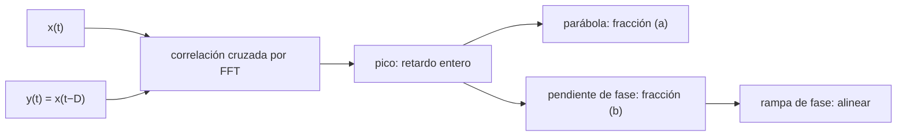

# B51-C08 — Compensación de retardo y alineación temporal de flujos de antenas

<!-- nav:top -->
[🏠 Programa](../../../../README.md) · [📚 Bloque B51](../../../tronco-comun/B51-interferometria-avanzada-y-reduccion-de-datos-de-radio.md) · [← Anterior: B51-C07 — Evaluación de residuos y diagnóstico de calidad de calibración](../B51-C07-evaluacion-de-residuos-y-diagnostico-de-calidad-de-calibracion/CLASE.md) · [Siguiente: B51-C09 — Fringe stopping y rotación de fase por retardo geométrico →](../B51-C09-fringe-stopping-y-rotacion-de-fase-por-retardo-geometrico/CLASE.md)
<!-- /nav -->

## 1. Ubicación, nivel y alcance

Clase 8 del bloque B51. Nivel N3. Antes de correlacionar, las señales de dos antenas deben alinearse en el tiempo. El retardo se separa en una parte **entera** (muestras) y una **fraccionaria** (rampa de fase en frecuencia). Aquí lo estimas por dos vías independientes en 4096 muestras y alineas los flujos. Usas [B46](../../../tronco-comun/B46-radioastronomia-e-interferometria.md) y [B15](../../../tronco-comun/B15-senales-imagenes-y-estimacion-cientifica.md). Los datos son sintéticos.

## 2. Por qué esta clase existe

Un retardo mal compensado reduce la coherencia y en VLBI hace perder la detección. La decisión central: **¿cómo se estima y se aplica un retardo con fracción de muestra y qué correlación se espera tras alinear?**

## 3. Lo que podrás hacer al terminar

1. Hallar el retardo entero con el máximo de la correlación cruzada (por FFT).
2. Estimar la fracción por interpolación parabólica del pico.
3. Estimarla por la pendiente de la fase del espectro cruzado.
4. Aplicar la compensación como rampa de fase en frecuencia.
5. Predecir el coeficiente de correlación tras alinear: `1/√((1+1/s₁)(1+1/s₂))`.
6. Explicar por qué la parábola es sesgada en señales de banda limitada.

La evidencia es la **ficha del retardo y la alineación** del ejercicio 12 (sección 20).

## 4. Con qué llegas y cómo comprobarlo

1. ¿Qué es una incertidumbre?
2. ¿Qué es una simulación Monte Carlo?
3. ¿Qué es una tabla de resultados?
4. ¿Qué es un valor ilustrativo?
5. ¿Qué es una verificación?

<details>
<summary>Ver respuestas</summary>

1. Un intervalo en que se espera el valor verdadero. 2. Repetir con números aleatorios de semilla fija. 3. Un resumen ordenado de cálculos. 4. Un valor propuesto para el ejemplo, no medido. 5. Comparar un cálculo con un caso independiente.
</details>

Con cuatro o cinco aciertos, sigue; si no, repasa los prerrequisitos.

## 5. Un caso de contexto y casos de referencia

Con dos flujos de 4096 muestras, un retardo verdadero de 37,30 muestras (sintético) y relaciones señal-ruido de 1,0 y 2,0, el entero es 37, la parábola da 37,2094 y la pendiente de fase 37,2757. La correlación tras alinear es 0,5774. Es el **ejemplo conductor**.

## 6. Vocabulario

El **retardo entero** y el **fraccionario**. La **correlación cruzada** y su pico. El **espectro cruzado** `B A*`. La **rampa de fase** `e^{2πikτ/N}`. El **coeficiente de correlación** `ρ`. La **banda limitada**: señal sin potencia sobre cierta frecuencia.

## 7. Modelo mental: alinear dos partituras

Como alinear dos grabaciones de la misma canción: primero deslizas compases enteros hasta que coinciden más o menos y después ajustas la fracción con una pendiente suave.



*Descripción textual:* la correlación da el entero; dos métodos independientes dan la fracción; una rampa de fase aplica el retardo completo.

Analogía: alinear dos partituras. Límite: retardo constante y circular, ruido blanco aditivo.

## 8. La explicación, paso a paso

### 8.1 Estimaciones

| Método | Retardo (muestras) | Error |
|---|---|---|
| Verdadero | 37,3000 | — |
| Entero (pico) | 37 | -0,3000 |
| Fracción (a) parábola | 37,2094 | -0,0906 |
| Fracción (b) pendiente de fase | 37,2757 | -0,0243 |

La parábola está sesgada porque el pico de la correlación de una señal de banda limitada se parece a un seno cardinal y no a una parábola.

### 8.2 Coherencia tras alinear

| Caso | Coeficiente de correlación |
|---|---|
| Sin alinear | -0,0090 |
| Solo el retardo entero | 0,5294 |
| Con la fracción (b) | 0,5774 |
| Analítico `1/√((1+1/1)(1+1/2))` | 0,5774 |

Quedarse en el entero pierde 8,3 % de la correlación posible.

## 9. Magnitudes, símbolos y unidades

| Símbolo | Qué es | Unidad | Valor / nota |
|---|---|---|---|
| `D` | retardo | muestras | 37,30 |
| `N` | muestras | — | 4096 |
| `s₁, s₂` | relaciones señal-ruido | — | 1,0 y 2,0 |
| `ρ` | coeficiente de correlación | — | 0,5774 (analítico) |

## 10. Convenciones y referencias

Magnitudes en SI salvo que se indique (flujos en Jy, fases en radianes, retardos en segundos); los laboratorios usan la semilla 20261109, coma decimal en el texto y punto decimal en las salidas.

## 11. De dónde sale lo que afirmamos

| ID | Fuente | Localizador | Respalda | Estado |
|---|---|---|---|---|
| S1 | Documentación de correladores (FX/XF) | — | arquitectura de correladores | No consultado |

Límites: no se consultó ninguna documentación de correlador: el laboratorio usa FFT genéricas.

## 12. Cómo ver las cifras

| Símbolo | Qué es | Valor o nota |
|---|---|---|
| `D` | retardo | 37,30 |
| `N` | muestras | 4096 |
| `s₁, s₂` | relaciones señal-ruido | 1,0 y 2,0 |
| `ρ` | coeficiente de correlación | 0,5774 (analítico) |

Descripción larga: la tabla resume las magnitudes de la sección 9; las cifras completas del laboratorio están en las tablas de la sección 8 y en la salida de la sección 17.

## 13. Ejemplo trabajado: la correlación esperada

**Paso 1 · SNR.** `s₁ = 1`, `s₂ = 2`.

**Paso 2 · Factor.** `(1 + 1/1)(1 + 1/2) = 2 · 1,5 = 3`.

**Paso 3 · ρ.** `1/√3 = 0,5774`.

**Paso 4 · Lectura.** El laboratorio da 0,5774: dentro de 0,02.

## 14. Distintas formas de describir el resultado

**Por ecuación:** `y = x(t−D) + n`. **Por tabla:** 8.1–8.2. **Por fórmula:** `ρ = 1/√((1+1/s₁)(1+1/s₂))`. **Por código:** `retardo_y_alineacion.py`.

## 15. Práctica guiada

**Ejercicio 1 · con los pasos indicados.** Coeficiente de correlación con `s₁ = s₂ = 1`. *Pasos:* `1/(1+1/s)`.

<details><summary>Solución comentada</summary>

`1/2 = 0,5`.
</details>

**Ejercicio 2 · con una pista.** Con `s₁ = s₂ = 10`.

<details><summary>Solución comentada</summary>

`1/1,1 = 0,9091`.
</details>

**Ejercicio 3 · casi autónomo.** Con `s₁ = 1` y `s₂ = 100`.

<details><summary>Solución comentada</summary>

`1/√(2 · 1,01) = 0,7036`.
</details>

## 16. Práctica autónoma, transferencia e integrador

**Ejercicio 4.** Error de la parábola en el ejemplo.

<details><summary>Solución comentada</summary>

`-0,0906` muestras.
</details>

**Ejercicio 5.** Error de la pendiente de fase.

<details><summary>Solución comentada</summary>

`-0,0243` muestras.
</details>

**Ejercicio 6.** Pérdida de correlación al quedarse en el entero.

<details><summary>Solución comentada</summary>

`8,3 %`.
</details>

**Ejercicio 7.** Retardo en ns si el muestreo es de 1 GS/s y `D = 37,3`.

<details><summary>Solución comentada</summary>

`37,3 ns`.
</details>

**Ejercicio 8.** Muestras de retardo para 1 µs a 2 GS/s.

<details><summary>Solución comentada</summary>

`2000`.
</details>

**Ejercicio 9 · transferencia.** **Transferencia.** ¿Por qué un retardo circular es una aproximación?

<details><summary>Solución comentada</summary>

Porque una señal real no es periódica: los bordes pierden muestras.
</details>

**Ejercicio 10 · transferencia.** **Transferencia.** ¿Qué pasa con el estimador de fase si la banda tiene muchos canales sin señal?

<details><summary>Solución comentada</summary>

Su ponderación por amplitud cuadrada los ignora.
</details>

**Ejercicio 11 · transferencia.** **Transferencia.** ¿Qué limita la alineación en un interferómetro real?

<details><summary>Solución comentada</summary>

La estabilidad del reloj y la geometría; el laboratorio solo cubre un retardo constante.
</details>

**Ejercicio 12.** **Integrador.** Elabora tu *ficha del retardo y la alineación*: entero, fracción por dos vías, alineación y límites.

<details><summary>Solución comentada</summary>

Secciones 8.1–8.2.
</details>

**Ejercicio 12 · integrador.** **Integrador.** Elabora tu *ficha del retardo y la alineación*: entero, fracción por dos vías, alineación y límites.

<details><summary>Solución modelo</summary>

Secciones 8.1–8.2.
</details>

## 17. Laboratorio: retardo entero y fraccionario

El script [retardo_y_alineacion.py](retardo_y_alineacion.py) estima y compensa un retardo con dos métodos (**comprueba** parábola a 0,12 y pendiente a 0,05 muestras, y la correlación tras alinear a 0,02 del valor analítico).

**Datos:** ninguna constante; todo **sintético**. **Predice antes de ejecutar:** ¿Qué correlación esperas tras alinear? (≈ 0,577.) **Ejecución del 2026-11-09 (Python 3.12.9):**

```text
Python 3.12.9 (biblioteca estandar)
N = 4096 muestras ; retardo verdadero = 37.3 muestras
retardo entero (pico de correlacion cruzada) = 37
fraccion (a) parabola: retardo = 37.2094 ; (b) pendiente de fase: retardo = 37.2757
coeficiente de correlacion: sin alinear = -0.0090 ; solo retardo entero = 0.5294 ; alineado con fraccion = 0.5774 ; analitico = 0.5774
Pruebas superadas.
```

```bash
python programa/clases/B51/B51-C08-compensacion-de-retardo-y-alineacion-temporal-de-flujos-de-antenas/retardo_y_alineacion.py
```

**Límites:** retardo constante, circular y sin deriva.

## 18. Errores frecuentes y cómo corregirlos

**Quedarse con el retardo entero.** Se corrige con 8.2.

**Usar la parábola con señales de banda limitada.** Se corrige con 8.1.

**Ignorar el signo del retardo.** Compensa con el signo contrario.

**Alinear sin comprobar la coherencia.** Se corrige con el coeficiente de correlación.

## 19. Cómo sabrás que vas bien

Tras la sección 8: ¿qué resultado esperabas y cuál obtuviste? Si dudas, repasa el ejemplo 13. Tras el laboratorio: ¿qué comprueba? (ver la sección 17).

## 20. Qué entregas y cómo se evalúa

El producto es tu **ficha del retardo y la alineación** (ejercicio 12).

| Criterio | Inicial | En desarrollo | Logrado | Destacado |
|---|---|---|---|---|
| Conceptos | Los confunde | Parciales | conceptos de la clase | Explica los límites |
| Cálculo | Sin unidades | Con errores | Tablas completas | Calcula casos nuevos |
| Numérico | Sin comprobar | Un caso | Contraste con el análisis | Interpreta las diferencias |
| Fuentes | Sin fuente | Sin fecha | fuentes con fecha | Declara lo ilustrativo |
| Límites | No los nombra | Uno | Tres | Discute qué falta del modelo |

**Condiciones críticas (no se compensan con promedio):** rotular lo sintético como sintético; no presentar la simulación como reducción de datos reales; citar solo lo consultado.

## 21. Ética, seguridad y límites

Clase educativa: los modelos son simplificados. Accesibilidad: tablas equivalentes a las gráficas, fórmulas en texto, ejercicios sin conexión.

## 22. Para cerrar y seguir

El retardo se estima como entero (37) y fracción (0,276) y la alineación recupera 0,577 de correlación, igual que lo analítico. Queda una pregunta: ¿cómo cambia el retardo con la rotación terrestre?

**Glosario español–inglés.** retardo · *delay*; correlación cruzada · *cross-correlation*; espectro cruzado · *cross spectrum*; alineación · *alignment*.

**Continuidad.** [B51-C09](../B51-C09-fringe-stopping-y-rotacion-de-fase-por-retardo-geometrico/CLASE.md) estudia el fringe stopping.

**Referencias:** ver sección 11.

<!-- nav:bottom -->
---

[← Anterior: B51-C07 — Evaluación de residuos y diagnóstico de calidad de calibración](../B51-C07-evaluacion-de-residuos-y-diagnostico-de-calidad-de-calibracion/CLASE.md) · [📚 Bloque B51](../../../tronco-comun/B51-interferometria-avanzada-y-reduccion-de-datos-de-radio.md) · [Siguiente: B51-C09 — Fringe stopping y rotación de fase por retardo geométrico →](../B51-C09-fringe-stopping-y-rotacion-de-fase-por-retardo-geometrico/CLASE.md)
<!-- /nav -->
