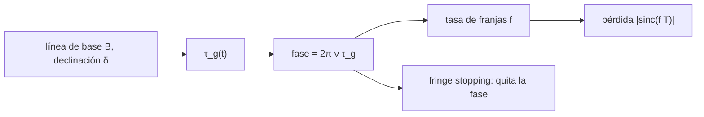

# B51-C09 — Fringe stopping y rotación de fase por retardo geométrico

<!-- nav:top -->
[🏠 Programa](../../../../README.md) · [📚 Bloque B51](../../../tronco-comun/B51-interferometria-avanzada-y-reduccion-de-datos-de-radio.md) · [← Anterior: B51-C08 — Compensación de retardo y alineación temporal de flujos de antenas](../B51-C08-compensacion-de-retardo-y-alineacion-temporal-de-flujos-de-antenas/CLASE.md) · [Siguiente: B51-C10 — Retardo troposférico e ionosférico en VLBI y su modelado →](../B51-C10-retardo-troposferico-e-ionosferico-en-vlbi-y-su-modelado/CLASE.md)
<!-- /nav -->

## 1. Ubicación, nivel y alcance

Clase 9 del bloque B51. Nivel N3. Cuando la Tierra gira, el retardo geométrico entre dos antenas cambia y la fase de la visibilidad oscila a la **tasa de franjas**. El **fringe stopping** quita esa rotación con un modelo. Aquí lo calculas para una línea de base este-oeste de 1000 m a 1,4 GHz. Usas [B46](../../../tronco-comun/B46-radioastronomia-e-interferometria.md) y [B05](../../../tronco-comun/B05-fisica-fundamental-para-el-espacio.md). Los datos son ilustrativos.

## 2. Por qué esta clase existe

Si se promedia sin detener las franjas, la señal se anula. La decisión central: **¿qué tasa de franjas tiene una fuente, cuánto se pierde al promediar y qué precisión pide el modelo?**

## 3. Lo que podrás hacer al terminar

1. Escribir `τ_g(t) = −(B/c) cosδ sin H` para una línea este-oeste.
2. Derivar la tasa de franjas `f = −(ν B ω/c) cosδ cos H`.
3. Comprobar la tasa con la derivada numérica de la fase.
4. Predecir la pérdida de coherencia con `|sinc(f T)|`.
5. Relacionar un error de retardo del modelo con un error de fase.
6. Decidir cada cuánto actualizar el modelo.

La evidencia es la **ficha del fringe stopping** del ejercicio 12 (sección 20).

## 4. Con qué llegas y cómo comprobarlo

1. ¿Qué es una incertidumbre?
2. ¿Qué es una simulación Monte Carlo?
3. ¿Qué es una tabla de resultados?
4. ¿Qué es un valor ilustrativo?
5. ¿Qué es una verificación?

<details>
<summary>Ver respuestas</summary>

1. Un intervalo en que se espera el valor verdadero. 2. Repetir con números aleatorios de semilla fija. 3. Un resumen ordenado de cálculos. 4. Un valor propuesto para el ejemplo, no medido. 5. Comparar un cálculo con un caso independiente.
</details>

Con cuatro o cinco aciertos, sigue; si no, repasa los prerrequisitos.

## 5. Un caso de contexto y casos de referencia

Con `B = 1000` m, `δ = 30°` y `ν = 1,4` GHz, el retardo geométrico máximo es 2,8887 µs y la tasa de franjas en `H = 0` es -0,294911 Hz. Promediar 10 s sin detener las franjas deja el 1,7 % de la amplitud. Es el **ejemplo conductor**.

## 6. Vocabulario

El **retardo geométrico** `τ_g`. El **ángulo horario** `H`. La **tasa de franjas** `f`. El **fringe stopping**: multiplicar por `e^{−iφ_modelo}`. La **función seno cardinal**. La **velocidad de rotación terrestre** `ω`.

## 7. Modelo mental: un estroboscopio

Como un estroboscopio que se sincroniza con la rueda que gira: si la luz parpadea a la tasa de franjas, la rueda parece quieta y puedes promediar sin que se borre.



*Descripción textual:* la rotación terrestre cambia el retardo; el modelo del retardo se resta de la fase y deja una señal que puede promediarse.

Analogía: un estroboscopio. Límite: línea de base fija, fuente puntual, sin refracción.

## 8. La explicación, paso a paso

### 8.1 Tasa de franjas

| Magnitud | Valor |
|---|---|
| Tasa analítica en `H = 0` | -0,294911 Hz |
| Derivada numérica de la fase | -0,294911 Hz |
| Tasa de variación del retardo | 210,7 ps/s |

### 8.2 Pérdida de coherencia sin detener las franjas

| Tiempo de integración T (s) | Coherencia numérica | Módulo del seno cardinal |
|---|---|---|
| 0,50 | 0,96462 | 0,96462 |
| 1,00 | 0,86295 | 0,86295 |
| 3,39 | 0,00025 | 0,00025 |
| 10,00 | 0,01718 | 0,01718 |

### 8.3 Con fringe stopping

Un error de retardo del modelo de 10 ps da un error de fase de 0,0880 rad y una coherencia `cos` de 0,99613. Si el modelo se actualiza cada 2 s, la coherencia residual es 1,00000. Sin detener, un cuarto de ciclo ocurre en 0,848 s.

## 9. Magnitudes, símbolos y unidades

| Símbolo | Qué es | Unidad | Valor / nota |
|---|---|---|---|
| `B` | línea de base | m | 1000 (ilustrativa) |
| `ω` | rotación terrestre | rad/s | 7,292115 × 10⁻⁵ (estándar, no consultado) |
| `c` | velocidad de la luz | m/s | 299 792 458 (exacta, NIST) |
| `f` | tasa de franjas | Hz | -0,2949 |

## 10. Convenciones y referencias

Magnitudes en SI salvo que se indique (flujos en Jy, fases en radianes, retardos en segundos); los laboratorios usan la semilla 20261109, coma decimal en el texto y punto decimal en las salidas.

## 11. De dónde sale lo que afirmamos

| ID | Fuente | Localizador | Respalda | Estado |
|---|---|---|---|---|
| S1 | NIST, *Fundamental Physical Constants* (CODATA 2022) | https://physics.nist.gov/cuu/Constants/Table/allascii.txt | constantes citadas en la sección 9 | Consultada el 2026-11-09 |

Límites: la velocidad de rotación terrestre es un valor estándar no consultado en esta sesión; los demás números son ilustrativos.

## 12. Cómo ver las cifras

| Símbolo | Qué es | Valor o nota |
|---|---|---|
| `B` | línea de base | 1000 (ilustrativa) |
| `ω` | rotación terrestre | 7,292115 × 10⁻⁵ (estándar, no consultado) |
| `c` | velocidad de la luz | 299 792 458 (exacta, NIST) |
| `f` | tasa de franjas | -0,2949 |

Descripción larga: la tabla resume las magnitudes de la sección 9; las cifras completas del laboratorio están en las tablas de la sección 8 y en la salida de la sección 17.

## 13. Ejemplo trabajado: la tasa de franjas

**Paso 1 · Derivada.** `dτ_g/dt = −(B ω/c) cosδ cos H`.

**Paso 2 · Valor.** `1000 · 7,292×10⁻⁵ · 0,866 / 2,998×10⁸ = 0,000000000211` s/s.

**Paso 3 · Tasa.** `f = ν · dτ/dt = -0,2949` Hz en `H = 0`.

**Paso 4 · Pérdida.** Para `T = 1` s, `|sinc(0,295)| = 0,8630`.

## 14. Distintas formas de describir el resultado

**Por ecuación:** `f = ν dτ_g/dt`. **Por tabla:** 8.1–8.2. **Por fórmula:** `|sinc(fT)| = |sin(π f T)/(π f T)|`. **Por código:** `fringe_stopping.py`.

## 15. Práctica guiada

**Ejercicio 1 · con los pasos indicados.** Tasa de franjas a 1,4 GHz, 1000 m, `δ = 30°`, `H = 0`. *Pasos:* `ν B ω cosδ / c`.

<details><summary>Solución comentada</summary>

`0,2949 Hz`.
</details>

**Ejercicio 2 · con una pista.** Misma con `B = 10 km`.

<details><summary>Solución comentada</summary>

`2,949 Hz`.
</details>

**Ejercicio 3 · casi autónomo.** Misma con `δ = 60°`.

<details><summary>Solución comentada</summary>

`0,1703 Hz`.
</details>

## 16. Práctica autónoma, transferencia e integrador

**Ejercicio 4.** Misma a 22 GHz (1000 m, 30°).

<details><summary>Solución comentada</summary>

`4,634 Hz`.
</details>

**Ejercicio 5.** Coherencia al integrar 1 s sin detener.

<details><summary>Solución comentada</summary>

`0,8630`.
</details>

**Ejercicio 6.** Error de fase de un retardo de modelo de 100 ps a 1,4 GHz.

<details><summary>Solución comentada</summary>

`0,880 rad`.
</details>

**Ejercicio 7.** Tiempo para un cuarto de ciclo sin detener.

<details><summary>Solución comentada</summary>

`0,848 s`.
</details>

**Ejercicio 8.** Retardo máximo en ns para 1000 m.

<details><summary>Solución comentada</summary>

`2888,7 ns`.
</details>

**Ejercicio 9 · transferencia.** **Transferencia.** ¿Por qué la tasa de franjas es máxima en `H = 0` para una línea este-oeste?

<details><summary>Solución comentada</summary>

Porque `cos H` es máximo: la fuente cruza el meridiano.
</details>

**Ejercicio 10 · transferencia.** **Transferencia.** ¿Qué pasa con la tasa si la fuente está en el polo?

<details><summary>Solución comentada</summary>

Se anula, porque `cosδ = 0`: no hay movimiento aparente.
</details>

**Ejercicio 11 · transferencia.** **Transferencia.** ¿Por qué se actualiza el modelo cada pocos segundos y no continuamente?

<details><summary>Solución comentada</summary>

Porque la fase residual es de segundo orden y basta con un intervalo corto.
</details>

**Ejercicio 12.** **Integrador.** Elabora tu *ficha del fringe stopping*: retardo, tasa, pérdida, actualización y límites.

<details><summary>Solución comentada</summary>

Secciones 8.1–8.3.
</details>

**Ejercicio 12 · integrador.** **Integrador.** Elabora tu *ficha del fringe stopping*: retardo, tasa, pérdida, actualización y límites.

<details><summary>Solución modelo</summary>

Secciones 8.1–8.3.
</details>

## 17. Laboratorio: tasa de franjas y pérdida

El script [fringe_stopping.py](fringe_stopping.py) calcula retardo, tasa y pérdida (**comprueba** la derivada a `10⁻⁶` y la coherencia numérica a `10⁻⁴` del seno cardinal).

**Datos:** `c` de NIST; `ω` estándar no consultado; geometría **ilustrativa**. **Predice antes de ejecutar:** ¿Qué tasa de franjas esperas? (≈ 0,29 Hz.) **Ejecución del 2026-11-09 (Python 3.12.9):**

```text
Python 3.12.9 (biblioteca estandar)
B = 1000 m ; dec = 30 grados ; nu = 1.4 GHz ; retardo geometrico maximo = 2.8887 us
tasa de franjas en H = 0: analitica = -0.294911 Hz ; derivada numerica = -0.294911 Hz ; la tasa de retardo es 210.7 ps/s
   T [s]   |<exp(i fase)>| numerico   |sinc(f T)|
    0.50              0.96462        0.96462
    1.00              0.86295        0.86295
    3.39              0.00025        0.00025
   10.00              0.01718        0.01718
error de retardo de 10 ps -> error de fase = 0.0880 rad ; coherencia cos = 0.99613
con el modelo actualizado cada 2 s: coherencia residual = 1.00000 ; un cuarto de ciclo en 0.848 s sin detener las franjas
Pruebas superadas.
```

```bash
python programa/clases/B51/B51-C09-fringe-stopping-y-rotacion-de-fase-por-retardo-geometrico/fringe_stopping.py
```

**Límites:** línea de base fija, fuente puntual, sin atmósfera.

## 18. Errores frecuentes y cómo corregirlos

**Olvidar `cosδ`.** Se corrige con la sección 8.1.

**Promediar sin detener.** Se corrige con 8.2.

**Confundir tasa de franjas con tasa de retardo.** Difieren en el factor `ν`.

**Usar un modelo de retardo con errores de decenas de ps.** Se corrige con 8.3.

## 19. Cómo sabrás que vas bien

Tras la sección 8: ¿qué resultado esperabas y cuál obtuviste? Si dudas, repasa el ejemplo 13. Tras el laboratorio: ¿qué comprueba? (ver la sección 17).

## 20. Qué entregas y cómo se evalúa

El producto es tu **ficha del fringe stopping** (ejercicio 12).

| Criterio | Inicial | En desarrollo | Logrado | Destacado |
|---|---|---|---|---|
| Conceptos | Los confunde | Parciales | conceptos de la clase | Explica los límites |
| Cálculo | Sin unidades | Con errores | Tablas completas | Calcula casos nuevos |
| Numérico | Sin comprobar | Un caso | Contraste con el análisis | Interpreta las diferencias |
| Fuentes | Sin fuente | Sin fecha | fuentes con fecha | Declara lo ilustrativo |
| Límites | No los nombra | Uno | Tres | Discute qué falta del modelo |

**Condiciones críticas (no se compensan con promedio):** rotular lo sintético como sintético; no presentar la simulación como reducción de datos reales; citar solo lo consultado.

## 21. Ética, seguridad y límites

Clase educativa: los modelos son simplificados. Accesibilidad: tablas equivalentes a las gráficas, fórmulas en texto, ejercicios sin conexión.

## 22. Para cerrar y seguir

La rotación terrestre impone 0,29 Hz de tasa de franjas; sin detenerlas, 10 s de promediado dejan 1,7 % de la señal. Queda una pregunta: ¿qué aportan la troposfera y la ionosfera al retardo?

**Glosario español–inglés.** retardo geométrico · *geometric delay*; tasa de franjas · *fringe rate*; ángulo horario · *hour angle*; detención de franjas · *fringe stopping*.

**Continuidad.** [B51-C10](../B51-C10-retardo-troposferico-e-ionosferico-en-vlbi-y-su-modelado/CLASE.md) estudia los retardos atmosféricos en VLBI.

**Referencias:** ver sección 11.

<!-- nav:bottom -->
---

[← Anterior: B51-C08 — Compensación de retardo y alineación temporal de flujos de antenas](../B51-C08-compensacion-de-retardo-y-alineacion-temporal-de-flujos-de-antenas/CLASE.md) · [📚 Bloque B51](../../../tronco-comun/B51-interferometria-avanzada-y-reduccion-de-datos-de-radio.md) · [Siguiente: B51-C10 — Retardo troposférico e ionosférico en VLBI y su modelado →](../B51-C10-retardo-troposferico-e-ionosferico-en-vlbi-y-su-modelado/CLASE.md)
<!-- /nav -->
